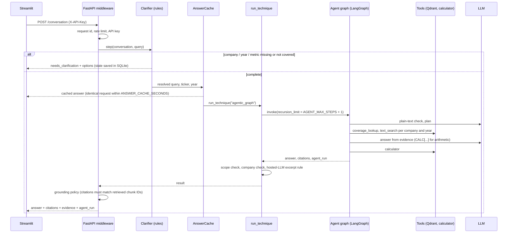
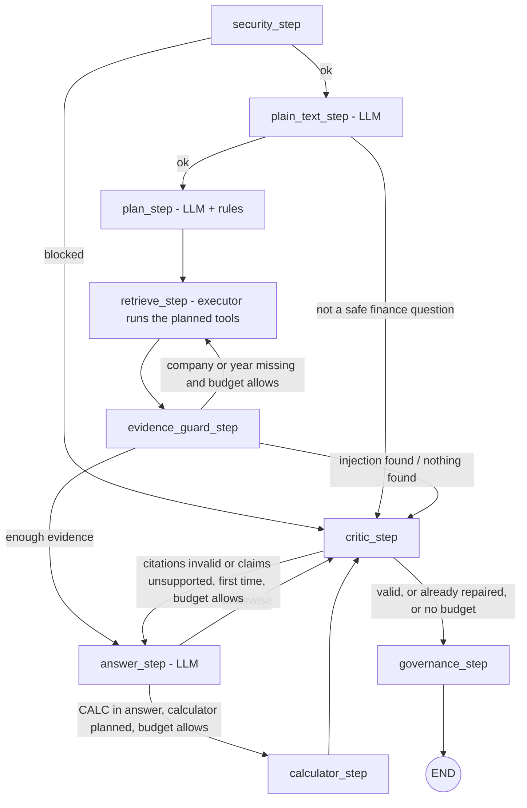

# Agent Flows: Calls, Routing and Execution

How a question travels from Streamlit to an answer: which agents and tools run, which steps call the LLM, how LangGraph decides each branch, and what the response records. Code: [financial_prompting_agent.py](../scripts/agents/financial_prompting_agent.py), [financial_tools.py](../scripts/agents/financial_tools.py), [financial_clarifier.py](../scripts/agents/financial_clarifier.py), [api_app.py](../scripts/api/api_app.py).

**In short**

- Every flow is a **LangGraph state machine compiled in code**. The LLM never picks the next node. It works *inside* three nodes (plain-text check, planner, answer) and its output is validated before anything uses it.
- The financial graph routes **per request**: the planner's tools decide whether the coverage check, ColPali search and calculator run; a comparison becomes one filtered search per company and year; a company with no evidence gets **one broadened retrieval retry**; an answer whose citations fail, or whose claims or figures the cited evidence doesn't state, gets **one repair** carrying the critic's feedback.
- The critic is two checks: citation IDs must be retrieved IDs, and a **support check** (every figure must appear in a cited chunk; an LLM judge decides claim by claim). With a hosted LLM, the generated answer is shown only when both pass; otherwise the response falls back to cited excerpts.
- Loops are **budget-aware**: a loop runs only if the rest of the run still fits `AGENT_MAX_STEPS` (default 10), so the cap shortens a run instead of failing it.
- Each response carries `agent_run`: the node path, every tool call, retrieval attempts, repairs and calculations. Streamlit shows it under **Agent run**.

---

## 1. Entry points

| Route | Who calls it | What runs |
|---|---|---|
| `POST /conversation/financial_report_qa` | Streamlit financial chat | Clarifier, then the financial agent graph (or the report pipeline) |
| `POST /chat/financial_report_qa` | API clients, evaluation | The financial agent graph (`technique=agentic_graph`) or a single-prompt technique |
| `POST /retrieve/...` | Evidence browsing | Retrieval only, no agents, no LLM |
| `POST /multimodal/financial_report_qa/chat` | Local multimodal profile | Input guard, retrieval, fail-closed `safe_answer` (not LangGraph) |
| `generate_financial_report` | Clarifier's "Full financial report" | Deterministic pipeline; numbers come only from the PDF |

## 2. End-to-end request path (financial conversation)



| Stage | Where | Decides | LLM? |
|---|---|---|---|
| Middleware | `api_app` | `X-Request-ID`, per-IP rate limit (429), API key (401) | No |
| Clarifier | `financial_clarifier.Clarifier.step` | Company, years, metric, intent; asks up to 3 follow-up questions; refuses companies or years outside the index | No |
| Answer cache | `AnswerCache` | Reuses an identical request's answer; never caches errors or `step_limit` | No |
| Agent graph | `agentic_graph_prompt` | Sections 3–5 | 3 nodes |
| Post-graph checks | `run_technique` | Coverage (`not_available`), company scope, hosted-LLM excerpt rule | No |
| Grounding policy | `apply_grounding_policy` | Withholds an answer whose citations don't match retrieved chunk IDs | No |

## 3. The financial agent graph



### Nodes

| Node | Role | LLM? | Reads | Writes |
|---|---|---|---|---|
| `security_step` | Input guard: prompt injection, code or tool abuse, length | No (regex) | query | `security`, refusal |
| `plain_text_step` | Is this a safe, plain-language finance question? Returns a cleaned query | **Yes** (JSON) | query | `plain_text`, refusal |
| `plan_step` | **Planner.** The LLM proposes `intent`, `tools`, `needs_calculation`; `normalize_plan` validates it and splits targets | **Yes** + rules | query, request ticker/year | `plan` |
| `retrieve_step` | **Executor.** Runs the plan: `coverage_lookup`, then `text_search` (+ `visual_search`) per target. On a retry, only missing targets | No | plan, evidence check | `evidence`, `tool_calls`, `retrieval_attempts` |
| `evidence_guard_step` | Injection check on retrieved text; which targets found nothing | No | evidence | `evidence_guard`, `evidence_check` |
| `answer_step` | Answer only from evidence, citing chunk IDs; `CALC[...]` for arithmetic; on repair, gets the critic's feedback | **Yes** | evidence, plan, citation check | `answer` |
| `calculator_step` | Evaluates `CALC[...]` safely and checks each operand appears in the evidence | No | answer, evidence | `answer`, `calculations` |
| `critic_step` | (1) Every cited chunk ID must be in the retrieved evidence. (2) If so, the **support check**: every figure in the answer must appear in a cited chunk (code), and an LLM judge decides whether the cited text states each claim | **Yes** (judge) + code | answer, evidence, calculations | `citation_check`, `support_check`, `repair_count` |
| `governance_step` | Output filter (allow/review/block), human-review triggers, unverified calculations | No | everything | `output_filter`, `human_review`, final status |

### Routing decisions

Every branch is a Python function of the state. None asks the LLM.

| After | Function | Condition | Goes to |
|---|---|---|---|
| `security_step`, `plain_text_step` | `should_continue_after_security` | `final_status == "refused"` | `critic_step` (refusal is still recorded) |
| `evidence_guard_step` | `after_evidence` | refused, or no evidence and no retry possible | `critic_step` |
| | | a target found nothing, attempts < 2, and `steps + 2 + tail <= AGENT_MAX_STEPS` | `retrieve_step` (**retry**) |
| | | otherwise | `answer_step` |
| `answer_step` | `after_answer` | `calculator` planned, answer contains `CALC[...]`, and `steps + 3 <= AGENT_MAX_STEPS` | `calculator_step` |
| | | otherwise (any leftover `CALC[...]` becomes "[not calculated]") | `critic_step` |
| `critic_step` | `should_repair` | citations invalid **or** support verdict not `supported`, no repair yet, and `steps + tail <= AGENT_MAX_STEPS` | `answer_step` (**repair**, with the invalid IDs, unsupported claims and missing figures) |
| | | otherwise | `governance_step` |

`tail` is what every run still needs after the decision: answer, critic, governance (3), plus the calculator when it is planned (4).

## 4. Tools and how the planner chooses them

| Tool | Does | Runs when |
|---|---|---|
| `coverage_lookup` | Checks the served index's company/year list (`ingest.sqlite3`) and skips targets it can't answer | The question names a company or year |
| `text_search` | Hybrid Qdrant search (dense MiniLM + BM25, RRF fusion, rerank) with ticker, year and sector filters | Always: every answer must cite text |
| `visual_search` | ColPali page search over chart, table and image pages, merged into the same ranking | `RAG_FIN_VISUAL=1` (every question) or `auto` (planner or chart words); dropped when no ColPali index is served |
| `calculator` | Evaluates `CALC[...]` from the answer: numbers and `+ - * /` only, operands must appear in the evidence | Planner sets `needs_calculation`, or the question asks for growth, change, ratio, margin or comparison |

**Who decides.** The planner LLM proposes the tools. `normalize_plan` then:

- keeps only known tools, mapping legacy names (`hybrid_financial_search` → `text_search`, `chart_lookup` → `visual_search`);
- always keeps `text_search`;
- adds tools the question clearly needs (calculator, coverage);
- drops tools the deployment can't run (`visual_search` without ColPali);
- builds **targets**: one per company × year named in the question (request `ticker`/`year` win; more than 3 years → one search per company; at most 6).

Each change is listed in `plan.adjustments` and `plan.planner` says whether the LLM's plan (`llm`) or the fallback (`fallback`) was used, so a weak or mock LLM can't skip a needed tool and the trace shows who decided.

**Search depth.** Each target gets `max(3, ceil(top_k / targets))` hits; a retry searches twice as deep, with the question rewritten to its content words plus the metric's synonyms and statement names (for example "net income net earnings net profit consolidated statements annual report"). The filters stay the same, so a retry never borrows another company's or year's figures.

## 5. Step budget and loops

`AGENT_MAX_STEPS` (default 10) caps node executions; LangGraph's `recursion_limit` is set to `AGENT_MAX_STEPS + 1` as a hard stop. The routing functions check the budget before taking a loop, so with the default cap a run takes **at most one loop** and never ends in `step_limit`:

| Run | Path | Steps |
|---|---|---|
| Simple question | security, plain_text, plan, retrieve, evidence_guard, answer, critic, governance | 8 |
| With calculator | … answer, **calculator**, critic, governance | 9 |
| Retrieval retry | … retrieve, evidence_guard, **retrieve, evidence_guard**, answer, critic, governance | 10 |
| Citation repair | … answer, critic, **answer, critic**, governance | 10 |
| Refused at input | security, critic, governance (or security, plain_text, critic, governance) | 3–4 |
| Retry + repair + calculator | needs 14: set `AGENT_MAX_STEPS=14` to allow every loop | 14 |

The repair loop existed before but never ran: the old check stopped after the first failed critique. It now repairs once, with the invalid and allowed chunk IDs in the prompt.

## 6. The critic's support check

The critic answers two questions. The first is cheap and exact; the second is what lets a hosted model's own words reach the user.

| Check | How | Fails when |
|---|---|---|
| Citation IDs | `validate_citations`: cited IDs ⊆ retrieved IDs, at least one citation | An ID wasn't retrieved, or nothing is cited |
| Figures | `financial_tools.numeric_grounding` (code): every number in the answer must appear in a **cited** chunk or be a calculator result. Rounding is allowed only to the precision the answer prints, in any unit scale ("$254.5 billion" matches 254,453 million; "$255 billion" does not). Years and counts up to 10 are skipped | A figure is in no cited chunk |
| Claims | LLM judge (`SUPPORT_SYSTEM`/`SUPPORT_HUMAN`): splits the answer into claims and decides, for each, whether the cited text states it (company, period, figure and unit must match; no outside knowledge) | Any claim unsupported; unparseable output counts as `unverified` |

**Verdict.** `supported` only when the judge supports every claim **and** every figure is found. A failed figure check downgrades the judge's verdict (the judge can't overrule the code). Verdicts: `supported`, `partially_supported`, `unsupported`, `unverified`.

**What happens next.**

| Situation | Result |
|---|---|
| Verdict `supported` | Governance as usual; with a hosted LLM the generated answer is shown (`grounding.method = llm_support_check`, `semantic_answer_verified = true`) |
| Not supported, budget allows, no repair yet | **Repair**: the answer step gets the unsupported claims and missing figures, and is told to copy figures exactly, cite the chunk that states them and use `CALC[...]` for arithmetic |
| Still not supported after the repair (or no budget) | Governance adds `unsupported_claims` → `pending_human_review`; with a hosted LLM the response shows cited **excerpts** (`evidence_only`) instead of the prose |

The judge runs inside `critic_step`, so it adds one LLM call per critique but no graph step. `RAG_SUPPORT_CHECK=0` turns it off (citation IDs only, and hosted answers fall back to excerpts again). With the mock LLM the judge is a stand-in (it passes any answer that cites retrieved chunks), so `semantic_answer_verified` stays `false` in local mock runs.

## 7. After the graph: final checks

| Check | Where | Effect |
|---|---|---|
| Coverage | `run_technique` → `question_scope` | Company or year not in the filings → `not_available`, the clarifier's message, no figure, no evidence |
| No evidence | `run_technique` | `insufficient_evidence`, "No answer found in the available evidence." |
| Company scope | `guard_checks.company_scope_check` | An answer citing a company the question didn't ask about → `not_grounded`, answer withheld |
| **Hosted LLM answer rule** | `run_technique` → `answer_verified` | With `llm_provider != mock`, the generated answer is kept only for `agentic_graph` when the critic's verdict is `supported` and its citations are still in the (company-filtered) evidence. Otherwise it is **replaced by cited evidence excerpts** (`evidence_only`, method `source_excerpts`). Single-prompt techniques always get excerpts |
| Relevance floor | `answer_evidence` | With a reranker (`RAG_RERANKER_MODEL`), hits below `RAG_MIN_RERANK_SCORE` are dropped before answering |
| Grounding policy | `api_app.apply_grounding_policy` | Citations must match retrieved chunk IDs, or the answer is withheld (`not_grounded`). The response's `grounding` keeps `method` and `semantic_answer_verified` from the critic (true only if the citations also validate here) |

### Final statuses

| `final_status` | Meaning |
|---|---|
| `answered` | Answer with valid citations |
| `evidence_only` | Hosted LLM: the answer wasn't verified (or a single-prompt technique ran), so cited excerpts are shown instead |
| `pending_human_review` | Governance triggers (advice language, low confidence, citation failure, unverified calculation, unsupported claims, …) |
| `not_available` | The filings can't answer (company, year or measure not covered) |
| `insufficient_evidence` | Searches found nothing usable |
| `not_grounded` | Citations failed validation or named the wrong company |
| `refused` | Input, evidence or output guard blocked it |
| `step_limit` | Hard cap reached (not expected with budget-aware routing) |
| `tool_error` | A model or search call failed or timed out (`RAG_REQUEST_TIMEOUT_SECONDS`) |

## 8. Worked runs (local Retail index, mock LLM)

Measured on 10 Nov 2026 against the live API with the 5-filing Retail index (Costco 2024/2025, Walmart, Home Depot and Amazon 2025). Searches took 0.6–0.7 s each once the model was loaded.

| Question | Plan (tools, targets) | Path | Result |
|---|---|---|---|
| Compare Costco and Walmart revenue in 2025 | coverage, text, calculator; COST 2025, WMT 2025 | 9 steps, via calculator | `answered`; one search per company; calculation grounded |
| How much did Costco net sales grow from 2024 to 2025? | coverage, text, calculator; COST 2024, COST 2025 | 9 steps, via calculator | `answered`; one search per year |
| What was Home Depot's net earnings in fiscal 2025? | coverage, text; HD 2025 | 8 steps | `answered`, citations valid |
| What was Apple's net income for FY2024? | coverage, text; AAPL 2024 skipped | 7 steps, no search | `not_available`: "I don't have filings for Apple…" |
| Compare Amazon and Target revenue in 2025 | coverage, text, calculator; AMZN 2025 | 9 steps | `not_available`: "I don't have filings for Target… I can answer for Amazon alone." |

Proven in tests ([test_agent_routing.py](../tests/test_agent_routing.py)) with controlled search results:

| Scenario | What happens |
|---|---|
| Walmart finds nothing on the first search | Retry for WMT only, broadened query, twice the depth; path has two `retrieve_step`s |
| Same, with `AGENT_MAX_STEPS=8` | No retry (budget), answer from Costco alone, ≤ 8 steps, no `step_limit` |
| Answer cites a chunk that wasn't retrieved | One repair with the critic's feedback; second critique valid |
| Judge finds a claim unsupported ("net sales doubled") | One repair with the claim in the feedback; the second answer is supported |
| Answer invents "300,000 million" and the judge agrees | Figure check fails anyway (`partially_supported`), one repair, still wrong → `pending_human_review` with `unsupported_claims` |
| Hosted LLM, verified answer | The model's answer is returned; `grounding.semantic_answer_verified = true` |
| Hosted LLM, unverified answer | Cited excerpts (`evidence_only`); `semantic_answer_verified = false` |
| `CALC[...]` with a number not in the evidence | Calculated, marked ungrounded; governance adds `unverified_calculation` and routes to human review |
| `CALC[__import__('os')...]` | Rejected: only numbers and `+ - * /` parse |

Example `agent_run` (the growth question, as returned by the API):

```json
{"path": ["security_step", "plain_text_step", "plan_step", "retrieve_step", "evidence_guard_step",
          "answer_step", "calculator_step", "critic_step", "governance_step"],
 "steps": 9, "max_steps": 10, "retrieval_attempts": 1, "repairs": 0,
 "tool_calls": [
   {"tool": "coverage_lookup", "searchable": ["COST 2024", "COST 2025"], "skipped": []},
   {"tool": "text_search", "target": "COST 2024", "top_k": 3, "hits": 3, "ms": 660},
   {"tool": "text_search", "target": "COST 2025", "top_k": 3, "hits": 3, "ms": 698},
   {"tool": "calculator", "expressions": 1, "grounded": true}],
 "calculations": [{"expression": "(2,804 - 3,007) / 3,007 * 100", "value": -6.7509, "grounded": true}]}
```

The first question after a restart can take longer (31 s here) when it arrives before the startup warm-up has finished loading the embedding model.

The mock LLM's answer text is a placeholder: it cites the first three chunk IDs it sees and computes `CALC[...]` from the first two figures in the evidence. The routing, searches, checks and calculator are real.

## 9. Removed domains

The five other Track B domains (procurement, travel and expense, competitive research, incident postmortem, HR policy) and their `/chat/{domain}` and `/retrieve/{domain}` routes were removed on 10 November 2026; the copilot serves `financial_report_qa` only. Their shared graph code (`scripts/agents/rag_agent.py`), domain prompts and `DOMAIN_*` guard patterns followed on 11 November 2026; the `/multimodal` chat route now uses the financial input guard. The removed code is in git history.

## 10. Other flows

| Flow | Steps |
|---|---|
| Single-prompt techniques (`baseline_rag`, `structured_few_shot`, `decomposition`, `self_consistency`) | Input guards → one retrieval → one prompt (decomposition: LLM sub-questions; self-consistency: N samples) → evidence guard → governance. Used for comparison in evaluation |
| `/retrieve/financial_report_qa` | Search only; no relevance floor |
| `/multimodal/{domain}/chat` | Input guard → retrieval → `safe_answer` (`extractive`, `ollama`, `transformers` or `llamacpp`), fail-closed, at most 8 sub-questions |
| Financial report | Clarifier "Full financial report" → confirmation → `generate_financial_report` (exact-label parsing, `Decimal`, reconciliations; an LLM never supplies numbers) |

## 11. Observability

| Where | What you see |
|---|---|
| Response `agent_run` | Path, steps/max, every tool call (target, hits, ms), retrieval attempts, repairs, calculations |
| Response `plan` | Planner source (`llm`/`fallback`), proposed tools, final tools, targets, rule adjustments |
| Response `support_check` | Verdict, each claim with the judge's reason, figures checked and any missing |
| Response `grounding` | Citation status, `method` (`llm_support_check`, `source_excerpts` or `mock`), `semantic_answer_verified` |
| Streamlit **Agent run** expander | The path, tools, attempts and a tool-call table |
| Streamlit **What can I ask?** and **How to read an answer** | Clickable examples built from the indexed companies (cited answer, growth, comparison, follow-up, risks, not available, guardrails), the coverage line, and what each status means |
| `trace` / `trace_id` | Timed spans from `common/resilience.Calls` |
| LangSmith (optional) | `LANGSMITH_API_KEY` + `enable_langsmith`; each graph node is a run |
| Access log | Request ID, route, status, latency; never bodies or prompts |

## 12. Configuration

| Variable | Default | Effect on the flow |
|---|---|---|
| `AGENT_MAX_STEPS` | 10 | Node budget; loops run only if they fit (14 allows retry + repair + calculator) |
| `DEFAULT_LLM_PROVIDER` | `mock` | `hosted` uses `LLM_API_BASE`, `LLM_API_KEY`, `LLM_MODEL` |
| `RAG_BACKEND` | from runtime profile | `financial_qdrant`, `financial_vlm`, `qdrant` or Chroma |
| `RAG_FIN_VISUAL` | off | `1`: ColPali for every question; `auto`: planner decides |
| `RAG_RERANKER_MODEL`, `RAG_MIN_RERANK_SCORE` | off, -4 | Cross-encoder rerank and relevance floor |
| `RAG_REQUEST_TIMEOUT_SECONDS` | 60 | Whole-workflow deadline (`tool_error` when exceeded) |
| `RAG_SUPPORT_CHECK` | on | `0` turns off the critic's support check (and hosted answers then fall back to excerpts) |
| `ANSWER_CACHE_SECONDS` | 0 | Reuse identical answers |
| `CONVERSATION_DB` | in memory | Clarifier state in SQLite |

## 13. Limits

- The answer text in local tests comes from the mock LLM, and the mock judge is a stand-in; answer quality and judge accuracy need a hosted model. A small (≤8B) judge can be lenient or strict; the figure check doesn't depend on it, and an unverified answer falls back to excerpts.
- The support check is one extra LLM call per critique (two if repaired). It judges the cited chunks only, so an answer that is true but cites the wrong page fails and is repaired.
- The retry broadens the query, not the filters; a filing that isn't indexed still ends as `not_available` or `insufficient_evidence`.
- The calculator and the figure check verify that numbers appear in the evidence, not that they are the right line items; that is the judge's job.
- Visual search was not exercised live (no ColPali index locally); its routing is covered by tests.
