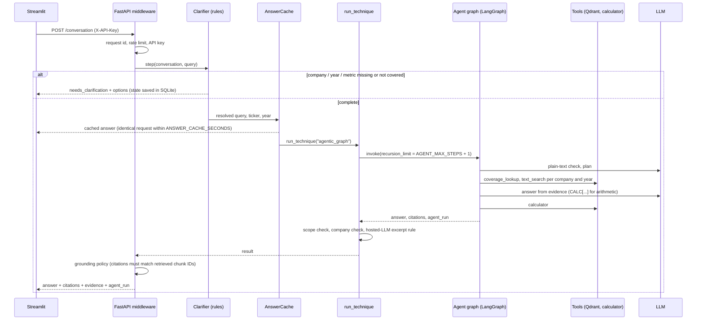
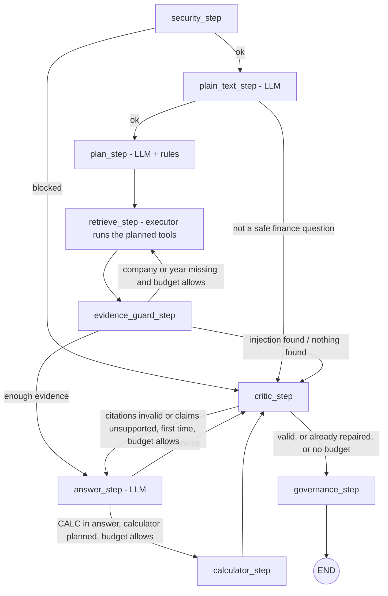
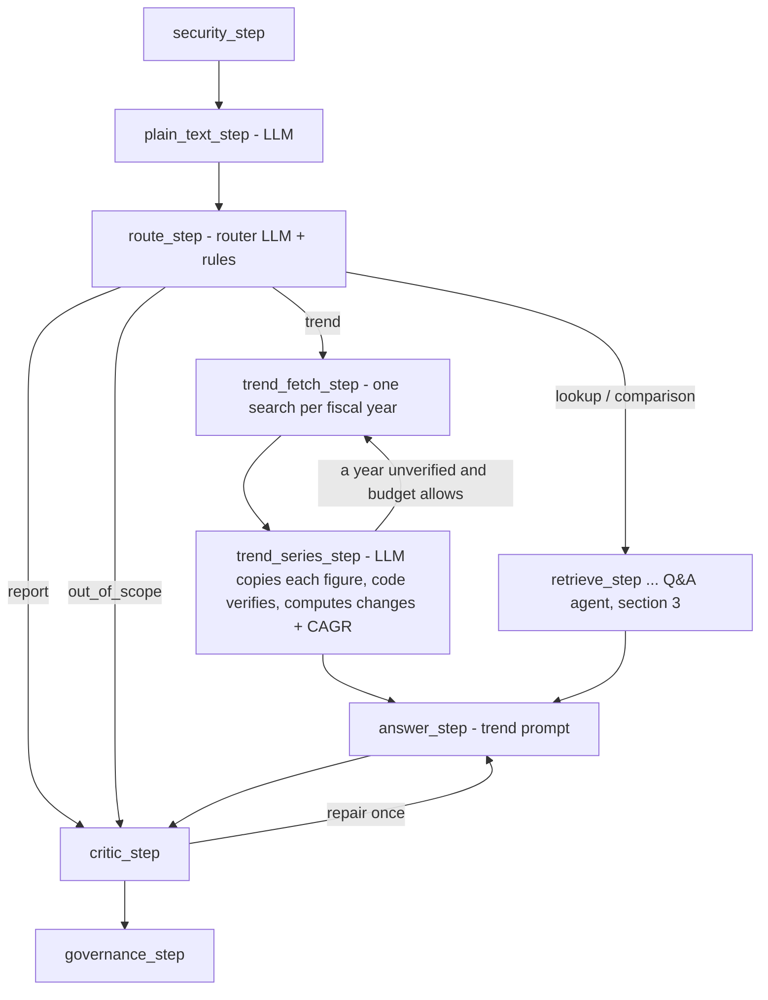
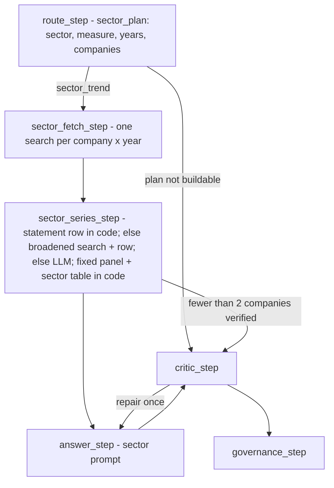
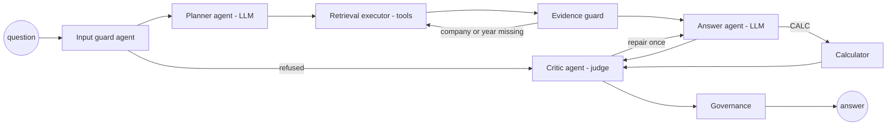
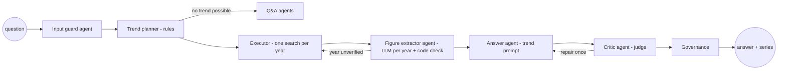
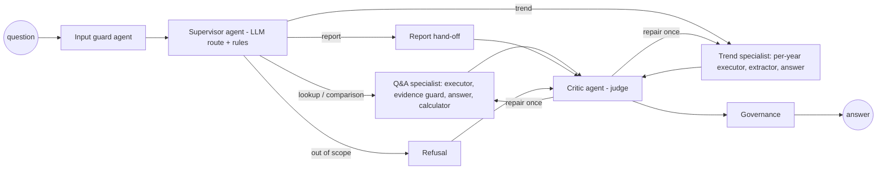
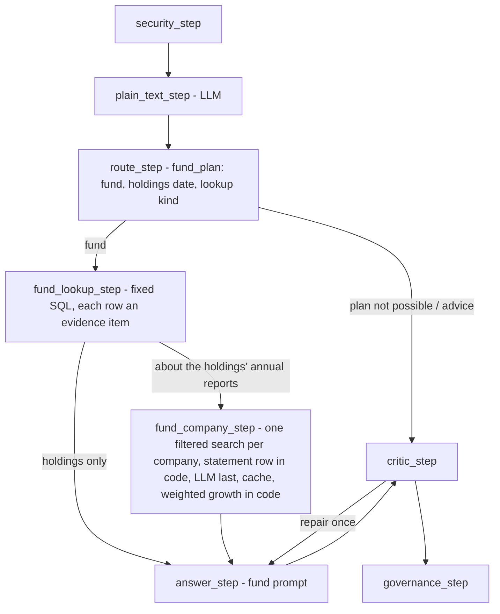

# Agent Flows: Calls, Routing and Execution

How a question travels from Streamlit to an answer: which agents and tools run, which steps call the LLM, how LangGraph decides each branch, and what the response records. Code: [financial_prompting_agent.py](../scripts/agents/financial_prompting_agent.py), [financial_tools.py](../scripts/agents/financial_tools.py), [financial_clarifier.py](../scripts/agents/financial_clarifier.py), [api_app.py](../scripts/api/api_app.py).

**In short**

- Every flow is a **LangGraph state machine compiled in code**. The LLM never picks the next node. It works *inside* three nodes (plain-text check, planner, answer) and its output is validated before anything uses it.
- The financial graph routes **per request**: the planner's tools decide whether the coverage check, ColPali search and calculator run; a comparison becomes one filtered search per company and year; a company with no evidence gets **one broadened retrieval retry**; an answer whose citations fail, or whose claims or figures the cited evidence doesn't state, gets **one repair** carrying the critic's feedback.
- The critic is two checks: citation IDs must be retrieved IDs, and a **support check** (every figure must appear in a cited chunk; an LLM judge decides claim by claim). With a hosted LLM, the generated answer is shown only when both pass; otherwise the response falls back to cited excerpts.
- Loops are **budget-aware**: a loop runs only if the rest of the run still fits `AGENT_MAX_STEPS` (default 10), so the cap shortens a run instead of failing it.
- **Five agent flows share these guards, critic and governance** (sections 7a and 7c): `agentic_graph` (the Q&A agent), `trend_graph` (multi-year trend agent), `sector_trend_graph` (one measure across a sector), `fund_graph` (mutual fund holdings, linked to the holdings' annual reports) and `router` (a supervisor that sends each question to one of them, a report handoff or a refusal). The fund route exists only when fund data is loaded. Streamlit uses `router` by default. Each flow is a **multi-agent flow**: input guard, supervisor/planner, executor, extractor, answer and critic agents hand work to each other inside one bounded graph (section 7b).
- Each response carries `agent_run`: the node path, every tool call, retrieval attempts, repairs and calculations. Streamlit shows it under **Agent run**.

---

## 1. Entry points

| Route | Who calls it | What runs |
|---|---|---|
| `POST /conversation/financial_report_qa` | Streamlit financial chat | Clarifier, then the financial agent graph (or the report pipeline) |
| `POST /chat/financial_report_qa` | API clients, evaluation | An agent flow (`technique=agentic_graph`, `trend_graph`, `sector_trend_graph`, `fund_graph` or `router`) or a single-prompt technique |
| `GET /mutual_fund/...` | API clients, checks | Loaded funds, holdings, holders, fund-card search: SQL and vector lookups only, no agents (section 7c) |
| `POST /retrieve/...` | Evidence browsing | Retrieval only, no agents, no LLM |
| `POST /multimodal/financial_report_qa/chat` | Local multimodal profile | Input guard, retrieval, fail-closed `safe_answer` (not LangGraph) |
| `generate_financial_report` | Clarifier's "Full financial report" | Deterministic pipeline; numbers come only from the PDF |

## 2. End-to-end request path (financial conversation)



| Stage | Where | Decides | LLM? |
|---|---|---|---|
| Middleware | `api_app` | `X-Request-ID`, per-IP rate limit (429), API key (401) | No |
| Clarifier | `financial_clarifier.Clarifier.step` | Company, years, metric, intent; asks up to 3 follow-up questions; refuses companies or years outside the index | No |
| Answer cache | `AnswerCache` | Reuses an identical request's answer; never caches errors or `step_limit` | No |
| Agent graph | `agentic_graph_prompt` | Sections 3–5 | 3 nodes |
| Post-graph checks | `run_technique` | Coverage (`not_available`), company scope, hosted-LLM excerpt rule | No |
| Grounding policy | `apply_grounding_policy` | Withholds an answer whose citations don't match retrieved chunk IDs | No |

## 3. The financial agent graph



### Nodes

| Node | Role | LLM? | Reads | Writes |
|---|---|---|---|---|
| `security_step` | Input guard: prompt injection, code or tool abuse, length | No (regex) | query | `security`, refusal |
| `plain_text_step` | Is this a safe, plain-language finance question? Returns a cleaned query | **Yes** (JSON) | query | `plain_text`, refusal |
| `plan_step` | **Planner.** The LLM proposes `intent`, `tools`, `needs_calculation`; `normalize_plan` validates it and splits targets | **Yes** + rules | query, request ticker/year | `plan` |
| `retrieve_step` | **Executor.** Runs the plan: `coverage_lookup`, then `text_search` (+ `visual_search`) per target. On a retry, only missing targets | No | plan, evidence check | `evidence`, `tool_calls`, `retrieval_attempts` |
| `evidence_guard_step` | Injection check on retrieved text; which targets found nothing | No | evidence | `evidence_guard`, `evidence_check` |
| `answer_step` | Answer only from evidence, citing chunk IDs; `CALC[...]` for arithmetic; on repair, gets the critic's feedback | **Yes** | evidence, plan, citation check | `answer` |
| `calculator_step` | Evaluates `CALC[...]` safely and checks each operand appears in the evidence | No | answer, evidence | `answer`, `calculations` |
| `critic_step` | (1) Every cited chunk ID must be in the retrieved evidence. (2) If so, the **support check**: every figure in the answer must appear in a cited chunk (code), and an LLM judge decides whether the cited text states each claim | **Yes** (judge) + code | answer, evidence, calculations | `citation_check`, `support_check`, `repair_count` |
| `governance_step` | Output filter (allow/review/block), human-review triggers, unverified calculations | No | everything | `output_filter`, `human_review`, final status |

### Routing decisions

Every branch is a Python function of the state. None asks the LLM.

| After | Function | Condition | Goes to |
|---|---|---|---|
| `security_step`, `plain_text_step` | `should_continue_after_security` | `final_status == "refused"` | `critic_step` (refusal is still recorded) |
| `evidence_guard_step` | `after_evidence` | refused, or no evidence and no retry possible | `critic_step` |
| | | a target found nothing, attempts < 2, and `steps + 2 + tail <= AGENT_MAX_STEPS` | `retrieve_step` (**retry**) |
| | | otherwise | `answer_step` |
| `answer_step` | `after_answer` | `calculator` planned, answer contains `CALC[...]`, and `steps + 3 <= AGENT_MAX_STEPS` | `calculator_step` |
| | | otherwise (any leftover `CALC[...]` becomes "[not calculated]") | `critic_step` |
| `critic_step` | `should_repair` | citations invalid **or** support verdict not `supported`, no repair yet, and `steps + tail <= AGENT_MAX_STEPS` | `answer_step` (**repair**, with the invalid IDs, unsupported claims and missing figures) |
| | | otherwise | `governance_step` |

`tail` is what every run still needs after the decision: answer, critic, governance (3), plus the calculator when it is planned (4).

## 4. Tools and how the planner chooses them

| Tool | Does | Runs when |
|---|---|---|
| `coverage_lookup` | Checks the served index's company/year list (`ingest.sqlite3`) and skips targets it can't answer | The question names a company or year |
| `text_search` | Hybrid search over the served index (dense vectors of the index's model, bge-small or MiniLM, + BM25, RRF fusion; cross-encoder rerank on Qdrant) with ticker, year and sector filters | Always: every answer must cite text |
| `fund_search`, `fund_lookup`, `company_figures` | Fund route only (section 7c): find the fund (names, then fund cards), fixed SQL over the N-PORT tables, cached verified company figures | The router chose `fund` |
| `visual_search` | ColPali page search over chart, table and image pages, merged into the same ranking | `RAG_FIN_VISUAL=1` (every question) or `auto` (planner or chart words); dropped when no ColPali index is served |
| `calculator` | Evaluates `CALC[...]` from the answer: numbers and `+ - * /` only, operands must appear in the evidence | Planner sets `needs_calculation`, or the question asks for growth, change, ratio, margin or comparison |

**Who decides.** The planner LLM proposes the tools. `normalize_plan` then:

- keeps only known tools, mapping legacy names (`hybrid_financial_search` → `text_search`, `chart_lookup` → `visual_search`);
- always keeps `text_search`;
- adds tools the question clearly needs (calculator, coverage);
- drops tools the deployment can't run (`visual_search` without ColPali);
- builds **targets**: one per company × year named in the question (request `ticker`/`year` win; more than 3 years → one search per company; at most 6).

Each change is listed in `plan.adjustments` and `plan.planner` says whether the LLM's plan (`llm`) or the fallback (`fallback`) was used, so a weak or mock LLM can't skip a needed tool and the trace shows who decided.

**Search depth.** Each target gets `max(3, ceil(top_k / targets))` hits; a retry searches twice as deep, with the question rewritten to its content words plus the metric's synonyms and statement names (for example "net income net earnings net profit consolidated statements annual report"). The filters stay the same, so a retry never borrows another company's or year's figures.

## 4a. Parallel searches

Added 14 November 2026. Every step that runs several filtered searches runs them **in parallel**, up to `RAG_SEARCH_WORKERS` (default 4) at a time: the Q&A executor (one search per company × year), the trend fetch (one per year), the sector fetch and its broadened retries (one per company × year), and the fund agent's company searches. The first search of a step runs alone, so the query embedder and other lazily loaded models are created once; then the rest run side by side. Results are taken **in target order** and de-duplicated afterwards, so the evidence, its order and `tool_calls` are exactly what a one-by-one loop gives (`tests/test_search_fan_out.py` compares 1 and 4 workers). Each parallel round is listed in `agent_run.search_fan_out` (searches, workers, wall time).

The sector and fund nodes work in rounds: all first searches in parallel → statement rows read in code → all broadened searches for what is still missing in parallel → the LLM, one call at a time, only for figures code couldn't read. **LLM calls are never parallel**: the hosted Track B client sends one request at a time. The fan-out uses its own threads, not the 4-slot `Calls` pool, and embedded Qdrant (one in-process client) stays sequential. The step count is unchanged.

Measured on the local API (bge index, 180 filings, mock LLM, an ingest running beside it): "How did healthcare revenue trend from 2022 to 2025?" (24 searches) 97 s with 1 worker → 33 s with 4; a three-bank comparison 6.9 s → 5.9 s. Answers, figures and CAGR were identical.

## 5. Step budget and loops

`AGENT_MAX_STEPS` (default 10) caps node executions; LangGraph's `recursion_limit` is set to `AGENT_MAX_STEPS + 1` as a hard stop. The routing functions check the budget before taking a loop, so with the default cap a run takes **at most one loop** and never ends in `step_limit`:

| Run | Path | Steps |
|---|---|---|
| Simple question | security, plain_text, plan, retrieve, evidence_guard, answer, critic, governance | 8 |
| With calculator | … answer, **calculator**, critic, governance | 9 |
| Retrieval retry | … retrieve, evidence_guard, **retrieve, evidence_guard**, answer, critic, governance | 10 |
| Citation repair | … answer, critic, **answer, critic**, governance | 10 |
| Refused at input | security, critic, governance (or security, plain_text, critic, governance) | 3–4 |
| Retry + repair + calculator | needs 14: set `AGENT_MAX_STEPS=14` to allow every loop | 14 |

The repair loop existed before but never ran: the old check stopped after the first failed critique. It now repairs once, with the invalid and allowed chunk IDs in the prompt.

## 6. The critic's support check

The critic answers two questions. The first is cheap and exact; the second is what lets a hosted model's own words reach the user.

| Check | How | Fails when |
|---|---|---|
| Citation IDs | `validate_citations`: cited IDs ⊆ retrieved IDs, at least one citation | An ID wasn't retrieved, or nothing is cited |
| Figures | `financial_tools.numeric_grounding` (code): every number in the answer must appear in a **cited** chunk or be a calculator result. Rounding is allowed only to the precision the answer prints, in any unit scale ("$254.5 billion" matches 254,453 million; "$255 billion" does not). Years and counts up to 10 are skipped | A figure is in no cited chunk |
| Claims | LLM judge (`SUPPORT_SYSTEM`/`SUPPORT_HUMAN`): splits the answer into claims and decides, for each, whether the cited text states it (company, period, figure and unit must match; no outside knowledge) | Any claim unsupported; unparseable output counts as `unverified` |

**Verdict.** `supported` only when the judge supports every claim **and** every figure is found. A failed figure check downgrades the judge's verdict (the judge can't overrule the code). Verdicts: `supported`, `partially_supported`, `unsupported`, `unverified`.

**What happens next.**

| Situation | Result |
|---|---|
| Verdict `supported` | Governance as usual; with a hosted LLM the generated answer is shown (`grounding.method = llm_support_check`, `semantic_answer_verified = true`) |
| Not supported, budget allows, no repair yet | **Repair**: the answer step gets the unsupported claims and missing figures, and is told to copy figures exactly, cite the chunk that states them and use `CALC[...]` for arithmetic |
| Still not supported after the repair (or no budget) | Governance adds `unsupported_claims` → `pending_human_review`; with a hosted LLM the response shows cited **excerpts** (`evidence_only`) instead of the prose |

The judge runs inside `critic_step`, so it adds one LLM call per critique but no graph step. `RAG_SUPPORT_CHECK=0` turns it off (citation IDs only, and hosted answers fall back to excerpts again). With the mock LLM the judge is a stand-in (it passes any answer that cites retrieved chunks), so `semantic_answer_verified` stays `false` in local mock runs.

## 7. After the graph: final checks

| Check | Where | Effect |
|---|---|---|
| Coverage | `run_technique` → `question_scope` | Company or year not in the filings → `not_available`, the clarifier's message, no figure, no evidence |
| No evidence | `run_technique` | `insufficient_evidence`, "No answer found in the available evidence." |
| Company scope | `guard_checks.company_scope_check` | An answer citing a company the question didn't ask about → `not_grounded`, answer withheld |
| **Hosted LLM answer rule** | `run_technique` → `answer_verified` | With `llm_provider != mock`, the generated answer is kept only for `agentic_graph` when the critic's verdict is `supported` and its citations are still in the (company-filtered) evidence. Otherwise it is **replaced by cited evidence excerpts** (`evidence_only`, method `source_excerpts`). Single-prompt techniques always get excerpts |
| Relevance floor | `answer_evidence` | With a reranker (`RAG_RERANKER_MODEL`), hits below `RAG_MIN_RERANK_SCORE` are dropped before answering |
| Grounding policy | `api_app.apply_grounding_policy` | Citations must match retrieved chunk IDs, or the answer is withheld (`not_grounded`). The response's `grounding` keeps `method` and `semantic_answer_verified` from the critic (true only if the citations also validate here) |

### Final statuses

| `final_status` | Meaning |
|---|---|
| `answered` | Answer with valid citations |
| `evidence_only` | Hosted LLM: the answer wasn't verified (or a single-prompt technique ran), so cited excerpts are shown instead |
| `pending_human_review` | Governance triggers (advice language, low confidence, citation failure, unverified calculation, unsupported claims, …) |
| `not_available` | The filings can't answer (company, year or measure not covered) |
| `insufficient_evidence` | Searches found nothing usable |
| `not_grounded` | Citations failed validation or named the wrong company |
| `refused` | Input, evidence or output guard blocked it; on the fund route also investment-advice wording ("should I buy", "best fund") |
| `step_limit` | Hard cap reached (not expected with budget-aware routing) |
| `tool_error` | A model or search call failed or timed out (`RAG_REQUEST_TIMEOUT_SECONDS`) |

## 7a. Router (supervisor) and the multi-year trend agent

Code: [financial_router.py](../scripts/agents/financial_router.py), [financial_trend.py](../scripts/agents/financial_trend.py), `financial_graph` in [financial_prompting_agent.py](../scripts/agents/financial_prompting_agent.py). Tests: [test_agent_flows.py](../tests/test_agent_flows.py).



**Router (`technique=router`).** The router LLM returns Route JSON (`route`, `tools`, `needs_calculation`, `reason`). `financial_router.decide` validates it the same way `normalize_plan` validates the planner:

| Route | Goes to | Accepted when |
|---|---|---|
| `lookup` | Q&A agent (from `retrieve_step`) | Default |
| `comparison` | Q&A agent: one filtered search per company × year | The LLM says so, or the parser finds two companies / compare words |
| `trend` | Trend agent | One company, one measure and at least two indexed fiscal years (`trend_plan.feasible`); otherwise answered as a lookup or comparison |
| `report` | Handoff (`final_status = report_handoff`, `handoff` with ticker, year, whether a report profile exists) | Only with an explicit request ("generate a full report"); the deterministic report runs after the user confirms in the chat |
| `out_of_scope` | Refused | Only when the question names no company, measure or known intent |

Explicit signals win: a question the parser reads as a report, comparison or trend goes there even if the LLM said otherwise; the LLM decides the rest (for example "How has Costco's revenue developed?", wording the rules don't know). `route` in the response records the LLM's and the rules' choices, `decided_by` and every adjustment. The route step also plans (its tools become the Q&A plan), so a routed run takes the **same 8 steps** as a direct one.

**Trend agent (`technique=trend_graph`, or the router's `trend` route).**

| Step | What it does | LLM? |
|---|---|---|
| `route_step` | `trend_plan`: company, measure, years (asked years the index holds, else every indexed year, at most 5); coverage recorded as a `coverage_lookup` call. If no trend can be built, the question goes to the Q&A path (`decided_by = technique`) | No |
| `trend_fetch_step` | One filtered `text_search` per fiscal year ("Costco revenue fiscal year 2024"); a retry searches only unverified years, broadened and twice as deep | No |
| `trend_series_step` | Evidence injection guard; per year, the LLM copies the figure (Series JSON: value, unit, chunk_id, quote). `validate_point` keeps it only if the chunk is in **that year's** search and its text contains the number (`ok`, `not_found`, `wrong_chunk`, `not_in_evidence`, `no_evidence`). Year-over-year change, % change and CAGR are **computed in code** and recorded as calculations | **Yes** (one call per year) |
| `answer_step` | Trend prompt: the verified series with chunk IDs and the computed changes; the model describes them and may not compute new numbers. With no verified year it falls back to the Q&A prompt | **Yes** |
| `critic_step`, `governance_step` | As in section 6. The judge now also sees the calculator results, so a correctly reported growth rate or CAGR counts as supported; `numeric_grounding` accepts them as calculations | Yes (judge) |

Budget: 8 steps; one retry of unverified years adds 2 (10). The response's `trend` holds `points`, `changes`, `cagr`, `missing` and `chart` rows; Streamlit shows a table, a line chart of the verified years and names the years it could not verify.

**Live check (local Retail index, mock LLM, 12 November 2026).** "How did Costco revenue change over the years?" → route `trend` (rules overrode the mock's `lookup`) → searches for FY2024 and FY2025 → 249,625 (p42) and 269,912 (p41), both verified → +8.13% → `answered`, `grounded`. The mock extractor takes the first figure on the page (net sales here); a hosted model picks the asked measure.

**Sector trend agent (`technique=sector_trend_graph`, or the router's `sector_trend` route).** One measure across one sector's companies, fiscal year by fiscal year: "How did healthcare revenue trend from 2022 to 2025?". Code: [financial_sector_trend.py](../scripts/agents/financial_sector_trend.py). Tests: [test_sector_trend.py](../tests/test_sector_trend.py).



| Step | What it does | LLM? |
|---|---|---|
| `route_step` | The clarifier's parser reads a sector name and no company plus trend words (or two years) as `sector_trend`; the sidebar's sector filter does the same for a company-less trend question. `sector_plan`: one sector, one measure, the years (asked years the sector's index holds, else its last 5), and the companies with a filing for **every** year (alphabetical, at most `RAG_SECTOR_MAX_COMPANIES`, default 8). The rest are listed in `excluded` with the reason. A plan that can't be built (no or several sectors, no measure, a measure banks don't report, fewer than 2 companies) ends as `not_available` with the reason | Router only |
| `sector_fetch_step` | One `text_search` filtered by ticker and year per company × year ("AbbVie revenue fiscal year 2024", top 3) | No |
| `sector_series_step` | Per company-year, **code first**: `label_match` reads the statement row ("Total revenues 36,751 33,424 28,190") in the column whose header is that year. Without one, a broadened search twice as deep, and the row again. Only then the LLM (Series JSON), whose figure must also sit on a line naming the measure (`on_metric_line`). `validate_point` applies to both. Chunks the injection guard flags are **dropped**, not trusted, and the rest of the sector stands. Then `aggregate`: the **fixed panel** (companies verified in every year), per year the sector total in USD millions, its change, the median company change and how many companies grew, plus the total's CAGR and the median company CAGR, all recorded as calculations | Only for rows code can't read |
| `answer_step` | Sector prompt: the table, the panel's figures with chunk IDs and who was left out; no new numbers | **Yes** |
| `critic_step`, `governance_step` | As in section 6. Extra human-review triggers: `low_sector_coverage` (panel under half the companies read) and `unusual_sector_change` (a company moved more than `RAG_SECTOR_OUTLIER_PCT`, default 50%, in a year) | Yes (judge) |

Budget: 8 steps, as the retry runs inside `sector_series_step` (Track B's 10-step cap holds with one repair). A sector request gets `RAG_SECTOR_TIMEOUT_SECONDS` (default 300) instead of the 60-second request deadline. The response's `sector_trend` holds `rows`, `panel`, `excluded`, `companies` (each figure with `method` `label` or `llm`, page and chunk), the CAGRs and `unusual_changes`; Streamlit shows the sector table, a chart of the total and the per-company figures.

**Live check (local Chroma index, 180 min500 filings, mock LLM, 13 November 2026).** "How did healthcare revenue trend from 2022 to 2025?" → `sector_trend`, 8 steps, 24 searches, 33 s. AbbVie (58,054 / 54,318 / 56,334 / 61,160) and Amgen (26,323 / 28,190 / 33,424 / 36,751) read from their statement rows; Abbott left out (no FY2023–24 statement row in the text layer, those pages were skipped at ingest); Danaher, Gilead and Intuitive Surgical left out (filings missing for some years). Sector total 84,377 → 97,911 USD m, CAGR 5.08%. "How did banking net interest income change from 2022 to 2025?" → no panel: bank income statements were rarely in the top hits and segment tables repeat the year header, so code read 5 of 32 figures and the line check rejected every mock guess; the answer says a sector trend needs at least 2 companies. A hosted extractor is needed for banks.

## 7b. Multi-agent view of the three flows

All three flows are **multi-agent flows**: each question passes through several agents with separate roles, prompts and outputs, which hand work to each other. A critic agent can send work back for a rewrite. In the router flow, a supervisor agent also delegates to a specialist agent.

### 7b.1 The agents

| Agent | Node(s) | Kind | Role | Hands over to |
|---|---|---|---|---|
| **Supervisor (router)** | `route_step` (router flow) | LLM (Route JSON) + rules | Chooses the specialist for the question (Q&A, trend, report, refusal) and plans it | Q&A executor, trend executor, or the critic (report / refusal) |
| **Input guard** | `security_step`, `plain_text_step` | regex + LLM (classifier) | Blocks prompt injection and code or tool abuse; checks that the question is a plain finance question and cleans it | planner / supervisor, or the critic when refused |
| **Planner** | `plan_step` (Q&A flow); inside `route_step` (router and trend flows) | LLM (Plan JSON) + rules | Chooses tools; splits the question into one target per company × year (Q&A) or per fiscal year (trend) | executor |
| **Retrieval executor** | `retrieve_step` (Q&A), `trend_fetch_step` (trend) | tools, no LLM | Runs `coverage_lookup`, then hybrid `text_search` (+ `visual_search`) per target; broadened retry of missing targets | evidence guard / extractor |
| **Evidence guard** | `evidence_guard_step` (Q&A); start of `trend_series_step` (trend) | code | Blocks injected instructions in retrieved text; lists targets with no evidence | executor (retry) or answer agent |
| **Figure extractor** | `trend_series_step` (trend) | LLM (Series JSON) + code | Copies each year's figure; code keeps it only if that year's chunk states it, then computes changes and CAGR | executor (retry of unverified years) or answer agent |
| **Answer agent** | `answer_step` | LLM | Writes the cited answer (Q&A prompt) or the trend narrative (trend prompt); on a repair, receives the critic's feedback | calculator or critic |
| **Calculator** | `calculator_step` (Q&A) | code | Evaluates `CALC[...]`; every operand must be in the evidence | critic |
| **Critic** | `critic_step` | code + LLM (support judge) | Checks every citation ID, every figure and every claim against the cited chunks | answer agent (one repair) or governance |
| **Governance** | `governance_step` | code | Output filter (allow / review / block) and human-review triggers | END |

### 7b.2 Agents in each flow

| Agent | `agentic_graph` (Q&A) | `trend_graph` (trend) | `router` (supervisor) |
|---|---|---|---|
| Supervisor | — | forced to `trend` (no LLM call); falls back to Q&A when no trend can be built | ✓ LLM route, validated by rules |
| Input guard | ✓ | ✓ | ✓ |
| Planner | ✓ LLM planner | rules (`trend_plan`) | ✓ the router's tools become the plan |
| Retrieval executor | ✓ per company × year | ✓ per fiscal year | the chosen specialist's |
| Evidence guard | ✓ | ✓ | ✓ |
| Figure extractor | — | ✓ one LLM call per year | on the trend route |
| Answer agent | ✓ Q&A prompt | ✓ trend prompt | the chosen specialist's |
| Calculator | when planned | changes and CAGR computed by the extractor's code | on the Q&A route |
| Critic | ✓ | ✓ | ✓ |
| Governance | ✓ | ✓ | ✓ |
| **LLM agents per question** (mock and typical runs) | 4: guard, planner, answer, judge | 3 + one per year: guard, extractor × years, answer, judge | 4–5: guard, router, (extractor × years), answer, judge |

### 7b.3 Hand-offs per flow

**Q&A flow (`agentic_graph`): planner → executor → answer → critic**



**Trend flow (`trend_graph`): planner → per-year executor → extractor → answer → critic**



**Router flow (`router`): the supervisor delegates to a specialist**



### 7b.4 How the agents are coordinated

- **One shared state, one controller per run.** The agents are nodes of one compiled LangGraph state machine per flow (`financial_graph`). They read and write one shared state (`AgentState`: plan, evidence, answer, checks, trend, route), and pass work along graph edges. They are not separate processes sending each other messages.
- **The next step is decided in code.** LLM agents propose: a route, a plan, a figure, an answer, a verdict. Each proposal is validated (`financial_router.decide`, `normalize_plan`, `validate_point`, `numeric_grounding`), and a routing function in code decides the next node. An LLM never picks the next node directly.
- **The specialists are branches, not separate subgraphs.** In the router flow, the Q&A and trend specialists are branches of the supervisor's graph that share the critic and governance agents. They could be split into separately compiled subgraphs without changing the routing or the step budget.
- **Bounded and auditable.** Every loop (retrieval retry, repair) runs only if the rest of the run fits `AGENT_MAX_STEPS` (10, the Track B cap). `agent_run` records the path, every tool call and every calculation, and `route` records the supervisor's decision: the LLM's choice, the rules' choice, who decided, and any adjustments.

**In one line:** three bounded multi-agent flows. A supervisor routes questions to a planner–executor–critic Q&A agent team or a verify-and-retry trend agent team, and all three share one guard, critic and governance layer.

## 7c. Fund agent (mutual fund holdings)

Added 14 November 2026. Code: [agent_mutual_fund.py](../scripts/agents/agent_mutual_fund.py), [tools_mutual_fund.py](../scripts/agents/tools_mutual_fund.py), [prompts_mutual_fund.py](../scripts/prompts/prompts_mutual_fund.py), the `fund_*` nodes in `financial_graph`. Data: [annual_report_rag_structure.md](annual_report_rag_structure.md) §13. Design: [mutual_fund_rag_design.md](mutual_fund_rag_design.md). Tests: [test_agent_mutual_fund.py](../tests/test_agent_mutual_fund.py).



**When the router picks `fund`.** Only when `nport_mutual_fund.sqlite3` holds a filing **and** the question names a loaded fund (every distinctive word of its name, or its family plus one) or uses a fund word with a holdings word ("which funds hold NVIDIA"). The rule wins over the router LLM, and an LLM `fund` without those signals is overruled. Without fund data the route doesn't exist, so every other route is unchanged. The clarifier passes fund questions straight through (`clarifier: passthrough`, `route_hint: fund`); it never asks them for a company and year.

| Node | Does | LLM? |
|---|---|---|
| `route_step` | `fund_plan`: the fund (names first; fund cards only when the best card beats the next by 0.03), the filing (latest, or the year asked), the lookup kind and how many holdings. Not possible → `not_available` with the reason ("which Vanguard fund? Loaded: ..."); advice wording → `refused` | Router only |
| `fund_lookup_step` | `fund_lookup`: fixed, parameterised SQL. Rows become evidence with IDs `nport_<accession digits>_<row>` (`_fund`, `_coverage`, `_h<holding>`, `_sector_<slug>`, `_x_<ticker>`, `_flows`, `_returns_<class>`) and the row as text | No |
| `fund_company_step` | Only for `holdings_growth` and `holdings_text`. Per top holding with a corpus ticker: the latest **indexed** annual report filed by the holdings date. Growth: the measure for that fiscal year and the one before, from the same filing; statement row in code, one broadened search, then the LLM (Series JSON); a cached figure is reused when its chunk is retrieved again. Weighted growth `Σ weight × growth / Σ covered weight` in code. Text: one filtered search per company | Only for rows code can't read |
| `answer_step` | Fund prompt: facts only, figures copied from rows or the computed table, the holdings date named, every row or chunk cited | **Yes** |
| `critic_step`, `governance_step` | As in section 6; `nport_*` IDs are valid citations and their numbers count for the figure check. Extra trigger `low_fund_coverage` (companies used carry under half of the weight asked about). "Hold"/"holdings" don't trigger the investment-language review on this route; advice words do | Yes (judge) |

| Lookup kind | Example | Data |
|---|---|---|
| `top_holdings` | What are the top 5 holdings of the Vanguard 500 Index Fund? | rows |
| `holders` | Which funds hold the most NVIDIA? | rows across loaded funds |
| `exposure` | How much Microsoft does the Vanguard Total Stock Market Index Fund hold? | rows |
| `sector_mix` | What is the sector allocation of the Vanguard Growth Index Fund? | rows by corpus sector |
| `facts`, `flows`, `returns` | net assets; monthly sales and redemptions; monthly total returns | rows |
| `holdings_growth` | How did revenue of the Vanguard Value Index Fund's top 10 holdings grow? | rows + annual reports |
| `holdings_text` | What risks do the fund's three largest holdings report? | rows + annual-report search |

**Budget.** 7 steps for holdings questions, 8 with `fund_company_step`, 10 with one repair (the retry runs inside the node). A routed fund request gets `RAG_SECTOR_TIMEOUT_SECONDS` (default 300), like the sector agent. `run_technique` skips the company-scope checks for this route, because the answer cites N-PORT rows, not one company's filings.

**Safety rules in code.** A figure the LLM copies for both years from one chunk is left out ("the same figure was read for both years"), not reported as 0% growth. Companies whose filings aren't indexed are listed as not used, never searched.

**Live check (14 November 2026; local API on the Chroma index with 180 filings, real N-PORT data for four Vanguard funds, mock LLM).** Top holdings, holders, exposure, sector mix, returns and net assets: `fund` route, 7 steps, valid citations, 0.2–5.5 s. Value fund top 10 revenue growth: 8 steps, ABBV +8.57% read from its statement rows, JPM left out (same figure for both years), the rest not indexed → `pending_human_review` (`low_fund_coverage`). "What does the Vanguard fund hold?" → asks which of the four. "Should I buy the Vanguard 500 Index Fund?" → refused. The Q&A, trend, sector trend and report routes gave the same results as before.

## 8. Worked runs (local Retail index, mock LLM)

Measured on 10 Nov 2026 against the live API with the 5-filing Retail index (Costco 2024/2025, Walmart, Home Depot and Amazon 2025). Searches took 0.6–0.7 s each once the model was loaded.

| Question | Plan (tools, targets) | Path | Result |
|---|---|---|---|
| Compare Costco and Walmart revenue in 2025 | coverage, text, calculator; COST 2025, WMT 2025 | 9 steps, via calculator | `answered`; one search per company; calculation grounded |
| How much did Costco net sales grow from 2024 to 2025? | coverage, text, calculator; COST 2024, COST 2025 | 9 steps, via calculator | `answered`; one search per year |
| What was Home Depot's net earnings in fiscal 2025? | coverage, text; HD 2025 | 8 steps | `answered`, citations valid |
| What was Apple's net income for FY2024? | coverage, text; AAPL 2024 skipped | 7 steps, no search | `not_available`: "I don't have filings for Apple…" |
| Compare Amazon and Target revenue in 2025 | coverage, text, calculator; AMZN 2025 | 9 steps | `not_available`: "I don't have filings for Target… I can answer for Amazon alone." |

Proven in tests ([test_agent_routing.py](../tests/test_agent_routing.py)) with controlled search results:

| Scenario | What happens |
|---|---|
| Walmart finds nothing on the first search | Retry for WMT only, broadened query, twice the depth; path has two `retrieve_step`s |
| Same, with `AGENT_MAX_STEPS=8` | No retry (budget), answer from Costco alone, ≤ 8 steps, no `step_limit` |
| Answer cites a chunk that wasn't retrieved | One repair with the critic's feedback; second critique valid |
| Judge finds a claim unsupported ("net sales doubled") | One repair with the claim in the feedback; the second answer is supported |
| Answer invents "300,000 million" and the judge agrees | Figure check fails anyway (`partially_supported`), one repair, still wrong → `pending_human_review` with `unsupported_claims` |
| Hosted LLM, verified answer | The model's answer is returned; `grounding.semantic_answer_verified = true` |
| Hosted LLM, unverified answer | Cited excerpts (`evidence_only`); `semantic_answer_verified = false` |
| `CALC[...]` with a number not in the evidence | Calculated, marked ungrounded; governance adds `unverified_calculation` and routes to human review |
| `CALC[__import__('os')...]` | Rejected: only numbers and `+ - * /` parse |

Example `agent_run` (the growth question, as returned by the API):

```json
{"path": ["security_step", "plain_text_step", "plan_step", "retrieve_step", "evidence_guard_step",
          "answer_step", "calculator_step", "critic_step", "governance_step"],
 "steps": 9, "max_steps": 10, "retrieval_attempts": 1, "repairs": 0,
 "tool_calls": [
   {"tool": "coverage_lookup", "searchable": ["COST 2024", "COST 2025"], "skipped": []},
   {"tool": "text_search", "target": "COST 2024", "top_k": 3, "hits": 3, "ms": 660},
   {"tool": "text_search", "target": "COST 2025", "top_k": 3, "hits": 3, "ms": 698},
   {"tool": "calculator", "expressions": 1, "grounded": true}],
 "calculations": [{"expression": "(2,804 - 3,007) / 3,007 * 100", "value": -6.7509, "grounded": true}]}
```

The first question after a restart can take longer (31 s here) when it arrives before the startup warm-up has finished loading the embedding model.

The mock LLM's answer text is a placeholder: it cites the first three chunk IDs it sees and computes `CALC[...]` from the first two figures in the evidence. The routing, searches, checks and calculator are real.

## 9. Removed domains

The five other Track B domains (procurement, travel and expense, competitive research, incident postmortem, HR policy) and their `/chat/{domain}` and `/retrieve/{domain}` routes were removed on 10 November 2026; the copilot serves `financial_report_qa` only. Their shared graph code (`scripts/agents/rag_agent.py`), domain prompts and `DOMAIN_*` guard patterns followed on 11 November 2026; the `/multimodal` chat route now uses the financial input guard. The removed code is in git history.

## 10. Other flows

| Flow | Steps |
|---|---|
| Single-prompt techniques (`baseline_rag`, `structured_few_shot`, `decomposition`, `self_consistency`) | Input guards → one retrieval → one prompt (decomposition: LLM sub-questions; self-consistency: N samples) → evidence guard → governance. Used for comparison in evaluation |
| `/retrieve/financial_report_qa` | Search only; no relevance floor |
| `/multimodal/{domain}/chat` | Input guard → retrieval → `safe_answer` (`extractive`, `ollama`, `transformers` or `llamacpp`), fail-closed, at most 8 sub-questions |
| Financial report | Clarifier "Full financial report" → confirmation → `generate_financial_report` (exact-label parsing, `Decimal`, reconciliations; an LLM never supplies numbers) |

## 11. Observability

| Where | What you see |
|---|---|
| Response `agent_run` | Path, steps/max, every tool call (target, hits, ms), retrieval attempts, repairs, calculations |
| Response `plan` | Planner source (`llm`/`fallback`), proposed tools, final tools, targets, rule adjustments |
| Response `support_check` | Verdict, each claim with the judge's reason, figures checked and any missing |
| Response `mutual_fund` | Fund route: fund, holdings date, accession, lookup kind, the rows shown, corpus coverage, linked company figures, weighted growth and what was not used |
| Response `grounding` | Citation status, `method` (`llm_support_check`, `source_excerpts` or `mock`), `semantic_answer_verified` |
| Streamlit **Agent run** expander | The path, tools, attempts and a tool-call table |
| Streamlit **What can I ask?** and **How to read an answer** | Clickable examples built from the indexed companies (cited answer, growth, comparison, follow-up, risks, not available, guardrails), the coverage line, and what each status means |
| `trace` / `trace_id` | Timed spans from `common/resilience.Calls` |
| LangSmith (optional) | `LANGSMITH_API_KEY` + `enable_langsmith`; each graph node is a run |
| Access log | Request ID, route, status, latency; never bodies or prompts |

## 12. Configuration

| Variable | Default | Effect on the flow |
|---|---|---|
| `AGENT_MAX_STEPS` | 10 | Node budget; loops run only if they fit (14 allows retry + repair + calculator) |
| `DEFAULT_LLM_PROVIDER` | `mock` | `hosted` uses `LLM_API_BASE`, `LLM_API_KEY`, `LLM_MODEL` |
| `RAG_BACKEND` | from runtime profile | `financial_qdrant`, `financial_vlm`, `qdrant` or Chroma |
| `RAG_FIN_VISUAL` | off | `1`: ColPali for every question; `auto`: planner decides |
| `RAG_RERANKER_MODEL`, `RAG_MIN_RERANK_SCORE` | off, -4 | Cross-encoder rerank and relevance floor |
| `RAG_REQUEST_TIMEOUT_SECONDS` | 60 | Whole-workflow deadline (`tool_error` when exceeded) |
| `RAG_SUPPORT_CHECK` | on | `0` turns off the critic's support check (and hosted answers then fall back to excerpts) |
| `ANSWER_CACHE_SECONDS` | 0 | Reuse identical answers |
| `RAG_MUTUAL_FUND_DIR` | `<RAG_HOME>/indexes/mutual_fund` | Fund database and fund cards; the `fund` route exists only when its database holds a filing |
| `RAG_FUND_MAX_COMPANIES` | 10 | Most holdings a fund question reads annual reports for |
| `RAG_SEARCH_WORKERS` | 4 | Searches a step runs at once (`financial_tools.fan_out`); `1` = one by one. Embedded Qdrant always runs them one by one. LLM calls are never run in parallel |
| `CONVERSATION_DB` | in memory | Clarifier state in SQLite |

## 13. Limits

- The answer text in local tests comes from the mock LLM, and the mock judge is a stand-in; answer quality and judge accuracy need a hosted model. A small (≤8B) judge can be lenient or strict; the figure check doesn't depend on it, and an unverified answer falls back to excerpts.
- The support check is one extra LLM call per critique (two if repaired). It judges the cited chunks only, so an answer that is true but cites the wrong page fails and is repaired.
- The retry broadens the query, not the filters; a filing that isn't indexed still ends as `not_available` or `insufficient_evidence`.
- The calculator and the figure check verify that numbers appear in the evidence, not that they are the right line items; that is the judge's job.
- Visual search was not exercised live (no ColPali index locally); its routing is covered by tests.
