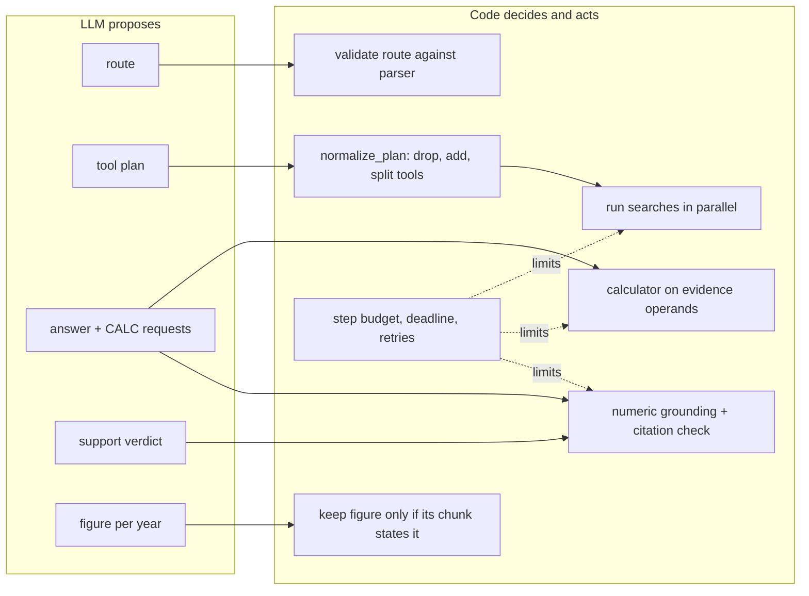

# Agents and Their Actions

What the Financial Report Copilot's agents decide, what they actually do, and where the limits are. This page answers two questions: are these real agents or only tool calling, and in which behaviours do they take actions. For the node-by-node request path, see [agent_flows.md](agent_flows.md).

Code: [financial_prompting_agent.py](../scripts/agents/financial_prompting_agent.py), [financial_tools.py](../scripts/agents/financial_tools.py), [financial_router.py](../scripts/agents/financial_router.py), [financial_trend.py](../scripts/agents/financial_trend.py), [financial_sector_trend.py](../scripts/agents/financial_sector_trend.py), [agent_mutual_fund.py](../scripts/agents/agent_mutual_fund.py), [tools_mutual_fund.py](../scripts/agents/tools_mutual_fund.py), [api_app.py](../scripts/api/api_app.py).

**In short**

- They are **real agents with bounded autonomy**. Each is a LangGraph state machine in which an LLM makes some decisions (the route, the tools, whether an answer is supported) and code carries out every action and checks every decision.
- The tool use is **planner–executor**, not native function calling. The LLM returns a JSON plan; `normalize_plan` drops unknown tools, adds required ones and splits comparisons into one search per company × year. The LLM never calls a tool directly.
- The agents **only read and compute**. Their writes are limited to report files (after the user confirms), conversation state and the fund agent's figure cache. No web access, email or transactions.
- The single-prompt techniques (`baseline_rag`, `structured_few_shot`, `decomposition`, `self_consistency`) are **not agents**: one fixed retrieval, one answer.
- **Human review is a status, not a queue yet.** The agent sets `pending_human_review` with a reviewer payload, but nothing stores it or lets a reviewer act on it.

---

## 1. Agent or tool calling?

An LLM is an agent here because its output changes what the system does next: a route sends the question to a different agent, a plan changes which searches run, a `CALC[...]` runs the calculator, and a "not supported" verdict sends the answer back for repair. It is bounded because code validates every one of those outputs before it has any effect, and a step budget caps the loops.

## 2. What each agent decides and does

| Agent | Decisions the LLM makes | Actions executed (in code) | Loops | Writes anything? |
|---|---|---|---|---|
| **Router** (`router`, `route_step`) | Picks the route: lookup, trend, sector trend, fund, report or out of scope | Validates the route against the question parser, then hands off to that agent, returns a report handoff, or refuses | none | no |
| **Q&A** (`agentic_graph`) | Planner proposes tools; the answer requests `CALC[...]`; the judge rules on each claim | `coverage_lookup`; `text_search` (one filtered search per company × year, in parallel); `visual_search` (ColPali); `calculator` | evidence retry (once, broadened); critic → repair (once) | no |
| **Trend** (`trend_graph`) | Copies each year's figure from the evidence | One search per fiscal year; a figure is kept only if that year's chunk states it; changes and CAGR computed in code | retry inside the node | no |
| **Sector trend** (`sector_trend_graph`) | LLM only as a last resort for a figure | One search per company × year; the statement row is read in code first; fixed company panel; totals, changes and CAGR in code | retry inside the node | no |
| **Fund** (`fund_graph`) | Writes the answer | Fixed read-only SQL over SEC N-PORT holdings, then annual-report lookups for the holdings | none | yes: caches verified company figures in SQLite |
| **Critic + governance** (all flows) | Judge verdict | Numeric grounding, citation check, output filter, human-review triggers | drives the repair loop | no |
| **Baselines** (`baseline_rag`, few-shot, decomposition, self-consistency) | The answer only | One fixed retrieval | none | no (not agents) |

## 3. Behaviours where the agents take actions

### 3.1 Route the question (router)
- **Trigger:** every question when the technique is `router` (the Streamlit default).
- **Decision:** the LLM picks a route; code checks it against the question parser and overrides it when they disagree.
- **Action:** hands the question to the Q&A, trend, sector trend or fund agent, returns a report handoff, or refuses.
- **Example:** "How did banking sector net income trend from 2022 to 2025?" goes to the sector trend agent. "Should I buy NVIDIA stock?" is refused with no retrieval.

### 3.2 Plan and choose tools (Q&A agent)
- **Trigger:** each question that reaches the Q&A agent.
- **Decision:** the planner LLM proposes tools. Code drops unknown ones, always adds `text_search`, adds `coverage_lookup` when a company or year is named, `calculator` for growth, ratio or comparison questions, and `visual_search` for chart questions when ColPali is served.
- **Action:** splits the question into one search per company × year (at most 6) and runs them in parallel (`RAG_SEARCH_WORKERS`, default 4).
- **Example:** "Which had higher net income in 2025, JPMorgan or Bank of America?" runs a coverage check, two filtered searches (JPM 2025, BAC 2025) and the calculator.

### 3.3 Check coverage before searching
- **Trigger:** the question names a company or year.
- **Action:** looks the targets up in the corpus directory. A target the filings don't cover is skipped, and the answer says it isn't available instead of guessing.
- **Example:** "Apple revenue 2024" returns `not_available` (`company_not_in_filings`) with similar companies.

### 3.4 Retry retrieval when evidence is missing
- **Trigger:** the evidence guard finds a planned target with no evidence.
- **Action:** one more search for the missing targets only, with a broadened query (synonyms of the measure) and twice the depth, if the rest of the run still fits the step budget.
- **Example:** in a two-bank comparison where Bank of America's chunk didn't come back, a second, wider BAC search runs.

### 3.5 Refuse unsafe evidence
- **Trigger:** a retrieved chunk contains prompt-injection text.
- **Action:** stops before answering (`refused`) and records the flagged chunks.

### 3.6 Run the calculator
- **Trigger:** the answer contains `CALC[...]` and the plan includes the calculator.
- **Action:** code evaluates the expression and puts the result into the answer. Every operand must appear in the evidence; otherwise the calculation is marked ungrounded and the answer goes to review.
- **Example:** "By what percentage did AbbVie's revenue change in 2025?" computes +8.6% from 61,160 and 56,334.

### 3.7 Critic and repair loop
- **Trigger:** every answer.
- **Decision:** code checks that every figure appears in a cited chunk; an LLM judge rules on every claim.
- **Action:** an unsupported answer goes back to the answer step once, with the critic's notes. With a hosted LLM, an answer that still isn't verified is replaced by cited excerpts (`evidence_only`).
- **Example:** an answer stating "$300,000 million" is caught as a figure in no chunk, repaired once, and held for review if still wrong.

### 3.8 Send to human review
- **Triggers:** investment or decision language, citation failure, unsupported claims, an ungrounded calculation, a figure only a vision model read (`unverified_vlm_figure`), low sector or fund coverage, a security review.
- **Action:** sets `final_status: pending_human_review` and attaches a reviewer payload (draft answer, checks, evidence IDs) and `allowed_actions` (approve, reject, request revision, mark out of scope).
- **Limit:** nothing stores the payload or notifies a reviewer, and the four actions are not implemented. See section 5.

### 3.9 Build and verify a trend (trend agent)
- **Trigger:** a multi-year question about one company.
- **Action:** one search per fiscal year. The LLM copies each year's figure; code keeps it only if that year's chunk states it. Missing years are marked, not filled. Changes and CAGR are computed in code.
- **Example:** "How did JPMorgan's net income trend from 2022 to 2025?" returns four verified points, year-on-year changes and the CAGR.

### 3.10 Build a sector panel (sector trend agent)
- **Trigger:** one measure across a sector over several years.
- **Action:** searches each company × year, reads the statement row in code first (LLM only as a last resort), keeps only companies verified in every year, and computes totals, changes and CAGR. Unusual jumps (`unusual_sector_change`) or a thin panel (`low_sector_coverage`) trigger review.

### 3.11 Query fund holdings (fund agent)
- **Trigger:** a mutual-fund question, when N-PORT data is loaded.
- **Action:** runs fixed read-only SQL (top holdings, exposure, sector mix, flows, returns), then looks up the holdings' annual reports. It **writes** each verified company figure to a SQLite cache (`save_figure`) for reuse.
- **Example:** "How much of the Vanguard Growth Index Fund is in NVIDIA?" returns NVIDIA's weight from N-PORT rows plus revenue from NVIDIA's annual report.

### 3.12 Generate a report (the only action that produces files)
- **Trigger:** asking for a full financial report. Through `/chat`, the router only **hands off** (`report_handoff`: a message saying how to ask). Through `/conversation`, the user confirms first.
- **Action:** after confirmation, `run_financial_report` runs the deterministic report pipeline: figures parsed from the PDF by exact label, reconciliations checked, then PDF, Markdown, charts, manifest and trace written to `output/pdf/<TICKER>_<YEAR>/<trace_id>/`.
- **Example:** "Generate a full financial report for Apple FY2024", confirmed in the chat, produces the report; a company without a report profile gets a message saying it isn't available yet.

### 3.13 Remember the conversation (clarifier)
- **Trigger:** a `/conversation` turn with a missing or ambiguous company, year or measure.
- **Action:** asks a clarifying question and saves the partial request in SQLite (`CONVERSATION_DB`), so it survives a restart (30-minute TTL).

## 4. Limits on every action

| Limit | Where | Effect |
|---|---|---|
| Step budget | `AGENT_MAX_STEPS` (default 10) | Retries and repairs run only if the rest of the run fits; hitting the cap returns `step_limit` with no answer |
| Per-request deadline | `Calls(timeout)`, `RAG_REQUEST_TIMEOUT_SECONDS` | A slow model or search call fails as `tool_error`, never hangs |
| Capacity | 4-slot shared pool | A full pool fails fast (`capacity_exceeded`), no queueing |
| Retries | only HTTP 429/503, with an idempotency key | Ambiguous timeouts are never retried |
| Tool validation | `normalize_plan` | Unknown tools dropped, required tools added, unavailable tools (ColPali without an index) removed |
| Guards | security, plain-text, evidence, output filter | Injection, secrets, off-topic and advice requests stopped before or after the answer |
| No external side effects | design | No web, email or transactions; writes limited to report files, conversation state and the fund cache |

## 5. Gap: human review is not yet a workflow

`human_review_queue` returns `pending_human_review`, a `queue_id`, a reviewer payload and `allowed_actions`, but:

- the payload is not stored anywhere;
- no reviewer is notified;
- approve, reject, request revision and mark out of scope are not implemented.

The smallest working version is a SQLite review table written by governance, two API routes (list pending items; approve or reject one) and a Streamlit review page.

## 6. How to describe it

An agentic RAG system with bounded autonomy. A supervisor routes each question to a specialist agent. Each agent plans its own tool use, retries retrieval when evidence is missing, and repairs its answer when the critic rejects it. Code enforces every step, and a step budget caps the loops. The agents only read and compute; the one action with real output, report generation, runs only after the user confirms it.
