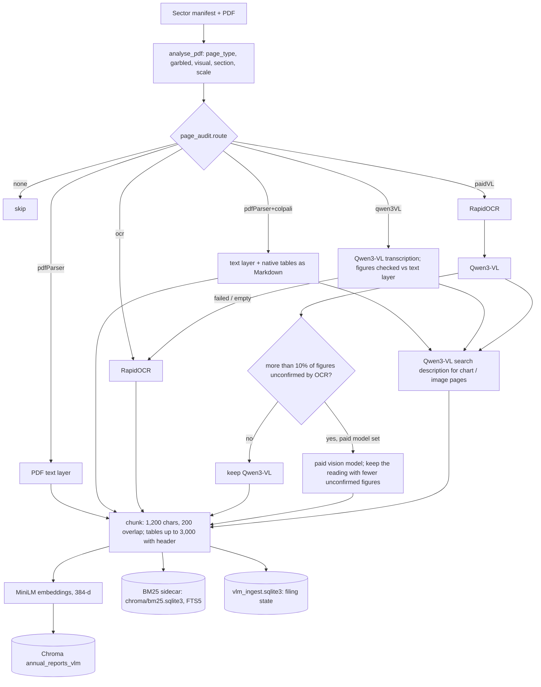
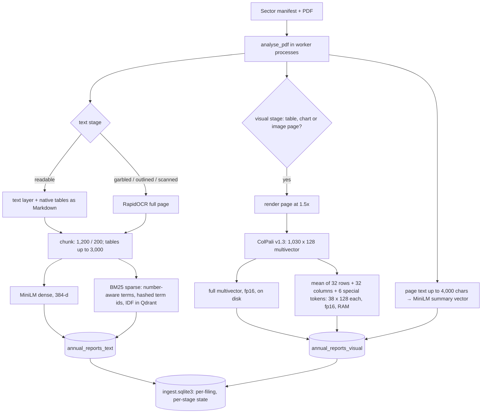
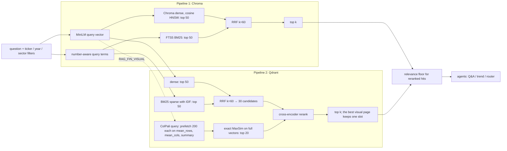

# Annual-report RAG: structure for the 1,004-filing corpus

Updated 13 November 2026. How the plan in [annual_report_corpus_plan.html](annual_report_corpus_plan.html) becomes a searchable index that the financial agents and the API answer from. The plan is 1,004 Form ARS PDFs from 281 companies in 13 sectors (11.3 GB), or the 509-filing `min500` preset.

This page covers the stages, both pipelines' flows (ingestion and query), the collections and their metadata, the models, the evaluation metrics, where everything lives, serving and commands. Section 13 adds the mutual fund data (SEC N-PORT holdings) that sits beside this index and links to it by company; section 14 the switch of Pipeline 1 to bge-small-en-v1.5 embeddings.

Updated 14 November 2026: mutual fund stores (§13), Pipeline 1 embeddings (§14), collections table (§5.1) and models (§6).

There are **two pipelines over the same corpus**:

- **Pipeline 1, Chroma (text index):** every page becomes text, so the text-only Track B model (Qwen3-8B) can read all of it. This is the main index. Code: [financial_ingest_chroma_db.py](../scripts/rag/financial_ingest_chroma_db.py). Notebook: [colab_ingest_chroma_db.ipynb](../notebooks/colab_ingest_chroma_db.ipynb).
- **Pipeline 2, Qdrant (text + ColPali index):** text and OCR chunks, plus ColPali page vectors that find table, chart and image pages from their pixels. Ready for a vision chat model. Code: [financial_ingest_qdrant_db.py](../scripts/rag/financial_ingest_qdrant_db.py). Notebook: [colab_ingest_qdrant_db.ipynb](../notebooks/colab_ingest_qdrant_db.ipynb).

Both are driven by [scripts/rag/colab_pipeline.py](../scripts/rag/colab_pipeline.py), where the pipelines are named `vlm_chroma` and `colpali_qdrant`. Both write into the storage layout of [deployment.md](deployment.md) §7.

```
corpus_plan.jsonl ──download──▶ Drive: annual_reports/<sector>/ ──stage──▶ local disk ──analyse pages──┬──▶ Pipeline 1 ──▶ Chroma text index ──┐
   (1,004 rows)                  PDFs + one manifest per sector        (per sector)    (+ page audit)   └──▶ Pipeline 2 ──▶ Qdrant text + ColPali ┴──▶ API / agents / UI
                                                                                                                                              (ticker, year, sector filters)
```

## 1. Stages

| Stage | Code | What it does | Resumable by |
|---|---|---|---|
| Plan | `data/raw/financial_report_qa/annual_reports/corpus_plan.jsonl` | 1,004 rows: sector, ticker, year, EDGAR URL, bytes. Every company is in `scripts/common/companies.py` | — |
| Download | `scripts/downloads/download_annual_report_corpus.py` (`cp.download`) | Fetches each PDF from EDGAR at ≤8 requests/s with a contact e-mail, checks the `%PDF-` header and size, and records SHA-256 and pages in the sector manifest | skipping PDFs already listed with the right size |
| Page audit (optional) | `scripts/rag/page_audit.py` (`cp.page_audit`, [colab_page_audit.ipynb](../notebooks/colab_page_audit.ipynb)) | One CSV per PDF (`pageNumber,parserUsage`): which reader each page needs. CPU only, about 0.22 s per page per core | filings that already have a CSV are skipped |
| Stage | `cp.stage` | Copies one sector's PDFs and manifest from Drive to the VM's local disk before ingesting | skipping files with the same size |
| Ingest | `cp.ingest` → **Pipeline 1** `financial_ingest_chroma_db.VlmIngest` or **Pipeline 2** `financial_ingest_qdrant_db.Ingest` | One sector at a time; models loaded once for all sectors | per-filing state in SQLite; finished filings are skipped |
| Back up | Chroma folder copy (Pipeline 1) or Qdrant snapshot (Pipeline 2) to Drive | After each sector | `cp.restore` at the start of the next session |
| Check | `cp.status`, `cp.coverage` | Chunks or points per sector, and failures; every planned filing shown as planned → downloaded → ingested / pending / failed | — |
| Serve | `cp.serve` | FastAPI (one worker) + Streamlit on localhost, with `cp.serving_env(s)` pointing them at this index | — |

The plan is complete when `cp.coverage(s)["total"]["ingested"]` equals the preset's count (509 for `min500`, 1,004 for `full`).

## 2. Two pipelines, same corpus

Both pipelines:
- read the same sector manifests;
- run the same page analysis (`financial_ingest_qdrant_db.analyse_page`);
- store **one chunk schema** (section 5).

| | **Pipeline 1: Chroma** (`vlm_chroma`) | **Pipeline 2: Qdrant** (`colpali_qdrant`) |
|---|---|---|
| Purpose | Every page as text, for the text-only Qwen3-8B; the main index | Text plus page-image search; ready for a vision chat model |
| Plain text pages | PDF text layer | PDF text layer |
| Tables with a text layer | Text layer + native tables (`find_tables`) as Markdown | Text layer + native tables as Markdown, and ColPali page vectors |
| Garbled text, glyphs drawn as outlines, scans | RapidOCR | RapidOCR (every one by default: `ocr_max_pages_per_filing=0`) |
| Charts without printed values, infographics | **Qwen3-VL** (default 4B; 2B or 8B), figures checked against the text layer | ColPali page vectors; text from the text layer or OCR |
| Tables, charts or pictures with an unusable text layer (`paidVL`) | OCR → Qwen3-VL, every figure checked against the OCR text → a **paid vision model** only when more than 10% are unconfirmed | ColPali page vectors; text from OCR |
| Model failure | A failed or empty Qwen3-VL or paid reading falls back to OCR; the filing still completes | — |
| Blank pages, photos and logos | Skipped (`none`) | Not indexed when they have no text |
| Finding chart and image pages | A Qwen3-VL **search description** chunk per chart or image page (kind, title, measures, series, years; no values) | ColPali page vectors (MaxSim) |
| Chunking | 1,200-character windows with 200 overlap; tables split up to 3,000 characters, keeping their title and header | the same |
| Retrieval | Dense + BM25, fused by RRF | Dense + BM25, fused by RRF; with `RAG_FIN_VISUAL=1`, also ColPali (pooled prefetch → full MaxSim) |
| Rerank | **None yet**: RRF order (section 6.2) | Cross-encoder when `RAG_RERANKER_MODEL` is set, plus the relevance floor |
| Agent backend | `RAG_BACKEND=financial_vlm` (`RAG_VLM_DIR`) | `RAG_BACKEND=financial_qdrant` (`RAG_INGEST_DIR`) |

**Page audit routing.** On 20 EDGAR filings (3,316 pages), the audit routed pages as follows:

| Route | Share of pages |
|---|---|
| `pdfParser` | 79.9% |
| `pdfParser+colpali` | 8.6% |
| `ocr` | 8.6% |
| `qwen3VL` | 0.8% |
| `paidVL` | 2.2% |

**Unreadable pages** are found by two checks in `analyse_page`, plus outlined text:
- **Garbled English:** fewer than 5% stopwords among 40+ words, or `�` characters.
- **Font-encoding garbage** (`non_ascii_garbage`): more than 30% non-ASCII among 40+ letters and symbols, such as Costco 2024's `èçé ´±½¿¬`.
- **Text drawn as vector outlines:** about 3,000 shapes per page with no text layer, as in Costco 2025. These pages go to OCR too.

A garbled text layer is never indexed.

## 3. Ingestion flows

### 3.1 Pipeline 1: Chroma (`financial_ingest_chroma_db`, `--vlm routed`)



Every reading is cached per page and per reader (`cache/vlm_pages/`), so a rerun never pays twice. Changing the paid model or the threshold reuses the OCR and Qwen3-VL readings.

**Search descriptions.** Chart and image pages routed `pdfParser+colpali`, `qwen3VL` or `paidVL` get an extra `page_description` chunk from Qwen3-VL (`DESCRIBE_PROMPT`).
- **What it contains:** the kind of visual, its title, what it measures, the series and the years. It contains no values.
- **Example:** *"Chart on page 2 (page description): Bar chart titled Revenue by segment…"*
- **Not described:** pages routed to OCR (outlined text, scans) and skipped pages. A failed description is skipped, and `--no-describe-visuals` turns them off.
- **Number check:** any figure in a description that the page doesn't print is flagged in `unverified_numbers`.
- **Measured:** about 54 s per page with Qwen3-VL-2B on CPU (llama.cpp).

### 3.2 Pipeline 2: Qdrant (`financial_ingest_qdrant_db`, stages `text,visual`)



Run `STAGES="text"` on a CPU runtime first, then `STAGES="visual"` on a GPU. Each stage is recorded separately, so neither repeats.

## 4. Query flows

Both backends return the same evidence keys (`chunk_schema.EVIDENCE_KEYS`), so the agents, the critic and the API work unchanged on either one.



What happens at each step:
- **Filters.** `ticker`, `fiscal_year` and `sector_slug` are applied inside both databases, before ranking.
- **Fusion.** The agent sees how each hit matched, for example `matched_by: bm25 #1, dense #8`.
- **Agents.** Each company × year or fiscal-year target runs as its own filtered search (see [agent_flows.md](agent_flows.md)).
- **Relevance floor.** With the reranker on, a question whose best cross-encoder score is below `RAG_MIN_RERANK_SCORE` (default −4) gets no answer.
- **`/retrieve`.** This endpoint returns the ranked hits with no floor.

## 5. Collections and metadata

### 5.1 Collections

| Store | Collection / file | Vectors and index | Where it lives | What one record is |
|---|---|---|---|---|
| Chroma (Pipeline 1) | `annual_reports_vlm` | 384-d, cosine, HNSW (`hnsw:space=cosine`). New indexes: `bge-small-en-v1.5` (local or the shared API, §14); the index built so far: MiniLM (a bge copy is in `chroma_db_bge`) | `<RAG_HOME>/indexes/chroma_db/chroma/` | one chunk: text, table piece or page description |
| Chroma (mutual funds) | `fund_cards_mutual_fund` | `bge-small-en-v1.5` 384-d, cosine | `<RAG_HOME>/indexes/mutual_fund/chroma_mutual_fund/` (its own folder) | one card per fund and N-PORT filing (§13) |
| SQLite (mutual funds) | `nport_mutual_fund.sqlite3`: `funds`, `filings`, `flows`, `monthly_returns`, `holdings`, `security_map`, `holding_link`, view `fund_exposure`, `company_figures` | — (exact SQL, not vectors) | `<RAG_HOME>/indexes/mutual_fund/` | one fund, filing, holding, mapping or cached company figure (§13) |
| SQLite FTS5 (Pipeline 1) | `chroma/bm25.sqlite3`, table `chunks(terms, chunk_id, doc_id, ticker, fiscal_year, sector_slug)` (only `terms` is indexed) | BM25 over number-aware terms (`tokenchars '$,.%'`) | next to Chroma | one chunk's terms |
| Qdrant (Pipeline 2) | `annual_reports_text` | `dense`: MiniLM 384-d, cosine, HNSW m=16 / ef_construct=100, in RAM. `bm25`: sparse, `Modifier.IDF`; term ids are the first 4 bytes of each term's SHA-256 (`hashing.term_id`) | Qdrant storage; payloads on disk | one chunk |
| Qdrant (Pipeline 2) | `annual_reports_visual` | `colpali`: 1,030 × 128 fp16 multivector, MaxSim, on disk, no HNSW (m=0). `mean_rows` and `mean_cols`: 38 × 128 fp16 multivectors, MaxSim, HNSW in RAM. `summary`: MiniLM 384-d of the page text | Qdrant storage; payloads on disk | one table, chart or image page |
| SQLite (both) | `vlm_ingest.sqlite3` / `ingest.sqlite3` | — | index root | per-filing (and, in Pipeline 2, per-stage) state; the API's company and year list |

**Names.** The collection names are this corpus's own, so `LocalRAG` (`multimodal_rag.py`, with its `docs_text` / `visual_pages`) can share a Qdrant server. Snapshots from before the rename are restored into the new names.

**Embedding signatures.** Each index records the embedding model and chunk settings it was built with. Ingesting with a different model raises an error instead of mixing vectors.

### 5.2 Chunk metadata: one schema for both stores

[chunk_schema.py](../scripts/rag/chunk_schema.py) (`FIELDS`) builds every stored chunk in both pipelines, and `tests/test_chunk_schema.py` pins it.
- **Chroma encoding:** Chroma metadata only accepts scalars, so list fields are stored as JSON strings and `None` values are left out. `normalize` turns them back.
- **Visual pages** carry the same filing and page fields, plus the page text (up to 4,000 characters) in their payload.

| Group | Fields | Meaning |
|---|---|---|
| Filing | `domain`, `doc_id` (`edgar_ars_<TICKER>_<YEAR>`), `filing_id`, `doc_kind`, `ticker`, `company`, `cik`, `sector`, `sector_slug`, `sic`, `year`, `fiscal_year`, `accession_number`, `filing_date`, `source_url`, `source_type`, `content_sha256`, `pdf_name`, `title`, `doc_title` | Which filing; the filters use `ticker`, `fiscal_year` and `sector_slug` |
| Page | `page`, `section`, `page_type` (text, table, chart, image, outlined_text, blank), `scale` (e.g. "in millions"), `garbled`, `visual_rich`, `page_route` (the page audit label) | Where in the filing, and how the page was read |
| Chunk | `chunk_id` (citable, e.g. `annual_report_edgar_ars_COST_2025_p0041_…`), `point_id`, `chunk_index`, `content_type` (`text`, `table`, `page_description`), `text`, `table_markdown` (list) | The evidence the agent cites |
| Provenance | `pipeline` (`chroma_db` / `qdrant_db`), `text_source` (`native_pdf`, `ocr`, `vlm`), `reader` (`pdfParser`, `ocr`, `qwen3VL`, `paidVL`, `openaiVL`, `mock`), `reader_model`, `escalation`, `number_check` (`text_layer`, `ocr`, `ocr_only`, `no_text_layer`, `no_reference`), `unverified_numbers` (the page's), `unverified_in_chunk` (this chunk's) | How trustworthy the text is; figures a model wrote that the page doesn't print are listed, never silently trusted |

The agent receives these as evidence keys (`EVIDENCE_KEYS`):
- `chunk_id`, `text`, `preview`, `title`, `company`, `ticker`, `year`, `sector`, `page`, `section`, `scale`;
- `source_url`, `content_type`, `text_source`, `reader`, `unverified_numbers`, `table_markdown`;
- the scores `score`, `rrf_score` and `rerank_score`;
- `retrieval_paths`, `retrieval_ranks` and `metadata`.

## 6. Models

### 6.1 Ingestion

| Task | Model | Where it runs | Used by |
|---|---|---|---|
| Text embeddings (chunks, page summaries) | Pipeline 1: `BAAI/bge-small-en-v1.5` (384-d, default since 14 November 2026; locally or through the shared Track B embedding API, same vectors). Pipeline 2: `sentence-transformers/all-MiniLM-L6-v2` (384-d) | CPU or GPU, or the shared API | both pipelines |
| Fund cards | `BAAI/bge-small-en-v1.5` (local or shared API) | CPU | mutual funds (§13) |
| Page images → visual vectors | `vidore/colpali-v1.3-hf` through `transformers` (128-d multivectors, 1,030 per page) | GPU (T4 or better); very slow on CPU | Pipeline 2, visual stage |
| Page transcription and search descriptions | `Qwen/Qwen3-VL-4B-Instruct` (default; `-2B` for speed, `-8B` on L4/A100), in-process with `transformers` (4-bit with bitsandbytes on CUDA), or any OpenAI-compatible endpoint (`--qwen-reader openai`: vLLM, llama.cpp, Ollama) | GPU; about 50–100 s per page on CPU (measured with 2B) | Pipeline 1, `qwen3VL` / `paidVL` pages and descriptions |
| Paid fallback reader | any OpenAI-compatible vision model (`RAG_PAID_VISION_API_BASE` / `_MODEL` / `_API_KEY`) | hosted API | Pipeline 1, `paidVL` pages with more than 10% unconfirmed figures; off unless configured, and pending mentor approval ([chart_reading.md](chart_reading.md)) |
| OCR | RapidOCR (PP-OCR detection and recognition models, ONNX Runtime) | CPU | both pipelines |
| Tables | PyMuPDF `find_tables` (rule-based, not a model) | CPU | both pipelines |
| Offline / tests | `hashing` embeddings (`scripts/rag/hashing.py`: log-scaled term counts folded into 384 dimensions) | CPU | smoke runs and tests only |

### 6.2 Retrieval and ranking

| Step | Model or method | Pipeline 1 (Chroma) | Pipeline 2 (Qdrant) |
|---|---|---|---|
| Query embedding | the index's recorded model (must match): bge-small (Pipeline 1, new) or MiniLM (Pipeline 2, and the Chroma index built so far) | ✓ | ✓ |
| Lexical search | BM25 over number-aware terms (`391,035`, `391035` and `$6.08` kept whole) | SQLite FTS5 `bm25()` | Qdrant sparse vectors with IDF |
| Fusion | Reciprocal Rank Fusion, k = 60 (`scripts/rag/hybrid.py`) | ✓ | ✓ |
| Visual search | ColPali v1.3 query encoder; pooled prefetch, then exact MaxSim | — | with `RAG_FIN_VISUAL=1` (or `auto`) |
| Rerank | Cross-encoder `cross-encoder/ms-marco-MiniLM-L-6-v2` (`RAG_RERANKER_MODEL`; turned on automatically when a local copy exists) | **not applied** | ✓ (30 candidates → top k) |
| Relevance floor | `RAG_MIN_RERANK_SCORE` (default −4) on reranked hits | — (nothing is reranked) | ✓ |

### 6.3 Answering and checking (not ingestion, listed for completeness)

| Task | Model |
|---|---|
| Plain-text check, planner, router, figure extraction (trend), answer | Track B hosted **Qwen/Qwen3-8B** (`LLM_MODEL`; thinking off, ≤1,024 output tokens, one request at a time); `mock` offline |
| Critic support judge | the same Qwen3-8B, in its own call |
| Figure, citation and calculator checks | code, no model |

## 7. Evaluation metrics

### 7.1 Retrieval

The code is [retrieval_metrics.py](../scripts/rag/retrieval_metrics.py), driven by `scripts/evaluation/evaluate_financial_rag.py`. The API's `response_metrics` scores the evidence any workflow returns.

| Metric | Definition |
|---|---|
| **Recall@k** (k = 1, 5, 10) | Relevant chunks (or pages) in the top k ÷ all relevant ones |
| **nDCG@5** | DCG of the top 5 with linear relevance gains (ViDoRe / trec_eval convention) ÷ the ideal DCG; duplicates earn gain once |
| **MRR** | 1 ÷ rank of the first relevant hit, averaged over questions |
| **Gold page retrieved** | The share of questions whose gold page is among the retrieved pages (architecture notebooks) |
| ColPali pooling ([colab_colpali_pooling_eval.py](../scripts/evaluation/colab_colpali_pooling_eval.py)) | Recall@1/5/10 and MRR per pooling variant; `keeps_full_top5@N` (the share of exact full-ColPali top-5 pages kept by an N-page pooled prefetch, N = 20…200); agreement of the top 20 with full MaxSim |

### 7.2 Answers: the frozen evaluation set

**The set.** `data/evaluation/financial_report_qa/eval_set_v1.jsonl` holds **86 items**, frozen and reviewed. Gold values come from XBRL facts and the filings.

| Category | Items | Scored as correct when |
|---|---|---|
| `single_figure` | 40 | A figure in the answer matches the gold value at the printed precision and unit scale |
| `computed_metric` | 10 | The same rule, for growth, margins and ratios |
| `text_fact` | 10 | The key words (auditor) or the number (employees, within tolerance) appear |
| `refusal` | 8 | The agent declines (advice, prediction, prompt injection) |
| `comparison` | 6 | The right company is named first, and the agent doesn't decline |
| `chart_value` | 6 | Every chart value is in the answer (FIN-067–072) |
| `not_disclosed` | 6 | The agent says the filings don't disclose it, with no figure |

**Per-item checks** (`prompt_baselines.score`):
- whether the gold value appears anywhere in the retrieved evidence (`gold_in_evidence`), which separates retrieval misses from reading misses;
- the declined flag;
- the strategy used.

**Architecture comparison.** The notebooks in `notebooks/rag_architectures/` use the same scoring code on **66 gold questions** from Chevron's 2024 report:

| Metric | Definition | Target |
|---|---|---|
| Numeric number-match rate | Numeric questions answered with the gold figure (exact, or correctly rounded with ≥3 significant digits), split by tables / narrative / charts | — |
| Text-fact accuracy | Text questions with every gold key word | — |
| **Faithfulness** | RAGAS-style: supported claims ÷ claims, judged by Qwen in a separate call; an unreadable verdict counts as unsupported | > 0.98 |
| **Negative refusal accuracy** | Unanswerable questions correctly declined | > 0.95 |
| False refusal rate | Answerable questions declined | lower is better |
| Fallback rate | Answers that fell back to excerpts instead of the model's text | — |
| Latency | Median retrieval and total seconds per question | — |

**Latest scoreboard in the repo** (`results/rag_arch/architecture_scoreboard.csv`, 66 questions, Chevron 2024). `04_vlm_chroma` is the predecessor of Pipeline 1.

| Architecture | Number match (tables / narrative / charts) | Text facts | Faithfulness | Negative refusal | False refusal | Gold page retrieved | Median total |
|---|---|---|---|---|---|---|---|
| `04_vlm_chroma` | 0.50 (0.62 / 0.50 / 0.13) | 0.83 | 0.82 ✗ | 1.00 ✓ | 0.28 | 0.67 | 4.4 s |
| `05_clip_chroma` | 0.23 (0.27 / 0.33 / 0.00) | 0.00 | 0.86 ✗ | 1.00 ✓ | 0.70 | 0.30 | 7.0 s |

These numbers show chart values as the weakest kind of question, which [chart_reading.md](chart_reading.md) addresses. Neither pipeline has been scored yet on the full `min500` index.

### 7.3 Checks on every live answer

These are reported in each API response; they are not offline metrics.

| Check | Where | Result field |
|---|---|---|
| Citation validity: every cited chunk ID was retrieved | critic, `apply_grounding_policy` | `citation_check`, `grounding.status` |
| Numeric grounding: every figure appears in a cited chunk or the calculator's results | `financial_tools.numeric_grounding` | `support_check.numeric` |
| Claim support: an LLM judge, claim by claim | critic | `support_check.verdict` (`supported`, `partially_supported`, `unsupported`, `unverified`) |
| Company scope: no citation from a company the question didn't ask about | `company_scope_check` | `company_check` |
| Trend series: each year's figure verified in that year's evidence | trend agent | `trend.points[].status` |

## 8. Where everything lives

All environments use one layout under `RAG_HOME` ([deployment.md](deployment.md) §7). Folders built before this layout (`colpali_qdrant`, `vlm_chroma`, `financial_qdrant`, `financial_vlm`, `snapshots/colpali_qdrant`, `indexes/vlm_chroma`, `vlm_pages/`) are still found.

**Google Drive** (`MyDrive/capstone_rag/`; durable, paid storage):

```
capstone_code.zip                     code (python -m scripts.common.colab_bundle)
annual_reports/
    corpus_plan.jsonl                 copied from the repo
    pdf_manifest.jsonl                all sectors (local_path = <sector>/<file>.pdf)
    banking/pdf_manifest.jsonl        this sector (local_path = <file>.pdf)
    banking/EDGAR_ARS_JPM_2025.pdf
    ... 13 sector folders
indexes/chroma_db/                    Pipeline 1: chroma/ (+ bm25.sqlite3), vlm_ingest.sqlite3, pages/
cache/vlm_pages/                      Pipeline 1 readings (OCR, Qwen3-VL, paid), one JSONL per filing (append-only)
snapshots/qdrant_db/                  Pipeline 2: annual_reports_text-*.snapshot, annual_reports_visual-*.snapshot, ingest.sqlite3, pages/
page_audit/<sector>/<pdf>.csv         page audit (pageNumber,parserUsage) + _summary.csv / _summary.json
```

**Colab local disk** (`/content/rag/` = `RAG_HOME`; fast, lost at disconnect):

```
annual_reports/<sector>/              the staged PDFs being ingested
indexes/chroma_db/                    Pipeline 1: chroma/, vlm_ingest.sqlite3, pages/
indexes/qdrant_db/                    Pipeline 2: ingest.sqlite3, pages/, qdrant_storage/, snapshots/
cache/hf/                             HF_HOME (MiniLM, ColPali, Qwen3-VL)
bin/qdrant, qdrant.log, logs/         Qdrant server binary; API and Streamlit logs
```

Smoke runs (`SMOKE_TEST = True`) write to `chroma_db_smoke` / `qdrant_db_smoke` (with embedded Qdrant) and never touch the real index.

**On your PC:** `indexes/rag_home/indexes/chroma_db` and `indexes/rag_home/indexes/qdrant_db` (embedded Qdrant), plus `indexes/rag_home/indexes/mutual_fund/` (fund database, fund cards and the downloaded N-PORT XML, §13). **GCP:** the same layout on the VM's persistent disk, copied from `gs://$RAG_GCS_BUCKET`.

## 9. Serving

[scripts/common/runtime_profile.py](../scripts/common/runtime_profile.py) fills the defaults from the layout; anything you set yourself wins. Deployment steps per environment are in [deployment.md](deployment.md) §7.2.

| | local | colab | server / gcp |
|---|---|---|---|
| `RAG_VLM_DIR` (Pipeline 1) | `<RAG_HOME>/indexes/chroma_db` | same | same |
| `RAG_INGEST_DIR` (Pipeline 2) | `<RAG_HOME>/indexes/qdrant_db` | same | same |
| `QDRANT_URL` | unset (embedded) | `http://127.0.0.1:6333` | `http://qdrant:6333` |
| `RAG_BACKEND` | `financial_qdrant` if its `ingest.sqlite3` exists, else `financial_vlm` if `vlm_ingest.sqlite3` exists | same | same |

**Choosing a pipeline.** When both indexes exist, the automatic choice prefers Pipeline 2. To serve Pipeline 1, set `RAG_BACKEND=financial_vlm`; the Chroma notebook's `cp.serve` does this. To serve both side by side, run one API per backend (for example ports 8000 and 8001).

**UI and filters.**
- The Streamlit sidebar has a **Sectors** picker, a **Retrieval mode** (`hybrid`, or `dense` / `bm25` for comparisons) and the agent **Technique** (default `router`).
- `/chat`, `/conversation` and `/retrieve` accept `ticker`, `year` and `sector`; the filters apply to both pipelines.

## 10. Commands

```bash
# Pipeline 1: Chroma text index (routed readers; the paid model needs RAG_PAID_VISION_API_BASE / _MODEL / _API_KEY)
python -m scripts.rag.colab_pipeline run --pipeline vlm_chroma --corpus-preset min500 --max-per-sector 0
python -m scripts.rag.financial_ingest_chroma_db ingest --manifest data/raw/financial_report_qa/annual_reports --sectors banking --vlm routed
python -m scripts.rag.financial_ingest_chroma_db query "net interest income" --sector banking

# Pipeline 2: Qdrant text + ColPali index
python -m scripts.rag.colab_pipeline run --pipeline colpali_qdrant --corpus-preset min500 --max-per-sector 0
python -m scripts.rag.colab_pipeline query --pipeline colpali_qdrant "net interest income" --sector banking

# Both
python -m scripts.rag.colab_pipeline coverage --pipeline vlm_chroma
python -m scripts.rag.page_audit --manifest data/raw/financial_report_qa/annual_reports --corpus-preset min500
python -m scripts.rag.colab_pipeline export --pipeline vlm_chroma --bucket gs://capstone-rag-<name>   # for GCP
# locally, embedded Qdrant and offline vectors:
python -m scripts.rag.colab_pipeline run --pipeline colpali_qdrant --qdrant-url "" --embedding-provider hashing --sectors banking --max-per-sector 2

# Evaluation
python scripts/evaluation/evaluate_financial_rag.py --embedding-provider hashing --generate-silver   # retrieval smoke test
```

## 11. Sizes

The page mix was measured on 100 local filings and scaled to about 147,600 pages.

| Item | Size |
|---|---|
| PDFs | 11.3 GB full, 5.4 GB min500 (on Drive, and staged per sector on local disk) |
| Page mix (measured: 14,701 pages) | text or blank 68.9%, table 10.4%, chart or image 7.7%, unreadable 13.1% |
| Pipeline 1 model pages | about 3% of pages need Qwen3-VL or the paid model, and about 10% need OCR (page audit, 20 filings) |
| Pipeline 2 ColPali full vectors | ~264 KB per selected page: **~7 GB** for the table, chart and image pages (18.0%, ~26,600 pages) |
| Pipeline 2 pooled vectors (RAM) | ~19 KB per selected page: **~0.5 GB** |
| Snapshot rotation | The new snapshot is written before the old one is deleted, so it can take up to 2× on Drive, plus a local copy on the VM |
| Measured locally (Retail test, 5 filings, `--vlm ocr`, CPU) | Pipeline 1: 82 s for Walmart 2025 (97 pages, 11 OCR'd, 421 chunks) |

## 12. Known limits

- **Qwen3-VL and the paid model haven't run on a GPU yet.** Routing, OCR, cross-checks and fallbacks are tested with real OCR and stand-in models, so the first Colab run is the real test. Reading one page at a time with `transformers` is slow at full scale; serve Qwen3-VL with vLLM and use `--qwen-reader openai`.
- **Pipeline 1 has no cross-encoder rerank** and therefore no relevance floor. Its order is RRF over dense + BM25. Adding the cross-encoder there is small (the same `cross_encoder_rerank` call), but it isn't done yet.
- **Mixed pages:** a text page with a small embedded chart is read through its text layer only, so values that exist only as pixels are missed.
- **Evaluation coverage:** the scoreboard above is from one filing (Chevron 2024). The frozen 86-item set hasn't been run against the `min500` indexes yet.
- **Not implemented** from [financial_rag_final_design.md](financial_rag_final_design.md): the 10-K HTML/iXBRL text source and the facts DB. Numbers come from the ARS PDFs only.

## 13. Mutual fund data beside the annual-report index

Added 14 November 2026. Design and measurements: [mutual_fund_rag_design.md](mutual_fund_rag_design.md). Every file of this layer has `_mutual_fund` in its name.

**What it is.** US mutual funds and ETFs report their full portfolio on SEC Form N-PORT. A fund's holdings are mapped to the corpus companies, so a question can go from a fund to the annual reports of the companies it holds. The data is exact numbers that are summed and ranked, so it is stored in **SQLite**, not embedded; only a short **fund card** per fund and filing is embedded, so search can find a fund by the way people name it.

```
EDGAR NPORT-P XML ──download_mutual_fund──▶ raw_mutual_fund/ ──nport_mutual_fund load──▶ nport_mutual_fund.sqlite3 ──cards_mutual_fund build──▶ Chroma fund_cards_mutual_fund
(or the quarterly bulk ZIP, 440 MB)          + manifest_mutual_fund.jsonl                     holdings → corpus tickers               (bge-small-en-v1.5)
                                                                                                │
                                                       fund agent (router `fund` route) ◀───────┴──── links each holding to its company's annual report in annual_reports_vlm
```

| Stage | Code | What it does |
|---|---|---|
| Download | `scripts/downloads/download_mutual_fund.py` (`latest`, `bulk`) | The newest `NPORT-P` of each fund in `configs/funds_mutual_fund.json` (EDGAR, `SEC_USER_AGENT` contact), or one quarterly ZIP |
| Load | `scripts/rag/nport_mutual_fund.py load` | XML or ZIP (streamed) into the tables; re-loading a filing replaces it |
| Map | same, `map_holdings` | Holding → corpus ticker by reported ticker, issuer CUSIP-6, ISIN, LEI, then cleaned name (equity of corporate issuers only). Identifiers matched once are learned. Unmatched holdings stay unmatched |
| Cards | `scripts/rag/cards_mutual_fund.py build` | One card per filing (fund, date, net assets, top 10, sector mix, corpus coverage), embedded with bge-small into `fund_cards_mutual_fund` |
| Check | `nport_mutual_fund status`, `cards_mutual_fund search "..."` | Funds, periods, coverage by mapping method; nearest cards |

**Holdings date.** `filings.period_end` is the date the holdings are reported for (`REPORT_DATE` in the bulk data, `repPdDate` in the XML). `REPORT_ENDING_PERIOD` / `repPdEnd` is the fund's fiscal year end, kept as `fiscal_year_end`.

**Link to the annual reports.** A question about the holdings' companies uses, for each company, its latest annual report filed on or before the holdings date (manifest `filing_date`) that is indexed: no look-ahead, and never a filing the index doesn't hold. Figures are read from that filing (statement row in code, LLM last) and cached in `company_figures` with their chunk ID.

**Loaded now** (holdings as of 30 June 2026):

| Fund | Corpus companies held | Share of net assets |
|---|---|---|
| Vanguard 500 Index | 240 | 86.7% |
| Vanguard Growth Index | 73 | 90.1% |
| Vanguard Value Index | 176 | 82.6% |
| Vanguard Total Stock Market Index | 274 | 77.3% |

With 52 companies indexed today, most of the largest holdings' annual reports are not yet searchable; questions about them list those companies as not used.

```bash
export SEC_USER_AGENT="capstone-research you@example.com"
python -m scripts.downloads.download_mutual_fund latest                        # configs/funds_mutual_fund.json
python -m scripts.rag.nport_mutual_fund load --xml indexes/rag_home/indexes/mutual_fund/raw_mutual_fund
python -m scripts.rag.cards_mutual_fund build                                   # bge-small, local; --embedding-provider hosted for the shared API
python -m scripts.rag.nport_mutual_fund status
# many funds: the quarterly ZIP
python -m scripts.downloads.download_mutual_fund bulk --quarter 2026q3
python -m scripts.rag.nport_mutual_fund load --tsv-zip indexes/rag_home/indexes/mutual_fund/raw_mutual_fund/2026q3_nport_mutual_fund.zip --top 50
```

**Colab and GCP.** `python -m scripts.rag.colab_pipeline pack-funds` zips the folder to `output/colab/mutual_fund_data.zip`; uploaded to `MyDrive/capstone_rag/`, it is restored by `cp.restore` on Colab, exported by `cp.export_to_gcs` to `gs://<bucket>/indexes/mutual_fund`, and pulled by `deploy/sync_from_gcs.sh` / `restore_index.sh` on the VM ([deployment.md](deployment.md) §7.4).

**Isolation.** The fund code never opens `chroma_db`; the annual-report collections, their chunk schema and `tests/test_chunk_schema.py` are unchanged. Without `nport_mutual_fund.sqlite3` the API and agents behave exactly as before.

## 14. Pipeline 1 embeddings: bge-small-en-v1.5

Since 14 November 2026 Pipeline 1 embeds with `BAAI/bge-small-en-v1.5` by default: locally (`--embedding-provider local`) or through the shared Track B embedding API (`hosted`, needs `EMBEDDING_API_KEY` and the API's CA; see [embedding_key.md](embedding_key.md)). The API serves the same model and returns the same vectors (cosine 1.0), so an index built one way is continued or served the other way without redoing filings. `RAG_EMBEDDING_PROVIDER` picks the provider at serving time (the server and GCP profiles prefer `hosted`), with a fallback to the other if it can't start.

The 180 filings indexed before the switch were embedded with MiniLM and keep that model: resume them with `--embedding-model sentence-transformers/all-MiniLM-L6-v2`. `financial_ingest_chroma_db reembed --from-root <minilm index> --root <new index>` copies the chunks, text, metadata and BM25 index and re-embeds only the vectors (resumable, one filing at a time); a bge copy is being built at `indexes/rag_home/indexes/chroma_db_bge`. To serve it, point `RAG_VLM_DIR` at that folder (or swap the folder names) and restart the API. Pipeline 2 still defaults to MiniLM.
