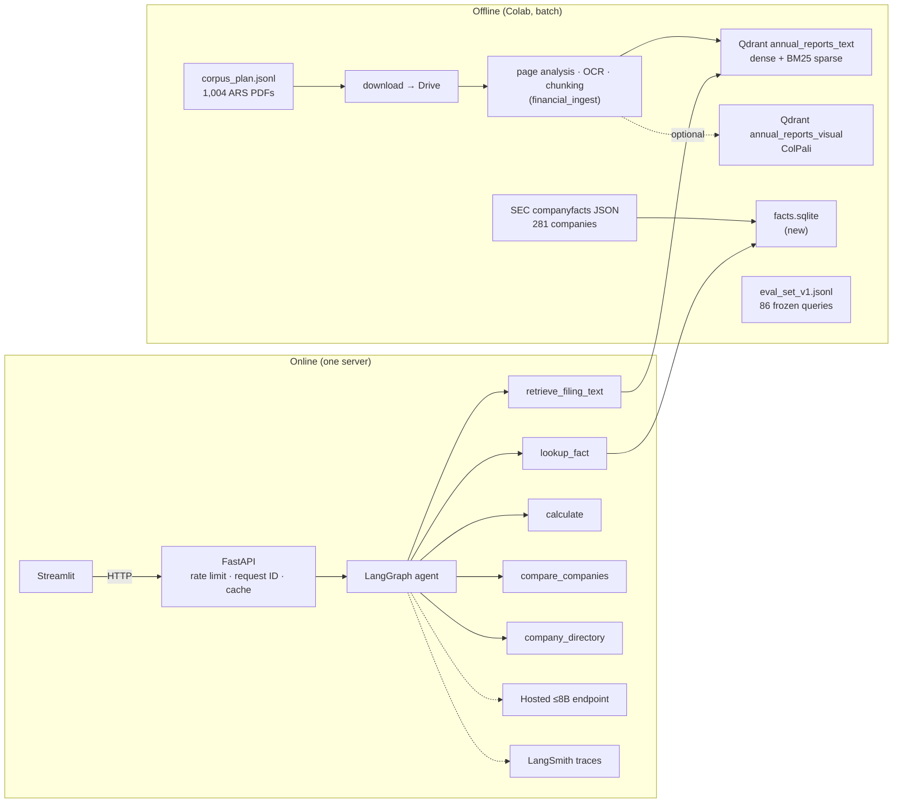

# Annual Report Copilot: capstone implementation plan

**Submission:** 25 November 2026 (today is 10 November: 15 days). **Track:** B, API-side (hosted ≤8B chat endpoint plus an embeddings endpoint; no GPU for serving).

**What we submit** (from `Capstone-Templates-GenAI-Agentic-AI.pdf`):
- the Git repository with the full agent stack;
- a trace dashboard (LangSmith) showing real queries;
- an evaluation report with the failure taxonomy;
- a 12-page technical report;
- a 10-minute live demo of the deployed system.

**How it is graded:**

| Component | Weight | What earns it here |
|---|---|---|
| Technical depth and rigour | 30% | Hybrid RAG, a planner → executor → critic graph, tools with Pydantic schemas, grounding checks, measured results |
| Punctuality and consistent progress | 25% | The day plan in section 6, with commits every day |
| Working deployed system | 20% | One server running FastAPI, Streamlit and Qdrant behind HTTPS |
| Report and demo | 25% | Evaluation tables, the failure taxonomy, and the "what we did to compensate for a small model" section |

Status column in this document:
- **Exists:** in the repo and tested; 325 tests pass.
- **Extend:** partly there.
- **New:** to build.

---

## 1. Product scope

An analyst copilot over **1,004 SEC annual reports (Form ARS)** from **281 companies in 13 sectors**, fiscal years 2022–2025 ([annual_report_corpus_plan.html](annual_report_corpus_plan.html)).

- **Every answer is grounded:** each figure carries a citation to the filing and page it came from, or a source XBRL fact.
- **Calculations are code:** they are done by a calculator tool from cited inputs, never by the LLM.
- **Refusals:** the copilot refuses investment advice and anything outside the corpus. It answers "not available" rather than guess.
- **Human review:** a person reviews answers flagged for review before they are shown as final, and approves any generated report.

### What the copilot must refuse

| Request | Behaviour |
|---|---|
| Buy, sell or hold advice, price targets | Refuse; offer factual metrics instead |
| A company, year or metric not in the corpus | `not_available`, naming what *is* covered (the clarifier does this) |
| A metric that doesn't apply to the company (e.g. gross margin for a bank) | Explain why, and suggest the right measure |
| Prompt injection, code execution, secrets | Block at the input guard |
| A figure that can't be supported by evidence | Withhold the answer (grounding policy) |

---

## 2. Feature catalogue

The full build specification for every feature is in [features_to_implement.md](features_to_implement.md) ([HTML](features_to_implement.html)): design, files, Pydantic contracts, tests and metrics.

Priorities:
- **P0:** required for the submission.
- **P1:** strong demo value; build if P0 is on track.
- **P2:** stretch.

### 2.1 Single filing (one company, one year)

| # | Feature | Example question | Priority | Status |
|---|---|---|---|---|
| F1 | Cited Q&A | "What was Costco's net income in FY2024?" | P0 | Exists |
| F2 | Clarifier for missing company or year | "What was revenue?" → "Which company and year?" | P0 | Exists |
| F3 | "Not available" / refusal | "Apple's 2019 revenue?" (not in the corpus) | P0 | Exists |
| F4 | Section summary (MD&A, risks, CEO letter) | "Summarise JPM's 2025 risk factors" | P1 | Extend: summary prompt plus a citation per bullet |
| F5 | Statement extraction | income statement, balance sheet, cash flow as tables | P1 | Extend: report generator (Apple profile) or the XBRL facts tool |
| F6 | Chart and table reading | "What does the revenue-by-region chart show?" | P2 | Extend: ColPali search exists; chart values are estimates |

### 2.2 One ticker across years

| # | Feature | Example | Priority | Status |
|---|---|---|---|---|
| F7 | Trend and growth (YoY, 3-year CAGR) | "How did NVIDIA's revenue grow 2023–2026?" | **P0** | New: facts tool plus calculator |
| F8 | Ratios with cited inputs | margins, ROE, debt/equity, FCF | **P0** | New: calculator tool |
| F9 | What changed this year | new risk factors, changed outlook | P1 | New: section comparison of year *n* and *n−1* |
| F10 | Company fact-sheet PDF | KPIs, charts and highlights in one page | P2 | Extend: `generate_financial_report` |

### 2.3 Within a sector

| # | Feature | Example | Priority | Status |
|---|---|---|---|---|
| F11 | Peer comparison table | "Compare JPM, BAC and WFC on net income 2024" | **P0** | New: decompose → parallel retrieval → table |
| F12 | Sector filter in search and UI | Streamlit sector picker | P0 | Exists |
| F13 | Sector-specific metrics | banks: NIM, CET1; insurers: combined ratio | P1 | Extend: the clarifier already knows bank exceptions |
| F14 | Ranking within a sector | "Highest operating margin in retail, 2024" | P1 | New: facts tool |

### 2.4 Across sectors

| # | Feature | Example | Priority | Status |
|---|---|---|---|---|
| F15 | Theme tracking | "Which sectors mention tariffs most in 2025?" | P2 | New: keyword counts by sector and year, from payload filters |
| F16 | Cross-sector benchmark | R&D share of revenue across sectors | P2 | New: facts tool |

### 2.5 Agentic workflows

| # | Feature | What the agent does | Priority | Status |
|---|---|---|---|---|
| F17 | Planner → executor → critic with repair | Plan, call tools, check citations, repair once | P0 | Exists (financial graph); add the step cap |
| F18 | Comparison agent | Splits multi-company or multi-year questions; joins results; never fills gaps | **P0** | New |
| F19 | Research memo with human approval | Plan → tools → draft → critic → **human approves** → PDF | P1 | New: reuse the HITL queue |
| F20 | Change alerts | A new filing is compared with last year and big changes flagged | P2 | New |

**Scope for 25 November:** all P0 (F1–F3, F7, F8, F11, F12, F17, F18), then F4, F5 and F19 if time allows. P2 goes in the report as "future work".

---

## 3. Architecture



### 3.1 Agent graph (LangGraph)

```
security_guard → clarifier → planner ─┬─► executor (tool calls, ≤10 steps)
                                      │        │
                                      │   evidence_guard
                                      │        │
                                      │   answer_agent (Pydantic FinancialAnswer)
                                      │        │
                                      │   output_filter → citation_critic ──repair (max 1)──► answer_agent
                                      │                         │
                                      └──── fail fast ────────► governance / human_review → response
```

| Element | Implementation | Status |
|---|---|---|
| State | `AgentState` TypedDict; conversation slots (company, year, metric) | Exists |
| **Persistent state across turns** | `ConversationStore(path=CONVERSATION_DB)`: SQLite keyed by `conversation_id`, 30-minute TTL, survives API restarts | **Done** (10 Nov; verified across a restart) |
| **Step cap** | `AGENT_MAX_STEPS=10` node executions (`recursion_limit` = steps + 1) on both graphs; over the cap → `step_limit`, no answer | **Done** (10 Nov) |
| **Token budget** | Count prompt and evidence tokens; trim evidence to fit; stop when the budget is used up | **New** |
| Malformed JSON | Pydantic validation → one retry with the validation error in the prompt → fallback to extractive | Extend (`answer_schema.py`) |
| Tool failures | `Calls` timeouts and `CallFailure` reasons; the tool error goes back into the state, never crashes the run | Exists |
| Infinite loops | At most 1 repair loop, plus the step cap | Exists / New |

### 3.2 Tools (Pydantic input and output schemas)

| Tool | Input model | Output | Status |
|---|---|---|---|
| `retrieve_filing_text` | `query, ticker?, year?, sector?, k` | chunks with `chunk_id`, page, score | Exists (hybrid RRF and rerank) |
| `lookup_fact` | `ticker, concept, fiscal_year` | value, unit, period, accession (XBRL) | **New** |
| `calculate` | `operation, inputs[{value, source_id}]` | result (`Decimal`), formula, input sources | **New** |
| `compare_companies` | `tickers[], metric, years[]` | table; missing cells marked, not guessed | **New** (calls the two tools above) |
| `company_directory` | `name or ticker` | ticker, sector, years covered | Exists (`companies.py`, clarifier) |

**Track B note:** small models fumble tool calls. Every tool call is parsed into its Pydantic model and validated. If that fails, the model gets one retry with the error message, and then the run uses a deterministic fallback (the slot parser in the clarifier). This is the "constrained decoding, schema validation, retry" content the template asks for.

### 3.3 Grounding and anti-hallucination ("no hallucination" in measurable form)

A guarantee of zero hallucination isn't possible with any LLM. What the system guarantees is that **unsupported output is not shown as fact**, and it measures the rate.

| Layer | Rule | Status |
|---|---|---|
| Retrieval floor | No answer when the best rerank score is below `RAG_MIN_RERANK_SCORE` | Exists |
| Evidence guard | Injection or code in retrieved text → the chunk is dropped | Exists |
| Citation validity | Every cited ID must be in the retrieved set; otherwise the answer is withheld | Exists (`apply_grounding_policy`) |
| Company scope | An answer citing a company the question didn't ask about is withheld | Exists |
| **Number grounding** | Every number in the answer must appear in cited evidence or be a `calculate` output with cited inputs | **New** (extends the critic) |
| Coverage check | Company, year or metric not covered → `not_available` | Exists |
| Human review | `review` decisions go to the HITL queue | Exists |

### 3.4 Guardrails and responsible AI

| Area | Implementation | Status |
|---|---|---|
| Input guard | Regex sets for injection, code and tool abuse; encoded payload detection | Exists |
| Injected instructions in the corpus | Evidence guard on retrieved chunks; **new test: plant 10 injected chunks** | Extend |
| PII and secrets | Redaction of secret and sensitive-data patterns in logs and output | Exists; add a test set |
| Advice refusal | Output filter plus a refusal prompt; 8 refusal cases in the eval set | Exists |
| Logs | Access logs never store bodies or prompts; traces redacted | Exists |
| Human-in-the-loop boundary | The copilot drafts and recommends only. Reports, memos and anything marked `review` need a person's approval | Exists; document it |
| Red-team log | 20 or more adversarial prompts with outcomes | **New** (report appendix) |

---

## 4. Evaluation plan

**Frozen set:** [data/evaluation/financial_report_qa/eval_set_v1.jsonl](../data/evaluation/financial_report_qa/eval_set_v1.jsonl), 86 queries (rubric: 60–100).

| Category | Count | Note |
|---|---|---|
| Single figure | 40 | |
| Computed metric | 10 | |
| Text fact | 10 | |
| Refusal | 8 | must refuse |
| Comparison | 6 | |
| Chart value | 6 | |
| Not disclosed | 6 | must answer "not available" |

### 4.1 Metrics

| Metric | How it is measured | Tool |
|---|---|---|
| Retrieval recall@k, MRR, nDCG (**separately from answers**) | Gold evidence pages vs retrieved chunks, k = 1, 5, 10 | `evaluate_financial_rag.py`, `retrieval_metrics.py` |
| End-to-end accuracy | Numeric match within rounding and unit; text facts by rubric | **New:** `evaluate_agent.py` |
| Task completion rate | Answered correctly, or correctly refused or marked not available | New |
| Citation correctness and coverage | The cited page contains the figure; share of claims with a citation | New |
| Schema validity rate | Pydantic parse success, first try vs after retry | New |
| Unsupported-claim (hallucination) rate | Numbers in answers not in evidence and not computed | New (from number grounding) |
| Average tool calls per task | From the trace | New |
| Cost and tokens per query; p50/p95 latency | From the trace and endpoint usage | New |

### 4.2 Comparisons for the report

| Run | Purpose |
|---|---|
| 3 single-prompt baselines: structured few-shot, chain of thought or self-consistency, decomposition | Week 1 requirement; `prompt_baselines.py`, `--technique` |
| RAG without tools | Shows what retrieval alone achieves |
| Full agent (tools + critic) | Final system |
| Ablations: no reranker; no critic; no facts tool | "What did we do to compensate for a small model?" |

### 4.3 Failure taxonomy

Each wrong answer gets one label:
- retrieval miss;
- reasoning error;
- tool-call error;
- hallucination (unsupported claim);
- permission or routing failure;
- malformed output.

The report includes the counts by label and 2–3 worked examples of each.

---

## 5. Deployment

| Item | Choice |
|---|---|
| Containers | **Done (10 Nov), not yet built on a Docker host:** `Dockerfile` (one CPU image) and `docker-compose.yml` with `qdrant`, `api` (uvicorn, 1 worker), `ui` (streamlit) and `caddy` (HTTPS profile). Steps and costs: [deployment.md](deployment.md) |
| Server | One cloud VM: 4 vCPU, 16 GB RAM, 100 GB disk, **no GPU** (about $100 a month, or ~$50 for the two weeks needed) |
| Index | Text collection restored from the Drive snapshot (`cp.restore`); ColPali collection only if the visual demo is shown |
| LLM | Track B hosted endpoint (`LLM_API_BASE/KEY/MODEL`) |
| Rate limiting | Exists: 60 requests a minute per IP |
| **Caching** | Model and retrieval calls (5-minute idempotent cache), plus the **answer cache** (`ANSWER_CACHE_SECONDS`, identical requests; failures never cached). **Done** (10 Nov) |
| Access | **Done:** `API_AUTH_TOKEN` on the API; Caddy basic auth in front of Streamlit |
| Fallback demo | Same compose stack on a laptop, plus a recorded video in case the network fails |

---

## 6. Day plan to 25 November

| Date | Work | Exit check |
|---|---|---|
| Mon 10 | Freeze scope (this doc). Start the corpus download on Colab (about 1 hour). Write the Dockerfile and compose skeleton | 1,004 PDFs on Drive; `download_summary.json` has no failures |
| Tue 11 – Wed 12 | Ingest the text collection (text + OCR, ColPali off) sector by sector on Colab; snapshot to Drive. In parallel: XBRL companyfacts for 281 companies → `facts.sqlite`; `lookup_fact` tool | `cp.coverage` = 1,004 ingested; facts tool tests pass |
| Thu 13 | `calculate` tool (`Decimal`, cited inputs) and number grounding in the critic | Unit tests; a calculation answer shows its formula and sources |
| Fri 14 | `compare_companies` and the comparison planner (F11, F18); trend and growth (F7) | Comparison questions in the eval set answer with a table |
| Sat 15 | Persistent state (LangGraph `SqliteSaver`), the 10-step cap, the token budget, Pydantic retry | Multi-turn test survives an API restart |
| Sun 16 | Streamlit: comparison table, trend chart, citation panel, HITL approve button | UI walk-through |
| Mon 17 – Tue 18 | **Evaluation runs:** baselines, RAG only, full agent, ablations; recall@k; latency and cost | `eval/` results JSON and tables |
| Wed 19 | Failure taxonomy labelling; red-team (20+ prompts, 10 injected chunks, PII) | Taxonomy and red-team tables |
| Thu 20 | **Deploy** on the VM with compose and HTTPS; LangSmith project with real traces | Public URL works; trace dashboard link |
| Fri 21 – Sun 23 | 12-page report, architecture diagram, demo script, backup video | Draft reviewed |
| Mon 24 | Full dry run of the demo on the deployed URL; fix only blockers | Freeze code; tag `v1.0` |
| **Tue 25** | **Submit:** repository link, report, evaluation report, trace dashboard, demo | — |

**If the schedule slips, cut in this order:** F19 memo, then F4/F5, then the ColPali visual demo. Never cut: evaluation, the failure taxonomy, deployment.

---

## 7. Six-member role split

| Role | Owns |
|---|---|
| Domain spec and evaluation design | Scope, refusal policy, eval set, accuracy scoring |
| Prompt engineering | Baselines, structured output, small-model failure notes |
| RAG and retrieval | Corpus ingestion, hybrid search, reranker, recall@k |
| Agent orchestration and tools | LangGraph graph, the 5 tools, state, step and token limits |
| Observability and safety | LangSmith, failure taxonomy, red-team, PII tests |
| Front-end and deployment | Streamlit, Docker, VM, HTTPS, caching, demo |

---

## 8. 10-minute demo script

| Time | Scene | Shows |
|---|---|---|
| 0:00 | Problem, corpus (1,004 filings, 13 sectors), architecture slide | Scope |
| 1:00 | "What was JPMorgan's net income in 2024?" → answer with a citation; click to the page | Grounding |
| 2:00 | "What was revenue?" → clarifier asks for company and year | Multi-turn state |
| 3:00 | "Compare JPM, BAC and WFC net income 2022–2025" → table, growth, sources | Planner, tools, calculator |
| 4:30 | "Should I buy NVIDIA?" → refusal; injected-prompt attempt → blocked | Guardrails |
| 5:30 | A question outside the corpus → `not_available` | No hallucination |
| 6:00 | LangSmith trace of the comparison run: steps, tool calls, latency | Observability |
| 7:00 | Evaluation dashboard: baseline vs agent, recall@k, failure taxonomy | Rigour |
| 8:30 | HITL: a `review` answer approved in the UI | Human boundary |
| 9:30 | Limits and next steps | Honesty |

---

## 9. Risks and decisions to confirm with the mentor

| Risk | Mitigation |
|---|---|
| Track B says "no GPU", but ColPali, OCR on GPU and VLM ingestion use a Colab GPU | Keep the **graded path GPU-free** (text + CPU OCR + hosted LLM). Present ColPali and VLM as an optional offline extension. Confirm with the mentor |
| Track B expects the **provided embeddings endpoint**; the index uses local MiniLM | Ask whether local MiniLM is acceptable. If not, build the text index with `--embedding-provider hosted` (re-ingest of the text collection only) |
| The hosted 8B model mis-formats tool calls | Pydantic validation, one retry, a deterministic slot-parser fallback; report the rates |
| Ingestion overruns on Colab | Text-only first (ColPali off); sector by sector with snapshots; use 500 filings if needed (the rubric minimum) |
| Token quota on the endpoint | Answer cache, evaluation runs once per configuration, small `k` |
| Deployment network or credentials fail during the demo | Laptop compose fallback and a recorded video |
