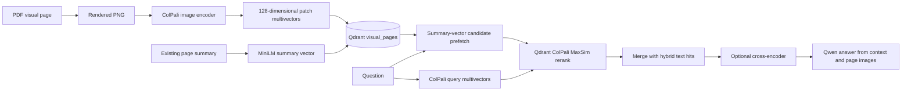

# ColPali implementation and Qdrant storage

Updated: 26 October 2026.

## Implemented design

ColPali is an optional visual retrieval path alongside the existing text/summary retrieval. Qwen3-VL remains the answer-generation model. ColPali processes actual rendered page pixels and query tokens to produce separate **128-dimensional multivectors**. The implementation never replaces these with a pooled image vector.

The encoder uses the official `vidore/colpali-v1.3-hf` checkpoint through Transformers `ColPaliForRetrieval` and `ColPaliProcessor`. The processor uses the trained `Query: ` prefix. Output vectors are normalized and checked for finite values and the expected dimension. CPU NF4 weight quantization is enabled by default to reduce model memory use.



## Qdrant collection

The existing local database at `indexes/multimodal_full/qdrant` holds both collections:

| Collection | Contents |
|---|---|
| `docs_text` | Existing text, table text, captions, dense vectors, and sparse vectors |
| `visual_pages` | One point per visual page, containing summary and ColPali vectors |

The visual schema is:

```python
vectors_config = {
    "summary": models.VectorParams(
        size=384, distance=models.Distance.COSINE, on_disk=True
    ),
    "colpali": models.VectorParams(
        size=128, distance=models.Distance.COSINE, on_disk=True,
        multivector_config=models.MultiVectorConfig(
            comparator=models.MultiVectorComparator.MAX_SIM
        ),
        hnsw_config=models.HnswConfigDiff(m=0),
    ),
}
```

The summary dimension is derived from the selected text encoder; 384 is the default MiniLM dimension. The collection requests on-disk payloads. There is no HNSW graph for the multivector field: it reranks a summary-prefetched candidate set. No Qdrant vector quantization is configured; NF4 quantizes model weights, not the stored output vectors.

Point IDs are deterministic: `UUID5(NAMESPACE_URL, "visual:domain:doc_id:page")`. Payloads carry the existing source metadata, page image path, full page summary, and first text chunk's `chunk_id`, plus `visual_point_id`, `colpali_model` (configuration signature), and `colpali_patches`. The source `chunk_id` remains usable by the existing citation and context-expansion logic.

## Query and lifecycle behavior

Visual search prefetches at least 30 candidates using the summary vector, then invokes Qdrant with the query multivector and `using="colpali"`. Qdrant MaxSim sums each query-token vector's maximum cosine similarity to any page vector. Domain, source/ticker/year metadata, and ColPali signature filters apply to this search.

Normal `LocalRAG.retrieve` merges text and visual hits by source chunk ID using rank contributions `1/(60 + rank)`, then applies the configured cross-encoder. Results expose `retrieval_paths`, `rrf_score`, and `colpali_score`. The existing answer-stage cross-encoder cutoff still applies. A visual-only method/endpoint returns MaxSim ranking directly.

Backfill groups existing visual chunks by document and page, reads the existing rendered PNGs, generates actual ColPali vectors, and upserts `visual_pages`. It does not regenerate Qwen captions or modify `docs_text`. Repeated runs skip pages already carrying the same ColPali signature; `--force` rebuilds them. This backfill currently gathers selected payloads in memory and targets a small corpus.

Ordinary ingestion also writes visual multivectors when ColPali is enabled. Document replacement and failed-ingestion cleanup remove matching points from both collections. Enabling ColPali changes the ingestion pipeline signature. Changing the ColPali model/quantization signature requires a fresh index directory rather than mixing incompatible embeddings.

## Prepare, write, inspect, and run

Run from the repository root using the project environment:

```powershell
uv pip install --python .venv/Scripts/python.exe "bitsandbytes>=0.48,<1"
.venv/Scripts/python.exe -m scripts.prepare_colpali

# Write existing page images into the same local Qdrant database.
.venv/Scripts/python.exe -m scripts.colpali_index backfill --domain financial_report_qa
.venv/Scripts/python.exe -m scripts.colpali_index status
.venv/Scripts/python.exe -m scripts.colpali_index query --domain financial_report_qa --query "Which quarter has the highest revenue in the chart?"

# Include ColPali in new PDF ingestion and normal multimodal API retrieval.
.venv/Scripts/python.exe -m scripts.run_local_multimodal ingest --colpali
.venv/Scripts/python.exe -m scripts.run_local_multimodal serve --colpali

# Real-checkpoint storage and MaxSim validation.
.venv/Scripts/python.exe -m scripts.evaluate_colpali
```

`python -m scripts.run_local_multimodal prepare --colpali` prepares both Qwen and ColPali. The official ColPali weight shards total approximately 5.85 GB, plus processor/tokenizer files. Downloads use persistent connections, verified byte ranges, per-chunk checksums for resuming interrupted runs, and final SHA-256 verification. Model files live under `indexes/models/colpali-v1.3-hf`.

The embedded Qdrant database must have one owning process; stop `serve` before backfill or inspection. ColPali backfill/query commands do not start Qwen. Model failures are surfaced; no synthetic vectors or caption-only substitutes are written as ColPali embeddings.

## Configuration and API

| Variable | Default when enabled through the ColPali launcher |
|---|---|
| `RAG_COLPALI_MODEL` | `<repo>/indexes/models/colpali-v1.3-hf` |
| `RAG_COLPALI_DEVICE` | `cpu` |
| `RAG_COLPALI_QUANTIZATION` | `4bit`; also accepts `8bit` or `none` |
| `RAG_DOWNLOAD_WORKERS` | 4 |
| `RAG_LOCAL_DIR` | `<repo>/indexes/multimodal_full` |

The optional `colpali` dependency extra declares bitsandbytes. Existing text-model, CPU-thread, storage, and Qdrant configuration also apply. CPU NF4 operation was checked with the installed runtime, but full checkpoint resource use and latency must be assessed from the actual model run.

`POST /multimodal/{domain}/visual/retrieve` accepts the existing multimodal query, `top_k`, and metadata filters. It returns `retriever="colpali_maxsim"`, count, and visual evidence with MaxSim scores. Unknown domains return 404; caught model/configuration errors return 503. Ordinary retrieval and chat include visual candidates when `RAG_COLPALI_MODEL` is set. Without it, the summary-only path remains available.

## Files and validation

| File | Responsibility |
|---|---|
| `scripts/domain_common/colpali_retrieval.py` | Actual checkpoint loading and image/query multivectors |
| `scripts/domain_common/multimodal_rag.py` | Both collections, backfill, query fusion, and cleanup |
| `scripts/prepare_colpali.py` | Official checkpoint preparation |
| `scripts/colpali_index.py` | Backfill, status, and visual-query CLI |
| `scripts/evaluate_colpali.py` | Actual vector writes, table/chart queries, idempotence, and reopen persistence |
| `tests/test_colpali_qdrant.py` | Real Qdrant integration using deterministic test vectors |

The integration change passes **104 regression tests**. The controlled-vector tests verify actual Qdrant storage, matrix dimensions, MaxSim arithmetic, filters, merge behavior, backfill deduplication, model signatures, persisted reopening, and failure/update cleanup. They do not measure checkpoint accuracy.

At the ColPali checkpoint validation run, the database contained **3 `docs_text` points and 2 `visual_pages` points**. The table and raster-only chart each have **1,030 vectors of 128 dimensions**. The budget query ranked the table first (MaxSim 18.9894), and the revenue query ranked the chart first (MaxSim 17.4377). Domain isolation, repeated-backfill skipping, and persistence after reopening passed. The subsequent [OCR validation](ocr_validation_results.md) adds three text-fixture points and enriches text/summary vectors while preserving those two ColPali matrices.

See [the actual ColPali validation report](colpali_validation_results.md) and `output/colpali_validation/results.json` for model-vector shapes, retrieval scores, and integration outcomes. The first write's original measurements are also retained at `output/colpali_validation/initial_write_results.json`. The earlier nine Qwen answer checks in [the main design document](multimodal_rag_design_and_implementation.md) are historical summary-only results, not ColPali accuracy results.

References: [official checkpoint and query prefix](https://huggingface.co/vidore/colpali-v1.3-hf), [Transformers ColPali API](https://huggingface.co/docs/transformers/model_doc/colpali), [Qdrant multivector reranking](https://qdrant.tech/documentation/tutorials-search-engineering/using-multivector-representations/).
