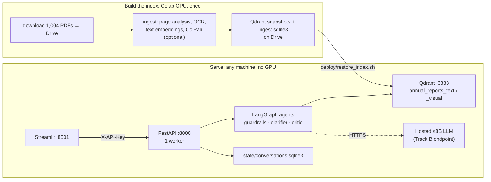
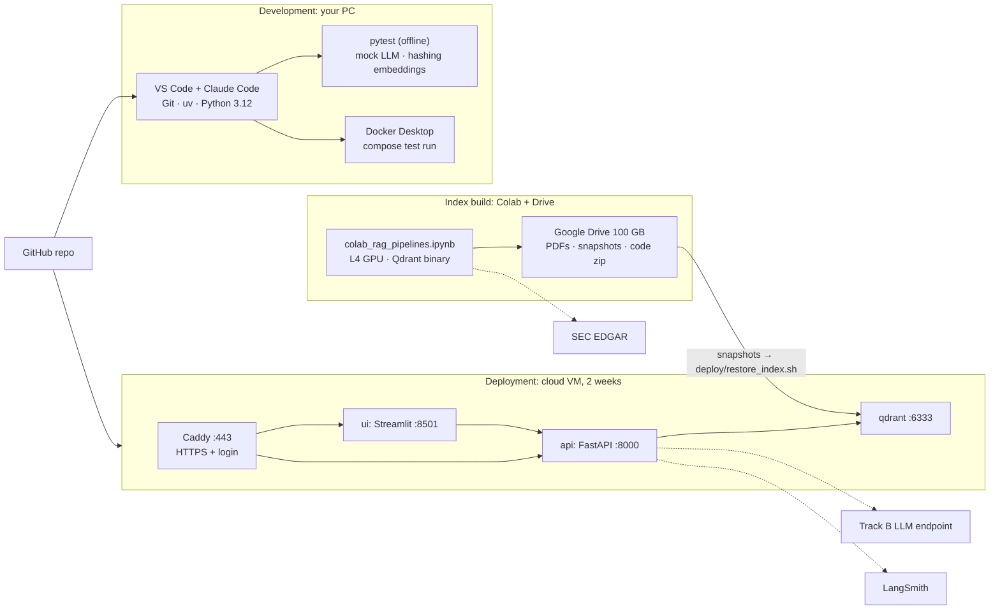

# Deploying the Annual Report Copilot: options, steps and costs

Date: 10 November 2026. Prices were read from the providers' pricing pages on 9–10 November 2026 unless marked otherwise. Infrastructure prices are third-party list prices; check them before you commit.

**Recommendation:**
- **Build the index on Colab** (GPU, batch).
- **Serve it with Docker Compose:** Qdrant + FastAPI + Streamlit on one machine without a GPU, using the Track B hosted LLM. Run this on a laptop for the demo, or on one small cloud VM for a public URL.
- **Expected spend:** about **$12–65** in total for the capstone, or $12 if the demo runs from a laptop.

---

## 1. What runs where



| Part | Runs on | GPU? | Notes |
|---|---|---|---|
| Streamlit | the serving machine | no | Only calls the API. Sends `API_AUTH_TOKEN` as `X-API-Key` |
| FastAPI + agents | the serving machine, **1 worker** | no | Rate limit, request IDs, answer cache and the 10-step agent cap |
| Conversation context | `indexes/state/conversations.sqlite3` | no | Survives restarts (`CONVERSATION_DB`). Stores only the clarifier slots, never answers |
| Qdrant | container next to the API | no | Must be the server, not embedded mode: embedded mode allows one process only |
| Query embedding, reranker | inside FastAPI, CPU | no | The index's model: bge-small (Pipeline 1 by default; or the shared embedding API, `RAG_EMBEDDING_PROVIDER=hosted`) or MiniLM; cached in `indexes/hf_cache` |
| Mutual fund data (optional) | `RAG_HOME/indexes/mutual_fund/` | no | SQLite holdings + Chroma fund cards (bge-small); read by the API's fund agent and `/mutual_fund/*` routes. A few MB per fund; build it on the serving machine (§7.4) |
| LLM | hosted endpoint | no (yours) | `LLM_API_BASE/KEY/MODEL` |
| ColPali, OCR on GPU, VLM | **only while building the index** | yes | Not needed to answer questions |

---

## 2. Deployment options

| Option | Use it for | What you need | Monthly cost | Drawbacks |
|---|---|---|---|---|
| **A. Laptop, Docker Compose** | Development, evaluation runs, the demo as a fallback | Docker Desktop, about 15 GB free disk | **$0** | Only you can reach it, unless you add a tunnel |
| **B. Laptop without Docker** | When Docker isn't available | the `uv` venv; Qdrant embedded or a local Qdrant server | $0 | Embedded Qdrant allows one process: fine for one API worker, but evaluation scripts can't read the index while the API runs |
| **C. Colab (`cp.serve`)** | A quick look right after ingesting | Colab session | Colab Pro **$9.99** (Pro+ $49.99) | Stops when the session ends; localhost only, so others need a tunnel |
| **D. One cloud VM, Compose + HTTPS (recommended for the demo URL)** | The graded "working deployed system" | Linux VM with 4 vCPU, 16 GB RAM, 50 GB disk, a domain name | **≈ $108** (GCP e2-standard-4 ≈ $98 + 100 GB disk ≈ $10); **≈ $50 for 2 weeks**. Text only: e2-standard-2 ≈ $49 | You patch the VM and keep the `.env` secret |
| E. VM + Qdrant Cloud | Managed database, several API servers | Qdrant Cloud cluster + `QDRANT_URL`, `QDRANT_API_KEY` | VM as D, plus the cluster. Qdrant doesn't publish a per-GB rate; use its calculator. The free tier (1 GB RAM / 4 GB disk) fits only a small text-only pilot | More moving parts; snapshots go over the internet |
| F. GPU VM running your own LLM | Only if you leave Track B's hosted model | e.g. 1× L4 GPU VM + vLLM | ≈ $500+ (estimate) | Expensive; Track B says to use the provided endpoint |

**Avoid serverless platforms** that start many short-lived copies (Cloud Run, Lambda). Each copy would reload the models, and keep its own rate limits, answer cache and in-memory state.

**Any cloud works for option D:** GCP, AWS, Azure, DigitalOcean and Hetzner all run the same `docker compose` files. Only the price differs.

---

## 3. How to deploy

**Order:** download the PDFs to Drive (§3.5, full or min500) → index on Colab → copy the index to the server (§3.4) → start the stack (§3.1).

### 3.1 With Docker Compose (options A and D)

Files: [Dockerfile](../Dockerfile), [docker-compose.yml](../docker-compose.yml), [.env.example](../.env.example), [deploy/Caddyfile](../deploy/Caddyfile) and [deploy/restore_index.sh](../deploy/restore_index.sh).

```bash
git clone <repo> && cd Capstone          # or unzip the code bundle
cp .env.example .env                     # LLM endpoint, API_AUTH_TOKEN, APP_UID/APP_GID (id -u / id -g)

# 1. The index. Copy from Drive (MyDrive/capstone_rag/snapshots/colpali_qdrant/) into ./snapshots
#    (on a VM: rclone or a GCS bucket, see 3.4):
#    annual_reports_text-*.snapshot (+ .json), annual_reports_visual-*.snapshot, ingest.sqlite3, pages/
docker compose up -d qdrant
docker compose run --rm --user root api sh deploy/restore_index.sh

# 2. Start everything
docker compose up -d --build
curl http://127.0.0.1:8000/health        # financial_backend should be financial_vlm (Chroma)
# UI: http://127.0.0.1:8501

# 3. On a VM with a domain (A record → the VM's IP): HTTPS + a login in front of the UI
#    set DOMAIN, BASIC_AUTH_USER, BASIC_AUTH_HASH in .env, open ports 80 and 443
docker compose --profile https up -d
```

**What the compose stack sets:**
- `RAG_PROFILE=server`, `QDRANT_URL=http://qdrant:6333` and `API_BASE_URL=http://api:8000`.
- Ports bind to `127.0.0.1` unless you set `BIND_ADDRESS`. On a VM, use the HTTPS profile rather than opening 8000 and 8501.
- **The image is CPU-only:** torch comes from the CPU wheel index, so no CUDA libraries are pulled in.

**Volumes:**
- `./indexes`: ingest state, Chroma for the five other domains, conversations, and the Hugging Face model cache.
- `./data/processed`: BM25 chunks for the Chroma domains.
- `qdrant_storage`: Qdrant's data.
- `qdrant_snapshots`: shared by the API and Qdrant at the same path, so a restore can hand Qdrant a file path.

**Updating the code:**
- `git pull && docker compose up -d --build`.
- The index and conversations live in volumes, so they stay.

### 3.2 Without Docker (option B)

```powershell
uv sync
$env:RAG_PROFILE="local"; $env:API_AUTH_TOKEN="..."; $env:CONVERSATION_DB="indexes/state/conversations.sqlite3"
$env:LLM_API_BASE="..."; $env:LLM_API_KEY="..."; $env:LLM_MODEL="..."; $env:DEFAULT_LLM_PROVIDER="hosted"
uvicorn scripts.api.api_app:app --host 127.0.0.1 --port 8000 --workers 1
streamlit run scripts\ui\api_streamlit_app.py     # second terminal, same environment
```

With only embedded Qdrant (`QDRANT_URL` unset), run just the API. Streamlit talks to the API, so it doesn't open the index itself.

### 3.3 Colab (option C)

Run `colab_rag_pipelines.ipynb` cells 9–12 (`cp.serve`). It uses the `colab` runtime profile.

### 3.4 Getting the index from Google Drive onto the VM

A VM **can't mount your Drive the way Colab does**: `drive.mount` only works inside Colab. The VM **copies** what it needs onto its own disk once, and Qdrant then restores from that local copy. Don't point Qdrant at a live Drive mount: it is slow and fails if the connection drops.

**What to copy:**

| Copy | From Drive | Size | Needed? |
|---|---|---|---|
| Qdrant snapshots + `.json` checksums | `capstone_rag/snapshots/colpali_qdrant/annual_reports_*.snapshot*` | ~2–3 GB text only, ~10 GB with ColPali (estimate) | **Yes**: this is the index |
| `ingest.sqlite3`, `pages/` | same folder | small | **Yes**: the list of indexed filings and the page analysis |
| PDFs | `capstone_rag/annual_reports/<sector>/*.pdf` | 11.3 GB | Only to show page images in citations |
| Code zip | `capstone_rag/capstone_code.zip` | 3.5 MB | No, if the VM runs `git clone` |

**Which method:**

| VM on | Use |
|---|---|
| **GCP** | **Option B (bucket):** no Drive login on the server, and the fastest transfer |
| AWS, Azure or another cloud | **Option A2 (service account)**, or Option A1 (a one-time browser approval) |

#### Option A1: rclone with your Google login (any cloud)

rclone talks to the Drive API. The VM has no browser, so you approve the login once on your PC.

```bash
# On the VM
curl https://rclone.org/install.sh | sudo bash          # Ubuntu's apt version is often old
rclone config
#   n (new remote) → name: gdrive → storage: drive
#   client_id / client_secret: blank
#   scope: drive.readonly                               (read-only is enough)
#   service_account_file: blank → advanced config: n
#   "Use auto config?": n   → it prints:  rclone authorize "drive" "eyJ..."
```

```powershell
# On your PC (it has a browser)
winget install Rclone.Rclone
rclone authorize "drive" "eyJ..."      # sign in with the Drive account, then copy the token it prints
```

```bash
# Back on the VM: paste the token, finish the config, then copy
rclone lsd gdrive:capstone_rag                          # check access
rclone copy gdrive:capstone_rag/snapshots/colpali_qdrant /opt/copilot/snapshots -P --transfers 4
# optional, for citation page images:
# rclone copy gdrive:capstone_rag/annual_reports /opt/copilot/data/raw/financial_report_qa/annual_reports -P
cd /opt/copilot && docker compose up -d qdrant
docker compose run --rm --user root api sh deploy/restore_index.sh
```

rclone checks each copied file against Drive's MD5 checksum. The restore script then checks every snapshot against the SHA-256 in its `.json` file.

#### Option A2: rclone with a service account (no personal login on the VM)

1. In the Google Cloud console, create a service account and download a JSON key to `/opt/copilot/secrets/sa.json` (`chmod 600`).
2. In Drive, **share the `capstone_rag` folder** with the service account's e-mail address as **Viewer**.
3. In `rclone config`, set `service_account_file = /opt/copilot/secrets/sa.json` and scope `drive.readonly`.
4. A shared folder appears under "Shared with me", so add the flag:

```bash
rclone copy gdrive:capstone_rag/snapshots/colpali_qdrant /opt/copilot/snapshots --drive-shared-with-me -P
```

The VM then sees only that one folder. Delete the key when the project ends.

#### Option B: Google Cloud Storage bucket (GCP VMs)

Copy from Drive to a bucket inside Colab, where Drive is already mounted. The VM then reads the bucket with its own built-in identity, with no OAuth step.

```python
# Colab cell, after ingestion
from google.colab import auth; auth.authenticate_user()
!gcloud storage buckets create gs://capstone-rag-<yourname> --location=us-central1   # once
!gcloud storage cp -r /content/drive/MyDrive/capstone_rag/snapshots/colpali_qdrant gs://capstone-rag-<yourname>/snapshots/
```

```bash
# On the GCP VM (needs read-only storage access; the default service account has it)
gcloud storage cp -r "gs://capstone-rag-<yourname>/snapshots/colpali_qdrant/*" /opt/copilot/snapshots/
cd /opt/copilot && docker compose up -d qdrant
docker compose run --rm --user root api sh deploy/restore_index.sh
```

Copying from a bucket to a VM in the same region should be the fastest option. Storing ~20 GB costs well under $1 a month at standard bucket prices (check the current rate). Put the bucket in the VM's region.

#### Option C: manual download and upload (last resort)

Download from the Drive website to your PC, then copy the files to the VM with `scp -r snapshots/ user@<vm-ip>:/opt/copilot/`. This is fine for the code zip. For 10–20 GB it depends on your home upload speed and can take hours.

`gdown` (a shared-link downloader) works for single files but is unreliable for large folders and hits Drive's download limits. Don't use it for the snapshots.

**Security, whichever option:**
- Use read-only access (`drive.readonly`, bucket viewer).
- Keep `~/.config/rclone/rclone.conf` and any service-account key out of Git, with `chmod 600`.
- Revoke the rclone token, or delete the key or bucket, after grading.

### 3.5 Downloading the corpus to Google Drive on Colab: full or min500

This is the first step of everything else: the PDFs go from SEC EDGAR to your Drive. Use [notebooks/colab_rag_pipelines.ipynb](../notebooks/colab_rag_pipelines.ipynb) and run **only cells 1–4** (cell 5 starts indexing), then cell 6b to check.

| | **full load** | **min500 load** |
|---|---|---|
| `CORPUS` in cell 1 | `"full"` | `"min500"` |
| Filings | 1,004 | 509 |
| Companies / sectors | 281 / 13 | 143 / 13 |
| Download size (Drive space needed) | 11.3 GB (keep ~12 GB free) | 5.36 GB (keep ~6 GB free) |
| Time (estimate) | ~30–60 min | ~15–30 min |
| Cell 4 first line | `1004 selected, 0 already downloaded, 1004 to fetch (11.30 GB)` | `509 selected, 0 already downloaded, 509 to fetch (5.36 GB)` |
| Cell 6b coverage, before indexing | planned 1004 / downloaded 1004 / ingested 0 | planned 509 / downloaded 509 / ingested 0 |
| List of filings | `--preset full` report | [corpus_min500.html](corpus_min500.html) |

**min500** is the 41 largest filings per sector plus every filing of the companies the frozen eval set asks about: Track B's 500-document minimum, with no eval question losing its source. You can start with min500 and switch to full later. The download skips files already on Drive, so it fetches only the other 495.

#### Before opening Colab (on your PC)

1. **Rebuild the code zip and upload it:** run `python -m scripts.common.colab_bundle` in the repo, then upload `output/colab/capstone_code.zip` to Drive as **`MyDrive/capstone_rag/capstone_code.zip`**, replacing any older copy. The corpus presets are only in the latest code.
2. **Open the notebook:** in Colab, **File → Upload notebook →** `notebooks/colab_rag_pipelines.ipynb`.
3. **Runtime:** **Runtime → Change runtime type → CPU** is enough to download. Use an L4 GPU only for indexing (cell 5), later.

#### Cells to run

| Cell | What to do | What happens |
|---|---|---|
| **1. Settings** | `CORPUS = "full"` or `"min500"`; **`MAX_PER_SECTOR = 0`**; **`SMOKE_TEST = False`**; `SECTORS = ""` (all 13); **`SEC_USER_AGENT`** = your name and e-mail, e.g. `"capstone-research yourname@gmail.com"` | Stores the settings |
| **2. Drive, code, dependencies** | Run it and allow Drive access | Mounts Drive, unpacks the code zip to `/content/Capstone`, installs packages (2–4 min). Check that the printed `BUNDLE_INFO` `built_at` is your new zip |
| **3. Settings object, Qdrant server, restore** | Run it | Builds the settings with `corpus_preset`, creates the Drive folders. Starting Qdrant and "nothing to restore" are harmless here |
| **4. Download** | Run it | Downloads from SEC EDGAR to `MyDrive/capstone_rag/annual_reports/<sector>/`, then prints each sector folder's size |
| **6b. Coverage** | Run it | Planned → downloaded → ingested by sector (ingested stays 0 until cell 5) |

**`SMOKE_TEST = False` is essential.** With `True`, cell 3 limits the download to 2 filings per sector: 26 PDFs.

#### Result on Drive

```
MyDrive/capstone_rag/annual_reports/
    corpus_plan.jsonl            the full 1,004-row plan (copied)
    pdf_manifest.jsonl           every downloaded filing
    download_summary.json        counts, seconds, failures
    banking/pdf_manifest.jsonl   banking/EDGAR_ARS_JPM_2025.pdf ...
    ... 13 sector folders
```

Each manifest row records the SHA-256, page count, size, accession number and EDGAR URL. Indexing and the API read these manifests.

#### Optional checks (add a cell)

```python
# Preview the selection without downloading
!cd /content/Capstone && python -m scripts.downloads.download_annual_report_corpus --preset {CORPUS} --dry-run --output-dir {DRIVE_ROOT}/annual_reports

# Count the PDFs on Drive (expect 509 or 1004)
!find {DRIVE_ROOT}/annual_reports -name "*.pdf" | wc -l
```

#### Without the notebook (any machine with the repo)

```bash
python -m scripts.downloads.download_annual_report_corpus --preset min500 --output-dir <folder> --user-agent "name email@domain"
python -m scripts.downloads.download_annual_report_corpus --preset full   --output-dir <folder> --user-agent "name email@domain"
```

#### If something goes wrong

| Problem | Fix |
|---|---|
| Disconnected, or `N failed; rerun to retry them` | Run cells 2 → 3 → 4 again. Files already there with the right size are skipped; only missing or failed ones are fetched (`download_summary.json` lists failures) |
| `SEC requires a contact e-mail` | `SEC_USER_AGENT` in cell 1 must contain an `@` |
| HTTP 429 / 503 from SEC | Handled: the script backs off and retries, at most 8 requests per second |
| `unexpected keyword argument 'corpus_preset'` | Drive has an old code zip. Rebuild it, upload it again, rerun cell 2 |
| Only 26 PDFs | `SMOKE_TEST` was `True`. Set it to `False` and rerun cells 1, 3 and 4 |
| Drive full | Free the space in the table above, or upgrade (Google One 100 GB ≈ $1.99/month) |

**After cell 4:** wait a few minutes before ending the runtime, so Drive finishes saving the files. Anything not saved is downloaded again the next time cell 4 runs.

**Next:** to index, switch the runtime to an **L4 GPU**, run cells 1–3 with the same `CORPUS`, then **cell 5**. Snapshots go to Drive after each sector, and section 3.4 brings them to the VM.

---

## 4. Settings

Every setting is an environment variable. [.env.example](../.env.example) lists all of them with comments.

| Variable | Default | Purpose |
|---|---|---|
| `LLM_API_BASE`, `LLM_API_KEY`, `LLM_MODEL` | — | Hosted chat model |
| `DEFAULT_LLM_PROVIDER` / `DEFAULT_EMBEDDING_PROVIDER` | `mock` / `hashing` | What requests and the UI use when they don't say. Set `hosted` for the demo |
| `API_AUTH_TOKEN` | empty (open) | Required key for every route except `/health` and `/docs`. **Set it on any shared server** |
| `RATE_LIMIT_PER_MINUTE` | 60 | Per client IP. Behind Caddy, the real IP comes from `X-Forwarded-For` (`--proxy-headers`) |
| `CORS_ALLOW_ORIGINS` | `*` | Browser origins allowed to call the API |
| `ANSWER_CACHE_SECONDS` | 0 (off); 600 in `.env.example` | Reuse the answer to an identical question. Failures are never cached |
| `AGENT_MAX_STEPS` | 10 | LangGraph node executions per question. Above the cap the run stops with `step_limit` and no answer |
| `CONVERSATION_DB`, `CONVERSATION_TTL_SECONDS` | server profile: `indexes/state/conversations.sqlite3`; 1800 | Clarification state that survives restarts |
| `RAG_PROFILE` | `local` (Colab detected) | `local`, `server` (Docker or VM) or `colab` |
| `RAG_BACKEND` | automatic | `financial_vlm` (pipeline 1, Chroma) when `chroma_db` holds an index, else `financial_qdrant`, else the older Chroma index. Set `financial_qdrant` or `financial_hybrid` to test those |
| `QDRANT_URL`, `QDRANT_API_KEY` | server: `http://qdrant:6333` | Qdrant server, or Qdrant Cloud |
| `RAG_RERANKER_MODEL`, `RAG_MIN_RERANK_SCORE` | off | Cross-encoder rerank and the "don't answer below this score" floor |
| `LANGSMITH_TRACING`, `LANGSMITH_API_KEY`, `LANGSMITH_PROJECT` | off | Trace dashboard for the submission |
| `API_BASE_URL`, `API_TIMEOUT_SECONDS`, `UI_SHOW_ADVANCED` | — | Streamlit |

**How coverage reaches the UI:**
- The API knows which companies and years it can answer from the served index's `ingest.sqlite3`, even when the PDFs stay on Drive.
- `GET /companies` lists them with names, sectors and years.
- The Streamlit ticker and year pickers are built from that list.

---

## 5. Costs

### 5.1 How many pages need a vision model (measured)

All 14,701 pages of the 100 local filings were classified with the ingest's own page analysis (`financial_ingest_qdrant_db.analyse_page`). The results are scaled to the 1,004-filing plan at 147 pages per filing, about **147,600 pages**.

| Page type | Share (measured) | Pages in the full corpus (estimate) |
|---|---|---|
| Text or blank | 68.9% | 101,700 |
| Table (text layer present) | 10.4% | 15,300 |
| Chart or image | 7.7% | 11,300 |
| Unreadable text (garbled, font-encoding garbage, outlined) | 13.1% | 19,300 |
| **No usable text: charts, images and unreadable** | **20.7%** | **30,600** |
| No usable text + tables | 31.1% | 45,900 |
| ColPali pages (`tables_charts_images`) | 18.0% | 26,600 |

**Caveat:** the 100 filings come from 25 large companies. Other sectors may have more charts. Re-measure after the first sectors are ingested with `cp.status`.

**This replaces earlier estimates.** The structure doc assumed 44–75% visual pages. With 18%:
- **ColPali full vectors:** ~**7 GB** on disk, not 17–29 GB.
- **Pooled vectors:** ~**0.5 GB** in RAM.
- **VLM pipeline:** ~46k pages to transcribe, not ~89k.

### 5.2 Building the index on Colab (one-off)

These times are **estimates** from earlier measurements on 4 filings (CPU and T4). The first full sector replaces them.

| Step | Work | Time on Colab (estimate) |
|---|---|---|
| Download | 11.3 GB from EDGAR | about 30–60 min (4.1 MB/s measured from a PC) |
| Page analysis | 147,600 pages × ~0.5 s CPU, 8 workers | ~2.5 h |
| OCR of unreadable pages | 19,300 pages × ~0.4 s (GPU) to 4 s (CPU) | 2–20 h |
| Text embeddings | ~450k chunks at ~800/s on GPU | ~10 min |
| ColPali (optional) | 26,600 pages at 1–3 pages/s on an L4 | 2.5–7.5 h |

| Plan | Total | Cost |
|---|---|---|
| Text + OCR only, L4 | ~5–8 h | ~10–20 compute units: inside **Colab Pro $9.99** (100 units) |
| Text + OCR + ColPali, L4 | ~8–15 h | ~15–40 units: inside Colab Pro |
| VLM pipeline, open model on Colab (vLLM, ~46k pages) | ~5–25 h depending on model size and GPU | Pro, plus perhaps one $9.99 top-up |

**Burn rates** are as reported by third-party sources: L4 about 1.7–2.5 units/h, A100 about 5–15 units/h. Pro+ ($49.99) mainly adds background execution, so a run survives a closed browser tab.

### 5.3 Closed vision models for the pages without text

This applies only if you choose a closed model instead of the open VLM. Prices are **Batch API** rates (50% of standard), because ingestion is offline work. Totals assume per page:
- **Typical:** 1,500 input tokens (page image + prompt) and 800 output tokens (Markdown).
- **High:** 2,500 in and 1,500 out, for dense tables and larger image token counts.

Image tokenisation differs by vendor. Measure 20 pages before trusting the totals.

| Model | Batch $/M tokens (in / out) | $ per 1,000 pages (typical) | **No-text pages only** (30,600) | With tables (45,900) |
|---|---|---|---|---|
| Claude Haiku 5.5 | $0.05 / $0.25 | $0.28 | **$8 – $15** | $13 – $23 |
| GPT-5.6 Luna | $0.10 / $0.60 | $0.63 | $19 – $35 | $29 – $53 |
| Gemini 3.1 Flash-Lite | $0.125 / $0.75 | $0.79 | $24 – $44 | $36 – $66 |
| Gemini 3.5 Flash-Lite | $0.15 / $1.25 | $1.23 | $37 – $69 | $56 – $103 |
| Gemini 3.8 Flash (to 31 Dec 2026) | $0.375 / $1.875 | $2.06 | $63 – $115 | $95 – $172 |
| Gemini 3.8 Flash (from 1 Jan 2027) | $0.75 / $3.75 | $4.12 | $126 – $230 | $189 – $344 |
| GPT-5.4 mini | $0.375 / $2.25 | $2.36 | $72 – $132 | $108 – $198 |
| Claude Sonnet 5.5 | $1 / $5 | $5.50 | $168 – $306 | $252 – $459 |
| GPT-5.6 Terra | $1 / $6 | $6.30 | $193 – $352 | $289 – $528 |
| Claude Opus 5.5 | $2 / $10 | $11.00 | $337 – $612 | $505 – $918 |
| Gemini 4 Argon (from 1 Dec 2026) | $2 / $10 | $11.00 | $337 – $612 | $505 – $918 |
| GPT-5.6 Sol (promotional to 30 Nov) | $2 / $10 | $11.00 | $337 – $612 | $505 – $918 |

**Which closed model is most accurate:** no independent benchmark compares these exact models on annual-report tables and charts, so don't pick on price alone. Run a 100-page pilot: 30 tables, 30 charts and 40 unreadable pages, with one model from each price band. Score how many printed numbers come back exactly. The pipeline already flags numbers the text layer doesn't contain (`unverified_numbers`). Then pick the cheapest model within about 1–2 points of the best.

**Track B caution:** the template says teams "cannot swap in a frontier model". Using one *only to transcribe pages at ingest time* is arguable but not obviously allowed. **Ask the mentor before spending.** The open-VLM or OCR path avoids the question.

### 5.4 Answering questions: LLM cost per 1,000 questions

Assumes about 3 LLM calls per question (plan, answer, critic): ~10,000 input and ~1,500 output tokens. Standard (not batch) prices.

| Model | $ per 1,000 questions |
|---|---|
| **Track B hosted endpoint** | **provided** (team token quota) |
| Claude Haiku 5.5 | $1.75 |
| GPT-5.6 Luna | $3.80 |
| Gemini 3.1 Flash-Lite | $4.75 |
| Gemini 3.8 Flash (2026 price) | $13.12 |
| Claude Sonnet 5.5 | $35.00 |
| GPT-5.6 Terra | $38.00 |
| Claude Opus 5.5 | $70.00 |

The evaluation is 86 questions × about 6 configurations (3 baselines, RAG only, the full agent, ablations), roughly 500 runs. That costs well under $5 even on a mid-priced model. With the Track B endpoint it only uses quota. `ANSWER_CACHE_SECONDS` keeps repeated demo questions free.

### 5.5 Storage

| Item | Size | Where | Cost |
|---|---|---|---|
| PDFs | 11.3 GB | Drive | Google One 100 GB ≈ $1.99/month; 2 TB ≈ $9.99. Local prices differ, e.g. in India |
| Qdrant snapshots (text ~2–3 GB, visual ~7 GB; rotation keeps up to 2×) | ~10–20 GB | Drive | as above |
| Served index on the VM | ~10–15 GB with ColPali, ~3 GB text only | VM disk | included in option D's 50–100 GB disk |

With the measured page mix, **100 GB of Drive is enough**. 2 TB is only needed if you also keep VLM caches and several index versions.

### 5.6 Total for the capstone

| Scenario | Index build | Storage | Serving | LLM | **Total** |
|---|---|---|---|---|---|
| Lean: open models, demo from a laptop | Colab Pro $9.99 | Drive 100 GB $1.99 | $0 | Track B quota | **≈ $12** |
| **Recommended: plus a public VM for 2 weeks** (all components: §6) | $9.99 | $1.99 | ≈ $50 | Track B quota | **≈ $62** |
| Plus a cheap closed VLM on the no-text pages | $9.99 | $1.99 | ≈ $50 | + $8–44 | **≈ $70–106** |
| Plus a mid-tier closed VLM, tables included | $9.99 | $1.99 | ≈ $50 | + $95–198 | **≈ $157–260** |
| **509-filing variant**, public server for 2 weeks (§5.7) | $9.99 | $1.99 | ≈ $25 | Track B quota | **≈ $37** |

### 5.7 Variant: 509 filings (the 500-document minimum)

This variant indexes 509 filings: the largest companies, 41 filings per sector, plus every Adobe and Salesforce filing, so all 42 filings the frozen eval set uses are included. The selection is explained in [capstone_implementation_plan.md](capstone_implementation_plan.md) section 10. Choose it with `CORPUS = "min500"` in the Colab notebook, or `--corpus-preset min500` on the command line.

| Item | 1,004 filings | **509 filings** |
|---|---|---|
| PDFs | 11.3 GB | **5.36 GB** |
| Pages | ~147,600 | **~74,800** |
| No-text pages (charts, images, unreadable) | ~30,600 | **~15,500** |
| No-text + tables | ~45,900 | **~23,300** |
| ColPali pages / full vectors | ~26,600 / ~7 GB | **~13,500 / ~3.6 GB** |
| Colab, text + OCR (L4) | ~5–8 h | **~2.5–3.5 h** (one session) |
| Colab, + ColPali | ~8–15 h | **~4–7 h** |
| Server | 4 vCPU / 16 GB / 100 GB (≈ $50 for 2 weeks) | **2 vCPU / 8 GB / 50 GB** (GCP e2-standard-2: ≈ $23 + disk ≈ $2.5 ≈ **$25**) |
| Drive | 100 GB plan | 100 GB plan (the free 15 GB is too tight once snapshots and their rotation copies are added) |

**Closed vision model on the ~15,500 no-text pages** (batch prices, typical – high, as in §5.3):

| Model | No-text pages only | With tables (~23,300) |
|---|---|---|
| Claude Haiku 5.5 | $4 – $8 | $6 – $12 |
| GPT-5.6 Luna | $10 – $18 | $15 – $27 |
| Gemini 3.1 Flash-Lite | $12 – $22 | $18 – $34 |
| Gemini 3.8 Flash (to 31 Dec 2026) | $32 – $58 | $48 – $87 |
| Claude Sonnet 5.5 | $85 – $155 | $128 – $233 |
| Claude Opus 5.5 / Gemini 4 Argon / GPT-5.6 Sol | $171 – $310 | $256 – $466 |

**Total for the capstone with 509 filings:**

| Scenario | Index build | Storage | Serving | LLM | **Total** |
|---|---|---|---|---|---|
| Demo from a laptop | Colab Pro $9.99 | Drive 100 GB $1.99 | $0 | Track B quota | **≈ $12** |
| **Public server for 2 weeks** | $9.99 | $1.99 | ≈ $25 | Track B quota | **≈ $37** |
| Plus a cheap closed VLM on the no-text pages | $9.99 | $1.99 | ≈ $25 | + $4–22 | **≈ $41–59** |

The page counts scale the measured page mix (§5.1). Times are estimates. Server prices are third-party list prices.

---

## 6. Recommended setup: every component for development and deployment

This is the **"Recommended: plus a public VM for 2 weeks" (≈ $62)** scenario from §5.6:
- you develop on your PC;
- you build the index on Colab;
- the graded demo runs on one cloud VM for the last two weeks.



### 6.1 Accounts and external services

| Component | Used for | Dev | Deploy | Cost (2 weeks) |
|---|---|---|---|---|
| GitHub repository (private) | Code, history, the submission link; the VM pulls from it | ✓ | ✓ | free |
| Google account + **Google One 100 GB** | Drive: PDFs (11.3 GB), Qdrant snapshots, code zip | ✓ | ✓ (snapshots copied to the VM) | $1.99/month |
| rclone (or a GCS bucket on GCP) | Copying the snapshots from Drive to the VM (§3.4) | — | ✓ | free (bucket well under $1/month) |
| **Colab Pro** | GPU for ingestion (L4), longer sessions | ✓ | — | $9.99/month |
| SEC EDGAR | Downloading the 1,004 PDFs and XBRL facts. Needs a contact e-mail in `SEC_USER_AGENT`, ≤ 10 requests/s | ✓ | — | free |
| **Track B LLM endpoint** (+ embeddings endpoint) | All answers: `LLM_API_BASE/KEY/MODEL` | ✓ | ✓ | team quota |
| **LangSmith** | Traces, evaluation experiments, the trace dashboard for the submission | ✓ | ✓ | free developer tier |
| **Cloud account** (GCP, AWS, Azure, …) with billing | The VM | — | ✓ | ≈ $50 (§6.6) |
| Hostname for HTTPS | Caddy gets a Let's Encrypt certificate for it | — | ✓ | free with `<vm-ip>.sslip.io`, or ~$10–15/year for your own domain |
| Hugging Face Hub (no account needed) | Model downloads: MiniLM, reranker, ColPali | ✓ | ✓ (first start; then cached) | free |

### 6.2 Development workstation (your PC)

| Component | Version / setting | Purpose |
|---|---|---|
| Windows 11 + PowerShell | — | Current environment |
| Python | 3.12 | Runtime (`requires-python >= 3.12`) |
| **uv** | latest | `uv sync` builds `.venv` from `uv.lock` |
| Git | any recent | Version control; `scripts.common.colab_bundle` uses it to build the code zip |
| VS Code + Claude Code | — | Editing, running and debugging |
| **Docker Desktop** | with Compose v2 | **To install:** test the compose stack locally before the VM (the image hasn't been built yet) |
| JupyterLab | from `pyproject.toml` | Running notebooks locally |
| Local test setup | `pytest tests --basetemp tmp/pt` | 341 offline tests; mock LLM, hashing embeddings, no network |
| Local index folders | `indexes/` (Chroma for 5 domains, models), `data/processed/` | Development without Colab |

### 6.3 Software stack (same in development and the container)

Versions are the ones locked in `uv.lock`. The container installs the `pyproject.toml` ranges, with torch from the CPU wheel index.

| Layer | Component | Version | Role |
|---|---|---|---|
| UI | Streamlit | 1.66.1 | Chat, pickers, citations, tables and charts |
| API | FastAPI | 0.162.0 | Routes, OpenAPI docs, auth, rate limit, answer cache |
| API | Uvicorn | 0.54.0 | ASGI server, **1 worker**, `--proxy-headers` |
| Contracts | Pydantic | 2.14.0 | Request and response models, tool schemas, `FinancialAnswer` |
| Agents | LangGraph | 1.2.14 | Agent graphs (planner → executor → critic, 10-step cap) |
| Agents | LangChain / langchain-core | 1.4.4 / 1.6.9 | Messages, prompts, text splitters, tools |
| Observability | LangSmith SDK | 0.14.7 | Tracing (`LANGSMITH_TRACING=true`) |
| Vector DB client | qdrant-client | 1.20.0 | Hybrid search (dense + BM25 sparse, RRF) |
| Vector DB (other domains) | ChromaDB | 1.5.9 | Older Chroma index for the five non-financial domains |
| Lexical | rank-bm25 | 0.2.2 | BM25 for the Chroma domains |
| Embeddings / rerank | sentence-transformers | 5.7.0 | MiniLM query embeddings, cross-encoder rerank |
| Models runtime | transformers / torch (CPU) | 4.57.6 / 2.14.1 | ColPali and VLM at build time; CPU inference when serving |
| PDF | PyMuPDF | 1.28.2 | Page text, tables, rendering page images for citations |
| OCR | RapidOCR + onnxruntime | 3.10.0 / 1.31.0 | Unreadable pages (build time) |
| Reports | ReportLab | 4.5.1 | Report PDF |
| Data | pandas | 3.0.6 | Evaluation tables |
| Tests | pytest | 9.1.1 | Offline test suite |

### 6.4 Models

| Model | Where it runs | When | Size / note |
|---|---|---|---|
| **Track B hosted LLM (≤ 8B)** | Hosted endpoint | Every question | No GPU on our side |
| `sentence-transformers/all-MiniLM-L6-v2` | Colab (build) and the API container (queries) | Build + serving | 384-d; ~90 MB; must be the same model at build and query time |
| `cross-encoder/ms-marco-MiniLM-L-6-v2` | API container | Serving (when `RAG_RERANKER_MODEL` is set) | ~90 MB, CPU |
| `vidore/colpali-v1.3-hf` | Colab GPU | Build only (optional visual pages) | ~3B parameters; serving uses it only if `RAG_FIN_VISUAL=1` |
| RapidOCR detection and recognition models | Colab | Build only | Bundled with `rapidocr` |
| Qwen2.5-VL-3B (or a closed vision model) | Colab / API | Build only, pipeline 1 | Optional; see §5.3 |

### 6.5 Index build environment (Colab)

| Component | Setting |
|---|---|
| Notebook | [notebooks/colab_rag_pipelines.ipynb](../notebooks/colab_rag_pipelines.ipynb) (`PIPELINE=colpali_qdrant`, `SMOKE_TEST=False`) |
| Runtime | **L4 GPU**, High-RAM; background execution needs Pro+ |
| Code | `MyDrive/capstone_rag/capstone_code.zip` (from `python -m scripts.common.colab_bundle`) |
| Vector DB | Qdrant server binary on the Colab VM (`127.0.0.1:6333`), started by the notebook |
| Inputs | `corpus_plan.jsonl` (1,004 rows) → PDFs on Drive `annual_reports/<sector>/` |
| Outputs to keep | Drive `snapshots/colpali_qdrant/`: `annual_reports_text-*.snapshot`, `annual_reports_visual-*.snapshot` (+ `.json` checksums), `ingest.sqlite3`, `pages/` |
| Check | `cp.coverage(s)`: 1,004 planned → downloaded → ingested |

### 6.6 Deployment VM: 2 weeks

| Component | Setting |
|---|---|
| **VM** | 4 vCPU, 16 GB RAM, e.g. GCP `e2-standard-4` (us-central1, ≈ $0.134/hour). **509-filing variant:** 2 vCPU / 8 GB (`e2-standard-2`) |
| Disk | 100 GB balanced SSD (509-filing variant: 50 GB): images ~5 GB, Qdrant ~10–15 GB with ColPali (~3 GB text only), model cache ~1 GB, snapshots during restore |
| OS | Ubuntu 24.04 LTS |
| Container runtime | Docker Engine + Compose plugin |
| Firewall | Inbound **22** (SSH, your IP only), **80** and **443** (Caddy). 8000, 8501 and 6333 are **not** opened |
| Static IP + DNS | A reserved external IP; hostname `<ip>.sslip.io` or your domain's A record |
| Code | `git clone` of the repo (or the code zip) in `/opt/copilot` |
| Secrets | `/opt/copilot/.env` (chmod 600): `LLM_API_*`, `API_AUTH_TOKEN`, `LANGSMITH_API_KEY`, `BASIC_AUTH_HASH`. Never in Git |
| Index | Snapshots copied from Drive to `./snapshots` with rclone (any cloud) or through a GCS bucket (GCP), then `deploy/restore_index.sh`. See §3.4 |

**Containers** (from [docker-compose.yml](../docker-compose.yml)):

| Service | Image | Port | Volumes | Health check |
|---|---|---|---|---|
| `qdrant` | `qdrant/qdrant` (pin to the Colab version or newer) | 6333 (internal) | `qdrant_storage`, `qdrant_snapshots` | TCP 6333 |
| `api` | `annual-report-copilot` (built from `Dockerfile`, CPU) | 8000 (localhost only) | `./indexes`, `./data/processed`, `./snapshots` (read-only), `qdrant_snapshots` | `GET /health` |
| `ui` | same image | 8501 (localhost only) | same | `GET /_stcore/health` |
| `caddy` (`https` profile) | `caddy:2.8` | **80, 443** | `deploy/Caddyfile`, `caddy_data` (certificates) | — |

**Operations on the VM:**

| Concern | How |
|---|---|
| Start / update | `docker compose --profile https up -d --build` after `git pull` |
| Logs | `docker compose logs -f api ui` (request IDs, no bodies or prompts) |
| Health | `https://<host>/api/health` (public), the container health checks |
| Traces | LangSmith project `annual-report-copilot` |
| Backups | The index is rebuilt from the Drive snapshots; conversations (`indexes/state`) are disposable |
| Security | `API_AUTH_TOKEN` on the API, a basic-auth login on the UI, HTTPS only, SSH by key |
| Shutdown after grading | `docker compose down`, then delete the VM **and its disk and reserved IP**, or billing continues |

**VM cost for 14 days:** 0.134 × 24 × 14 ≈ **$45** compute + ≈ **$5** disk = **≈ $50**. Using it only from 18 to 25 November, plus a few days' buffer for grading, keeps it there.

### 6.7 Complete bill of materials

| # | Item | Phase | Cost |
|---|---|---|---|
| 1 | GitHub repository | Dev + deploy | $0 |
| 2 | PC with Python 3.12, uv, Git, VS Code, Docker Desktop | Dev | $0 |
| 3 | Google One 100 GB (Drive) | Build + deploy | $1.99 |
| 4 | Colab Pro (L4 GPU) | Build | $9.99 |
| 5 | SEC EDGAR access (contact e-mail) | Build | $0 |
| 6 | Track B LLM + embeddings endpoint | Dev + deploy | quota |
| 7 | LangSmith developer account | Dev + deploy | $0 |
| 8 | Cloud VM 4 vCPU / 16 GB / 100 GB, 14 days | Deploy | ≈ $50 |
| 9 | Hostname (`sslip.io`) + Let's Encrypt certificate via Caddy | Deploy | $0 (own domain ~$10–15/year) |
| 10 | Open-source stack (§6.3) and models (§6.4) | All | $0 |
| | **Total** | | **≈ $62** |

---

## 7. Paths and storage: local PC, Colab with Google Drive, and GCP

**Implemented on 13 November 2026** (the plan of 11 November). One module, [`scripts/common/storage.py`](../scripts/common/storage.py), defines the folders for every environment. [`runtime_profile.py`](../scripts/common/runtime_profile.py) (serving) and [`colab_pipeline.py`](../scripts/rag/colab_pipeline.py) (ingestion) both read it, so what an ingest writes is what the API serves. Tests: `tests/test_storage_layout.py`, `tests/test_runtime_profile.py`.

### 7.1 One layout everywhere, one root per environment

```
<RAG_HOME>/                              live copy, on fast local disk
  annual_reports/<sector>/*.pdf          ingestion only (Colab stages each sector here from Drive)
  indexes/qdrant_db/                     pipeline 2: ingest.sqlite3, pages/, qdrant_embedded/ (local)   = RAG_INGEST_DIR
  indexes/chroma_db/                     pipeline 1: chroma/ (+ bm25.sqlite3), vlm_ingest.sqlite3, pages/ = RAG_VLM_DIR
  snapshots/qdrant_db/                   Qdrant snapshots + ingest.sqlite3, for restore on another machine
  cache/vlm_pages/                       OCR / Qwen3-VL / paid page readings (never paid twice)
  cache/hf/                              HF_HOME on Colab
  models/                                local model copies (cross-encoder reranker)
  page_audit/<sector>/*.csv
  indexes/mutual_fund/                   nport_mutual_fund.sqlite3, chroma_mutual_fund/, raw_mutual_fund/  = RAG_MUTUAL_FUND_DIR
  state/conversations.sqlite3                                                                            = CONVERSATION_DB
  secrets/llm_ca.crt                     the endpoint's CA                                                = LLM_CA_CERT
```

| | **local** (PC) | **colab** | **server** (Docker anywhere) | **gcp** (Google Cloud VM) |
|---|---|---|---|---|
| Chosen by | default | detected automatically | `RAG_PROFILE=server` (compose default) | `RAG_PROFILE=gcp` in `.env` |
| `RAG_HOME` (live) | `<repo>/indexes/rag_home` | `/content/rag` (VM disk) | `/app/rag_home` in the containers = `RAG_HOME_DIR` on the host (default `./indexes/rag_home`) | same; put `RAG_HOME_DIR` on the persistent disk, e.g. `/srv/capstone` |
| Durable copy (same layout) | `RAG_HOME` itself | `MyDrive/capstone_rag` | the host folder | `gs://$RAG_GCS_BUCKET` |
| Qdrant | embedded in `indexes/qdrant_db` | server on the VM (`127.0.0.1:6333`) | compose `qdrant` service | compose `qdrant` service |
| `HF_HOME` | unchanged (your usual cache) | `/content/rag/cache/hf` | `/app/indexes/hf_cache` (image) | same |
| `RAG_DEVICE` | `cpu` | `cuda` when a GPU is present | `cpu` | `cpu` |
| `API_BASE_URL` | `http://127.0.0.1:8000` | same | `http://api:8000` | same |
| `CONVERSATION_DB` | `<RAG_HOME>/state/conversations.sqlite3` | same | same | same |
| `RAG_RERANKER_MODEL` | set when `<RAG_HOME>/models/ms-marco-MiniLM-L-6-v2` (locally also `<repo>/indexes/models/...`) exists | same rule | same rule | same rule |
| `LLM_CA_CERT` | set when `<RAG_HOME>/secrets/llm_ca.crt` exists | same rule | same rule (compose mounts `SECRETS_DIR` there read-only) | same rule |

**Defaults and backend:**
- Every value is a default. A variable you set yourself wins; an empty value counts as unset.
- `RAG_BACKEND` is `financial_vlm` (pipeline 1, Chroma) when `chroma_db` holds an index, else `financial_qdrant`, else the older Chroma index. This is the same in every profile (local, Colab, server, GCP).
- Qdrant and the hybrid are test backends you choose yourself: `RAG_BACKEND=financial_qdrant` (pipeline 2 only) or `RAG_BACKEND=financial_hybrid` (Chroma readings plus ColPali pages, needs both indexes; see [hybrid_retrieval.html](hybrid_retrieval.html)). On Colab, `cp.serve(s, backend="financial_hybrid")` does the same. `/health` lists `missing_indexes` when the chosen backend's index isn't there.
- `/health` shows the resolved paths: `RAG_HOME`, `durable`, both index folders, and whether a reranker and a certificate were found. It never shows their contents.

**Older folder names keep working:**
- An index is looked up under `indexes/qdrant_db` / `indexes/chroma_db` first.
- Then under the names used before: `colpali_qdrant`, `financial_qdrant`, `vlm_chroma` and `financial_vlm`. These are searched in `RAG_HOME` and `RAG_HOME/indexes`, plus `<repo>/indexes` locally and on servers. The first one holding its state file wins.
- On Drive, `snapshots/colpali_qdrant`, `indexes/vlm_chroma` and `vlm_pages/` are reused the same way.
- Nothing built before needs renaming or re-ingesting.

### 7.2 Running in each environment

**Local (PC):**
- Build with `python -m scripts.rag.colab_pipeline run --pipeline vlm_chroma ...` (or `colpali_qdrant`, with embedded Qdrant).
- It writes into `indexes/rag_home`, which is where the local API looks, so `uvicorn scripts.api.api_app:app` then serves it with no settings.
- To serve another folder, set only `RAG_HOME`, and `RAG_BACKEND` to pick a pipeline.

Example: both pipelines side by side. This was verified on 13 November 2026 with the Retail test index, whose folders still have the older names.

```powershell
$env:RAG_HOME="indexes/e2e_retail/work"
$env:RAG_BACKEND="financial_vlm";    uvicorn scripts.api.api_app:app --port 8000    # Chroma (the default)
$env:RAG_BACKEND="financial_qdrant"; uvicorn scripts.api.api_app:app --port 8001    # Qdrant (second terminal)
$env:API_BASE_URL="http://127.0.0.1:8001"; streamlit run scripts\ui\api_streamlit_app.py --server.port 8502    # UI on the Qdrant API
```

**Colab:** nothing to set. The profile is detected, `RAG_HOME=/content/rag`, and the durable copy is `MyDrive/capstone_rag`. The ingest notebooks (`colab_ingest_chroma_db.ipynb`, `colab_ingest_qdrant_db.ipynb`):
1. restore from Drive at the start of a session;
2. write `indexes/chroma_db` / `indexes/qdrant_db` on the VM disk;
3. copy to Drive after every sector;
4. serve from the same folders.

For the hosted LLM, upload the CA to `/content/rag/secrets/llm_ca.crt`, not to Drive.

**Docker on any host (`server`):** copy the Drive folders into `./snapshots`: `qdrant_db/` with the snapshots and `ingest.sqlite3`, and `chroma_db/` as is. Then:

```bash
docker compose up -d qdrant
docker compose run --rm --user root api sh deploy/restore_index.sh   # Qdrant restore + Chroma copy into RAG_HOME_DIR
docker compose up -d
```

**Google Cloud VM (`gcp`):**

```
Colab: build into /content/rag ──after each sector──► Drive (MyDrive/capstone_rag) ──cell 12 / cp.export_to_gcs──► gs://bucket
GCP VM: sh deploy/sync_from_gcs.sh  (bucket ──gcloud storage rsync──► RAG_HOME_DIR, Qdrant restore, docker compose up)
```

1. **On Colab, once after ingestion:** run cell 12 of either ingest notebook, or `python -m scripts.rag.colab_pipeline export --bucket gs://capstone-rag-<name>`. It authenticates, creates the bucket if needed, and copies `indexes/chroma_db` and `snapshots/qdrant_db` into it.
2. **On the VM, in `.env`:**
   - set `RAG_PROFILE=gcp`, `RAG_GCS_BUCKET=gs://capstone-rag-<name>` and `RAG_HOME_DIR=/srv/capstone` (on the persistent disk);
   - add the LLM settings and `API_AUTH_TOKEN`;
   - put `llm_ca.crt` in `SECRETS_DIR` (default `./secrets`, gitignored).
3. **On the VM, run `sh deploy/sync_from_gcs.sh`.** It:
   - rsyncs both index folders from the bucket;
   - starts Qdrant;
   - runs `restore_index.sh`;
   - brings the stack up.

   The VM's default service account reads a bucket in the same project, so there's no Google login on the server. Rerunning it copies only what changed.

### 7.3 Storage rules

- **Chroma, Qdrant and SQLite never run on Drive or on a mounted bucket.** They need real file locks and fast random reads. Colab builds on `/content/rag` and copies to Drive after each sector; the GCP VM copies from the bucket to its disk first.
- **Serving needs only the indexes**, not the PDFs. The company list (`GET /companies`) comes from the index state files (`ingest.sqlite3`, `vlm_ingest.sqlite3`).
- **The CA certificate never goes into git, Drive or a bucket.** `*.crt` and `secrets/` are gitignored, and compose mounts `SECRETS_DIR` read-only.
- **Not changed:**
  - model paths of the separate local multimodal path (`run_local_multimodal`, `indexes/models/*`);
  - the older `colab_financial_ingest.ipynb`, which sets `RAG_INGEST_DIR` itself (still honoured).

### 7.4 Mutual fund data in each environment

Added 14 November 2026 ([mutual_fund_rag_design.md](mutual_fund_rag_design.md), [annual_report_rag_structure.md](annual_report_rag_structure.md) §13). The fund layer is optional: without `indexes/mutual_fund/nport_mutual_fund.sqlite3` the API serves exactly as before and `/mutual_fund/*` answers 404.

| | Size | Build time (CPU) | Where |
|---|---|---|---|
| Four N-PORT XML filings | 4 MB | seconds (EDGAR) | `raw_mutual_fund/` |
| `nport_mutual_fund.sqlite3` | a few MB per fund (tens of MB for 100 funds from a bulk ZIP) | ~7 s for four funds | `indexes/mutual_fund/` |
| `chroma_mutual_fund/` (fund cards) | < 1 MB | seconds once bge-small (~130 MB) is cached | `indexes/mutual_fund/` |

It is small enough to **build on the serving machine** rather than copy:

```bash
# local (PC)
$env:SEC_USER_AGENT="capstone-research you@example.com"
python -m scripts.downloads.download_mutual_fund latest
python -m scripts.rag.nport_mutual_fund load --xml indexes\rag_home\indexes\mutual_fund\raw_mutual_fund
python -m scripts.rag.cards_mutual_fund build

# Docker (server / gcp): the same commands inside the api container write to RAG_HOME_DIR/indexes/mutual_fund
docker compose run --rm -e SEC_USER_AGENT="capstone-research you@example.com" api python -m scripts.downloads.download_mutual_fund latest
docker compose run --rm api python -m scripts.rag.nport_mutual_fund load --xml /app/rag_home/indexes/mutual_fund/raw_mutual_fund
docker compose run --rm api python -m scripts.rag.cards_mutual_fund build      # add --embedding-provider hosted to use the shared API
docker compose restart api
```

Notes:
- `configs/funds_mutual_fund.json` (the funds to fetch) is in the image; the data is not.
- Fund cards are embedded with bge-small. At serving time the API embeds a fund query with the provider `RAG_EMBEDDING_PROVIDER` picks (the server and GCP profiles prefer the shared API, which needs `EMBEDDING_API_KEY` and `secrets/embedding_ca.crt`) and falls back to the local model. Fund names resolve without the cards, so the cards matter only for questions that don't name a fund.

**Copying the local data to Colab and GCP** (instead of building it again; same funds, same holdings date):

```powershell
# 1. on the PC: one zip of the database (SQLite backup, safe while the API runs), the fund cards and the raw filings, ~1 MB
python -m scripts.rag.colab_pipeline pack-funds          # -> output/colab/mutual_fund_data.zip
# 2. upload it to MyDrive/capstone_rag/mutual_fund_data.zip
```

| Where | What happens |
|---|---|
| Colab | `cp.restore(s)` (every ingest notebook calls it) unpacks the zip once into `MyDrive/capstone_rag/indexes/mutual_fund/` and copies that into `/content/rag/indexes/mutual_fund/`, where `cp.serve` and the API find it. Already in place: left alone. |
| Bucket | `cp.export_to_gcs(s)` also runs `gcloud storage rsync` of `indexes/mutual_fund` to `gs://<bucket>/indexes/mutual_fund`. |
| GCP VM | `sh deploy/sync_from_gcs.sh` pulls `indexes/mutual_fund` with the two indexes; `restore_index.sh` then finds it in place. |
| Any Docker host | Put `mutual_fund_data.zip` (or a `mutual_fund/` folder) in `./snapshots` (`SNAPSHOT_DIR`); `restore_index.sh` unpacks or copies it into `RAG_HOME/indexes/mutual_fund`. |

With no fund data anywhere, each step prints that it skipped it and the fund route stays off. `tests/test_colab_mutual_fund.py` covers the pack → restore → export path and the two deploy scripts.

## 8. Not verified here

- **Paths (§7):** the layout is implemented and tested; the local profile was verified live with both pipelines. Not run here: `gcloud storage` (`cp.export_to_gcs`, `deploy/sync_from_gcs.sh`) and the scripts inside Docker. `sh -n` checks their syntax, and the tests check the commands they build.
- **Docker isn't installed on the development PC**, so `docker compose build` and `up` haven't been run yet. Everything they run is tested without Docker; the tests check the compose and `.env.example` wiring. The first build on the target machine is the real check, and it takes about 10 minutes to pull Python and the CPU torch wheel.
- **Snapshot restore into a Qdrant container** depends on the shared `/qdrant/snapshots` volume. The restore code is tested; the container path is not.
- **Prices:**
  - LLM prices were read from the providers' pages on 9–10 November 2026. Several change on 30 November, 1 December and 1 January.
  - VM, Colab and Drive prices come from third-party trackers.
  - Qdrant Cloud has no published per-GB rate.

**Sources:**
- [Gemini API pricing](https://ai.google.dev/gemini-api/docs/pricing)
- [OpenAI API pricing](https://platform.openai.com/docs/pricing)
- [Claude API pricing](https://docs.claude.com/en/docs/about-claude/pricing)
- [GCP e2-standard-4 (Holori)](https://calculator.holori.com/gcp/vm/e2-standard-4)
- [Colab GPU burn rates (gpuperhour)](https://gpuperhour.com/blog/google-colab-alternatives)
- [Colab Enterprise pricing](https://cloud.google.com/colab/pricing)
- [Qdrant pricing notes (activepieces)](https://www.activepieces.com/blog/qdrant-pricing-in-2026-and-what-a-real-bill-costs)
- [Qdrant free tier (costbench)](https://costbench.com/software/vector-databases/qdrant/free-plan/)
