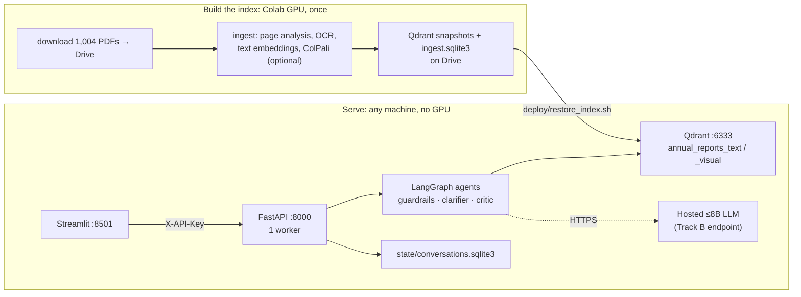

# Deploying the Annual Report Copilot: options, steps and costs

Date: 10 November 2026. Prices were read from the providers' pricing pages on 9–10 November 2026 unless marked otherwise. Infrastructure prices are third-party list prices; check them before you commit.

**Recommendation:**
- **Build the index on Colab** (GPU, batch).
- **Serve it with Docker Compose:** Qdrant + FastAPI + Streamlit on one machine without a GPU, using the Track B hosted LLM. Run this on a laptop for the demo, or on one small cloud VM for a public URL.
- **Expected spend:** about **$12–65** in total for the capstone, or $12 if the demo runs from a laptop.

---

## 1. What runs where



| Part | Runs on | GPU? | Notes |
|---|---|---|---|
| Streamlit | the serving machine | no | Only calls the API. Sends `API_AUTH_TOKEN` as `X-API-Key` |
| FastAPI + agents | the serving machine, **1 worker** | no | Rate limit, request IDs, answer cache and the 10-step agent cap |
| Conversation context | `indexes/state/conversations.sqlite3` | no | Survives restarts (`CONVERSATION_DB`). Stores only the clarifier slots, never answers |
| Qdrant | container next to the API | no | Must be the server, not embedded mode: embedded mode allows one process only |
| Query embedding, reranker | inside FastAPI, CPU | no | MiniLM; the model is cached in `indexes/hf_cache` |
| LLM | hosted endpoint | no (yours) | `LLM_API_BASE/KEY/MODEL` |
| ColPali, OCR on GPU, VLM | **only while building the index** | yes | Not needed to answer questions |

---

## 2. Deployment options

| Option | Use it for | What you need | Monthly cost | Drawbacks |
|---|---|---|---|---|
| **A. Laptop, Docker Compose** | Development, evaluation runs, the demo as a fallback | Docker Desktop, about 15 GB free disk | **$0** | Only you can reach it, unless you add a tunnel |
| **B. Laptop without Docker** | When Docker isn't available | the `uv` venv; Qdrant embedded or a local Qdrant server | $0 | Embedded Qdrant allows one process: fine for one API worker, but evaluation scripts can't read the index while the API runs |
| **C. Colab (`cp.serve`)** | A quick look right after ingesting | Colab session | Colab Pro **$9.99** (Pro+ $49.99) | Stops when the session ends; localhost only, so others need a tunnel |
| **D. One cloud VM, Compose + HTTPS (recommended for the demo URL)** | The graded "working deployed system" | Linux VM with 4 vCPU, 16 GB RAM, 50 GB disk, a domain name | **≈ $108** (GCP e2-standard-4 ≈ $98 + 100 GB disk ≈ $10); **≈ $50 for 2 weeks**. Text only: e2-standard-2 ≈ $49 | You patch the VM and keep the `.env` secret |
| E. VM + Qdrant Cloud | Managed database, several API servers | Qdrant Cloud cluster + `QDRANT_URL`, `QDRANT_API_KEY` | VM as D, plus the cluster. Qdrant doesn't publish a per-GB rate; use its calculator. The free tier (1 GB RAM / 4 GB disk) fits only a small text-only pilot | More moving parts; snapshots go over the internet |
| F. GPU VM running your own LLM | Only if you leave Track B's hosted model | e.g. 1× L4 GPU VM + vLLM | ≈ $500+ (estimate) | Expensive; Track B says to use the provided endpoint |

**Avoid serverless platforms** that start many short-lived copies (Cloud Run, Lambda). Each copy would reload the models, and keep its own rate limits, answer cache and in-memory state.

**Any cloud works for option D:** GCP, AWS, Azure, DigitalOcean and Hetzner all run the same `docker compose` files. Only the price differs.

---

## 3. How to deploy

### 3.1 With Docker Compose (options A and D)

Files: [Dockerfile](../Dockerfile), [docker-compose.yml](../docker-compose.yml), [.env.example](../.env.example), [deploy/Caddyfile](../deploy/Caddyfile) and [deploy/restore_index.sh](../deploy/restore_index.sh).

```bash
git clone <repo> && cd Capstone          # or unzip the code bundle
cp .env.example .env                     # LLM endpoint, API_AUTH_TOKEN, APP_UID/APP_GID (id -u / id -g)

# 1. The index. Copy from Drive (MyDrive/capstone_rag/snapshots/colpali_qdrant/) into ./snapshots:
#    annual_reports_text-*.snapshot (+ .json), annual_reports_visual-*.snapshot, ingest.sqlite3, pages/
docker compose up -d qdrant
docker compose run --rm --user root api sh deploy/restore_index.sh

# 2. Start everything
docker compose up -d --build
curl http://127.0.0.1:8000/health        # financial_backend should be financial_qdrant
# UI: http://127.0.0.1:8501

# 3. On a VM with a domain (A record → the VM's IP): HTTPS + a login in front of the UI
#    set DOMAIN, BASIC_AUTH_USER, BASIC_AUTH_HASH in .env, open ports 80 and 443
docker compose --profile https up -d
```

**What the compose stack sets:**
- `RAG_PROFILE=server`, `QDRANT_URL=http://qdrant:6333` and `API_BASE_URL=http://api:8000`.
- Ports bind to `127.0.0.1` unless you set `BIND_ADDRESS`. On a VM, use the HTTPS profile rather than opening 8000 and 8501.
- **The image is CPU-only:** torch comes from the CPU wheel index, so no CUDA libraries are pulled in.

**Volumes:**
- `./indexes`: ingest state, Chroma for the five other domains, conversations, and the Hugging Face model cache.
- `./data/processed`: BM25 chunks for the Chroma domains.
- `qdrant_storage`: Qdrant's data.
- `qdrant_snapshots`: shared by the API and Qdrant at the same path, so a restore can hand Qdrant a file path.

**Updating the code:**
- `git pull && docker compose up -d --build`.
- The index and conversations live in volumes, so they stay.

### 3.2 Without Docker (option B)

```powershell
uv sync
$env:RAG_PROFILE="local"; $env:API_AUTH_TOKEN="..."; $env:CONVERSATION_DB="indexes/state/conversations.sqlite3"
$env:LLM_API_BASE="..."; $env:LLM_API_KEY="..."; $env:LLM_MODEL="..."; $env:DEFAULT_LLM_PROVIDER="hosted"
uvicorn scripts.api.api_app:app --host 127.0.0.1 --port 8000 --workers 1
streamlit run scripts\ui\api_streamlit_app.py     # second terminal, same environment
```

With only embedded Qdrant (`QDRANT_URL` unset), run just the API. Streamlit talks to the API, so it doesn't open the index itself.

### 3.3 Colab (option C)

Run `colab_rag_pipelines.ipynb` cells 9–12 (`cp.serve`). It uses the `colab` runtime profile.

---

## 4. Settings

Every setting is an environment variable. [.env.example](../.env.example) lists all of them with comments.

| Variable | Default | Purpose |
|---|---|---|
| `LLM_API_BASE`, `LLM_API_KEY`, `LLM_MODEL` | — | Hosted chat model |
| `DEFAULT_LLM_PROVIDER` / `DEFAULT_EMBEDDING_PROVIDER` | `mock` / `hashing` | What requests and the UI use when they don't say. Set `hosted` for the demo |
| `API_AUTH_TOKEN` | empty (open) | Required key for every route except `/health` and `/docs`. **Set it on any shared server** |
| `RATE_LIMIT_PER_MINUTE` | 60 | Per client IP. Behind Caddy, the real IP comes from `X-Forwarded-For` (`--proxy-headers`) |
| `CORS_ALLOW_ORIGINS` | `*` | Browser origins allowed to call the API |
| `ANSWER_CACHE_SECONDS` | 0 (off); 600 in `.env.example` | Reuse the answer to an identical question. Failures are never cached |
| `AGENT_MAX_STEPS` | 10 | LangGraph node executions per question. Above the cap the run stops with `step_limit` and no answer |
| `CONVERSATION_DB`, `CONVERSATION_TTL_SECONDS` | server profile: `indexes/state/conversations.sqlite3`; 1800 | Clarification state that survives restarts |
| `RAG_PROFILE` | `local` (Colab detected) | `local`, `server` (Docker or VM) or `colab` |
| `RAG_BACKEND` | automatic | `financial_qdrant` when `indexes/financial_qdrant/ingest.sqlite3` exists, else `financial_vlm`, else Chroma |
| `QDRANT_URL`, `QDRANT_API_KEY` | server: `http://qdrant:6333` | Qdrant server, or Qdrant Cloud |
| `RAG_RERANKER_MODEL`, `RAG_MIN_RERANK_SCORE` | off | Cross-encoder rerank and the "don't answer below this score" floor |
| `LANGSMITH_TRACING`, `LANGSMITH_API_KEY`, `LANGSMITH_PROJECT` | off | Trace dashboard for the submission |
| `API_BASE_URL`, `API_TIMEOUT_SECONDS`, `UI_SHOW_ADVANCED` | — | Streamlit |

**How coverage reaches the UI:**
- The API knows which companies and years it can answer from the served index's `ingest.sqlite3`, even when the PDFs stay on Drive.
- `GET /companies` lists them with names, sectors and years.
- The Streamlit ticker and year pickers are built from that list.

---

## 5. Costs

### 5.1 How many pages need a vision model (measured)

All 14,701 pages of the 100 local filings were classified with the ingest's own page analysis (`financial_ingest.analyse_page`). The results are scaled to the 1,004-filing plan at 147 pages per filing, about **147,600 pages**.

| Page type | Share (measured) | Pages in the full corpus (estimate) |
|---|---|---|
| Text or blank | 68.9% | 101,700 |
| Table (text layer present) | 10.4% | 15,300 |
| Chart or image | 7.7% | 11,300 |
| Unreadable text (garbled, font-encoding garbage, outlined) | 13.1% | 19,300 |
| **No usable text: charts, images and unreadable** | **20.7%** | **30,600** |
| No usable text + tables | 31.1% | 45,900 |
| ColPali pages (`tables_charts_images`) | 18.0% | 26,600 |

**Caveat:** the 100 filings come from 25 large companies. Other sectors may have more charts. Re-measure after the first sectors are ingested with `cp.status`.

**This replaces earlier estimates.** The structure doc assumed 44–75% visual pages. With 18%:
- **ColPali full vectors:** ~**7 GB** on disk, not 17–29 GB.
- **Pooled vectors:** ~**0.5 GB** in RAM.
- **VLM pipeline:** ~46k pages to transcribe, not ~89k.

### 5.2 Building the index on Colab (one-off)

These times are **estimates** from earlier measurements on 4 filings (CPU and T4). The first full sector replaces them.

| Step | Work | Time on Colab (estimate) |
|---|---|---|
| Download | 11.3 GB from EDGAR | about 30–60 min (4.1 MB/s measured from a PC) |
| Page analysis | 147,600 pages × ~0.5 s CPU, 8 workers | ~2.5 h |
| OCR of unreadable pages | 19,300 pages × ~0.4 s (GPU) to 4 s (CPU) | 2–20 h |
| Text embeddings | ~450k chunks at ~800/s on GPU | ~10 min |
| ColPali (optional) | 26,600 pages at 1–3 pages/s on an L4 | 2.5–7.5 h |

| Plan | Total | Cost |
|---|---|---|
| Text + OCR only, L4 | ~5–8 h | ~10–20 compute units: inside **Colab Pro $9.99** (100 units) |
| Text + OCR + ColPali, L4 | ~8–15 h | ~15–40 units: inside Colab Pro |
| VLM pipeline, open model on Colab (vLLM, ~46k pages) | ~5–25 h depending on model size and GPU | Pro, plus perhaps one $9.99 top-up |

**Burn rates** are as reported by third-party sources: L4 about 1.7–2.5 units/h, A100 about 5–15 units/h. Pro+ ($49.99) mainly adds background execution, so a run survives a closed browser tab.

### 5.3 Closed vision models for the pages without text

This applies only if you choose a closed model instead of the open VLM. Prices are **Batch API** rates (50% of standard), because ingestion is offline work. Totals assume per page:
- **Typical:** 1,500 input tokens (page image + prompt) and 800 output tokens (Markdown).
- **High:** 2,500 in and 1,500 out, for dense tables and larger image token counts.

Image tokenisation differs by vendor. Measure 20 pages before trusting the totals.

| Model | Batch $/M tokens (in / out) | $ per 1,000 pages (typical) | **No-text pages only** (30,600) | With tables (45,900) |
|---|---|---|---|---|
| Claude Haiku 5.5 | $0.05 / $0.25 | $0.28 | **$8 – $15** | $13 – $23 |
| GPT-5.6 Luna | $0.10 / $0.60 | $0.63 | $19 – $35 | $29 – $53 |
| Gemini 3.1 Flash-Lite | $0.125 / $0.75 | $0.79 | $24 – $44 | $36 – $66 |
| Gemini 3.5 Flash-Lite | $0.15 / $1.25 | $1.23 | $37 – $69 | $56 – $103 |
| Gemini 3.8 Flash (to 31 Dec 2026) | $0.375 / $1.875 | $2.06 | $63 – $115 | $95 – $172 |
| Gemini 3.8 Flash (from 1 Jan 2027) | $0.75 / $3.75 | $4.12 | $126 – $230 | $189 – $344 |
| GPT-5.4 mini | $0.375 / $2.25 | $2.36 | $72 – $132 | $108 – $198 |
| Claude Sonnet 5.5 | $1 / $5 | $5.50 | $168 – $306 | $252 – $459 |
| GPT-5.6 Terra | $1 / $6 | $6.30 | $193 – $352 | $289 – $528 |
| Claude Opus 5.5 | $2 / $10 | $11.00 | $337 – $612 | $505 – $918 |
| Gemini 4 Argon (from 1 Dec 2026) | $2 / $10 | $11.00 | $337 – $612 | $505 – $918 |
| GPT-5.6 Sol (promotional to 30 Nov) | $2 / $10 | $11.00 | $337 – $612 | $505 – $918 |

**Which closed model is most accurate:** no independent benchmark compares these exact models on annual-report tables and charts, so don't pick on price alone. Run a 100-page pilot: 30 tables, 30 charts and 40 unreadable pages, with one model from each price band. Score how many printed numbers come back exactly. The pipeline already flags numbers the text layer doesn't contain (`unverified_numbers`). Then pick the cheapest model within about 1–2 points of the best.

**Track B caution:** the template says teams "cannot swap in a frontier model". Using one *only to transcribe pages at ingest time* is arguable but not obviously allowed. **Ask the mentor before spending.** The open-VLM or OCR path avoids the question.

### 5.4 Answering questions: LLM cost per 1,000 questions

Assumes about 3 LLM calls per question (plan, answer, critic): ~10,000 input and ~1,500 output tokens. Standard (not batch) prices.

| Model | $ per 1,000 questions |
|---|---|
| **Track B hosted endpoint** | **provided** (team token quota) |
| Claude Haiku 5.5 | $1.75 |
| GPT-5.6 Luna | $3.80 |
| Gemini 3.1 Flash-Lite | $4.75 |
| Gemini 3.8 Flash (2026 price) | $13.12 |
| Claude Sonnet 5.5 | $35.00 |
| GPT-5.6 Terra | $38.00 |
| Claude Opus 5.5 | $70.00 |

The evaluation is 86 questions × about 6 configurations (3 baselines, RAG only, the full agent, ablations), roughly 500 runs. That costs well under $5 even on a mid-priced model. With the Track B endpoint it only uses quota. `ANSWER_CACHE_SECONDS` keeps repeated demo questions free.

### 5.5 Storage

| Item | Size | Where | Cost |
|---|---|---|---|
| PDFs | 11.3 GB | Drive | Google One 100 GB ≈ $1.99/month; 2 TB ≈ $9.99. Local prices differ, e.g. in India |
| Qdrant snapshots (text ~2–3 GB, visual ~7 GB; rotation keeps up to 2×) | ~10–20 GB | Drive | as above |
| Served index on the VM | ~10–15 GB with ColPali, ~3 GB text only | VM disk | included in option D's 50–100 GB disk |

With the measured page mix, **100 GB of Drive is enough**. 2 TB is only needed if you also keep VLM caches and several index versions.

### 5.6 Total for the capstone

| Scenario | Index build | Storage | Serving | LLM | **Total** |
|---|---|---|---|---|---|
| Lean: open models, demo from a laptop | Colab Pro $9.99 | Drive 100 GB $1.99 | $0 | Track B quota | **≈ $12** |
| Recommended: plus a public VM for 2 weeks | $9.99 | $1.99 | ≈ $50 | Track B quota | **≈ $62** |
| Plus a cheap closed VLM on the no-text pages | $9.99 | $1.99 | ≈ $50 | + $8–44 | **≈ $70–106** |
| Plus a mid-tier closed VLM, tables included | $9.99 | $1.99 | ≈ $50 | + $95–198 | **≈ $157–260** |

---

## 6. Not verified here

- **Docker isn't installed on the development PC**, so `docker compose build` and `up` haven't been run yet. Everything they run is tested without Docker; the tests check the compose and `.env.example` wiring. The first build on the target machine is the real check, and it takes about 10 minutes to pull Python and the CPU torch wheel.
- **Snapshot restore into a Qdrant container** depends on the shared `/qdrant/snapshots` volume. The restore code is tested; the container path is not.
- **Prices:**
  - LLM prices were read from the providers' pages on 9–10 November 2026. Several change on 30 November, 1 December and 1 January.
  - VM, Colab and Drive prices come from third-party trackers.
  - Qdrant Cloud has no published per-GB rate.

**Sources:**
- [Gemini API pricing](https://ai.google.dev/gemini-api/docs/pricing)
- [OpenAI API pricing](https://platform.openai.com/docs/pricing)
- [Claude API pricing](https://docs.claude.com/en/docs/about-claude/pricing)
- [GCP e2-standard-4 (Holori)](https://calculator.holori.com/gcp/vm/e2-standard-4)
- [Colab GPU burn rates (gpuperhour)](https://gpuperhour.com/blog/google-colab-alternatives)
- [Colab Enterprise pricing](https://cloud.google.com/colab/pricing)
- [Qdrant pricing notes (activepieces)](https://www.activepieces.com/blog/qdrant-pricing-in-2026-and-what-a-real-bill-costs)
- [Qdrant free tier (costbench)](https://costbench.com/software/vector-databases/qdrant/free-plan/)
