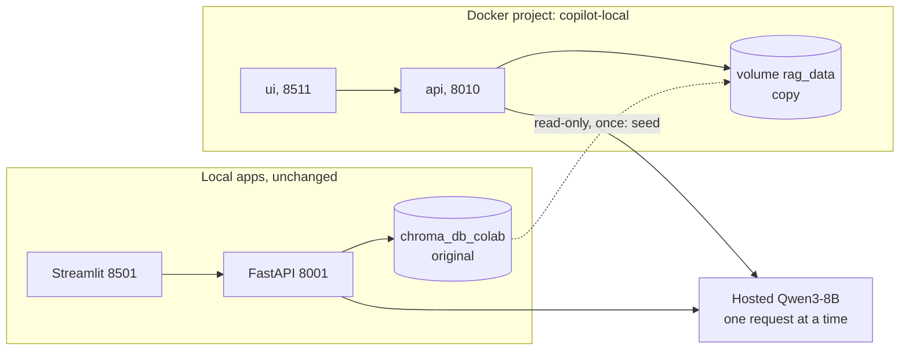

# Running the copilot in Docker on the local PC

Date: 24 November 2026. Branch `financial-report-only`.

**Status: plan, not yet built or run.** The compose file below was checked with `docker compose config`, and the pinned CPU wheels were confirmed to exist. No image was built, no container was started, and no repository file other than this document and its HTML copy was added. Times marked *estimate* are not measured.

**Goal:** run FastAPI and Streamlit in Docker on this PC, with the index built for the local apps, without touching the collections or the apps already running on ports 8001 and 8501.

## 1. Summary

| Question | Answer |
|---|---|
| Application code to change | None |
| Existing files to change | None. Three new files in the repository, plus one Windows settings file |
| Index used | A verified **copy** of `indexes/rag_home/indexes/chroma_db_colab` (5.8 GB, 335,699 chunks, 509 filings) |
| Ports | UI `127.0.0.1:8511`, API `127.0.0.1:8010`. The local apps keep 8501 and 8001 |
| First time, until usable | 1 to 1½ hours (*estimate*) |
| First time, with all regression checks | 2 to 2½ hours (*estimate*) |
| Later starts | 2 to 3 minutes (*estimate*) |
| Disk | 15 to 20 GB (*estimate*); 141 GB was free |
| Memory | About 4 GB for Docker (*estimate*); only 1.7 GB of 15.7 GB was free |
| LangSmith | Off by default; used only when `LANGSMITH_ENABLED` is `true` |
| Main risks | Memory, and one LLM request at a time per key |
| When | After the dry run of 24 November; Docker has never been set up on this PC |



## 2. What was found on this PC

| Item | Value |
|---|---|
| Docker Desktop | 4.99.0 installed, Docker 29.9.3, Compose 5.7.0, WSL 2 engine, **not running**, auto-start off |
| WSL | 3.0.5; required Windows features enabled on 13 November and the PC restarted since; **no Linux distribution and no Docker data disk yet** |
| CPU, memory, disk | i7-11800H, 8 cores / 16 threads; 15.7 GB, 1.7 GB free; NVMe SSD, 141 GB free |
| Memory used | Local API about 2.0 GB committed, Streamlit about 0.6 GB; VS Code about 2.9 GB in use |
| Local apps | API 127.0.0.1:8001 (`financial_vlm`, profile `local`, reranker on), Streamlit 127.0.0.1:8501 |
| Served index | `chroma.sqlite3` 4.4 GB, `bm25.sqlite3` 0.6 GB, vectors, page files; collection `annual_reports_vlm`; built with local `BAAI/bge-small-en-v1.5` |
| SQLite journal | `delete` mode, no journal or WAL file open |
| Fund data | 5.9 MB in `indexes/rag_home/indexes/mutual_fund` |
| Models needed | bge-small (Hugging Face cache), `ms-marco-MiniLM-L-6-v2` reranker (88 MB) |
| Local versions | Python 3.12.7, chromadb 1.5.9, torch 2.14.1, torchvision 0.29.1, transformers 4.57.6, sentence-transformers 5.7.0, langgraph 1.2.14, langchain 1.4.4, fastapi 0.162.0, streamlit 1.66.1, numpy 2.5.4: all equal to `uv.lock` |

## 3. Why the existing compose file is not used as it is

| Finding | What would happen | Fix in this plan |
|---|---|---|
| `docker-compose.yml` mounts `indexes/rag_home` and `indexes` read-write | Two processes would open the live Chroma folder. Chroma is not safe for that, SQLite locks are unreliable across a Windows mount, and Chroma writes when it opens: `chroma.sqlite3` was last modified at 02:52 on 24 November, when the local API started | Serve a copy in a Docker volume; mount the original read-only for the copy only |
| Conversation state is in the same folder | Both apps would write one `conversations.sqlite3` | State lives in the Docker volume |
| Ports 8000 and 8501 | 8501 is taken by the local Streamlit | 8010 and 8511 |
| Expects a folder named `chroma_db` | The index is `chroma_db_colab`, so no evidence would be found | `RAG_VLM_DIR` set explicitly |
| Profile `server` embeds questions with the hosted API | Needs the embedding key; differs from local | `RAG_EMBEDDING_PROVIDER=local`, bge-small copied into the volume |
| Reranker is read from `RAG_HOME/models` | Not there, so no rerank and different answers | Copied into the volume at that path |
| `Dockerfile` pins only chromadb exactly | Newer packages could change behaviour | Every package pinned to `uv.lock` |
| `.env` is required and missing | Compose stops with an error | Settings in the new compose file; LLM key as a Docker secret |
| PDFs are excluded from the image | The Apple 2024 report fails | That one PDF mounted read-only |
| `secrets/` is not in `.dockerignore` | Keys are sent in the build context, though not copied into the image | Own ignore file that excludes them |
| Qdrant starts and is required | Not needed for the Chroma backend; uses memory | Left out |
| `deploy/*.sh` have Windows line endings in this checkout | They could fail in a Linux container | Not used; steps are inline in the compose file |

## 4. Rules this plan keeps

1. No collection is modified: `chroma_db_colab`, `chroma_db_bge`, `chroma_db_fix`, `chroma_db_cvx_test` and Drive's copy stay as they are. Only `chroma_db_colab` and `mutual_fund` are read, through read-only mounts.
2. The API and UI containers never mount an index folder of the host.
3. Local FastAPI and Streamlit are not stopped, restarted or reconfigured.
4. The LLM and LangSmith keys stay in the gitignored `secrets/` folder. They are not in the image, the compose file or `.env`.
5. Both ports listen on 127.0.0.1 only, so nothing is reachable from the network.
6. Containers have CPU and memory limits and do not restart by themselves.
7. LangSmith is off unless `LANGSMITH_ENABLED` is exactly `true` (section 7.1). It is meant for the demo, or for a few runs for a technical document.

## 5. Files to add

| File | Purpose |
|---|---|
| `docker-compose.local.yml` | Project `copilot-local`: `seed`, `api`, `ui` |
| `deploy/Dockerfile.local` | Image with pinned versions and CPU-only torch |
| `deploy/Dockerfile.local.dockerignore` | Keeps secrets, indexes and PDFs out of the build |
| `%USERPROFILE%\.wslconfig` | Limits the Docker virtual machine. Outside the repository |

### 5.1 docker-compose.local.yml

Checked with `docker compose config`; not run.

```yaml
# Local Docker copy of the copilot, next to the normal local apps (8001 / 8501).
# It serves its OWN copy of the index (volume rag_data). The originals are mounted read-only, and only by "seed".
name: copilot-local

x-app: &app
  image: annual-report-copilot:local
  restart: "no"
  user: "1000:1000"

services:
  seed:                                   # one-off: docker compose -f docker-compose.local.yml run --rm seed
    <<: *app
    profiles: ["seed"]
    user: "0:0"
    network_mode: none
    volumes:
      - type: bind
        source: ./indexes/rag_home/indexes/chroma_db_colab
        target: /src/indexes/chroma_db_colab
        read_only: true
      - type: bind
        source: ./indexes/rag_home/indexes/mutual_fund
        target: /src/indexes/mutual_fund
        read_only: true
      - type: bind
        source: ./indexes/models/ms-marco-MiniLM-L-6-v2
        target: /src/models/ms-marco-MiniLM-L-6-v2
        read_only: true
      - type: bind
        source: ${USERPROFILE}/.cache/huggingface/hub/models--BAAI--bge-small-en-v1.5
        target: /src/cache/hf/hub/models--BAAI--bge-small-en-v1.5
        read_only: true
      - rag_data:/dst
      - output:/out
    command:
      - sh
      - -c
      - |
        set -eu
        if [ -e /dst/indexes ]; then echo "this volume already holds a copy: nothing done"; exit 1; fi
        if find /src -name '*-journal' -o -name '*-wal' | grep -q .; then echo "the source is being written: retry later"; exit 1; fi
        cp -a /src/indexes /src/models /src/cache /dst/
        mkdir -p /dst/state
        cd /src && find indexes models cache -type f -exec sha256sum {} + | sort -k2 > /dst/source.sha256
        cd /dst && sha256sum -c --quiet source.sha256
        python - <<'PY'
        import sqlite3
        root = "/dst/indexes/chroma_db_colab/"
        n = sqlite3.connect(root + "chroma/chroma.sqlite3").execute("select count(*) from embeddings").fetchone()[0]
        f = sqlite3.connect(root + "vlm_ingest.sqlite3").execute("select count(distinct doc_id) from filings").fetchone()[0]
        print("chunks", n, "filings", f)
        assert (n, f) == (335699, 509)
        PY
        chown -R 1000:1000 /dst /out
        echo "seed verified"

  api:
    <<: *app
    build:
      context: .
      dockerfile: deploy/Dockerfile.local
    command:
      - sh
      - -c
      - |
        export LLM_API_KEY="$$(tr -d '\r\n' < /run/secrets/llm_api_key)"
        if [ "$${LANGSMITH_ENABLED:-false}" = "true" ] && [ -s /run/secrets/langsmith_api_key ]; then
          export LANGSMITH_API_KEY="$$(tr -d '\r\n' < /run/secrets/langsmith_api_key)"; echo "LangSmith: on, for questions that ask for it"
        else
          unset LANGSMITH_API_KEY LANGCHAIN_API_KEY; echo "LangSmith: off"
        fi
        export LANGSMITH_TRACING=false LANGCHAIN_TRACING_V2=false
        exec uvicorn scripts.api.api_app:app --host 0.0.0.0 --port 8000 --workers 1
    environment:
      RAG_PROFILE: server
      RAG_HOME: /app/rag_home
      RAG_BACKEND: financial_vlm
      RAG_VLM_DIR: /app/rag_home/indexes/chroma_db_colab
      RAG_EMBEDDING_PROVIDER: local
      HF_HOME: /app/rag_home/cache/hf
      HF_HUB_OFFLINE: "1"
      OMP_NUM_THREADS: "4"
      DEFAULT_LLM_PROVIDER: hosted
      LLM_API_BASE: https://103.42.50.41:1032/v1
      LLM_MODEL: Qwen/Qwen3-8B
      LLM_MAX_TOKENS: "1024"
      LLM_CA_CERT: /run/certs/llm_ca.crt
      RAG_REQUEST_TIMEOUT_SECONDS: "180"
      RAG_HTTP_TIMEOUT_SECONDS: "90"
      RATE_LIMIT_PER_MINUTE: "1000"
      LANGSMITH_ENABLED: ${LANGSMITH_ENABLED:-false}        # exactly "true" = the key is loaded; anything else = off
      LANGSMITH_ENDPOINT: https://api.smith.langchain.com
      LANGSMITH_PROJECT: annual-report-copilot
    secrets: [llm_api_key, langsmith_api_key]
    volumes:
      - rag_data:/app/rag_home
      - output:/app/output
      - type: bind
        source: ./secrets/llm_ca.crt
        target: /run/certs/llm_ca.crt
        read_only: true
      - type: bind
        source: ./data/raw/financial_report_qa/pdfs/NASDAQ_AAPL_2024.pdf
        target: /app/data/raw/financial_report_qa/pdfs/NASDAQ_AAPL_2024.pdf
        read_only: true
    ports: ["127.0.0.1:8010:8000"]
    cpus: 4
    mem_limit: 3g
    healthcheck:
      test: ["CMD", "curl", "-fsS", "http://127.0.0.1:8000/health"]
      interval: 30s
      timeout: 10s
      start_period: 180s
      retries: 5

  ui:
    <<: *app
    command:
      - sh
      - -c
      - |
        if [ "$${LANGSMITH_ENABLED:-false}" = "true" ] && [ -s /run/secrets/langsmith_api_key ]; then
          export LANGSMITH_API_KEY="$$(tr -d '\r\n' < /run/secrets/langsmith_api_key)"; echo "LangSmith: on, for questions that ask for it"
        else
          unset LANGSMITH_API_KEY LANGCHAIN_API_KEY; echo "LangSmith: off"
        fi
        export LANGSMITH_TRACING=false LANGCHAIN_TRACING_V2=false
        exec streamlit run scripts/ui/api_streamlit_app.py --server.address 0.0.0.0 --server.port 8501 \
          --server.headless true --browser.gatherUsageStats false
    environment:
      RAG_PROFILE: server
      API_BASE_URL: http://api:8000
      DEFAULT_LLM_PROVIDER: hosted
      API_TIMEOUT_SECONDS: "300"
      LANGSMITH_ENABLED: ${LANGSMITH_ENABLED:-false}
      LANGSMITH_ENDPOINT: https://api.smith.langchain.com
      LANGSMITH_PROJECT: annual-report-copilot
    secrets: [langsmith_api_key]
    ports: ["127.0.0.1:8511:8501"]
    cpus: 2
    mem_limit: 1g
    depends_on:
      api:
        condition: service_healthy
    healthcheck:
      test: ["CMD", "curl", "-fsS", "http://127.0.0.1:8501/_stcore/health"]
      interval: 30s
      timeout: 5s
      retries: 3

secrets:
  llm_api_key:
    file: ./secrets/llm_api_key.txt
  langsmith_api_key:
    file: ./secrets/langsmith_api_key.txt

volumes:
  rag_data:
  output:
```

### 5.2 deploy/Dockerfile.local

Not built.

```dockerfile
# Local test image: the same layers as ../Dockerfile, with every package at its uv.lock version and CPU-only torch.
FROM python:3.12-slim

ENV PYTHONDONTWRITEBYTECODE=1 \
    PYTHONUNBUFFERED=1 \
    PIP_NO_CACHE_DIR=1 \
    PIP_DISABLE_PIP_VERSION_CHECK=1 \
    HOME=/tmp/app-home

RUN apt-get update && apt-get install -y --no-install-recommends libgl1 libglib2.0-0 curl

WORKDIR /app
COPY pyproject.toml uv.lock deploy/requirements_from_pyproject.py /tmp/build/
RUN cd /tmp/build \
 && pip install uv==0.12.23 \
 && uv export --frozen --no-dev --no-hashes --no-emit-project -q > lock.txt \
 && python requirements_from_pyproject.py pyproject.toml > requirements.txt \
 && pip install --index-url https://download.pytorch.org/whl/cpu torch==2.14.1 torchvision==0.29.1 \
 && pip install -r requirements.txt -c lock.txt \
 && pip check

COPY scripts ./scripts
COPY configs ./configs
COPY deploy ./deploy
COPY data ./data
COPY pyproject.toml ./

RUN mkdir -p /app/rag_home /app/output /tmp/app-home && chmod -R a+rwX /app/rag_home /app/output /tmp/app-home
EXPOSE 8000 8501
```

Torch and torchvision come from the CPU-only wheel index; versions 2.14.1 and 0.29.1 exist there for Python 3.12 on Linux. `pip check` fails the build if packages conflict. After a `uv lock`, update these two versions to match.

### 5.3 deploy/Dockerfile.local.dockerignore

Docker uses this file instead of `.dockerignore` for this Dockerfile only.

```text
# Keep the image to code + small committed data. Indexes, PDFs and outputs are mounted at run time.
.git
.gitignore
.venv
venv
**/__pycache__
**/*.pyc
.pytest_cache
.ipynb_checkpoints
.env
.env.*
!.env.example

indexes
output
eval
tmp
snapshots
notebooks
docs
tests
*.pptx
*.ipynb
*.jpeg

# Large raw data: PDFs and EDGAR side files (the manifests stay)
data/processed
**/*.pdf
data/raw/financial_report_qa/edgar/10k
data/raw/financial_report_qa/edgar/proxy
data/raw/financial_report_qa/edgar/submissions
data/raw/financial_report_qa/edgar/companyfacts
data/raw/mutualFund

# Keys and certificates never enter the build context
secrets
**/*.crt
**/*_api_key.txt
```

### 5.4 %USERPROFILE%\.wslconfig

```ini
[wsl2]
memory=4GB
processors=4
swap=4GB

[experimental]
autoMemoryReclaim=gradual
```

It applies to every WSL distribution, but this PC has none besides the one Docker will create. Check that the file does not exist before creating it (it did not on 24 November).

## 6. Before you start

1. Finish the dry run first, and commit or back up open work.
2. Plug the laptop in and keep it awake; sleep interrupts the copy and the timing.
3. Free about 3 GB of memory: close PowerPoint, unused VS Code windows and browser tabs.
4. Leave the local API and Streamlit running, and do not restart them until section 9 is done. A restart makes Chroma touch `chroma.sqlite3`, which would make the hash check fail for a reason unrelated to Docker.
5. Do not ask questions in the local app while the Docker copy is being tested (one LLM request at a time).
6. Record the starting state:

```powershell
Get-ChildItem indexes\rag_home\indexes -Recurse -File | Get-FileHash -Algorithm SHA256 |
  Select-Object Hash, Path | Export-Csv output\eval\docker_hash_before.csv -NoTypeInformation
git status --short
Invoke-RestMethod http://127.0.0.1:8001/health | ConvertTo-Json -Depth 5
(Invoke-WebRequest http://127.0.0.1:8501 -UseBasicParsing).StatusCode
```

## 7. Steps

```powershell
# 1. Create the three files of section 5 and .wslconfig, then start Docker Desktop and wait for "Engine running"
docker info

# 2. Build (12-25 min the first time)
docker compose -f docker-compose.local.yml build api

# 3. Copy the index into the Docker volume and verify it (5-15 min)
docker compose -f docker-compose.local.yml run --rm seed

# 4. Start the API and the UI
docker compose -f docker-compose.local.yml up -d api ui
docker compose -f docker-compose.local.yml ps

# 5. Check
Invoke-RestMethod http://127.0.0.1:8010/health | ConvertTo-Json -Depth 5
# then open http://127.0.0.1:8511
```

`seed` refuses to run if the volume already holds a copy or if the source is being written, compares every copied file with the SHA-256 of its source, and checks 335,699 chunks and 509 filings.

In `/health`, expect `profile` server, `financial_backend` financial_vlm, `vlm_index_ready` true, `reranker` true and `ca_cert` true.

### Daily use

| Action | Command |
|---|---|
| Start | Start Docker Desktop, then `docker compose -f docker-compose.local.yml up -d api ui` |
| Stop | `docker compose -f docker-compose.local.yml stop`, then quit Docker Desktop to give the memory back |
| Logs | `docker compose -f docker-compose.local.yml logs -f api` |
| Memory and CPU | `docker stats` |
| Code changed | `build api` again (1–3 min, cached), then `up -d api ui` |
| Index changed | Remove the Docker copy with `down -v` (this deletes the Docker volumes only, including its reports and conversations), then run `seed` again. Update the expected counts in `seed` if they changed |

### 7.1 LangSmith: only when the value is `true`

| `LANGSMITH_ENABLED` | What happens |
|---|---|
| Not set, `false`, or anything else (`TRUE`, `1`, `yes`) | **Off.** The key isn't loaded into FastAPI or Streamlit, so nothing is sent, even if someone switches on "LangSmith tracing" in Streamlit |
| `true` | The key is loaded. **Only** questions asked with "LangSmith tracing" switched on (Streamlit, Demo settings) are sent; one question is one trace |

`LANGSMITH_TRACING` is fixed to `false` in both containers, so there is no way to trace everything by accident. The switch is part of the container start command; no application code changes. Tested on 24 November 2026 outside Docker: the real start commands of both containers with a fake key, for every value in the table; nothing was sent.

```powershell
# On, for the demo or a few runs for a document
$env:LANGSMITH_ENABLED = "true"
docker compose -f docker-compose.local.yml up -d api ui

# Off again
Remove-Item Env:LANGSMITH_ENABLED
docker compose -f docker-compose.local.yml up -d api ui
```

`up -d` recreates the two containers with the new value (1–2 min). Check it: `/health` shows `langsmith.api_key_set` `false` when off and `true` when on, and the container log's first line says `LangSmith: off` or `LangSmith: on`.

Use it only for the demo or for technical documents: the free plan has 5,000 traces a month, kept for 14 days. Keep it off for the regression checks in section 9.

## 8. Time

| Step | Time | Basis |
|---|---|---|
| Create the files | 20–30 min | estimate |
| First Docker start | 5–10 min | estimate |
| Build the image (about 2 GB download) | 12–25 min | estimate, depends on the network |
| Copy and verify the index, 5.8 GB | 5–15 min | estimate |
| Start and smoke test | about 10 min | estimate |
| **Usable** | **about 1–1½ h** | |
| Retrieval comparison, then all 113 questions | 40–60 min | the 113 questions took 25 min on the local API (measured 24 November) |
| Offline tests and final hashes | about 10 min | tests take about 2 min (measured) |
| **Total** | **about 2–2½ h** | |

## 9. Regression checks

Zero differences can't be promised: Linux and Windows maths can reorder near-ties. Each gate must pass before the Docker copy is relied on.

| Gate | How | Pass rule |
|---|---|---|
| Collections untouched | Repeat the hashes of section 6 and compare | Identical |
| Copy is exact | `seed` output | `seed verified` |
| Code untouched | `git status --short`; `.venv\Scripts\python.exe -m pytest tests --basetemp tmp/pt` | Only the new files; all 723 tests pass |
| Key and certificate handling | `docker history` and a search of the image for the key | No key in any layer |
| Retrieval parity | The same 113 questions to `/retrieve/financial_report_qa` on 8001 and 8010 | Same top chunks; every difference explained |
| Answer parity | 86 fixed and 27 agent questions against 8010 | At least 71/86 and 26/27; every changed question reviewed |
| Speed | Same run | Median near 10.9 s, 95th percentile near 23.7 s |
| LangSmith off by default | `/health` on 8010; switch on tracing in Streamlit and ask one question | `api_key_set` false, response says `missing_LANGSMITH_API_KEY`, no new trace |
| Local apps healthy | `/health` on 8001 and the page on 8501, before, during and after | No change |
| Browser | One question per agent on 8511, and the Apple 2024 report | Works, with citations |

The comparison tools are in `output/eval/deck_eval` (gitignored): `run_agent.py`, `analyse.py`, `agentq_score.py`. `run_agent.py` has the API address fixed at 8001, so it needs a copy or a setting for 8010.

```powershell
Get-ChildItem indexes\rag_home\indexes -Recurse -File | Get-FileHash -Algorithm SHA256 |
  Select-Object Hash, Path | Export-Csv output\eval\docker_hash_after.csv -NoTypeInformation
Compare-Object (Import-Csv output\eval\docker_hash_before.csv) (Import-Csv output\eval\docker_hash_after.csv) -Property Hash, Path
# no output = nothing changed
```

## 10. Risks

| Risk | Effect | What to do |
|---|---|---|
| Memory | Local apps slow down from paging | Free 3 GB first; the limits are 4 GB for the virtual machine, 3 GB for `api`, 1 GB for `ui`; stop Docker when not in use |
| One LLM request at a time per key | Questions asked in both apps at once wait or fail (HTTP 429) | Use one app at a time. The queue works within one process, not between the two |
| First Docker start fails | No engine | Restart Windows, then `wsl --update`; the local apps are not involved |
| Linux and Windows differences | A few rankings or answers differ | Gates in section 9 |
| Older copy | The Docker index doesn't follow later changes | Seed again |
| First question is slow | Models load | Ask one warm-up question |
| Network | The endpoint is reached through Docker's network | Check `/health`, then one question; the certificate is the same file as local |
| Deadline | Setup trouble near submission on 25 November | Keep the local apps as the demo path |

## 11. Troubleshooting

| Symptom | Likely cause | Action |
|---|---|---|
| `failed to connect to the docker API` | Docker Desktop isn't running | Start it and wait |
| Port already allocated | Something uses 8010 or 8511 | Change the left-hand port in the compose file |
| `this volume already holds a copy` | `seed` already ran | Nothing to do, or see "Index changed" |
| `the source is being written` | An ingest is running | Wait for it to finish |
| `api` is unhealthy | Index or model not found | `logs api`; check `RAG_VLM_DIR` and that `seed` finished |
| `api` exits with code 137 | Memory limit reached | Raise `mem_limit` to 3500m and the WSL memory to 5 GB |
| LLM certificate error | Certificate not mounted | Check `secrets/llm_ca.crt` |
| HTTP 429 | Both apps asking at once | Use one app |
| No trace in LangSmith | The switch is off, or tracing wasn't on for that question | Set `LANGSMITH_ENABLED` to exactly `true`, run `up -d`, switch on tracing and ask again |
| Answers without evidence | Wrong backend or folder | Check `financial_backend` and `vlm_index_ready` in `/health` |

## 12. Undo

```powershell
docker compose -f docker-compose.local.yml --profile seed down        # removes containers, keeps the Docker copy
docker compose -f docker-compose.local.yml --profile seed down -v     # also deletes the Docker copy, never the originals
docker image rm annual-report-copilot:local
```

Then quit Docker Desktop and delete the three files and `.wslconfig`. The collections and the local apps aren't involved in any of these steps.
