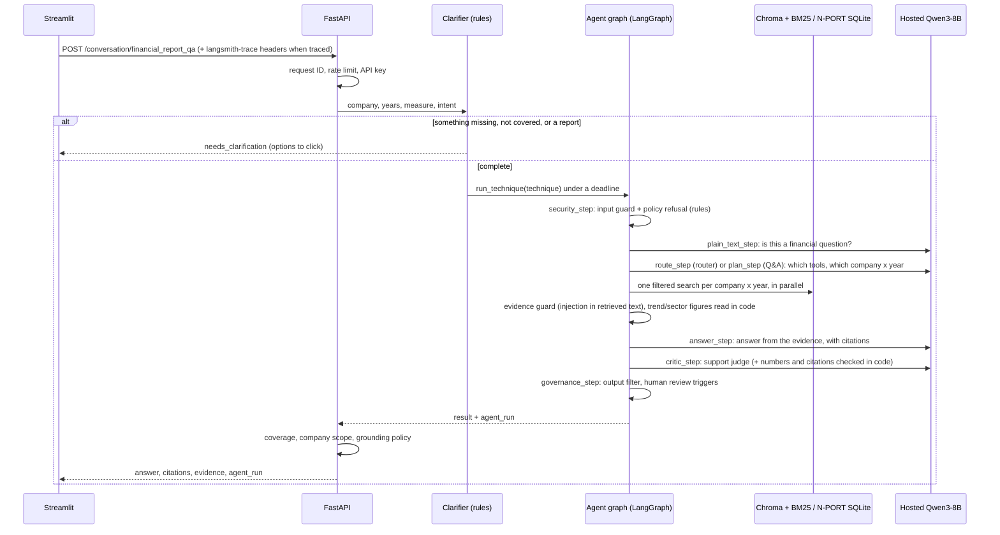

# End-to-end walkthrough: Streamlit, FastAPI, the agents, the checks, Chroma and the hosted LLM

This guide follows real questions through the whole Financial Report Copilot, one for each agent. Each question starts
in the Streamlit chat and goes through FastAPI, the clarifier, the agent's LangGraph steps, the guardrails and the
critic, retrieval from the Chroma index, and the hosted LLM's answer. Every result below comes from a run on
21 November 2026. Five of the runs were traced in LangSmith as evidence (section 9).

Related pages: [agent_flows.md](agent_flows.md) (every node and routing rule),
[agents_flows.md](agents_flows.md) (what each agent decides), [fastapi_api.md](fastapi_api.md) (routes),
[annual_report_rag_structure.md](annual_report_rag_structure.md) (the index),
[observability_langsmith.md](observability_langsmith.md) (tracing) and
[agent_test_questions.html](agent_test_questions.html) (more test questions).

## 1. What was run

| Item | Value |
|---|---|
| Index | Pipeline 1 Chroma index (`chroma_db_bge`): the `min500` corpus, **509 annual reports** from 143 companies in 13 sectors, FY2022–FY2026, **317,037 chunks**, embedded with `BAAI/bge-small-en-v1.5`; BM25 sidecar (SQLite FTS5) |
| Retrieval backend | `RAG_BACKEND=financial_vlm` (the capstone's main backend) |
| Fund data | SEC N-PORT holdings in `indexes/mutual_fund/nport_mutual_fund.sqlite3` |
| LLM | Hosted `Qwen/Qwen3-8B` (course endpoint, OpenAI-compatible, private CA), `LLM_MAX_TOKENS=1024` |
| API | FastAPI on `127.0.0.1:8000`, one worker, default limits (`AGENT_MAX_STEPS=10`, 60 s request deadline, 300 s for sector and fund routes) |
| Client | Streamlit's own request code (`build_payload` + `post_json`), the same path as typing into the chat |
| Questions | 11: one or more for each agent, plus the router's refusal, clarification, report and not-available paths |
| LangSmith | Tracing per request only; 5 evidence traces (one per agent), 13 in total with the reruns (section 9) |

This PC's index doesn't include Apple, so Apple questions are answered "not available" (section 7.4).

## 2. Starting it

In PowerShell, from the repo root. The keys stay in the gitignored `secrets\` folder:

```powershell
$env:LLM_API_KEY  = (Get-Content secrets\llm_api_key.txt -Raw).Trim()
$env:LLM_API_BASE = "https://103.42.50.41:1032/v1"
$env:LLM_MODEL    = "Qwen/Qwen3-8B"
$env:LLM_MAX_TOKENS = "1024"            # the server stops replies at 512 tokens unless asked for more (max 1024)
$env:DEFAULT_LLM_PROVIDER = "hosted"
$env:RAG_BACKEND  = "financial_vlm"
$env:RAG_VLM_DIR  = "$PWD\indexes\rag_home\indexes\chroma_db_bge"
# optional, only when traces are wanted (free plan: trace single questions, never batch runs)
$env:LANGSMITH_API_KEY = (Get-Content secrets\langsmith_api_key.txt -Raw).Trim()
$env:LANGSMITH_PROJECT = "annual-report-copilot"
uvicorn scripts.api.api_app:app --host 127.0.0.1 --port 8000
```

The LLM's CA certificate is found automatically at `indexes\rag_home\secrets\llm_ca.crt`. In a second window:

```powershell
streamlit run scripts\ui\api_streamlit_app.py      # http://localhost:8501
```

`GET /health` should show `financial_backend: financial_vlm`, `vlm_index_ready: true`, `ca_cert: true` and, when the
LangSmith key is set, `langsmith.api_key_set: true` with `tracing_all_requests: false`.

## 3. Using Streamlit

**Sidebar**

| Setting | Default | What it does |
|---|---|---|
| Ask clarifying questions | on | Sends the question to `/conversation`, which asks for a missing company, year or measure before running an agent |
| Sectors (optional) | none | Limits evidence to these sectors |
| Company / Fiscal year (optional) | Any | Filters retrieval; the lists come from `GET /companies` (only what the index holds) |
| Demo settings → **Technique** | `router` | Which agent runs (below) |
| Demo settings → LLM provider | `hosted` (with `DEFAULT_LLM_PROVIDER=hosted`) | `mock` gives placeholder wording; retrieval and checks are still real |
| Retrieval mode / Evidence chunks | hybrid / 5 | Dense + BM25 fused by RRF; chunks per search |
| Guardrails / Human review routing | on / on | Leave on: these are the checks in section 5 |
| LangSmith tracing | off | Turn on only for a question you want as evidence |

**Choosing an agent (Technique)**

| Technique | Agent | Ask it |
|---|---|---|
| `router` (default) | Supervisor: picks the agent from the question | Anything; the router sends it on |
| `agentic_graph` | Q&A agent | A figure, fact or explanation for one company and year, or a comparison of companies |
| `trend_graph` | Trend agent | One measure for one company across several years |
| `sector_trend_graph` | Sector trend agent | One measure across a sector's companies, year by year |
| `fund_graph` | Fund agent | A mutual fund's holdings, sector mix, returns or net assets |

**What an answer shows**: a status badge (`answered`, `evidence_only`, `pending_human_review`, `not_available`,
`refused`), the answer with `[chunk_id]` citations (the ID names the filing and page, for example
`annual_report_edgar_ars_JPM_2025_p0198_vlm0` is JPM's FY2025 report, page 198), an **Agent run** panel (the steps
taken, the router's decision, the plan, every tool call and calculation), **Citations and Human Review** (citation
check, support check, review triggers) and **Evidence** (the retrieved chunks). If the clarifier needs something, it
asks with buttons (a company list, years, Yes/No).

## 4. The request path



| Stage | Code | Decides | LLM call? |
|---|---|---|---|
| Middleware | `api/api_app.py` | `X-Request-ID`, per-IP rate limit, API key | No |
| Clarifier | `agents/financial_clarifier.py` | Company, years, measure, intent; whether the filings cover them | No |
| Deadline | `run_technique` → `resilience.Calls` | 60 s per request (300 s for sector and fund routes); a failure becomes `tool_error`, never a guess | No |
| `security_step` | `guardrails/checks.py` | Injection, code, encoded payloads; advice, forecasts, personal data refused by rule | No |
| `plain_text_step` | `llm_plain_text_classifier` | Financial intent and risk; never rewrites the question | Yes |
| `route_step` / `plan_step` | `financial_router.py` / `financial_tools.normalize_plan` | The agent (router) or the tools and targets (Q&A); the LLM proposes, rules validate | Yes |
| Retrieval | `rag/financial_ingest_chroma_db.retrieve_for_agent` | Evidence chunks (section 6) | No |
| `evidence_guard_step` | `guardrails/checks.py` | Drops chunks carrying instructions | No |
| `answer_step` | `prompts/financial.py` | The answer, citing chunk IDs; `CALC[...]` goes to the calculator. Sector trends: written in code from the verified table | Yes (sector: no) |
| `critic_step` | `financial_tools.numeric_grounding` + support judge | Every figure must appear in a cited chunk; the judge must support every claim; one repair (none when the judge's reply was cut off). Sector trends: figures checked in code only | Yes (sector: no) |
| `governance_step` | `apply_governance` | Output filter (advice wording) and human-review triggers | No |
| After the graph | `run_technique`, `apply_grounding_policy` | Coverage (`not_available`), company scope, citations must match retrieved chunks; with a hosted LLM only a `supported` answer is shown, else cited excerpts (`evidence_only`) | No |

## 5. The checks, and what they did in this run

| Check | Kind | Stops | In this run |
|---|---|---|---|
| Policy refusal | Rule | Advice, forecasts, personal or non-public data | "Should I buy NVIDIA stock now?" refused in 0.1 s, no LLM call |
| Input guard | Rule | Injection, code, encoded payloads | All 11 questions clean |
| Clarifier coverage | Rule | Companies or years not in the index; reports need a Yes | Apple → "not available", with three similar covered companies offered; the Costco report asked for confirmation |
| Plain-text classifier | LLM | Non-financial or risky messages | Passed every question (after fix 2 in section 8) |
| Evidence guard | Rule | Instructions hidden in retrieved text | Nothing flagged |
| Number grounding | Code | A figure that isn't in a cited chunk | 0 ungrounded figures in all 7 graph runs |
| Support judge | LLM | A claim the cited evidence doesn't state | Caught the misread Chevron chunk; missed two "right filing, wrong row" answers (section 8); not used for sector answers (written in code) |
| Citation check | Code | A cited chunk that wasn't retrieved | All citations valid |
| Human review | Rule | Unsupported claims, low sector coverage, failed citations | 2 answers sent to review (Chevron chart, banking sector) |
| Grounding policy | Code | Unverified generated text | 1 answer replaced by cited excerpts (`evidence_only`, the Chevron chart) |

## 6. Retrieval from Chroma

Every `text_search` is one filtered search for one company and fiscal year:

1. **Filter**: Chroma `where` on `ticker`, `year` (and `sector` when set), so a JPM 2025 search can only return JPM's
   FY2025 annual report.
2. **Dense**: the question embedded with bge-small (the model the index was built with), 50 nearest chunks by cosine.
3. **BM25**: the same filter over the FTS5 sidecar (`chroma/bm25.sqlite3`).
4. **Fusion**: reciprocal rank fusion (k = 60), keeping the top *k* (3 per target for comparisons and trends, 5 for a
   single lookup).
5. **Chart pages**: when a chart's `page_description` chunk is found without its values, up to 3 reading chunks of
   the same page follow it.
6. Searches for different targets run in parallel (4 workers); results keep target order. A target with no usable
   evidence gets one broadened retry if the step budget allows.

Chunks come from the routed page readers (text layer, native tables, OCR, Qwen3-VL, paid model). Each one carries
`reader`, `page`, `doc_id` and, for vision readings, `unverified_numbers`, so the critic can tell which figures only a
vision model saw.

## 7. The runs, agent by agent

### 7.1 Router (supervisor)

**Question:** "What was Citi's U.S. Personal Banking net income in 2025 compared with 2024?" (technique `router`)
[LangSmith trace](https://smith.langchain.com/o/1bce886d-0a5a-49ec-a8da-3c5c95164277/projects/p/e1cb48f0-3cab-4f1d-86b0-93801ebb7d43/r/01a1fa44-f735-79d1-8a42-996a3366b4ff?poll=true)

| Step | What happened |
|---|---|
| Clarifier | Company C, years 2024–2025, measure net income → ready |
| `route_step` | Hosted LLM proposed `trend`; the rule parser agreed (`decided_by: llm`) → trend agent |
| `trend_fetch_step` | Coverage, then one search for C 2024 and one for C 2025 (3 chunks each) |
| `trend_series_step` | The LLM copied each year's figure; code kept each only because that year's chunk states it; change and % change computed in code |
| `answer_step` → `critic_step` | Answer written; 4 figures grounded, judge `supported` |
| Result | `answered`, 25 s, 8 of 10 steps |

> Citi's U.S. Personal Banking net income in 2025 was $14,306 millions of dollars, compared with $12,682 millions
> of dollars in 2024, an increase of +1,624.00 or +12.81% [annual_report_edgar_ars_C_2024_p0322_vlm1,
> annual_report_edgar_ars_C_2025_p0024_vlm0].

**Verdict: wrong.** Those are Citi's **total** net income figures. The segment's are $3,097 million (2025) and $1,382
million (2024). The trend agent keeps the measure ("net income") but not the segment, and both checks passed because
both figures really are in the cited chunks. This is the main remaining failure type (section 8).

The first run of this question (before fix 1) went to the sector agent instead, because "Citi" wasn't a known name
and "Personal Banking" read as the banking sector. The critic caught it: it saw Bank of America's figures cited for
Citi, withheld the answer and sent it for review
([trace](https://smith.langchain.com/o/1bce886d-0a5a-49ec-a8da-3c5c95164277/projects/p/e1cb48f0-3cab-4f1d-86b0-93801ebb7d43/r/01a1fa42-622a-75f2-a0fc-24442049dea6?poll=true)).

### 7.2 Q&A agent (`agentic_graph`)

**Comparison:** "Which company had higher net income attributable to the company in its fiscal year ending in 2025:
JPMorgan Chase or Bank of America?"
[LangSmith trace](https://smith.langchain.com/o/1bce886d-0a5a-49ec-a8da-3c5c95164277/projects/p/e1cb48f0-3cab-4f1d-86b0-93801ebb7d43/r/01a1fa49-1f46-7d92-9d24-59688f5f3cb8?poll=true)

| Step | What happened |
|---|---|
| `plan_step` | Hosted LLM: tools `coverage_lookup`, `text_search`, `calculator`; rules split the comparison into JPM 2025 and BAC 2025 |
| `retrieve_step` | Two filtered searches in parallel, 3 chunks each |
| `evidence_guard_step` | Nothing flagged |
| `answer_step` → `critic_step` | 2 figures grounded, judge `supported`, citations valid |
| Result | `answered`, 20 s, 8 of 10 steps |

> JPMorgan Chase had a net income of $48,665 million, while Bank of America had a net income of $30,509 million.
> Therefore, JPMorgan Chase had higher net income attributable to the company in its fiscal year ending in 2025.
> [annual_report_edgar_ars_JPM_2025_p0346_vlm4, annual_report_edgar_ars_BAC_2025_p0073_vlm0]

**Verdict: right conclusion, wrong JPM figure.** Bank of America's $30,509 million is correct. JPM's FY2025 figure is
$57,048 million (the trend run below finds it). The $48,665 million comes from a **pro forma note** in JPM's 2025
10-K, showing **2023** net income as if the First Republic acquisition had happened earlier. Same failure type as 7.1.
The question's own wording found that note (p.346) but not JPM's income statement.

**Fixed (21 Nov, agent and retrieval):** for figure and comparison questions on a statement measure, the executor adds
one income-statement search per company-year, the statement row is read in code (`label_match`, which skips pro forma
tables) and given to the answer step, and the critic requires that figure. Rerun: *"JPMorgan Chase (JPM) FY2025 net
income: $57,048 million [annual_report_edgar_ars_JPM_2025_p0198_vlm0]; Bank of America (BAC) FY2025 net income:
$30,509 million"*, `supported`, 15 s.

**Text:** "Who was Bank of America's independent auditor for fiscal year 2025?" → `answered` in 17 s, but the answer
said the evidence doesn't name the firm. Page 129 names PricewaterhouseCoopers, but it is a two-column page and the
text-layer reader interleaved the columns ("…has been audited by to the maintenance of records that, in reasonable
detail, PricewaterhouseCoopers, LLP…"), so the plain question didn't match it (outside the top 10).

**Fixed (21 Nov, retrieval):** the search adds the filings' term for everyday words ("auditor" → "independent
registered public accounting firm", `financial_tools.expand_query`). Rerun: *"Bank of America's independent auditor
for fiscal year 2025 was PricewaterhouseCoopers, LLP"* [p.129], `supported`, 16 s. The lasting fix is at ingestion:
column-aware text extraction for two-column pages (or a vision reading, as the page audit routed this page).

**Table, refused:** "What was Bank of America's average total trading positions portfolio VaR in 2025 (Table 42)?"
was refused in 2 s: Qwen3-8B's plain-text check rated it `risk_level: medium` every time, judging the topic (value at
risk), not the request. **Fixed (21 Nov, agent):** the prompt says `risk_level` rates the request, not the financial
topic, and an LLM "medium" refuses only when the rule guard also flagged the message. Rerun: *"$72 million, as
indicated in Table 42"* [p.118], `supported`, 8 s.

**Chart:** "According to the production charts in Chevron's 2022 annual report, what was Chevron's net crude oil
production in 2022?" → `evidence_only` in 24 s, 10 of 10 steps. The search returned results-of-operations tables,
not the production chart page (1,440 thousand barrels per day). The model said the figure wasn't stated, the judge
found the answer only partly supported, the repair didn't help, and the answer was replaced by cited excerpts and
sent for human review. A retrieval miss, handled safely.

### 7.3 Trend agent (`trend_graph`)

**Question:** "How did JPMorgan Chase's net income trend from 2022 to 2025?"
[LangSmith trace](https://smith.langchain.com/o/1bce886d-0a5a-49ec-a8da-3c5c95164277/projects/p/e1cb48f0-3cab-4f1d-86b0-93801ebb7d43/r/01a1fa49-c9d2-7ea1-866a-578eb662d416?poll=true)

| Step | What happened |
|---|---|
| `route_step` | Technique fixed to the trend agent |
| `trend_fetch_step` | 4 searches (JPM 2022, 2023, 2024, 2025), one per filing |
| `trend_series_step` | One figure per year, each kept only if that year's chunk states it; 3 changes, 3 % changes and the CAGR computed in code |
| `answer_step` → `critic_step` | 11 figures grounded, judge `supported` |
| Result | `answered`, 42 s, 8 of 10 steps |

> JPMorgan Chase's net income increased from 37,676 millions of USD in FY2022 to 49,552 in FY2023 (+31.52%), rose to
> 58,471 in FY2024 (+18.00%) and decreased to 57,048 in FY2025 (−2.43%). The CAGR from FY2022 to FY2025 was 14.83%.
> (each year cites its own filing: JPM 2022 p.180, 2023 p.205, 2024 p.207, 2025 p.198)

**Verdict: correct.** All four figures match JPM's consolidated statements; the arithmetic was done in code.

### 7.4 Sector trend agent (`sector_trend_graph`)

**Question:** "How did banking sector net income trend from 2022 to 2025?"
[LangSmith trace](https://smith.langchain.com/o/1bce886d-0a5a-49ec-a8da-3c5c95164277/projects/p/e1cb48f0-3cab-4f1d-86b0-93801ebb7d43/r/01a1fa7c-f7a9-7172-b110-b42b424c3f92?poll=true)
(after the speed-ups below; the
[earlier run](https://smith.langchain.com/o/1bce886d-0a5a-49ec-a8da-3c5c95164277/projects/p/e1cb48f0-3cab-4f1d-86b0-93801ebb7d43/r/01a1fa54-76ed-7410-9a42-e3df6321f499?poll=true)
took 116 s)

| Step | What happened |
|---|---|
| Coverage | 11 banks in the index; MTB left out (no FY2022–2024 filings), USB and WFC over the 8-company limit |
| `sector_fetch_step` | 32 searches (8 banks × 4 years), 4 at a time: 14 s |
| `sector_series_step` | Each figure read from the statement row in code first (21 of 32); one broadened search for the rest (8 s), the row again, and only then the LLM, whose figure is kept only on a line naming the measure. Panel = banks verified in **every** year |
| `answer_step` | **Written in code** from the table (no LLM call): totals, changes, CAGR, each company's figures with their chunk IDs, and the banks left out with the reason |
| `critic_step` | Citations valid; all 26 figures checked in code against the cited chunks and the calculator (`support_check.method: code_table`, `supported`); no LLM judge |
| Result | `pending_human_review` (only `low_sector_coverage`: 3 of 8 banks in the panel), 40 s, 8 of 10 steps |

> Banking net income, FY2022–FY2025, for the 3 companies whose figure is verified in every year (Bank of America
> (BAC), Fifth Third Bancorp (FITB), JPMorgan Chase (JPM)): the panel total went from $67,650 million in FY2022 to
> $90,079 million in FY2025, a compound annual growth rate of 10.02%.
> - FY2023: $78,416 million (+15.91% on FY2022); median company change -3.68%; 1 of 3 companies grew.
> - FY2024: $87,917 million (+12.12% on FY2023); median company change +2.33%; 2 of 3 companies grew.
> - FY2025: $90,079 million (+2.46% on FY2024); median company change +8.99%; 2 of 3 companies grew.
>
> Company figures, each cited (for example JPM FY2025 57,048 [annual_report_edgar_ars_JPM_2025_p0198_vlm0]), then
> the banks not in the panel and why.

| Bank | FY2022 | FY2023 | FY2024 | FY2025 |
|---|---|---|---|---|
| Bank of America | 27,528 | 26,515 | 27,132 | 30,509 |
| Fifth Third | 2,446 | 2,349 | 2,314 | 2,522 |
| JPMorgan Chase | 37,676 | 49,552 | 58,471 | 57,048 |
| **Panel total** | **67,650** | **78,416** (+15.9%) | **87,917** (+12.1%) | **90,079** (+2.5%) |

**Verdict: correct**, and flagged for review because the panel is small. BNY, Citi, Capital One, State Street and
Truist were left out because at least one year's figure couldn't be verified: for those, the search didn't bring up
the income statement page. That's a retrieval limit, not a reading error.

**Speed-ups made on 21 Nov (116 s → 40 s, 54,836 → 25,554 tokens):**

| Change | Saving | Where |
|---|---|---|
| The sector answer is written in code from the verified table; the critic checks its figures in code instead of an LLM judge | ~55 s; the answer is no longer withheld because the judge's reply was cut off | `financial_sector_trend.answer_text`, `answer_node`, `critic_node` |
| No repair when the answer was written in code or the judge's own reply was cut off (a rewrite can't help) | ~30 s in the earlier run; also applies to Q&A and trend | `should_repair`, `parse_support` (`judge_cut_off`) |
| More statement-row labels for banks: "Net income (loss)", "…attributable to U.S. Bancorp", "…applicable to shareholders of The Bank of New York Mellon…", dot leaders; rows for common shareholders and before noncontrolling interests are skipped so every bank's figure is the same concept | 21 of 32 figures read in code (was 16), fewer LLM calls | `financial_sector_trend.QUALIFIED_LABELS` |
| Faster searches: BM25 searches only the filing's block of rows (same ranking), and Chroma filters on the one `doc_id` field | BM25 834 → 56 ms, Chroma 292 → 75 ms per search; about 1.2 s → 0.4 s per search on this PC | `financial_ingest_chroma_db.Bm25Index.spans`, `ChromaStore.search` |

Batching the query embeddings was also considered, but embedding a query takes only 15 ms here, so it wouldn't help.

### 7.5 Fund agent (`fund_graph`)

**Question:** "What are the top 10 holdings of the Vanguard 500 Index Fund?"
[LangSmith trace](https://smith.langchain.com/o/1bce886d-0a5a-49ec-a8da-3c5c95164277/projects/p/e1cb48f0-3cab-4f1d-86b0-93801ebb7d43/r/01a1fa56-3c2a-7b52-b138-096f5b453a7d?poll=true)

| Step | What happened |
|---|---|
| `fund_lookup_step` | `fund_search` found the fund; `fund_lookup` ran fixed SQL over its latest N-PORT filing (holdings as of 30 June 2026), each row cited as `nport_*` |
| `answer_step` → `critic_step` | 11 figures grounded, judge `supported` |
| Result | `answered`, 26 s, 7 of 10 steps |

> The top 10 holdings of the Vanguard 500 Index Fund as of 2026-06-30 are: 1. NVIDIA (NVDA) 7.51% of net assets
> [nport_000003640526000473_h426] · 2. Apple 6.59% · 3. Alphabet 5.84% · 4. Microsoft 4.30% · 5. Amazon 3.62% ·
> 6. Broadcom 2.77% · 7. Micron 2.02% · 8. Meta 1.92% · 9. Tesla 1.84% · 10. Eli Lilly 1.47% (each row cited)

**Verdict: correct** (matches the N-PORT rows).

### 7.6 Router: no agent needed

| Question | Result | Time | What decided it |
|---|---|---|---|
| "Should I buy NVIDIA stock now?" | `refused`: "I can't give investment advice… I can tell you what the companies' annual reports state" | 0.1 s | Policy rule in `security_step`; no LLM call |
| "What was the revenue?" | Asks "Which company?" with the covered companies as buttons | 0.2 s | Clarifier: company missing |
| "Generate a full financial report for Costco for fiscal 2025" | Asks for confirmation; notes that an automated report profile exists only for Apple FY2024 | 0.1 s | Clarifier: reports need a Yes |
| "What was Apple's net income in fiscal 2024?" | "I don't have filings for Apple… Similar companies I do have: Adobe, Applied Materials and AMD" | 0.2 s | Clarifier coverage |

## 8. Results, and what this run found

| Case | Agent | Status | Time | Correct? |
|---|---|---|---|---|
| Citi segment, 2025 vs 2024 | router → trend | answered | 25 s | No: company total, not the segment |
| JPM vs BAC net income 2025 | Q&A | answered | 20 s → 15 s | Was a pro forma JPM figure; **fixed**: $57,048M vs $30,509M |
| BAC auditor | Q&A | answered | 17 s → 16 s | Was "not in evidence"; **fixed**: PricewaterhouseCoopers |
| BAC trading VaR, Table 42 | Q&A | refused → answered | 2 s → 8 s | Was refused; **fixed**: $72 million |
| CVX production chart | Q&A | evidence_only | 24 s | Withheld (retrieval miss) |
| JPM net income 2022–2025 | trend | answered | 42 s | Yes |
| Banking net income 2022–2025 | sector trend | pending_human_review | 40 s (was 117 s) | Yes; small panel flagged |
| Vanguard 500 top 10 | fund | answered | 26 s | Yes |
| Advice / missing company / report / Apple | router | refused / clarify / confirm / not available | ≤ 0.2 s | Yes (all four as designed) |

**Bugs found by running with the hosted LLM, and fixed** (the mock LLM in the tests never showed them; a test now
covers each):

| # | Bug | Effect | Fix |
|---|---|---|---|
| 1 | "Citi" wasn't a company alias; "U.S. Personal Banking" read as the banking sector | One-company question sent to the sector agent | `common/companies.py`: "citi" added; test in `test_financial_clarifier.py` |
| 2 | Qwen3-8B marked ordinary questions `is_plain_text: false` | Comparison, chart and trend questions refused in 2 s | `llm_plain_text_classifier`: the rule guard decides plain text; the LLM's view kept as `llm_is_plain_text`; prompt states what "plain text" means |
| 3 | The plain-text step replaced the question with the LLM's `safe_query` (Qwen3-8B returned `true`) | The agent answered the question "True" | The classifier never rewrites the question (fixed 20 Nov) |
| 4 | Sector answer prompt over the model's 8,192-token context | HTTP 400, request failed after ~70 s | First a smaller evidence budget; then (7.4) the sector answer is written in code, so there is no answer prompt at all |
| 5 | Support judge's JSON longer than the output limit on long answers | 11-row fund answer withheld | Judge asked for short claims, a reason only for unsupported ones; a cut-off reply is reported as such |

**Configuration found**: the course server stops a reply at **512 tokens** unless the request sets `max_tokens`
(maximum 1024). Set `LLM_MAX_TOKENS=1024` everywhere (`.env.example` already does; the Colab notebooks don't yet).

**Open limits**

- **Right filing, wrong row** (7.1, 7.2): the agent cites a real figure from the right filing, but for a different
  concept or year (company total for a segment, a pro forma note for the actual). Number grounding can't catch this,
  and Qwen3-8B as judge passed both. This matches the Week 1 analysis, where it was the largest failure type with
  RAG ([week1_failure_scenarios.md](week1_failure_scenarios.md)). The statement-row check now covers consolidated
  statement measures (net income, revenue, operating income, total assets…); segment figures such as Citi's U.S.
  Personal Banking are still open.
- **Pages this PC's index lacks**: this index (`chroma_db_bge`) holds text-layer and OCR readings only. Pages the
  page audit routed to `paidVL` (Citi 2025 p.41, Wells Fargo 2023 p.44, Chevron 2022 p.41) are missing, and pages
  routed to `qwen3VL` kept only their text layer (BAC 2025 p.39 Erica screen, Chevron 2022 p.35 production charts,
  garbled). The Colab index (335,699 chunks) was built with the vision readers.
- **Long answers and the judge**: a Q&A or trend answer with many figures can still make the judge's JSON exceed
  1,024 tokens; it then ends as `evidence_only` (safe), now without a pointless repair. Sector answers no longer use
  the judge (7.4).
- **Sector panels**: some banks' income statements aren't found by the search, so they drop out of the panel.
- **Retrieval misses** (auditor name, Chevron chart): the answers were safe, not wrong; a larger `top_k` or the
  ColPali visual search would help.

## 9. LangSmith evidence

Tracing was on only for the five evidence questions; global tracing stayed off. Each trace starts at
`streamlit.conversation` (the UI), continues into the API (`api.conversation_turn`), the graph, every node, each
Chroma search (`retrieve.financial_vlm`, a retriever run with its documents) and each Qwen3-8B call (prompt, reply,
tokens).

| Agent | Question | Time | Tokens | Trace |
|---|---|---|---|---|
| Router → trend | Citi segment 2025 vs 2024 | 25 s | 8,882 | [open](https://smith.langchain.com/o/1bce886d-0a5a-49ec-a8da-3c5c95164277/projects/p/e1cb48f0-3cab-4f1d-86b0-93801ebb7d43/r/01a1fa44-f735-79d1-8a42-996a3366b4ff?poll=true) |
| Q&A | JPM vs BAC 2025 | 19 s | 5,853 | [open](https://smith.langchain.com/o/1bce886d-0a5a-49ec-a8da-3c5c95164277/projects/p/e1cb48f0-3cab-4f1d-86b0-93801ebb7d43/r/01a1fa49-1f46-7d92-9d24-59688f5f3cb8?poll=true) |
| Trend | JPM 2022–2025 | 42 s | 14,520 | [open](https://smith.langchain.com/o/1bce886d-0a5a-49ec-a8da-3c5c95164277/projects/p/e1cb48f0-3cab-4f1d-86b0-93801ebb7d43/r/01a1fa49-c9d2-7ea1-866a-578eb662d416?poll=true) |
| Sector trend | Banking 2022–2025 | 40 s | 25,554 | [open](https://smith.langchain.com/o/1bce886d-0a5a-49ec-a8da-3c5c95164277/projects/p/e1cb48f0-3cab-4f1d-86b0-93801ebb7d43/r/01a1fa7c-f7a9-7172-b110-b42b424c3f92?poll=true) |
| Fund | Vanguard 500 top 10 | 26 s | 7,062 | [open](https://smith.langchain.com/o/1bce886d-0a5a-49ec-a8da-3c5c95164277/projects/p/e1cb48f0-3cab-4f1d-86b0-93801ebb7d43/r/01a1fa56-3c2a-7b52-b138-096f5b453a7d?poll=true) |

The other eight traces in the project (`annual-report-copilot`, 20–21 Nov) record the runs before the fixes: the
misrouted Citi question, two refusals by the plain-text step, two sector runs rejected for context length, two fund
runs cut off by the token limits, and the 116 s sector run before the speed-ups. The links open only for members of the LangSmith workspace; for a report,
take screenshots of the trace tree.

## 10. Reproducing

```powershell
# API and Streamlit as in section 2, then:
python -m scripts.evaluation.streamlit_walkthrough                 # all 11 questions, nothing traced
python -m scripts.evaluation.streamlit_walkthrough --trace         # + one LangSmith trace per agent (5 traces)
python -m scripts.evaluation.streamlit_walkthrough trend fund      # selected cases
```

The script sends each question through Streamlit's own `build_payload` and `post_json` and writes
`output/walkthrough/<case>.json` (the full response, including `agent_run`) and `summary.json`. A full run takes about
4 minutes on this PC and makes about 40 hosted-LLM calls. In the Streamlit chat,
the same questions take the same paths; the wording, and sometimes a figure the LLM picks, can differ between runs
because the hosted model's replies aren't fully repeatable.
