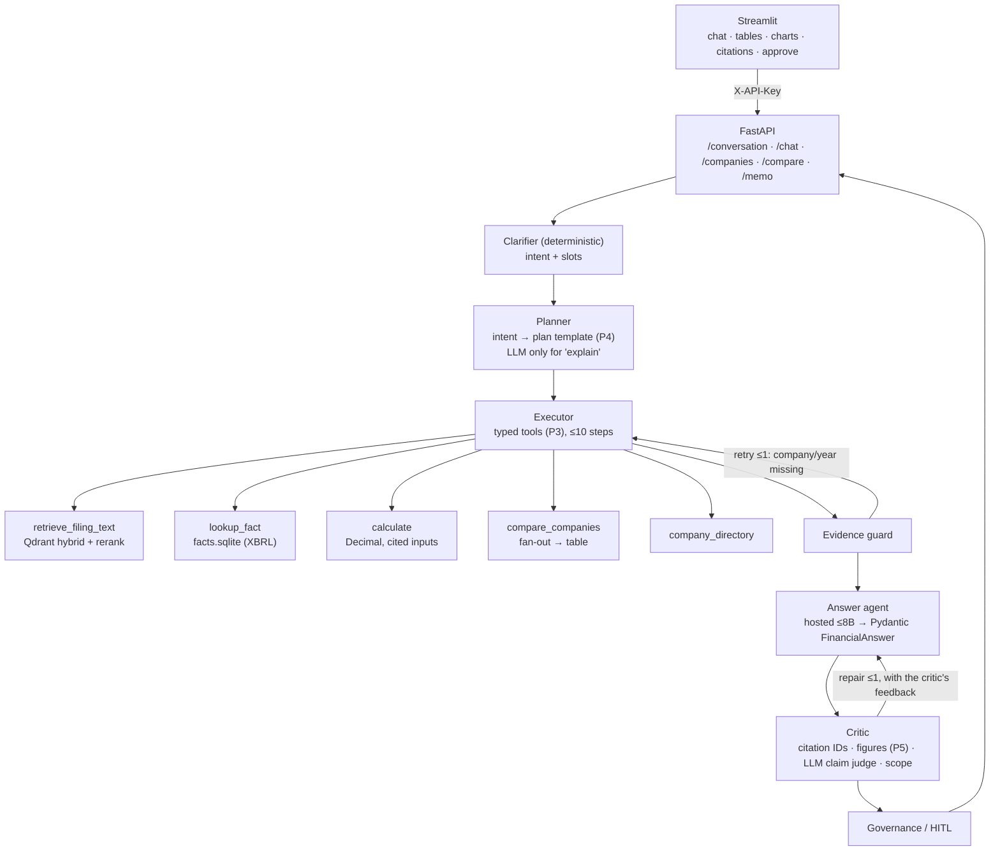

# Annual Report Copilot: features to implement

Date: 10 November 2026. Submission: **25 November 2026**. Companion to [capstone_implementation_plan.md](capstone_implementation_plan.md), which has the day plan, and [deployment.md](deployment.md), which covers running it and costs.

This is the build specification. Each feature lists:
- why it exists, with an example;
- how it works in the LangGraph / LangChain / FastAPI / Streamlit stack;
- the files it touches and its Pydantic contracts;
- the tests and the evaluation metric that prove it.

**Status:**
- **Done:** in the repo and tested; 387 tests pass (10 Nov).
- **Extend:** partly there.
- **New:** to build.

**Priority:**
- **P0:** needed for the submission.
- **P1:** strong demo value.
- **P2:** stretch / future work.

**Effort** is in person-days for one developer familiar with the repo.

---

## 1. Feature map

| ID | Feature | Level | Priority | Status | Effort | Depends on |
|---|---|---|---|---|---|---|
| P1 | Full 1,004-filing index (text + OCR) | Platform | P0 | Code done, run pending | 1 | — |
| P2 | XBRL facts store (`facts.sqlite`) | Platform | P0 | New | 1.5 | — |
| P3 | Typed tool layer (LangChain tools + Pydantic + retry) | Platform | P0 | Extend (4 graph tools done; Pydantic schemas new) | 1 | P2 |
| P4 | Plan templates by intent (deterministic planner) | Platform | P0 | Extend (LLM plan + rule validation done) | 0.5 | P3 |
| P5 | Number grounding in the critic, plus claim support | Platform | P0 | **Done** | — | — |
| P6 | Persistent conversations, step cap, auth, answer cache, Docker | Platform | P0 | **Done** | — | — |
| F1 | Cited Q&A on one filing | Single filing | P0 | Done | — | P1 |
| F2 | Clarifier for missing company, year or metric | Single filing | P0 | Done | — | — |
| F3 | "Not available" and refusals | Single filing | P0 | Done | — | — |
| F4 | Section summaries with a citation per bullet | Single filing | P1 | Extend | 1 | P1 |
| F5 | Financial statement tables | Single filing | P1 | Extend | 1 | P2 |
| F6 | Chart and table reading | Single filing | P2 | Extend | 1.5 | ColPali / VLM |
| F7 | Trend and growth (YoY, CAGR) | Ticker | **P0** | New | 1 | P2–P5 |
| F8 | Ratios with cited inputs | Ticker | **P0** | New | 1 | P2–P5 |
| F9 | What changed since last year | Ticker | P1 | New | 1.5 | P1 |
| F10 | Company fact sheet (PDF) | Ticker | P2 | Extend | 1.5 | F7, F8 |
| F11 | Peer comparison table | Sector | **P0** | New | 1 | F7, F8 |
| F12 | Sector, company and year filters in API and UI | Sector | P0 | **Done** | — | — |
| F13 | Sector-specific metrics (banks, insurers) | Sector | P1 | Extend | 1 | P2 |
| F14 | Ranking within a sector | Sector | P1 | New | 0.5 | P2 |
| F15 | Theme tracking (tariffs, AI, rates) by sector and year | Cross-sector | P2 | New | 1 | P1 |
| F16 | Cross-sector benchmarks | Cross-sector | P2 | New | 0.5 | P2 |
| F17 | Planner → executor → critic with bounded repair | Agentic | P0 | **Done** | — | — |
| F18 | Comparison agent (decompose, run in parallel, join) | Agentic | **P0** | Extend (decompose done; join table new) | 0.5 | P3 |
| F19 | Research memo with human approval | Agentic | P1 | New | 1.5 | F7, F8, F11 |
| F20 | Change alerts on a new filing | Agentic | P2 | New | 1 | F9 |
| F21 | Analyst signals (strengths, risks, watch items; never advice) | Agentic | P2 | New | 1 | F7, F8 |
| G1–G6 | Guardrail and grounding suite | Safety | P0 | Mostly done; G6 new | 0.5 | — |
| E1–E6 | Evaluation harness and reports | Evaluation | P0 | Extend / New | 2.5 | P0 features |
| U1–U6 | UI features | Front end | P0/P1 | Extend / New | 2 | features above |

**The P0 path** is P1 → P2 → P3 → P4 → P5 → F7, F8 → F11, F18 → G4, G6 → E1–E6 → U1–U4. That is about 13 days of work for one person, or 4–5 days spread across the six roles.

---

## 2. Target architecture

**Design rule for a small model:** the **deterministic layers choose what to fetch and compute**: the clarifier, the plan templates and the tools. **The LLM only writes prose around facts the tools return**, and the critic checks every number it writes. This is how the system compensates for the 8B model, and the report has a graded section on it.

---

## 3. Platform features

### P1. Full 1,004-filing index

- **Why:** every feature needs the corpus searchable. The rubric needs 500–2,000 documents.
- **How:**
  - Run `colab_rag_pipelines.ipynb` with `PIPELINE=colpali_qdrant`, `SMOKE_TEST=False` and ColPali off for the first pass (text + OCR only).
  - It works sector by sector and snapshots to Drive.
  - Restore into the server with `deploy/restore_index.sh`.
- **Done when:** `cp.coverage(s)["total"]["ingested"] == 1004`, and `GET /companies` lists 281 tickers.
- **509-filing variant:** 509 filings ingested (41 per sector + Adobe and Salesforce; all 42 eval-set filings included) and 143 tickers listed. Indexing fits one Colab session, so P1 finishes on 11 Nov and P2 needs only 143 companies' XBRL facts. Run with `CORPUS = "min500"` (notebook) or `--corpus-preset min500` (CLI). See [capstone_implementation_plan.md](capstone_implementation_plan.md) section 10.
- **Metric:** recall@5 on the 86-question set (E2).

### P2. XBRL facts store

- **Why:** the PDFs are good for text and citations but unreliable for exact numbers; the measured gold figure was in the top-5 evidence only 17% of the time. SEC XBRL `companyfacts` gives each reported figure with its period, unit and accession number.
- **Data:**
  - One `companyfacts` JSON per company: 281 requests, about 1 minute at ≤ 8 requests/s. 27 are already cached in `data/raw/financial_report_qa/edgar/companyfacts/`.
  - Extend `scripts/downloads/download_edgar_corpus.py --only companyfacts` to take the sector plan's CIKs.
- **New module `scripts/rag/facts.py`:**
  - `build(companyfacts_dir, out="indexes/facts/facts.sqlite")`.
  - `lookup(ticker, metric, fiscal_year) -> Fact | None`.
  - `series(ticker, metric, years) -> list[Fact]`.
  - Reuse `CONCEPTS` and `annual_fact` from [build_financial_eval_set.py](../scripts/evaluation/build_financial_eval_set.py): they are the rules the gold answers were built with. Move them into `facts.py` and import them back.
- **Table:** `facts(ticker, cik, metric, concept, fiscal_year, period_start, period_end, value TEXT, unit, form, accession, filed, original BOOL)`. Values are stored as text and read as `Decimal`.
- **Metric map:**
  - Canonical names from the clarifier's `METRICS`, mapped to the us-gaap concepts.
  - For banks: `InterestIncomeExpenseNet` (net interest income) and `Deposits`.
  - For insurers: premiums earned (`PremiumsEarnedNet`).
- **Rules:**
  - Annual values come from 10-K, FY period, ≥ 330 days.
  - Instant concepts use the period-end date.
  - The originally reported value wins; restatements are kept with `original=0`.
  - A missing value is `None`, never zero.
- **Tests:** a fixture companyfacts file gives AbbVie FY2025 revenue $61,160m, matching `eval_set_v1` FIN-001. Further tests cover a missing concept, an instant vs a duration concept, and a restatement.

### P3. Typed tool layer

- **Status (10 Nov):** four tools run inside the financial graph today: `coverage_lookup`, `text_search`, `visual_search` and `calculator` ([financial_tools.py](../scripts/agents/financial_tools.py)). They are chosen by the planner, validated by rules, and every call is logged in `agent_run.tool_calls`. Still to do: the Pydantic `args_schema` / result models and the retry-on-validation-error path below, plus `lookup_fact` (P2).
- **Why:** the rubric requires ≥ 3 tools, schema validation and retry logic, and small models fumble tool calls.
- **New module `scripts/agents/tools.py`.** Each tool is a LangChain `StructuredTool` with a Pydantic `args_schema` and a Pydantic result:

| Tool | Input model | Output model |
|---|---|---|
| `retrieve_filing_text` | `RetrieveArgs(query: str, ticker: str \| None, year: int \| None, sector: str \| None, k: int = 5)` | `list[EvidenceChunk(chunk_id, doc_id, page, text, score)]` |
| `lookup_fact` | `FactArgs(ticker: str, metric: str, fiscal_year: int)` | `Fact(ticker, metric, fiscal_year, value: Decimal, unit, period_end, concept, accession, source_id)` or `NotFound(reason)` |
| `calculate` | `CalcArgs(operation: Literal["growth","cagr","ratio","margin","difference","sum"], inputs: list[CitedNumber])` | `Calculation(result: Decimal, formula: str, inputs: list[CitedNumber], unit)` |
| `compare_companies` | `CompareArgs(tickers: list[str] (2–6), metric: str, years: list[int])` | `ComparisonTable(rows, missing: list[cell])` |
| `company_directory` | `DirectoryArgs(query: str)` | `list[Company(ticker, name, sector, years)]` |

- **How calls are validated:**
  - Every call goes through `run_tool(name, raw_args)`, which validates the args with Pydantic.
  - If validation fails, the model gets one retry with the validation error in the prompt; after that the run falls back to the deterministic plan (P4).
  - A tool error becomes `ToolResult(ok=False, error=...)` in the state and never raises.
  - All calls run through `common/resilience.Calls` (timeouts, `CallFailure`).
- **Tests:** schema rejects (bad ticker, year out of range, an unsupported operation), the retry path, and the error-as-data path.
- **Metrics:** schema validity on the first try vs after retry, and average tool calls per task (E3).

### P4. Plan templates by intent

- **Status (10 Nov):** the LLM's plan is already checked by rules (`normalize_plan`): unknown tools dropped, needed tools added, targets built from the question, and a fallback plan when the LLM's JSON is unusable (`plan.planner = "fallback"`). Still to do: the per-intent templates below, so the deterministic layer chooses the plan outright.
- **Why:** an 8B model plans poorly. The clarifier already resolves intent, companies, years and metric deterministically, so the plan can be a template.
- **How:** in the financial graph, `planner_node` builds a `Plan(steps: list[ToolStep])` from the clarifier slots:

| Intent | Plan |
|---|---|
| figure | `lookup_fact` → if not found, `retrieve_filing_text` |
| trend | `lookup_fact` × years → `calculate(growth, cagr)` |
| ratio | `lookup_fact` × inputs → `calculate(ratio/margin)` |
| comparison | `compare_companies` (fans out `lookup_fact`) → `calculate` per row |
| explain | `retrieve_filing_text` (MD&A / risk sections) → LLM answer |
| report | report pipeline (existing) |

- **LLM planning** is used only when the intent is `explain` or unknown, and its JSON plan is validated as `Plan`.
- **Step budget:** a plan is rejected if it would exceed `AGENT_MAX_STEPS`. Comparisons are capped at 6 companies × 5 years.
- **Tests:** one plan per intent; an oversize plan is rejected; an invalid LLM plan falls back to the template.

### P5. Number grounding and claim support in the critic: done 10 November

- **Why:** this is the measurable form of "no hallucination", and it is what lets a hosted model's own answer be shown.
- **As built** (`critic_step`, [agent_flows.md §6](agent_flows.md)):
  - **Figures (code):** `financial_tools.numeric_grounding(answer, cited_chunks, calculations)` extracts every number (years and counts up to 10 skipped). Each must match a **cited** chunk or a calculator result, at the precision the answer prints, in any unit scale ("$254.5 billion" = 254,453 million; "$255 billion" fails).
  - **Claims (LLM judge):** the judge splits the answer into claims and decides for each whether the cited text states it; unparseable output counts as `unverified`. A failed figure check overrides the judge.
  - **Verdict:** `supported`, `partially_supported`, `unsupported` or `unverified`, returned as `support_check`.
- **Result:**
  - Not supported → one repair; the answer step gets the unsupported claims and missing figures.
  - Still not supported → governance adds `unsupported_claims` → `pending_human_review`.
  - With a hosted LLM, the generated answer is shown only when the verdict is `supported` (`grounding.semantic_answer_verified = true`); otherwise cited excerpts (`evidence_only`).
  - `RAG_SUPPORT_CHECK=0` turns the support check off (for the ablation).
- **Differs from the original plan:** the check lives in `financial_tools`, not `guardrails/checks`; XBRL `Fact` values become valid sources once P2 exists; an unsupported answer goes to review (and excerpts) instead of `not_grounded`.
- **Tests:** [tests/test_agent_support.py](../tests/test_agent_support.py): rounding and scale, a fabricated figure caught even when the judge agrees, judge feedback in the repair, fail-closed parsing, hosted answer shown only when verified, verification flag kept by the API.
- **Metric:** the unsupported-claim rate and verified-answer rate (E3), from `support_check` in each response.

### P6. Deployment foundations: done 10 November

| Item | Where it lives |
|---|---|
| Persistent conversations | `CONVERSATION_DB` |
| 10-step cap | `AGENT_MAX_STEPS` |
| API key auth | `API_AUTH_TOKEN` |
| Answer cache | `ANSWER_CACHE_SECONDS` |
| `/companies` endpoint | API |
| Pickers in Streamlit | UI |
| Docker Compose + HTTPS | compose files |
| `server` profile | `RAG_PROFILE=server` |

Details are in [deployment.md](deployment.md); the tests are in `tests/test_deployment_readiness.py`.

---

## 4. Features by level

### F1–F3. Cited Q&A, clarifier, refusals: done

- **What exists:** `/conversation/financial_report_qa` → clarifier → `agentic_graph`.
  - Citations are checked against retrieved IDs (`apply_grounding_policy`).
  - `question_scope` covers corpus coverage, and the company-scope check is in place.
- **Remaining:**
  - Run them on the full index (P1).
  - Route figure questions to `lookup_fact` first (P4), with the PDF page as the citation when found.

### F4. Section summaries (P1)

- **Example:** "Summarise JPMorgan's 2025 risk factors in 5 bullets."
- **How:**
  - Retrieval is filtered by `section` (`item_1a`, `item_7`), a payload field that already exists.
  - The prompt asks for at most 5 bullets, each ending with a `[chunk_id]`.
  - The critic requires one valid citation per bullet.
- **Files:** `prompts/financial.py` (summary template) and `financial_prompting_agent.py` (the `summary` intent).
- **Done when:** every bullet cites a chunk from the right filing and section, and 10 summary questions are added to the eval set as text facts.

### F5. Financial statement tables (P1)

- **Example:** "Show Costco's income statement for FY2024."
- **How:**
  - A fixed list of metrics per statement goes through `lookup_fact` (P2) and returns a table.
  - The PDF page with the statement is retrieved for the citation.
  - The existing report generator (`generate_financial_report`, Apple profile) stays the full-PDF path.
- **Done when:** the table values equal XBRL; missing lines show "not reported", never zero.

### F6. Chart and table reading (P2)

- **How:**
  - ColPali finds the page (`RAG_FIN_VISUAL=1`).
  - Values come from the VLM transcription (pipeline 1) or the closed-model pass (see [deployment.md](deployment.md) §5.3).
  - Values not printed on the page stay marked "approximate" and are never used in calculations.
- **Eval:** the 6 `chart_value` questions in the eval set.

### F7. Trend and growth (P0)

- **Example:** "How did NVIDIA's revenue grow from FY2023 to FY2026?"
- **How:** plan template `trend` (P4):
  - `lookup_fact` for each year;
  - `calculate(growth)` for each pair of consecutive years and `calculate(cagr)` over the span;
  - the LLM writes 2–3 sentences around the numbers, and the critic checks them (P5).
- **Output (`TrendAnswer`, Pydantic):** `series: list[Fact]`, `growth: list[Calculation]`, `cagr: Calculation | None`, `narrative: str`, `citations`.
- **API:** `/conversation` (intent `trend`), plus `POST /trend {ticker, metric, years}` for the UI chart.
- **UI:** line chart and table (U2).
- **Gaps:** a missing year leaves a gap in the series, never an interpolated value. The CAGR is only computed when both ends exist.
- **Tests:** CAGR arithmetic (`Decimal`), a missing middle year, and the fiscal-year label (Home Depot's "fiscal 2025" ends in 2026).
- **Eval:** the `computed_metric` category (10 questions) plus 5 new trend questions.

### F8. Ratios with cited inputs (P0)

- **Examples:**
  - Margins: gross, operating and net.
  - ROE = net income / average equity.
  - Debt / equity.
  - FCF = operating cash flow − capex.
  - FCF conversion.
  - Payout ratio = dividends / net income.
- **How:** a `RATIOS` table in `facts.py`: `name → (operation, [metric inputs], unit, applies_to)`.
  - `applies_to` excludes banks from gross margin (the clarifier already does this).
  - Output: `Calculation` with the formula, e.g. "operating income 123,216 / revenue 391,035 = 31.5%", and the source of each input.
- **Tests:** each ratio on fixture facts; the bank exclusion; division by zero → `not_available`.

### F9. What changed since last year (P1)

- **Example:** "What new risks did Pfizer add in 2025?"
- **How:**
  - Retrieve `item_1a` chunks for years *n* and *n−1*.
  - Align the paragraphs by embedding similarity: a cosine below 0.6 means new or removed.
  - The LLM summarises only the unmatched paragraphs, with citations from both years.
- **Done when:** a planted new paragraph is reported, and identical sections report "no material change".

### F10. Company fact sheet (P2)

- Extends `generate_financial_report` with a one-page layout: KPIs (F8), trend charts (F7), 3 cited highlights (F4) and a risk list (F9).
- It needs a human approval before it is shown as final (F19's approval flow).

### F11. Peer comparison table (P0)

- **Example:** "Compare JPMorgan, Bank of America and Wells Fargo on net income, 2022–2025."
- **How:** `compare_companies` (P3):
  - a parallel `lookup_fact` for each (ticker, year), through the 4-slot pool in `resilience.Calls`;
  - `calculate(growth)` per company;
  - a rank column.
- **Output (`ComparisonTable`):**
  - `rows[ticker] → {year: Fact | None}`;
  - growth per company;
  - `missing` cells listed explicitly;
  - the LLM writes a 2–3 sentence comparison that the critic checks.
- **API:** `/conversation` (intent `comparison`), plus `POST /compare` for the UI.
- **UI:** table plus a grouped bar chart (U2).
- **Tests:** a missing cell stays missing; companies from different sectors get a warning when the metric doesn't apply.
- **Eval:** the 6 `comparison` questions plus 6 new ones.

### F12. Filters: done

- **API:** `sector` / `ticker` / `year` on chat and retrieve.
- **`GET /companies`** lists the coverage.
- **Streamlit:** pickers filtered by sector.

### F13. Sector-specific metrics (P1)

| Sector | Metrics | Source |
|---|---|---|
| Banking | net interest income, deposits, provision for credit losses, efficiency ratio (non-interest expense / revenue) | XBRL; the ratio comes from `calculate` |
| Insurance | premiums earned, combined ratio (losses + expenses / premiums) where tagged | XBRL; text otherwise |
| Oil and gas | production volumes, proved reserves | PDF text and charts (F6); usually not tagged in XBRL |
| Real estate | FFO (non-GAAP) | PDF text only, labelled non-GAAP |

The clarifier suggests the right metric when the asked one doesn't apply. Its `metric_not_applicable` handling already exists for banks.

### F14. Ranking within a sector (P1)

- **Example:** "Which retailer had the highest operating margin in 2024?"
- **How:** run F8 over every ticker in the sector (`/companies?sector=retail`) and sort; ties and missing values are listed.
- **Limit:** at most 40 companies per question, with no LLM call per company. It is deterministic.

### F15. Theme tracking (P2)

- **Example:** "Which sectors mention tariffs most in 2025?"
- **How:** count filings with sparse/BM25 hits per (sector, year), normalised by the number of filings, plus 2 cited example passages per sector.
- **Output:** a heat-map table. It counts mentions; it doesn't judge sentiment.

### F16. Cross-sector benchmarks (P2)

- Median and interquartile range of a ratio (F8) by sector and year, from `facts.sqlite`.
- Each company's percentile within its sector.

### F17. Planner → executor → critic (P0): done 10 November

- **Graph:** security → plain text → plan → retrieve ⇄ evidence guard → answer → calculator? → critic ⟲ ×1 → governance ([agent_flows.md](agent_flows.md)).
- **As built:**
  - `plan_step`: the LLM proposes tools; `financial_tools.normalize_plan` keeps known tools, always keeps `text_search`, adds `calculator` / `coverage_lookup` when the question needs them, drops `visual_search` when no ColPali index is served, and builds company × year targets. Every rule change is listed in `plan.adjustments`.
  - `retrieve_step` is the executor: it runs the planned tools (coverage check, one filtered search per target, optional ColPali).
  - `evidence_guard_step` → **retry once** for targets that found nothing (broadened query, twice the depth, same filters).
  - `answer_step` writes `CALC[...]` for arithmetic → `calculator_step` (only numbers and `+ - * /`; operands must be in the evidence).
  - `critic_step` checks citation IDs and P5; **repairs once** with its feedback. (The old repair loop never ran; fixed.)
  - Loops run only if the rest of the run fits `AGENT_MAX_STEPS`; the response carries `agent_run` (path, tool calls, retries, repairs, calculations) for E3.
- **Still to do:** P4 intent templates and P3 Pydantic tool schemas around the same nodes.
- **Tests:** [tests/test_agent_routing.py](../tests/test_agent_routing.py).

### F18. Comparison agent (P0)

- **Done:** the planner splits comparisons and trends into one filtered search per company × year (at most 6); companies or years outside the index are skipped by `coverage_lookup` and named in the answer.
- **To do:** the joined table below. Searches currently run one after another.
- Same graph. The plan fans out across companies and years in the executor: parallel, at most 24 lookups.
- A join node builds `ComparisonTable`, and the answer agent sees the table, not the raw chunks.
- **Failure handling:** if one company's tool call fails, its row is marked `tool_error` and the rest is still answered (partial answer, clearly labelled).

### F19. Research memo with human approval (P1)

- **Example:** "Draft a one-page memo on Costco's FY2024 performance vs Walmart."
- **How:**
  - F11 + F7 + F8 + F4 sections go into a Markdown memo.
  - Status `pending_human_review` puts it in the existing HITL queue (`human_review_queue`).
  - `POST /review/{queue_id}` with `approve` / `reject` + a comment → then the PDF export.
  - Nothing is published without approval. This is the stated human-in-the-loop boundary.
- **UI:** Approve / Reject buttons (U4).

### F20. Change alerts (P2)

- When ingestion finishes a new filing, a job runs F9 and the F8 ratios against the previous year.
- It flags changes beyond thresholds (|revenue growth| > 20%, margin change > 5 pp, new risk sections) into an alerts table, shown in the UI.

### F21. Analyst signals, never advice (P2)

- **Output:** strengths / risks / watch items, computed by rules on F7/F8 outputs. Examples:
  - revenue growth > 10% two years running;
  - leverage up > 25%;
  - FCF negative.
- Each signal cites its facts.
- **Guardrails:**
  - The output filter blocks buy/sell/hold language.
  - Every response carries a fixed disclaimer.
  - Requests for advice are refused (G3).

---

## 5. Guardrails and grounding (G)

| ID | Guard | Status | Test |
|---|---|---|---|
| G1 | Input guard: injection, code, encoded payloads | Done | `test_guardrails.py` |
| G2 | Evidence guard: injected instructions inside retrieved chunks | Done | Add **10 planted injected chunks** to a fixture index |
| G3 | Advice / prediction / personal-data refusal | Done | 8 refusal questions in the eval set |
| G4 | **Number grounding and claim support (P5)** | **Done** (10 Nov) | `test_agent_support.py`: fabricated figure, unsupported claim, judge fail-closed |
| G5 | Citation validity, company scope, relevance floor | Done | existing tests |
| G6 | **Red-team suite:** 25 adversarial prompts (injection, jailbreak, PII, advice, tool abuse, oversize input) with expected outcomes | **New** | `tests/test_red_team.py` + a report appendix |

**PII:** secret and sensitive-data redaction exists (`checks.redact`). Logs never store bodies; traces are redacted. Add 5 PII prompts to G6.

---

## 6. Evaluation (E)

| ID | Feature | Status | Details |
|---|---|---|---|
| E1 | **Agent evaluation runner** `scripts/evaluation/evaluate_agent.py` | New | Runs the 86 frozen questions through `/conversation` (or in-process) for a configuration; writes `eval/<run>/results.jsonl` + `summary.json` |
| E2 | Retrieval metrics, separately | Extend | recall@1/5/10, MRR, nDCG against gold pages (`evaluate_financial_rag.py`, `retrieval_metrics.py`) |
| E3 | Answer metrics | New | Numeric accuracy (within 0.5% after unit normalisation), text-fact rubric, task completion, citation correctness and coverage, schema validity (first try / after retry), **unsupported-claim rate**, tool calls per task, tokens and cost, p50/p95 latency |
| E4 | Configuration comparison | New | 3 single-prompt baselines (structured few-shot, CoT/self-consistency, decomposition); RAG only; full agent; ablations (no reranker, no critic, no facts tool). One table in the report |
| E5 | Failure taxonomy | New | Each wrong answer gets one label: retrieval miss / reasoning error / tool-call error / hallucination / routing or permission / malformed output. Auto-suggested from the trace, confirmed by a person |
| E6 | LangSmith dataset and experiments | New | Upload the eval set as a LangSmith dataset; each E4 configuration is an experiment, which gives the trace dashboard to submit |

**Done when:** `python -m scripts.evaluation.evaluate_agent --config full_agent` reproduces the report tables from a clean checkout plus the restored index.

---

## 7. User interface (U)

| ID | Feature | Status | Details |
|---|---|---|---|
| U0 | Feature guide | **Done** (10 Nov) | "What can I ask?": one clickable example per working capability, built from `/companies` so every example is answerable; a live coverage line (filings, companies, sectors, years); a test-mode notice with the mock LLM; "How to read an answer" (statuses, support check, the *Thought for N s* dropdown). `tests/test_ui_guide.py` |
| U1 | Citation panel | Partly done | **Done:** numbered citations [1] [2] in the answer, listed under it and in the *Sources* tab by company, fiscal year (the company's own name for it) and page (`ui_thinking.source_label`). **To do:** the section, and opening the PDF page image (rendered on demand) |
| U2 | Comparison and trend views | New | `st.dataframe` table + `st.bar_chart` / `st.line_chart` from `ComparisonTable` / `TrendAnswer`; a download-CSV button |
| U3 | Answer card | Partly done | **Done:** status, agent, critic-verdict and figures-verified badges above the answer (`render_badges`). **To do:** calculations shown with formulas, an "approximate" tag for chart values, the disclaimer |
| U4 | Human review | New | Pending items with Approve / Reject and a comment → `POST /review/{id}` |
| U5 | Feedback | New | Thumbs up/down + reason, stored with the request ID (for the error analysis) |
| U6 | Evaluation dashboard page | New | Reads `eval/*/summary.json`: accuracy by category, recall@k, the taxonomy chart, latency; used in the demo |
| U7 | Chat and thinking view | **Done** | Right-aligned question bubbles, a live *Thinking…* line with a timer while the agents work (input disabled), the answer typed out, the guide in the sidebar once the chat starts, a navy and teal theme (`scripts/ui/.streamlit/config.toml`, `chat.css`). One collapsed **Thought for N s** dropdown replaces the five expanders: *Steps* (timeline of `agent_run`), *Agent graph* (Mermaid, path taken highlighted), *Sources*, *Checks*, *Raw* (`scripts/ui/ui_thinking.py`). UI only: the API has no per-step times or streaming, so the steps appear when the answer does. `tests/test_ui_thinking.py`, `tests/test_ui_guide.py` |

---

## 8. Build order to 25 November

| Days | Build | Owner role |
|---|---|---|
| 10–12 Nov | P1 ingestion run on Colab; P2 facts store | RAG / retrieval; domain and eval |
| 12–13 Nov | P3 tools, P4 plan templates | Agent orchestration |
| 13–14 Nov | P5 number grounding; F7, F8 | Agent orchestration; observability and safety |
| 14–15 Nov | F11, F18; F17 wiring | Agent orchestration |
| 15–16 Nov | U1–U4 | Front end |
| 16–18 Nov | E1–E6 runs; G6 red team | Domain and eval; observability and safety |
| 19 Nov | F4, F13, F14 if on schedule | Prompt engineering |
| 20 Nov | Deploy to the VM (compose + HTTPS); LangSmith dashboard | Front end and deployment |
| 21–24 Nov | Report, demo, dry run | All |

**Cut order if late:** F21 → F20 → F10 → F15/F16 → F9 → F19 → F4/F5. **Never cut** P2–P5, F7, F8, F11, E1–E6, or the deployment.

---

## 9. Definition of done (every feature)

1. **Code:** in the right layer (`agents/`, `rag/`, `guardrails/`, `api/`, `ui/`), with absolute imports and settings from the environment.
2. **Contracts:** Pydantic models for inputs and outputs; API routes documented in OpenAPI.
3. **Tests:** pass offline (`pytest tests`, mock LLM, hashing embeddings, fixture facts). Cover at least one failure path.
4. **Evaluation:** questions for the feature are in the eval set (new questions go to `eval_set_v2`; v1 stays frozen) and the feature appears in E3/E4.
5. **Traces:** the feature's run shows its tool calls in LangSmith.
6. **Docs:** a line in the README, plus this file's status updated.
7. **Demo:** if it is in the demo script, it has been run on the deployed URL.
