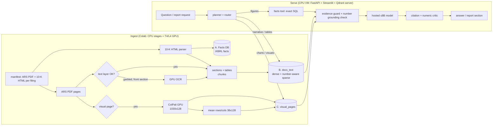
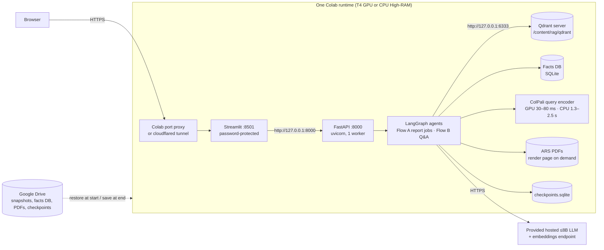

# Final design: multimodal financial RAG for 500–1,000 documents (Qdrant + Colab + agents)

Date: 2026-11-04. Status: **final design for implementation**. This document supersedes the storage and ingestion parts of [implementation_recommendations.md](implementation_recommendations.md), and adds the scale-out, numeric-integrity, cost and deployment decisions.

Labels:
- **measured**: measured in this repo on 2026-11-04.
- **published**: from Qdrant's blog and notebooks.
- **estimate**: to be confirmed in the Colab run.
- **target**: an acceptance threshold, not a result.

---

## 1. Answers in brief

| Question | Answer |
|---|---|
| Will 500–1,000 documents run smoothly? | **Yes, with the design in sections 3–7.** Ingest is a resumable batch job on a Colab GPU; serving runs on a small CPU VM. Search speed hardly changes with corpus size, because queries are filtered by company and year, and the full-vector rerank always scores the same ~300 candidates. |
| Can numbers be lost because of row/column pooling? | **No, in this design.** Pooling only decides *which page images become candidates*. Numbers are never read from vectors. They come from (1) official XBRL facts, which are exact and tagged, (2) text and tables stored verbatim in the payload, found by number-aware keyword search, and (3) chart labels: exact PDF text where possible, otherwise OCR that passes two readings plus geometry checks, or a reviewer's approval (section 4.1). An answer that contains a number not found in the cited evidence is withheld (section 4). |
| Does Qdrant keep data in RAM? | **Only what you configure.** Pooled vectors, HNSW graphs and indexes: RAM. Full ColPali vectors: **disk** (memory-mapped; the OS caches the pages in use). Payload: disk. At 1,000 documents Qdrant needs ~**2.1 GB RAM**, plus cache (section 5.3). |
| Storage? | Qdrant **9.4 GB (500 docs) / 18.7 GB (1,000 docs)**; PDFs 4.9 / 9.8 GB; facts DB 0.2 / 0.4 GB. Persistent total **~14 / ~29 GB** (section 6). |
| Recall and accuracy? | Exact figures: **100% when the figure is XBRL-tagged** (tool lookup). Visual search: Recall@20 **0.917** vs full ColPali (**published**); target ≥ 0.90 on our pages. End-to-end numeric accuracy target ≥ 98%, with "not disclosed" instead of a guess (section 8). |
| Speed? | Q&A: **~0.1–0.3 s retrieval** (+2.5 s ColPali query encoding on CPU for visual questions only, **measured**); ~4–15 s with the LLM. Report: **~2–7 min** of machine time per company, most of it LLM generation, plus human approvals (section 9). |
| Is the free tier enough? | **For compute, mostly.** Ingesting 1,000 documents takes ~9–33 GPU-hours, so 2–4 free T4 sessions, if a T4 is available. **For storage, no:** persistent data is 14–29 GB against 15 GB free Drive. **For hosting the app, no:** Colab is not a server (section 12). |
| Can FastAPI + Streamlit run on Colab with Qdrant? | **Yes, for demo sessions on a paid runtime.** Everything runs in one runtime over `127.0.0.1`, and only Streamlit is exposed through a tunnel. That costs ≈ $0.39 per 3-hour demo on a T4, or ≈ $0.05 on CPU High-RAM. It is not always-on: each session restores from Drive in ~10–20 min (section 11.1). |
| Cost? | One-off ingest: **≈ $5–10** of Colab compute units. Drive: **$1.99/month** (100 GB). Serving VM: **≈ $98–132/month** on demand, or ≈ $0.13–0.18 per hour only when running a demo (section 12). |
| Which LLM? | The **provided hosted ≤8B model**, as the Track B brief requires ([track-2.md](track-2.md)). Report quality comes from deterministic numbers, short sections with metric slots, a critic, and an explicit missing-data policy, not from a bigger model (section 10). |

---

## 2. What the measurements changed

| Finding (**measured**) | Consequence |
|---|---|
| **20.3% of text pages (2,820 of 13,865) in 49 of the 100 EDGAR ARS PDFs have a garbled text layer.** Fonts lack a character map; for example Chevron's 123 pages give 409k characters of junk. 24 documents are more than half garbled. | PDF text extraction alone **loses those numbers**. |
| The current OCR rule only runs on sparse text, `�` characters or large scans ([selective_ocr.py:82-88](../scripts/rag/selective_ocr.py#L82-L88)), so it **never runs on garbled pages** | A text-quality check must force OCR, or another text source must be used |
| RapidOCR (forced full-page) on Chevron: **all 5 statement figures recovered** (pages 58–61) after removing commas and spaces before comparing, but **18 s per page** on CPU (2 threads, 2× render). It also drops some thousands separators: `(8,001)` → `(8001)`. | OCR is accurate enough as a fallback, but ~29k garbled pages (1,000 docs) would take **~145 CPU-hours**. Use it only where the 10-K doesn't cover the page, on GPU, and always compare digits after normalising. |
| The **10-K HTML** for the same fiscal year has clean text: Chevron 569k characters, **all 5 statement figures present**, **3,146 tagged XBRL facts**. Nvidia 1,218 facts; Merck 3,244 facts. | **Use the 10-K HTML/iXBRL as the text and number source.** Use the ARS PDF for page images (ColPali) and the glossy front section. |
| XBRL figures in the PDF text layer: **85 of 96 (89%)**. 7 of 8 companies 100%; Chevron 0% (garbled) | The clean PDFs are reliable. The garbled ones are the whole gap. |
| PyMuPDF `find_tables` found the table on only **13 of 85** pages where a statement figure appears | Don't depend on PDF table detection for numbers. HTML `<table>` and iXBRL tags give structure. |
| The text tokenizer **splits numbers** (`391,035` → `391` + `035`; `6.08` → `6` + `08`) | Add a number-aware sparse tokenizer (section 4) |
| ColPali reads **pixels**, so broken fonts don't affect it | Visual retrieval works on garbled PDFs too |
| Rendering a page from the PDF on demand: **159 ms median** (p90 355 ms); PNG 176 KB median | **Store PDFs, not PNGs** (9.8 GB vs 22 GB at 1,000 docs). Render the 1–2 pages an answer needs. |

---

## 3. Architecture

### 3.1 Four stores, each holding what it is best at

| Store | Contents | Built from | Used for |
|---|---|---|---|
| **A. Facts DB** (SQLite/DuckDB) | Every iXBRL fact: company, CIK, fiscal year, period start/end, concept, label, value, unit, scale/decimals, dimensions (segment, geography), accession, HTML anchor | 10-K HTML (`ix:nonFraction`) + SEC companyfacts API | **Exact numbers**, ratios computed in code, ground truth for evaluation |
| **B. Qdrant `docs_text`** | Text chunks by 10-K section (Item 1, 1A, 7, 7A, 8…) and table chunks (markdown with row and column headers + units) | 10-K HTML; ARS front-section pages (native text if clean, GPU OCR if garbled) | Narrative, explanations, risk factors, table lookup by words or numbers |
| **C. Qdrant `visual_pages`** | ColPali full vectors (on disk) + mean-pooled rows/columns (RAM) + text summary | ARS PDF pages that contain charts, images or tables | Finding charts and infographics; page images for citation and review |
| **D. Object store** | ARS PDFs (rendered on demand), `manifest.jsonl` | EDGAR downloads | Page images, provenance, re-ingest |

### 3.2 Flow



### 3.3 Linking a 10-K to its ARS

Each ARS row in [edgar/pdf_manifest.jsonl](../data/raw/financial_report_qa/edgar/pdf_manifest.jsonl) already records the fiscal year taken from the matching 10-K. Store `tenk_accession` and `tenk_url` beside `accession_number`, so every chunk, fact and page shares one `filing_id`.

---

## 4. How numbers are protected despite row/column pooling

Pooling averages position away, but it never touches the stored numbers. Each layer below is independent:

| # | Layer | What it guarantees |
|---|---|---|
| 1 | **Numbers never pass through vectors.** They are stored as exact strings in the payload (`text`, `table_markdown`) and as typed values in the facts DB | Pooling and quantization can't change a digit |
| 2 | **Pooled vectors only choose candidate pages.** The full 1030-vector MaxSim decides the final visual ranking | The only possible loss is a missed visual candidate, never a changed value |
| 3 | **Numeric questions go to exact paths first:** facts tool (concept + period + company) → number-aware keyword search → dense text → visual | A figure is found by value, label or concept even if no image matches |
| 4 | **Number-aware sparse tokens:** keep `391,035`, `391035`, `6.08`, `$6.08`, `2.1%`, `fy2024` as single tokens | Exact-figure keyword search becomes possible (it isn't today) |
| 5 | **Units and scale travel with the number:** table chunks carry "in millions, except per-share", and facts carry `unit` + `decimals` | No 1,000× errors |
| 6 | **Number grounding check before release:** every number in an answer or report must match, after normalisation, a fact, a cited chunk, or a value computed by a named formula from facts | An answer with an unsupported number is withheld or sent to review (extends `apply_grounding_policy`) |
| 7 | **Ground-truth evaluation** with XBRL-derived questions (section 8) | Loss is measured, not assumed |

**Numbers that appear only in charts** used to be the one gap. Section 4.1 closes it. A chart number is used only if it comes from an exact source, passes two independent OCR checks, or is approved by a human. Otherwise the answer says the value isn't stated.

### 4.1 Numbers that appear only in charts

#### What the corpus actually contains (**measured**, 25 EDGAR ARS PDFs)

| Chart or figure type | Pages / regions | Where its numbers come from |
|---|---|---|
| Vector chart or table whose numeric labels are **real PDF text** | 117 pages | Exact: read words and positions from the PDF, no OCR |
| Raster image **with a text layer** over it | 57 pages | Exact: PDF text |
| Vector chart **with no numeric labels** (bars and lines only) | 90 pages | No number is printed, so there is nothing exact to extract. Trend and ranking can be described from the geometry |
| Vector chart in a **garbled font** | 25 pages | OCR of the rendered region (as for garbled text) |
| **Pixel-only** image regions | 84 regions, of which **21 contain numbers** (~0.8 per document) | OCR of the image crop |

So OCR is needed for only about 1–2 regions per document. Most chart numbers are already exact text, and most pixel-only images are photos or diagrams.

#### OCR test on the 21 number-bearing pixel-only charts (**measured**)

| Check | Result |
|---|---|
| Two RapidOCR passes (2× and 3× render) | Same numbers in 20 of 21 charts. One chart had 2 disagreements |
| Correctness, checked against the image (Nvidia revenue chart) | All 4 data labels exact: $229.70, $113.27, $54.03, $40.93 |
| Correctness (Chevron production charts) | Labelled totals exact (1,440; 279; 7,677; 11.2), but **both passes also returned "12000", which is not on the chart** (probably the "2,000" axis tick). Agreement between passes alone is not proof |
| Unlabelled stacked segments (Chevron, by region) | No printed value exists, so no tool can give an exact number |
| OCR time per image crop | ~2 s per region on CPU, both passes included (84 regions in 184 s), against 18 s for a full page |

#### The fix: an extraction ladder, with provenance on every chart number

| Tier | Source | Accepted automatically? |
|---|---|---|
| **T1** | XBRL fact (10-K `us-gaap`, proxy `ecd` pay-versus-performance, e.g. Microsoft `TotalShareholderRtnAmt` = 143, **measured**) | Yes |
| **T2** | 10-K / filing text or table (exact text) | Yes |
| **T3** | PDF text label inside the chart region (vector charts, text layers) | Yes |
| **T4** | OCR **validated**: two readings agree **and** the geometry checks below pass, **or** the value matches T1/T2 | Yes, labelled "read from chart" |
| **T5** | OCR without validation | **No.** Shown only as "unverified chart reading" and sent to review; never used in a report |
| **T6** | Human-approved in the review screen | Yes, labelled "verified by reviewer" |

**Geometry checks for T4** (cheap, deterministic):
1. **Axis ticks must form an even sequence.** 0, 500, 1,000, 1,500, 2,000 is valid, so a "12000" among them is rejected, as in the Chevron case.
2. **A data label must sit at a bar top or line point.** Its box must be within a few points of a filled shape's edge in the same chart region.
3. **Value must match bar height.** Converting the bar top through the axis scale must give the label value within ±3%. Nvidia: $229.70 sits just under the $250 tick, as expected.
4. **Totals must add up.** Stacked or segment labels must sum to the printed total, within rounding.
5. **Units and scale come from the chart title or axis** ("in billions", "thousands of barrels per day") and are stored with the value.

**Other sources to check first.** Many glossy-report figures are tagged or printed elsewhere:
- total shareholder return and peer return in the proxy statement's XBRL (`ecd`);
- revenue, profit and cash returned in the 10-K;
- operating KPIs in the 10-K business section.

When a chart number matches one of these, it is promoted to T1/T2.

**Where the values are stored.** Every chart number goes into the facts DB as a `chart_value` row with:
- `filing_id`, page and bounding box;
- series and category labels (e.g. "2022", "NVIDIA");
- value, unit and tier;
- the checks passed, and the OCR readings.

The answer agent and report writer call the same `get_fact` tool, so a chart value is cited like any other number, with its tier shown.

**Human review.** The review queue shows the page image with each candidate's box drawn on it. Expected volume is ~1 number-bearing chart per document: ~500–1,000 charts at 1,000 documents. Review only those that a question or report actually needs, so most are never reviewed. An approval is stored as T6 and audited.

**What is still never stated:** a value no document prints. Examples are unlabelled stacked segments, or a bar with no data label and no axis. For these the system describes only the trend or ranking ("Asia was the largest segment in 2022"), states that the exact value is not printed, and links the page image. It never estimates a value from bar height in a report.

**Optional third reader.** A local vision model (e.g. Qwen3-VL-2B, already in `indexes/models/`) can read chart crops at ingest time. Its values count only if they agree with OCR **and** pass the geometry checks, so it never is the only source. Confirm with course staff first, because Track B allows only the provided model for generation.

**Evaluation.** Hand-label ~50 number-bearing charts, both pixel-only and vector. Report precision and coverage per tier. **Target: precision ≥ 99.5% for automatically accepted values (T1–T4)**, with coverage reported honestly. Values below that threshold stay in T5.

### Which path answers which question

| Question type | Primary path | Fallback | Number source |
|---|---|---|---|
| "What was Chevron's net income in FY2025?" | Facts tool | Number-aware search in Item 8 tables | XBRL fact (exact) |
| "Gross margin trend 2023–2025" | Facts tool ×3 periods + ratio in code | Statement table chunks | Computed from facts, formula cited |
| "Why did data center revenue grow?" | `docs_text` (Item 7 MD&A) | Visual pages | Quoted text |
| "Show the chart of shareholder returns" | `visual_pages` (pooled prefetch → full rerank) | Facts tool (`ecd` TSR facts) | T1 XBRL if tagged, otherwise a T3/T4 `chart_value` (section 4.1). Never a T5 value without its "unverified" label |
| "Segment revenue by region" | Facts tool (dimensional facts) | Segment note table chunks | XBRL fact with dimension |

---

## 5. Qdrant design and optimisations

### 5.1 Collections (one Qdrant server, single node, 1 shard)

| Collection · vector | Shape / type | Index | Storage | Notes |
|---|---|---|---|---|
| `docs_text` · `dense` | provided embedding endpoint (dimension per endpoint; MiniLM 384 locally) | HNSW m=16, ef_construct=100 | RAM (on disk if dimension ≥ 1024 at 1,000 docs) | Optional scalar int8 quantization (`always_ram`, rescore on) if RAM is tight |
| `docs_text` · `bm25` | sparse, IDF modifier | sparse index | RAM/disk (default) | Number-aware tokenizer (section 4) |
| `visual_pages` · `colpali` | 1030 × 128, MaxSim, **float16** | **`m=0` (none)** | **on disk (mmap)** | Rerank only |
| `visual_pages` · `mean_rows` | 38 × 128, MaxSim, float16 | HNSW | **RAM** | First stage |
| `visual_pages` · `mean_cols` | 38 × 128, MaxSim, float16 | HNSW | **RAM** | First stage (column structure) |
| `visual_pages` · `summary` | text embedding of page text/OCR | HNSW | RAM | First stage, text side |

### 5.2 Optimisations used, and ones deliberately not used

| Technique | Decision | Why |
|---|---|---|
| Mean pooling of rows + columns, keeping the 6 special tokens | **Use** | NDCG@20 0.952 / Recall@20 0.917, 12× faster (**published**) |
| Max pooling | Don't use | 0.759 / 0.656 (**published**) |
| Full vectors float16, on disk, `m=0` | **Use** | Halves storage; rerank reads only candidates; no costly graph |
| Binary quantization of pooled prefetch | Don't use | −0.04 NDCG, −0.06 recall for ~6% speed (**published**) |
| Removing `<pad>` tokens from queries | **Use** (already done by the attention mask) | Free speed-up, −0.006 NDCG (**published**) |
| Payload indexes on `ticker` (keyword, `is_tenant=true`), `fiscal_year` (integer), `filing_id`, `section`, `content_type`, `doc_kind` (10-K/ARS) | **Use** | Filtered search touches one company's points; tenant index keeps them together on disk |
| `on_disk_payload=true` | **Use** | Payload text is large and read only for returned points |
| Bulk ingest: `hnsw m=0` / high `indexing_threshold` while uploading, restore after each batch; gRPC; batches of 16–64 points; `wait=false` with a final wait | **Use** | Avoids rebuilding graphs on every insert |
| Native fusion: `FusionQuery(RRF)` over dense + sparse prefetches in `docs_text` | **Use** | One request instead of client-side fusion |
| `query_points_groups` by `filing_id`/`page` | **Use** | Removes duplicate chunks of one page from the top 20 |
| Snapshots per collection after each batch | **Use** | Colab persistence (section 7) |
| Several shards / replicas | Don't use | Single node; the demo used 4 shards on a cluster |
| Qdrant embedded local mode | Don't use | Pure Python, slow, warns above 20k points |

### 5.3 What lives in RAM and what on disk

| Item | 500 docs | 1,000 docs | Location |
|---|---|---|---|
| Pooled rows + columns | 0.57 GB | 1.14 GB | RAM |
| `docs_text` dense (384-d) + sparse | 0.41 GB | 0.82 GB | RAM (1024-d: 0.61 / 1.23 GB dense) |
| HNSW graphs, payload indexes, summaries | ~0.1 GB | ~0.2 GB | RAM |
| **Qdrant fixed RAM** | **~1.1 GB** | **~2.1 GB** | |
| Full ColPali vectors | 7.75 GB | 15.5 GB | **Disk**; OS page cache holds the companies being queried |
| Payload (text, tables, paths) | 0.56 GB | 1.1 GB | Disk |

A report for one company touches only that company's filings: about 5 filings × ~60 visual pages × 258 KB ≈ **77 MB of full vectors**. That warms into cache after the first query, so RAM does not limit report generation even at 1,000 documents.

---

## 6. Storage requirements

| Item | 100 docs | **500 docs** | **1,000 docs** | Basis |
|---|---|---|---|---|
| Pages (147/doc) | 14,700 | 73,500 | 147,000 | measured |
| Visual pages (40% rule) | 5,880 | 29,400 | 58,800 | measured share |
| Text chunks (~300/filing) | 30,000 | 150,000 | 300,000 | estimate from 10-K sizes |
| XBRL facts (~2,000/filing) | 0.2 M | 1 M | 2 M | measured 1.2k–3.2k per filing |
| Qdrant `visual_pages` (full + pooled + payload) | 1.7 GB | 8.4 GB | 16.8 GB | computed |
| Qdrant `docs_text` | 0.2 GB | 0.9 GB | 1.8 GB | computed (384-d) |
| **Qdrant total** | **1.9 GB** | **9.4 GB** | **18.7 GB** | |
| ARS PDFs (9.76 MB avg) | 1.0 GB | 4.9 GB | 9.8 GB | measured |
| 10-K HTML (can be deleted after ingest) | 0.4 GB | 2.0 GB | 4.0 GB | measured 2–6 MB |
| Facts DB | 0.04 GB | 0.2 GB | 0.4 GB | estimate |
| PNGs, if stored (not recommended) | 2.2 GB | 11.1 GB | 22.1 GB | measured |
| **Persistent (snapshot + PDFs + facts)** | **2.9 GB** | **14.4 GB** | **28.9 GB** | |
| Extra space while rotating snapshots | +1.9 GB | +9.4 GB | +18.7 GB | |

---

## 7. Computing and storing on Colab

### 7.1 Where each stage runs

| Stage | Hardware | Speed | 1,000 docs |
|---|---|---|---|
| Download ARS PDFs + 10-K HTML from EDGAR (≤10 requests/s) | Local PC or Colab CPU | ~3.6 s/PDF (**measured** for ARS) | ~1–2 h |
| Parse 10-K HTML → sections, tables, iXBRL facts | CPU | < 1 s per filing (**estimate**) | < 20 min |
| PDF page classification + text-quality check | CPU | ~0.1 s/page (**estimate**) | ~4 h on 1 core. Run in parallel or on the local PC |
| ColPali page encoding | **GPU** | T4 ~0.5–1.5 pages/s (**estimate**); A100 1.81 pages/s with upload (**published**) | **9–33 GPU-hours** |
| GPU OCR of garbled front-section pages only (~20 per garbled filing) | GPU (ONNX Runtime CUDA) | ~0.5–1 s/page (**estimate**) | ~2–4 h |
| Text embeddings (300k chunks) | Provided endpoint, or MiniLM on GPU | endpoint quota / ~1,000 chunks/s on GPU (**estimate**) | quota-bound / minutes |
| Qdrant upsert + snapshot | Colab CPU + disk | | included above |

### 7.2 Batch pipeline (resumable)

1. **Stage the corpus outside Colab.** The local PC (or a Drive folder) holds PDFs + HTML in batches of ~50 filings (~0.7 GB).
2. **Session start.** Start the Qdrant server on `/content/rag/qdrant`. Restore the latest snapshots, `metadata.sqlite3`, the facts DB and `checkpoints.sqlite` from Drive.
3. **Per batch:**
   - **CPU workers:** HTML parse → facts + chunks → `docs_text`.
   - **GPU worker:** ColPali + OCR → `visual_pages`.
   - Mark each filing `done` in `metadata.sqlite3`, so reruns skip it.
4. **After each batch:** snapshot → copy to Drive → verify size and checksum → delete the previous snapshot → delete the batch's HTML. Keep the PDFs.
5. **Rotation needs extra space.** At 1,000 documents it needs ~29 GB + 19 GB, so use **Google One 100 GB** (section 12).

Rules:
- Qdrant storage stays on `/content`, never on the Drive mount.
- The same root path in every session.
- A single writer per collection.

---

## 8. Recall, accuracy and ground truth

| Measure | How | Expected / target |
|---|---|---|
| **Exact-figure accuracy** | 500+ auto-generated questions from the facts DB ("{company} {concept label} FY{year}"), gold = XBRL value | **target ≥ 98%** exact match after unit normalisation; 100% for figures the facts tool returns |
| Coverage of statement figures in text | XBRL value present in chunk text | 89% in PDF text (**measured**); **target ≥ 99%** with 10-K HTML text (Chevron 5/5 **measured**) |
| Text retrieval | Recall@10 on the brief's 60–100 hand-written gold queries (evidence pages labelled) | target ≥ 0.90 |
| Visual retrieval | `vs_full_top20@200` recall/NDCG from [colab_colpali_pooling_eval.py](../scripts/evaluation/colab_colpali_pooling_eval.py) + hand-written chart queries | Recall@20 ≥ 0.90, NDCG@20 ≥ 0.93 (published 0.917 / 0.952) |
| Citation correctness | Every cited `chunk_id`/page resolves and contains the quoted number | target 100% |
| Refusal on missing data | Questions about figures a company doesn't report | target ≥ 95% say "not disclosed" with the place searched; 0 invented values |
| Failure taxonomy | Retrieval miss, reasoning error, tool-call error, unsupported claim, routing, malformed output (as the brief asks) | reported per run |

The XBRL facts act as a **ground-truth oracle** for numeric questions: correctness is checked automatically, without hand-labelling.

---

## 9. Speed

### 9.1 One question (serving VM, 4 vCPU, index warm)

| Step | Time |
|---|---|
| Planner / router (hosted LLM, or rules for obvious figure questions) | 0.5–2 s |
| Facts tool (SQL) | < 10 ms |
| `docs_text` hybrid (dense + sparse, RRF, grouped) | 20–60 ms |
| `visual_pages` (pooled prefetch → full rerank, top 20), **only when the router asks for visuals** | 0.1–0.25 s + ColPali query encoding: **2.5 s** on 4 CPU threads, 1.3 s on 16 (**measured**, float32); ~30–80 ms on a GPU |
| Number grounding + citation checks | < 50 ms |
| Answer generation (hosted ≤8B, ~5k input tokens) | 3–10 s |
| **Total** | **~4–12 s** for text questions; **~7–15 s** for visual questions on a CPU VM; figure-only questions ~1–3 s |

### 9.2 Full report for one company

| Step | Time |
|---|---|
| Facts for 5 fiscal years + reconciliations (deterministic) | < 2 s |
| Retrieval for ~12 sections × ~3 queries | ~5–15 s total |
| Charts and tables (deterministic) | ~1–2 s |
| Section writing (hosted ≤8B, ~55k tokens, 3 sections in parallel) | ~1.5–6 min |
| Numeric critic + citation repair | ~0.5–1 min |
| **Machine time** | **~2–7 min** + human approvals (10–25 min) |

Corpus size barely matters here: every query is filtered to one company, and the rerank always scores a bounded candidate set.

---

## 10. LLM and report quality with missing data

**Model:** the provided hosted ≤8B chat endpoint (Track B rule). No frontier model, no fine-tuning, no assumed GPU at generation time. ColPali and OCR run at **ingest** (retrieval side). Confirm with the course staff that using a Colab GPU for ingest-time indexing is allowed.

How a small model writes a good report:
1. **Numbers are pre-filled.** Each section gets a JSON "metric slot" table from the facts DB: value, unit, period, change, formula. The model writes prose around slots like `{{revenue_fy2025}}`; it never types digits.
2. **Short contexts.** At most 5 evidence chunks per section, deduplicated, with section-specific queries.
3. **Structured output.** JSON schema per section (claims[], each with `slot` or `chunk_id`). Invalid output gets one bounded repair, then `needs_review`.
4. **Critic.** It checks that every claim has a slot or citation, numbers match the facts after normalisation, and the direction words ("increased") agree with the sign of the change.

**Missing data policy** (deterministic, applied before the LLM writes):

| Situation | What the report says |
|---|---|
| Figure tagged in XBRL | The value, cited `metric:<concept>:<period>` |
| Not tagged, but in a 10-K table | The value, cited to the chunk and page, marked "from filing table" |
| Derivable from tagged figures (e.g. gross profit = revenue − cost of revenue) | The value with the formula shown, marked "derived" |
| Only in a prior/next filing's comparatives | The value from that filing, marked with its source year |
| Not found anywhere | **"Not disclosed in the FY2025 10-K/annual report (searched: XBRL facts, Item 7, Item 8)"**, with no estimate. The section is flagged for review if the metric is mandatory. |
| Company or year with no filings, or a measure a bank doesn't report | **Implemented:** `not_available` with the reason and what is available, with no figure. See [fastapi_api.md](fastapi_api.md#when-the-filings-cant-answer) |

**Tools for the agents:** `get_fact`, `get_facts_series`, `compute_ratio` (deterministic, formula registry), `search_text`, `search_visual`, `get_page_image` (render on demand), `make_chart`, `cite`. The agent flows (Flow A report job, Flow B Q&A, checkpoints, approvals) are as designed in [financial_report_agentic_ai_recommendations.md](financial_report_agentic_ai_recommendations.md).

---

## 11. Deployment

| Component | Where | Why |
|---|---|---|
| Ingest (ColPali, OCR, HTML parsing) | **Colab** GPU runtime (batch jobs) | Cheap GPU; resumable with snapshots |
| Qdrant server, facts DB, FastAPI, Streamlit, LangGraph workers | **One CPU VM, 4 vCPU / 32 GB, 100 GB SSD** for both 500 and 1,000 docs. The ColPali query encoder alone needs ~11–12 GB RAM in float32. 16 GB is enough only with visual search turned off | Colab sessions end (≤12 h free) and are not for hosting. Colab's FAQ says free runtimes running a web UI instead of the notebook may be terminated |
| ColPali query encoder at serve time | VM CPU: **2.5 s per query on 4 threads** (**measured**). The first call after loading took 47 s, so warm the model at startup. Used only for visual questions | Avoids paying for a GPU VM; numeric and text questions don't need it. Cache query vectors for repeated report queries |
| LLM + embeddings | Provided hosted endpoints | Track B rule |
| Persistence | Snapshots + facts DB + PDFs on Drive (Google One 100 GB) or VM disk | Restore in minutes |
| Demo-only alternative | A paid Colab runtime (Pro/PAYG with a positive balance) running FastAPI + Streamlit through a tunnel for the demo session | Lowest cost, but the session ends and needs a restore each time (section 11.1) |

Settings carried over from the current code:
- uvicorn with a single worker;
- the 4-slot fail-fast call pool;
- `RAG_BACKEND=qdrant`, `QDRANT_URL`, `RAG_LOCAL_DIR` fixed;
- per-IP rate limiting;
- LangSmith optional.

### 11.1 Running FastAPI + Streamlit against the Qdrant RAG on Colab

There are three ways to place the pieces:

| Option | Layout | Verdict |
|---|---|---|
| **A. All in one Colab runtime** | Qdrant server, FastAPI, Streamlit, facts DB and the ColPali query encoder run in the same runtime and talk over `127.0.0.1`. Only Streamlit is exposed. | **Recommended for demos and assessment sessions.** Cheapest; but the session ends, so each session restores from Drive |
| B. FastAPI on a VM, Qdrant on Colab | The VM calls Qdrant over a public tunnel | **Not recommended.** It exposes the vector DB to the internet, adds ~50–150 ms per call (**estimate**), and the backend disappears when the Colab session ends |
| C. Ingest on Colab, serve on a VM | As in the table above | **Recommended for an always-on deployment** |

#### Option A: architecture



How a request flows:
1. The browser reaches Streamlit through the tunnel.
2. Streamlit calls FastAPI from the server side on `127.0.0.1:8000`, so the browser never reaches FastAPI directly.
3. FastAPI runs the agent graph. The agents call Qdrant, the facts DB and the ColPali encoder locally (~1–5 ms per Qdrant call, **estimate**).
4. The only internet calls are to the provided LLM and embeddings endpoints, which take most of the response time.

The existing code already supports this layout:
- `QDRANT_URL` switches `LocalRAG` to server mode ([multimodal_rag.py:103](../scripts/rag/multimodal_rag.py#L103)).
- `RAG_BACKEND=qdrant` routes both agents to Qdrant.
- Streamlit's API base URL defaults to `http://127.0.0.1:8000` ([api_streamlit_app.py:20](../scripts/ui/api_streamlit_app.py#L20)).
- `run_local_multimodal serve` already starts uvicorn with `workers=1`.

#### Which runtime

| Runtime | RAM / CPU | ColPali query encoding | Rate | Fits? |
|---|---|---|---|---|
| **T4 GPU** (standard) | ~12.7 GB / 2 vCPU + 16 GB GPU | ~30–80 ms on GPU (**estimate**); the model lives in GPU memory | ≈ 1.19 CU/h ≈ **$0.12/h** | ✅ Best response time. System RAM must hold Qdrant (1–2 GB) + page cache + app |
| **CPU High-RAM** (paid plans) | ~51 GB / 8 cores | ~1.3–2.5 s (**measured** at 16 and 4 threads on this PC) | ≈ 0.14 CU/h ≈ **$0.014/h** (2024 rate, unverified) | ✅ Cheapest; RAM holds the full vectors in page cache even at 1,000 docs |
| Standard CPU (free) | ~12.7 GB / 2 vCPU | ColPali in float32 needs ~11–12 GB, so it doesn't fit next to Qdrant and the app | ≈ 0.07 CU/h | ⚠️ Only with visual search turned off. Free runtimes running a web UI may also be terminated |

#### Session start (one notebook cell group, ~10–20 min, mostly copying from Drive, **estimate**)

```bash
# 1. restore data (same root path every session)
mkdir -p /content/rag && cp -r /content/drive/MyDrive/rag_fin/{snapshots,facts.sqlite,metadata.sqlite3,checkpoints.sqlite,pdfs} /content/rag/
# 2. Qdrant server on local disk, bound to localhost only
cd /content/qdrant && QDRANT__STORAGE__STORAGE_PATH=/content/rag/qdrant QDRANT__SERVICE__HOST=127.0.0.1 nohup ./qdrant > qdrant.log 2>&1 &
curl -X POST "http://127.0.0.1:6333/collections/docs_text/snapshots/upload?priority=snapshot"    -F snapshot=@/content/rag/snapshots/docs_text.snapshot
curl -X POST "http://127.0.0.1:6333/collections/visual_pages/snapshots/upload?priority=snapshot" -F snapshot=@/content/rag/snapshots/visual_pages.snapshot
# 3. environment (keys from Colab secrets, never in the notebook)
export RAG_BACKEND=qdrant QDRANT_URL=http://127.0.0.1:6333 RAG_LOCAL_DIR=/content/rag RAG_COLPALI_DEVICE=cuda
export LLM_API_BASE=... LLM_MODEL=... EMBEDDING_API_BASE=... EMBEDDING_MODEL=...   # LLM_API_KEY / EMBEDDING_API_KEY via userdata.get
# 4. API and UI (API on localhost only; Streamlit is the only exposed port)
nohup uvicorn scripts.api.api_app:app --host 127.0.0.1 --port 8000 --workers 1 > api.log 2>&1 &
nohup streamlit run scripts/ui/api_streamlit_app.py --server.port 8501 --server.address 127.0.0.1 > ui.log 2>&1 &
# 5. warm up: load ColPali, run ~20 fixed queries (fills the page cache; first ColPali call took 47 s on CPU)
# 6. expose Streamlit: Colab port proxy (only you, signed in to Google) or a cloudflared quick tunnel (public URL)
```

At session end, run a snapshot plus `checkpoints.sqlite` and copy them to Drive, so report jobs and conversations resume next time.

#### Exposure and security

| Choice | Who can open it | Use when |
|---|---|---|
| Colab port proxy (`google.colab.output` / `kernel.proxyPort`) | Only the signed-in notebook user | Your own testing |
| cloudflared quick tunnel → Streamlit only | Anyone with the URL | Demos to reviewers. **Add a Streamlit password** (Streamlit secrets) and keep FastAPI on `127.0.0.1` |
| Exposing FastAPI itself | Anyone with the URL | Only after adding an API-key check. Today `api_app.py` has **no authentication and CORS `*`** ([api_app.py:367-368](../scripts/api/api_app.py#L367-L368)), so a public URL would spend the LLM quota for anyone who finds it |

#### Limits to plan around

| Limit | Effect | Mitigation |
|---|---|---|
| Session length and idle disconnects (free ≤12 h; paid longer, not guaranteed) | The app goes offline | Restore script; checkpoints let report jobs resume |
| One uvicorn worker, a 4-slot call pool, a single SQLite writer | ~1–3 concurrent users | Enough for demos; use the VM (option C) for more |
| Restore time ~10–20 min | Slow first start | Keep the runtime alive during the demo window; start it before the session |
| GPU not guaranteed | No T4 → CPU encoding | CPU High-RAM: visual questions +1.3–2.5 s |

#### Cost of serving on Colab

| Usage | T4 runtime | CPU High-RAM runtime |
|---|---|---|
| One 3-hour demo (+0.3 h restore) | ~3.9 CU ≈ **$0.39** | ~0.5 CU ≈ **$0.05** |
| 40 h/month of demos and testing | ~48 CU ≈ **$4.80** | ~5.6 CU ≈ **$0.56** |
| Always on (730 h/month), if allowed | ~870 CU ≈ $87 (not practical: sessions end) | ~102 CU ≈ $10 (sessions still end) |
| Ingest of 500 / 1,000 docs (one-off, section 12.2) | ~12–48 / ~24–90 CU | — |

A **Pro plan ($9.99/month, 100 CU)** covers ingest plus ~40 h/month of T4 demos for 500 documents. Pay-as-you-go 100 CU ($9.99) works the same, with no monthly commitment. Add Google One 100–200 GB ($1.99–2.99/month) for the snapshots. Rates are third-party figures, so confirm them in the Colab resource panel.

---

## 12. Cost

### 12.1 Prices used (checked 2026-11-04; confirm before buying)

| Item | Price | Source |
|---|---|---|
| Colab compute units | Pay-as-you-go 100 CU $9.99 (≈ $0.10/CU); Pro $9.99/month for 100 CU; Pro+ $49.99/month | third-party 2026 pricing pages |
| Colab GPU burn rate | T4 ≈ 1.19 CU/h (≈ $0.12/h); L4 ≈ 1.71 CU/h; A100 ~15 CU/h (older, unverified) | third-party measurement, March 2026 |
| Colab CPU burn rate | Standard CPU ≈ 0.07 CU/h; CPU High-RAM (8 cores, ~51 GB) ≈ 0.14 CU/h | third-party table, 2024 (unverified) |
| Google One | 100 GB $1.99/month; 200 GB $2.99/month | third-party listings |
| GCP VM (us-central1, on demand) | e2-standard-4 (16 GB) ≈ $0.134/h ≈ $98/month; e2-highmem-4 (32 GB) ≈ $0.18/h ≈ $132/month; spot ≈ $0.07–0.09/h | third-party price trackers |
| Qdrant Cloud | free 1 GB RAM / 4 GB disk; paid ≈ $57–73 per GB RAM per month (third-party, unverified) | third-party |

### 12.2 Budget

| Item | 500 docs | 1,000 docs |
|---|---|---|
| Ingest GPU (ColPali + OCR, ×2 for reruns) on T4 | ~10–40 GPU-h → ~12–48 CU ≈ **$1–5** | ~20–75 GPU-h → ~24–90 CU ≈ **$2.5–9** |
| Recommended purchase for ingest | 1 × PAYG 100 CU ($9.99) or 1 month of Pro | same |
| Drive storage | Google One 100 GB **$1.99/month** | **$1.99/month** (or 200 GB $2.99 for safe rotation) |
| Serving VM, always on (e2-highmem-4, 32 GB) | ≈ **$132/month** ($98 with 16 GB and no visual search) | ≈ **$132/month** |
| Serving VM, demos only (~40 h/month) | ≈ $7–8 | ≈ $7–8 |
| **Serving on Colab instead** (option A, 40 h/month of demos) | T4 ≈ $4.80 · CPU High-RAM ≈ $0.56 | same (section 11.1) |
| Qdrant Cloud instead of self-hosting (~2–3 GB RAM) | ≈ $115–220/month (unverified) | ≈ $115–220/month |
| LLM + embeddings | Provided endpoint quota | Provided endpoint quota |

**Recommended budget:** about **$10–15 one-off** (compute units + first month of Drive), plus **$2/month** of Drive. Add a VM only for the hours it runs (≈ $0.13–0.18/h), or ≈ $100–130/month if it must stay online.

### 12.3 Free-tier verdict

| Need | Free tier? |
|---|---|
| GPU for ingest | ⚠️ Possible but unreliable: T4 not guaranteed; ≤12 h sessions → 2–4 sessions with snapshot/restore at 1,000 docs |
| RAM (~12.7 GB) | ✅ Qdrant needs ~1–2 GB plus page cache |
| Colab disk | ✅ Peak ~30–50 GB with batches |
| Drive persistence (15 GB) | ❌ 14 GB at 500 docs with no room to rotate; 29 GB at 1,000 docs |
| Hosting FastAPI + Streamlit | ❌ Free runtimes running a web UI may be terminated, and standard RAM can't hold ColPali alongside Qdrant. ✅ On a paid runtime (T4 or CPU High-RAM) for demo sessions (section 11.1) |

---

## 13. Changes on top of [implementation_recommendations.md](implementation_recommendations.md)

| # | Change | Files |
|---|---|---|
| 1 | Download the matching **10-K HTML** per ARS (submissions API, `reportDate` match); store `tenk_accession`, `tenk_url`, `filing_id` | `download_edgar_ars_pdfs.py` (new option) |
| 2 | **10-K HTML parser:** Items/sections → chunks; `<table>` → markdown with row and column headers + unit line; `ix:nonFraction` → facts (concept, context period, dimensions, scale, sign) | new `scripts/rag/edgar_html.py` |
| 3 | **Facts DB + tools** `get_fact`, `get_facts_series`, `compute_ratio` (formula registry), used by Flow A and Flow B | new `scripts/rag/financial_facts.py`; `financial_prompting_agent.py` |
| 4 | **Text-quality check** (common-word share < 5% → garbled). Garbled ARS pages: skip text if the 10-K covers them, otherwise GPU OCR. ColPali still runs on visual pages | `selective_ocr.py`, `multimodal_rag.py` |
| 5 | **Number-aware sparse tokenizer** (keep `391,035`, `391035`, `6.08`, `%`, `$`, fiscal-year tokens) | `multimodal_rag.tokens`/`sparse`; the financial indexer |
| 6 | **Number grounding check** in the output stage: every number must match a fact, a cited chunk or a registered formula | `api_app.apply_grounding_policy`, `safe_answer` |
| 7 | **Store PDFs, render page images on demand** (cache rendered pages in an LRU cache) | `multimodal_rag.py`, `safe_answer.py` |
| 8 | Payload fields `filing_id`, `doc_kind`, `section`, `fiscal_year`; tenant index on `ticker`; `query_points_groups` | `multimodal_rag.py` |
| 9 | **Router:** figure questions → facts first; visual retrieval only for chart/visual intents | planner in `financial_prompting_agent.py` |
| 10 | Evaluation: XBRL-generated numeric questions + 60–100 gold queries + chart queries | `eval/` + `colab_colpali_pooling_eval.py` |
| 11 | **Chart value extractor** (section 4.1): PDF text labels in chart regions; two-scale crop OCR for pixel-only and garbled regions; geometry checks (tick sequence, label position, bar height, totals); cross-source matching (10-K, `ecd` XBRL); `chart_value` rows with tier and box | new `scripts/rag/chart_values.py`; facts DB schema |
| 12 | **Review screen** in Streamlit: page image with candidate boxes, approve or correct → T6, audited | `api_streamlit_app.py`, new API route |
| 13 | Number grounding check also accepts T1–T4/T6 `chart_value` ids, and rejects T5 values in reports | `api_app.apply_grounding_policy` |

---

## 14. Risks

| Risk | Mitigation |
|---|---|
| Free T4 unavailable for days | Pay-as-you-go 100 CU; L4 is also cheap per hour |
| iXBRL quirks (scale, sign, duplicate contexts, custom concepts) | Parse `scale`/`sign`/`decimals`; prefer non-dimensional facts for headline figures; unit tests on 5 issuers |
| Numbers only in chart images | Extraction ladder T1–T6 (section 4.1): exact sources first; OCR only with two readings + geometry checks; reviewer approval for the rest; values no document prints are never estimated |
| OCR misreads that both passes repeat (e.g. "12000" for an axis tick, **measured**) | Geometry checks (even tick sequence, label at bar top, value matches bar height, totals add up) and cross-source matching; unverified values stay T5 |
| ColPali query encoding on CPU too slow for chat | Route visual search only when needed; cache query vectors; GPU only if measured latency is unacceptable |
| Hosted ≤8B model writes weak prose | Metric slots, short sections, critic, human review of the narrative |
| Drive snapshot rotation runs out of space | 100–200 GB Google One; verify the new snapshot before deleting the old |
| Course rules on GPU use | Confirm that ingest-time GPU indexing is allowed; the text + facts path works without any GPU |

## Sources

- Qdrant, *Optimizing ColPali for Retrieval at Scale*: [https://qdrant.tech/blog/colpali-qdrant-optimization/](https://qdrant.tech/blog/colpali-qdrant-optimization/)
- Qdrant demo notebooks: [https://github.com/qdrant/demo-colpali-optimized](https://github.com/qdrant/demo-colpali-optimized)
- Colab FAQ (free-tier restrictions, web UIs): [https://research.google.com/colaboratory/faq.html](https://research.google.com/colaboratory/faq.html)
- Colab pricing and CU burn rates (third-party, 2026): [https://gpuperhour.com/blog/google-colab-alternatives](https://gpuperhour.com/blog/google-colab-alternatives), [https://aitoolsatlas.ai/tools/google-colab/pricing](https://aitoolsatlas.ai/tools/google-colab/pricing)
- Google One prices: [https://subger.com/nl/service/google-one](https://subger.com/nl/service/google-one)
- GCP VM prices: [https://www.economize.cloud/resources/gcp/pricing/compute-engine/e2-highmem-4/](https://www.economize.cloud/resources/gcp/pricing/compute-engine/e2-highmem-4/), [https://www.devzero.io/instances/gcp/e2-standard-4](https://www.devzero.io/instances/gcp/e2-standard-4)
- Qdrant Cloud pricing (third-party): [https://leanopstech.com/blog/qdrant-cloud-pricing-2026/](https://leanopstech.com/blog/qdrant-cloud-pricing-2026/), [https://qdrant.tech/pricing/comparison/](https://qdrant.tech/pricing/comparison/)
- Colab CPU runtime burn rates (third-party, 2024): [https://varlog-info.pages.dev/colab-credit-consumption-comparison-2024/](https://varlog-info.pages.dev/colab-credit-consumption-comparison-2024/); GPU rates: [https://mccormickml.com/2024/04/23/colab-gpus-features-and-pricing/](https://mccormickml.com/2024/04/23/colab-gpus-features-and-pricing/)
