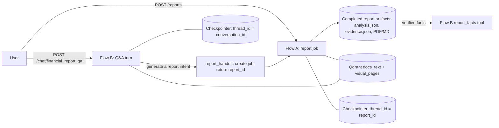
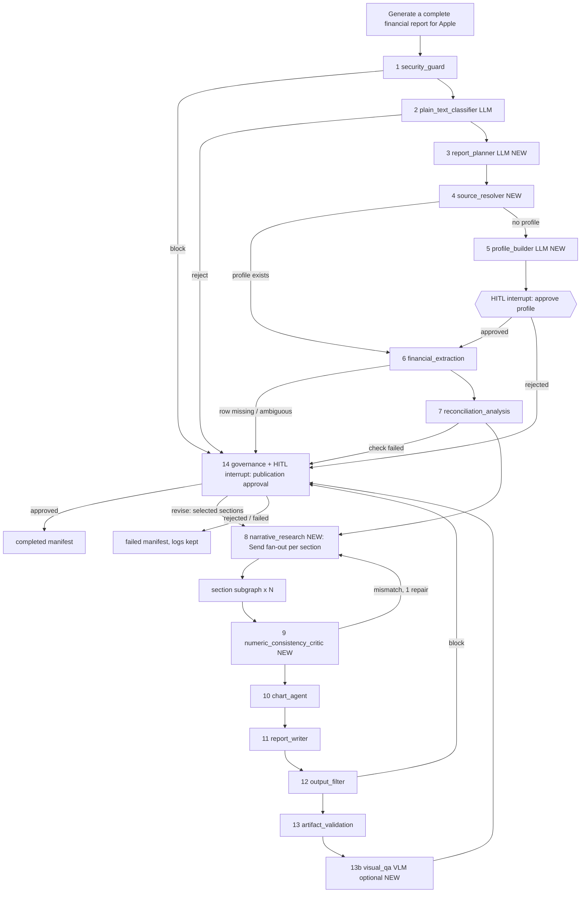
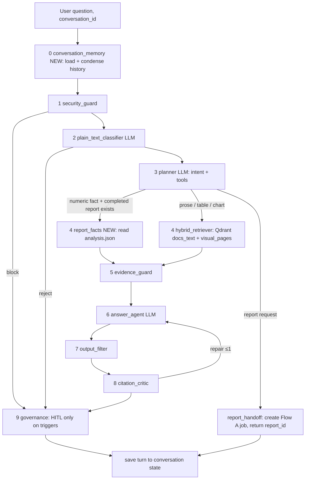

# Agentic financial copilot: report generation and Q&A flows (recommendations and LangGraph design)

Status: **recommendation for review**. After the approach is approved, assess the implementation against the checklist in section 14.

The copilot has **two flows** that share guardrails, retrieval and the Qdrant index:

- **Flow A: report generation.** *"Generate a complete financial report for Apple"* produces a full, reconciled and cited PDF/MD report. It is a long-running **job**, checkpointed after every step, so steps can be resumed or rerun.
- **Flow B: financial Q&A.** *"What was Apple's gross margin in FY2024?"* or *"What risks does Apple cite for China?"* produces a cited answer within seconds. It is a **multi-turn conversation** whose state is checkpointed per conversation.

This document answers:

- How long does each flow take?
- How many agents does each flow need?
- Which new agents are needed?
- How do the LangGraph graphs and checkpoints work?
- How are steps rerun?

It builds on these existing docs:

- [financial_report_generation.md](financial_report_generation.md): the deterministic report pipeline.
- [financial_report_agent_design.md](financial_report_agent_design.md): QA agents, tools and the HITL policy.
- [track-2.md](track-2.md): the Track B constraints.
- [rag_reliability.md](rag_reliability.md): timeouts and retries.
- [fastapi_streaming_design.md](fastapi_streaming_design.md): the job API and streaming design.
- [qdrant_colab_sizing/](qdrant_colab_sizing/README.md): the Qdrant two-index setup on Colab.

---

## 1. Summary

| Question | Answer |
|---|---|
| **What exists today?** | (1) An **8-node LangGraph Q&A agent** (`financial_prompting_agent.py`) for single questions. (2) A **7-stage deterministic report pipeline** (`generate_financial_report.py`) that writes the 8-page Apple PDF from a hand-written profile. **Neither graph has a checkpointer or conversation state** (`graph.compile()` with no saver). The report pipeline is not a LangGraph graph and has no API route. |
| **Flow A, time** | Today ~1.6 s measured (deterministic only, no LLM). Full agentic report: **~2.5–6.5 min of machine time** for Apple with sequential sections, **~1.5–3.5 min** with 3 sections in parallel. A new company adds ~1–2 min plus a human profile approval. The two human gates add ~10–25 min. |
| **Flow B, time** | **~6–15 s per question** (estimate). Numeric questions answered from an existing report's verified facts: **~2–4 s**. Within the 60 s request budget. |
| **Flow A, agents** | **15 top-level nodes** (9 reused, 5 new required, 1 optional) plus a reusable 6-node section subgraph. 4 nodes call an LLM. |
| **Flow B, agents** | **10 nodes**: the existing 8, plus a new `conversation_memory` node and a new `report_facts` tool node. A `report_handoff` route sends report requests to Flow A. |
| **New agents** | Flow A: `report_planner`, `source_resolver`, `profile_builder`, `narrative_research`, `numeric_consistency_critic` (+ optional `visual_qa`). Flow B: `conversation_memory`, `report_facts`. |
| **Checkpointing** | Both graphs are compiled with a **persistent checkpointer** (SQLite on Colab/dev, Postgres in deployment). Flow A uses `thread_id = report_id` and `durability="sync"`, which saves after every node. Flow B uses `thread_id = conversation_id`. **Verified on LangGraph 1.2.17:** resuming after a failure reruns only the failed step (completed fan-out sections are not repeated), and replaying from a chosen checkpoint reruns from that node onward. |
| **Key rule kept** | **Numbers never come from the LLM.** In both flows, numbers come from deterministic extraction and reconciliation (`analysis.json`) or are quoted from cited evidence. |

---

## 2. Current state (verified in code and docs)

### 2.1 Deterministic report pipeline: 7 stages, measured

These are trace spans in `generate()`, not LangGraph nodes and not LLM agents.

| # | Stage | What it does | Measured time |
|---|---|---|---|
| 1 | `source_validation_agent` | Checks the source PDF's SHA-256 against the profile | 0–16 ms |
| 2 | `financial_retrieval_agent` | Extracts 43 rows by exact label from 5 statements and 9 narrative anchors | 1,047–1,125 ms |
| 3 | `reconciliation_and_analysis_agent` | Runs 17 `Decimal` reconciliations and computes ratios | 0–16 ms |
| 4 | `rag_supplement_agent` | Optional: one fixed RAG question about risk and liquidity. Skipped by default | 0 ms (skipped) |
| 5 | `chart_agent` | Draws 5 charts from the validated dataset | ~203 ms |
| 6 | `report_writer_agent` | Writes the Markdown and PDF | 156–188 ms |
| 7 | `artifact_validation_agent` | Checks for at least 8 non-blank pages and renders previews | 140–172 ms |
| | **Total** | | **1.56–1.67 s** |

Source: traces under `output/pdf/AAPL_2024/`. One run (`d1a27a23…`) failed at retrieval, which is the hard-fail behavior working as designed.

### 2.2 Financial Q&A agent: 8 LangGraph nodes

`security → plain_text → plan → retrieve → evidence_guard → answer → critic ⟲ (≤1 repair) → governance`. It is compiled without a checkpointer and starts from empty state on every call (`financial_prompting_agent.py:993`), so it has no memory across turns.

### 2.3 Gaps

1. No natural-language entry point for reports; a hand-written profile JSON is required.
2. No profile for companies other than Apple.
3. Narrative comes from 9 reviewed notes plus one optional RAG question.
4. The report pipeline is not a graph, so there is no shared state, routing, checkpoints or HITL interrupt/resume.
5. **No checkpoints anywhere.** A failure means starting over, and a single step cannot be rerun.
6. **Q&A has no persistent state across turns**, which Track B requires ("persistent state across turns").
7. No report API route, and no link between Q&A and reports. For example, Q&A cannot reuse a completed report's verified numbers.

---

## 3. Two flows: overview



| | Flow A: report generation | Flow B: financial Q&A |
|---|---|---|
| Trigger | `POST /reports` (or a handoff from chat) | `POST /chat/financial_report_qa` |
| Shape | Long-running job, fan-out per section | One graph run per user turn |
| Duration | Minutes, plus human gates | Seconds |
| HITL | Mandatory: profile approval (new company) and publication approval | Only on triggers: advice language, low confidence, citation failure, security |
| Checkpoint `thread_id` | `report_id` (= `trace_id`) | `conversation_id` |
| Durability | `sync` (save before the next step starts) | `async` (lower latency) |
| Rerun | Resume after failure, rerun from any node, rerun selected sections | Resume an interrupted turn; replay a turn after a fix |
| Numbers | Only `analysis.json` | `report_facts` when a completed report exists, otherwise quoted from cited evidence |
| Step cap | Top-level ≤20 node steps; each section subgraph ≤10 | ≤10 per turn (brief) |

**Shared components:** `security_guard`, `plain_text_classifier`, `hybrid_retriever` (Qdrant), `evidence_guard`, `citation_critic`, `output_filter`, `governance`, `resilience.Calls` and `trace_log`. Guardrail regexes exist in both the financial and shared implementations, so a change must be made in both.

---

## 4. Flow A: report generation architecture



Every arrow is a checkpoint boundary (section 9). **Section subgraph** (one run per section, ≤10 steps): `plan_queries → hybrid_retriever → evidence_guard → section_writer → citation_critic ⟲ ≤1 repair → section_result`.

### 4.1 Agent count (Flow A)

| Group | Count | Nodes |
|---|---|---|
| Reused as-is | 9 | `security_guard`, `plain_text_classifier`, `financial_extraction`, `reconciliation_analysis`, `chart_agent`, `report_writer`, `output_filter`, `artifact_validation`, `governance` |
| New, required | 5 | `report_planner`, `source_resolver`, `profile_builder` (conditional, with a `profile_approval` HITL gate), `narrative_research`, `numeric_consistency_critic` |
| New, optional | 1 | `visual_qa` |
| **Top-level total** | **15** | 9 reused + 5 new required + 1 optional |
| Reusable subgraph | 6 nodes | `plan_queries`, `hybrid_retriever`, `evidence_guard`, `section_writer`, `citation_critic`, `section_result` |
| Nodes that call an LLM | 4 (+1 VLM) | `plain_text_classifier`, `report_planner`, `profile_builder`, `section_writer` (+ `visual_qa`) |

---

## 5. Flow A: agent and node details

Legend: **R** = reuse existing code, **E** = extend existing code, **N** = new. Times are per report (Apple, profile exists) unless stated otherwise.

| # | Node | Type | LLM? | Inputs → outputs | Guardrails | Rerun / retry behavior | Est. time |
|---|---|---|---|---|---|---|---|
| 1 | `security_guard` | R | No | request → allow/block + labels | Existing injection, secret and payload regexes | Deterministic; no retry | <10 ms |
| 2 | `plain_text_classifier` | R | Yes | request → `{is_plain_text, financial_intent, safe_query}` | JSON schema validation | Retry only on HTTP 429/503 (idempotency key) | 1–3 s |
| 3 | `report_planner` | N | Yes | safe_query → `ReportPlan {company, ticker, fiscal_year, sections[], audience}` | Constrained JSON; ticker/year must exist in the manifest or Qdrant; ambiguity goes to clarification, never a guess | Retry 429/503; malformed JSON gets 1 repair, then fail | 2–4 s |
| 4 | `source_resolver` | N | No | plan → source PDF, SHA-256, profile path or `needs_profile` | `doc_id`/SHA-256 from `pdf_manifest.jsonl` and the Qdrant payload | Cached by `(ticker, year)` | <1 s |
| 5 | `profile_builder` | N (conditional) | Yes | filing → draft profile | The LLM only maps existing row labels to standard keys. The draft must pass deterministic extraction and all reconciliations. **HITL approval** | Rerun with reviewer notes via `update_state` | 30–90 s + human |
| 6 | `financial_extraction` | R | No | profile + PDF → `evidence.json` | Exact labels; missing or ambiguous rows are a hard failure | `cache_policy` keyed by `(sha256, profile_hash)` | ~1.1 s (measured) |
| 7 | `reconciliation_analysis` | R | No | evidence → `analysis.json` | 17 `Decimal` checks; any failure stops the run | Cached by `evidence_hash` | <20 ms (measured) |
| 8 | `narrative_research` | N | via subgraph | sections + `analysis.json` → cited drafts | `Send` fan-out, **at most 3 concurrent** (4-slot `Calls` pool fails fast); a `Calls` deadline (60 s) and a 10-step cap per section | **Completed sections are not rerun on resume (verified)**; `sections_to_rerun` reruns only the listed sections | 2–4.5 min sequential / 1–2 min parallel |
| 8a–8f | Section subgraph | R/N | `section_writer` only | queries → retrieval (Qdrant `docs_text` + ColPali `visual_pages`) → evidence guard → writer (metric slots, `[chunk_id]` citations) → critic (≤1 repair) → result | Payload text only; no investment advice; ≤700 output tokens | Section results cached by `(doc_id, section, prompt_hash)` | 15–40 s per section |
| 9 | `numeric_consistency_critic` | N | No | sections + `analysis.json` → pass/fail | Every literal number must equal a slot value or be quoted from evidence | ≤1 repair (affected sections only), then HITL | <100 ms |
| 10 | `chart_agent` | R | No | `analysis.json` → 5 charts | Same dataset as the tables | Cached by `analysis_hash` | ~0.2 s (measured) |
| 11 | `report_writer` | E | No | sections + tables + charts → MD + PDF | Fills metric slots; adds a citation appendix | Writes to a new version directory per rerun | ~0.2–0.4 s |
| 12 | `output_filter` | R | No | text → allow/review/block | Existing policy | Deterministic | <50 ms |
| 13 | `artifact_validation` | R | No | PDF → page count, previews | At least 8 non-blank pages; hashes | Deterministic | ~0.15 s (measured) |
| 13b | `visual_qa` | N (optional) | VLM | previews → layout issues | Assists but never replaces human review | Retry on transient errors | ~1–1.5 min |
| 14 | `governance` | E | No | all → `interrupt()` for publication approval | Mandatory HITL for publication; approve, reject or revise | Resume with `Command(resume=decision)`; revise routes to the selected sections | <10 ms + human |

---

## 6. Flow B: interactive financial Q&A



| # | Node | Type | Purpose | Est. time |
|---|---|---|---|---|
| 0 | `conversation_memory` | **N** | Loads the last N turns from the checkpointed state; resolves follow-ups ("and in 2023?" → Apple, FY2023); keeps the active company/year; caps history (~2k tokens); never stores secrets | <50 ms |
| 1 | `security_guard` | R | Input guardrails | <10 ms |
| 2 | `plain_text_classifier` | R | Plain-text financial intent | 1–3 s |
| 3 | `planner` | E | Adds intents: `report_request` → handoff; `numeric_fact` → `report_facts` when a completed report exists for (ticker, year) | 1–2 s |
| 4a | `report_facts` | **N** | Reads verified metrics from the latest `completed` manifest's `analysis.json` (deterministic, citable to statement rows and pages). Never reads `failed` or pending runs | <100 ms |
| 4b | `hybrid_retriever` | R | Qdrant hybrid + ColPali, filtered by ticker/year from memory | 0.3–1.5 s |
| 5 | `evidence_guard` | R | Detects injection in evidence | <50 ms |
| 6 | `answer_agent` | R | Grounded answer with `[chunk_id]` or `[metric:…]` citations | 3–8 s |
| 7 | `output_filter` | R | allow/review/block | <50 ms |
| 8 | `citation_critic` | R | Validates citations; ≤1 repair | <50 ms (+3–8 s if repair) |
| 9 | `governance` | R | HITL only on triggers (advice, low confidence, conflicts, security) | <10 ms |
| — | `report_handoff` | **N** (route) | Creates the Flow A job and replies with `report_id` and a status link; never runs a report inside a chat turn | <1 s |

**Flow B agent count: 10 nodes** (8 existing, plus `conversation_memory` and `report_facts`) and one handoff route. LLM calls per turn: classifier, planner and answer (+1 if repaired).

---

## 7. Time estimates

Assumptions:
- Track B hosted ≤8B model at ~40–80 output tokens/s with ~0.5–2 s to the first token.
- Qdrant server on Colab with the index loaded; ColPali query encoder on a T4.
- 6 narrative sections, about 30% of which need one repair.

Measured values are marked; everything else is an estimate to be replaced by trace measurements (section 14).

### 7.1 Flow A: "Generate a complete financial report for Apple"

| Phase | Profile exists (Apple) | New company |
|---|---|---|
| Intake: guard + classifier + planner | 3–7 s | 3–7 s |
| Source resolution | <1 s | <1 s |
| Profile builder | — | 30–90 s |
| **HITL: profile approval** | — | **5–15 min (human)** |
| Extraction + reconciliation (measured) | ~1.1 s | ~1.1 s |
| Narrative, 6 sections (sequential / 3 parallel) | 2–4.5 min / 1–2 min | 2–4.5 min / 1–2 min |
| Critic, charts, writer, filter, validation | ~1 s | ~1 s |
| Checkpoint writes (~25 checkpoints × ~10–50 ms, SQLite) | ~0.5–1.5 s | ~0.5–1.5 s |
| Optional `visual_qa` | 1–1.5 min | 1–1.5 min |
| **Machine time (sequential / parallel)** | **~2.5–6.5 / ~1.5–3.5 min** | **~3.5–8 / ~2.5–5 min** |
| **HITL: visual review + publication** | **10–25 min** | **10–25 min** |
| **End-to-end wall clock** | **~12–30 min** | **~20–45 min** |

Resume and rerun costs (no full restart):

| Rerun | Time |
|---|---|
| Resume after a failed section | Only that section, ~15–40 s, plus the downstream deterministic steps (~1 s) |
| Rerun a single section after reviewer notes | ~15–40 s + ~1 s |
| Rerun from `report_writer` (layout fix) | ~0.5 s |

### 7.2 Flow B: one question

| Path | Time |
|---|---|
| Numeric fact with a completed report (`report_facts`) | **~2–4 s** (classifier + planner + short answer) |
| Prose / table / chart question (hybrid + ColPali) | **~6–15 s** |
| With one citation repair | +3–8 s |
| Report request (handoff) | ~2–4 s to return a `report_id` |

### 7.3 Token budget

| Item | Tokens |
|---|---|
| Flow A report, profile exists | ~55k (classifier + planner ~2k; 6 sections × ~6.7k; repairs ~12k) |
| Flow A, new company | ~75k (adds the profile builder) |
| Flow B question | ~3–9k (history capped at ~2k) |

---

## 8. LangGraph design

### 8.1 State (Flow A)

```python
class ReportState(TypedDict, total=False):
    request_hash: str            # hash only; raw request is not persisted in checkpoints
    security: dict
    plain_text: dict
    plan: dict                   # ReportPlan
    source: dict                 # path, sha256, doc_id, source_url
    profile_path: str
    profile_status: str          # existing | drafted | approved | rejected
    evidence_ref: dict           # {"path": ..., "sha256": ...}  - large artifacts by reference
    analysis_ref: dict           # analysis.json path + hash (the only numeric source)
    sections: Annotated[list[dict], merge_sections]   # keyed by section id; replace on rerun
    sections_to_rerun: list[str] # set by critic or reviewer; empty = all
    numeric_check: dict
    charts: list[dict]           # paths + hashes
    artifacts: dict              # md/pdf/previews paths + hashes, version number
    output_filter: dict
    visual_qa: dict
    human_review: dict           # reviewer, decision, notes
    repair_count: dict           # per gate, each ≤1
    step_count: int              # ≤20 top-level
    final_status: str            # completed | failed | refused | pending_review
    trace_id: str                # = report_id = checkpoint thread_id
```

`merge_sections` is a reducer that replaces a section by `id` instead of appending, so rerunning a section overwrites its old draft. Checkpoints keep state small, because artifacts are stored **by path and hash**.

### 8.2 Flow A graph skeleton (LangGraph 1.2.17)

```python
from langgraph.graph import StateGraph, START, END
from langgraph.types import Send, interrupt, Command, RetryPolicy, CachePolicy
from langgraph.checkpoint.sqlite import SqliteSaver     # pip: langgraph-checkpoint-sqlite (not installed yet)

transient = RetryPolicy(max_attempts=2, retry_on=is_retryable)   # True only for CallFailure from HTTP 429/503
g = StateGraph(ReportState)
g.add_node("security_guard", security_guard)
g.add_node("plain_text_classifier", plain_text_classifier, retry_policy=transient)
g.add_node("report_planner", report_planner, retry_policy=transient)
g.add_node("source_resolver", source_resolver)
g.add_node("profile_builder", profile_builder, retry_policy=transient)
g.add_node("profile_approval", profile_approval)                 # interrupt({"draft_profile": ...})
g.add_node("financial_extraction", financial_extraction, cache_policy=CachePolicy(key_func=by_sha_and_profile))
g.add_node("reconciliation_analysis", reconciliation_analysis)
g.add_node("section", section_subgraph, retry_policy=transient)  # compiled 6-node subgraph
g.add_node("numeric_consistency_critic", numeric_consistency_critic)
g.add_node("chart_agent", chart_agent)
g.add_node("report_writer", report_writer)
g.add_node("output_filter", output_filter)
g.add_node("artifact_validation", artifact_validation)
g.add_node("visual_qa", visual_qa, retry_policy=transient)
g.add_node("governance", governance)                             # interrupt({"previews": ..., "checks": ...})

g.add_edge(START, "security_guard")
g.add_conditional_edges("security_guard", ok_or_stop, {"continue": "plain_text_classifier", "stop": "governance"})
g.add_conditional_edges("plain_text_classifier", ok_or_stop, {"continue": "report_planner", "stop": "governance"})
g.add_edge("report_planner", "source_resolver")
g.add_conditional_edges("source_resolver", has_profile, {"yes": "financial_extraction", "no": "profile_builder", "stop": "governance"})
g.add_edge("profile_builder", "profile_approval")
g.add_conditional_edges("profile_approval", approved, {"yes": "financial_extraction", "no": "governance"})
g.add_conditional_edges("financial_extraction", ok_or_stop, {"continue": "reconciliation_analysis", "stop": "governance"})
g.add_conditional_edges("reconciliation_analysis", fan_out_sections, ["section", "governance"])  # Send per section in sections_to_rerun (or all)
g.add_edge("section", "numeric_consistency_critic")
g.add_conditional_edges("numeric_consistency_critic", numeric_ok, {"repair": "reconciliation_analysis", "continue": "chart_agent", "review": "governance"})
g.add_edge("chart_agent", "report_writer")
g.add_edge("report_writer", "output_filter")
g.add_conditional_edges("output_filter", ok_or_stop, {"continue": "artifact_validation", "stop": "governance"})
g.add_edge("artifact_validation", "visual_qa")
g.add_edge("visual_qa", "governance")
g.add_conditional_edges("governance", final_route, {"revise": "reconciliation_analysis", "end": END})

from langgraph.cache.memory import InMemoryCache                 # node cache backend required for cache_policy

with SqliteSaver.from_conn_string("/content/rag_financial_report_qa/checkpoints.sqlite") as saver:   # context manager
    report_app = g.compile(checkpointer=saver, cache=InMemoryCache())
    cfg = {"configurable": {"thread_id": report_id}, "max_concurrency": 3}
    report_app.invoke({"request_hash": h, "trace_id": report_id}, cfg, durability="sync")
```

Notes:
- **Failures route to `governance`, not `END`**, so a manifest and trace are always produced.
- **`retry_on` only for explicit 429/503.** This matches `resilience.py`: ambiguous timeouts are never retried automatically, but they can be rerun from a checkpoint (section 9).
- **Section fan-out ≤3 concurrent.** Set this in `fan_out_sections`, or with `max_concurrency` in the run config.
- **Step budget.** The brief's 10-step cap applies per section subgraph. The top-level budget is ≤20, and exceeding it gives `step_budget_exceeded` → `governance`.

### 8.3 Flow B graph (extension of the existing graph)

```python
qa = build_existing_financial_graph()          # security → plain_text → plan → retrieve → evidence_guard → answer → critic → governance
qa.add_node("conversation_memory", conversation_memory)     # new entry node
qa.add_node("report_facts", report_facts)                   # new tool node
qa.add_node("report_handoff", report_handoff)               # creates a Flow A job
# START → conversation_memory → security; planner routes: report_request → report_handoff → END,
# numeric_fact (completed report exists) → report_facts → evidence_guard, else → retrieve
qa_app = qa.compile(checkpointer=saver)                    # same SqliteSaver connection, separate thread_ids
qa_app.invoke({"query": text}, {"configurable": {"thread_id": conversation_id}}, durability="async")
```

The conversation state holds `messages` (bounded), the active `ticker`/`year`, and the last answer with its citations.

### 8.4 Mapping to existing code

| Node | Existing code to wrap |
|---|---|
| Guards, classifier, retriever, evidence guard, critic, governance | Node functions in `financial_prompting_agent.py` (`run_agentic_graph`) |
| Source resolver, extraction, reconciliation, charts, writer, artifact validation | Stage bodies of `generate_financial_report.generate()`, split into importable functions; keep the trace spans and atomic writes |
| Qdrant retrieval | `multimodal_rag.retrieve_local` (`RAG_BACKEND=qdrant`) |
| Reliability and tracing | `resilience.Calls` (one per node or section), `trace_log.TraceLog` (one trace per report or turn) |

---

## 9. Checkpointing and rerunning steps

### 9.1 What gets checkpointed

| Item | Flow A | Flow B |
|---|---|---|
| Saver | `SqliteSaver` at `$RAG_LOCAL_DIR/checkpoints.sqlite` (Colab/dev); `PostgresSaver` in deployment | Same database, separate threads |
| `thread_id` | `report_id` (= `trace_id`, = output directory name) | `conversation_id` |
| When | After every node (super-step); `durability="sync"` | After every turn's nodes; `durability="async"` |
| Contents | Small state: plan, refs (path + hash) to `evidence.json`, `analysis.json`, charts and PDF; section drafts; review decisions | Bounded messages, active company/year, last citations |
| Size | ~25 checkpoints × ~20–100 KB ≈ **0.5–2.5 MB per report** | ~5–20 KB per turn |
| Backup on Colab | Copy `checkpoints.sqlite` to Drive with the Qdrant snapshot and `metadata.sqlite3` | Same |
| Retention | Keep the last 30 days, or until the report is `completed` + approved; then prune old checkpoints | Keep the last N turns per conversation; prune idle conversations |

**Large artifacts are never stored in checkpoints.** They are written atomically to `output/pdf/<TICKER>_<YEAR>/<report_id>/v<N>/`, and the state keeps the paths and hashes. A rerun writes `v<N+1>`, so earlier versions stay auditable.

### 9.2 Rerun operations (verified on LangGraph 1.2.17)

A probe with `InMemorySaver` confirmed these on the installed version.

| Operation | How | Verified behavior |
|---|---|---|
| **Resume after a failure** (crash, timeout, Colab disconnect) | `report_app.invoke(None, {"configurable": {"thread_id": report_id}})` | Only the failed node runs again. In a 3-section fan-out where one section failed, **only that section reran**; extraction and the 2 completed sections were not repeated |
| **Rerun from a chosen step** (for example, from `report_writer` after a template fix) | `hist = report_app.get_state_history(cfg)`; pick the checkpoint whose `next == ("report_writer",)`; `report_app.invoke(None, cp.config)` | Execution restarts at that node and continues downstream; earlier steps are not rerun. This forks a new branch of the history; the old branch stays available |
| **Rerun with changed inputs** (edited profile, reviewer notes, `sections_to_rerun`) | `report_app.update_state(cfg, {"sections_to_rerun": ["risk_factors"], "human_review": notes}, as_node="reconciliation_analysis")`, then `invoke(None, cfg)` | The fan-out runs only the listed sections, and the `merge_sections` reducer replaces them |
| **Resume after HITL** | `report_app.invoke(Command(resume={"decision": "approved", "reviewer": "…", "notes": "…"}), cfg)` | The `interrupt()` in `profile_approval` or `governance` returns the decision and the graph continues |
| **Inspect** | `report_app.get_state(cfg)` → `values`, `next`, `tasks` and `interrupts` | Used by `GET /reports/{id}` |

### 9.3 Rules that keep reruns safe

1. **Idempotent nodes.** Each node's output is a function of its inputs. Deterministic nodes use `cache_policy` keyed by input hashes (source SHA-256, profile hash, `analysis_hash`), so a replay reuses the results. `InMemoryCache` lasts only for the process, so after a Colab restart the checkpoint, not the cache, provides resume. Use a persistent cache backend if replays across restarts must skip work.
2. **LLM calls use idempotency keys** (`resilience.Calls(key=...)`), formed as `report_id:node:section:attempt`, so a duplicate replay does not double-charge within the cache window.
3. **No side effects before approval.** Nothing is published or sent before `governance` approval. Files are versioned and atomic, so a replayed node never corrupts an earlier version.
4. **Manifest follows the state.** Each checkpointed terminal state updates `manifest.json` (`started`, `failed`, `pending_review`, `completed`). A rerun of a `failed` report reuses the same `report_id`.
5. **Checkpoint/index compatibility.** Store the embedding/ColPali signature and the profile hash in the state. Refuse to resume when the Qdrant index signature has changed (start a new `report_id`).
6. **Security.** Checkpoints contain financial data and conversation text, so restrict file access. The raw request is stored as a hash in Flow A, and secrets are never persisted.

---

## 10. API and runtime recommendations

| Endpoint | Flow | Purpose |
|---|---|---|
| `POST /reports` | A | Create a job (`ticker`, `fiscal_year`, `sections`) → `report_id`; runs the graph in a worker |
| `GET /reports/{id}` | A | `get_state` → status, `next` step, interrupts, manifest, artifact links |
| `GET /reports/{id}/events` | A | SSE progress from the trace (see [fastapi_streaming_design.md](fastapi_streaming_design.md)) |
| `POST /reports/{id}/review` | A | HITL decision → `Command(resume=...)` |
| `POST /reports/{id}/resume` | A | Resume after a failure: `invoke(None, cfg)` |
| `POST /reports/{id}/rerun` | A | Body `{from_node, sections_to_rerun, notes}` → `update_state` or replay from a checkpoint |
| `GET /reports/{id}/checkpoints` | A | List checkpoints (id, node, time) for audit and replay |
| `POST /chat/financial_report_qa` | B | Existing endpoint plus `conversation_id`; checkpointed per conversation; report requests return a `report_id` |

Runtime:
- Section fan-out ≤3 concurrent (4-slot `Calls` pool).
- One report worker per process on Colab.
- Flow B keeps the 60 s budget and the 60 req/min rate limit.
- LangSmith is optional. Record the token usage the provider returns; never fabricate it.

---

## 11. Guardrails and HITL boundaries

| Boundary | Rule |
|---|---|
| Numbers | Only from `analysis.json` (Flow A and Flow B `report_facts`) or quoted from cited evidence; `numeric_consistency_critic` rejects stray digits in reports |
| Claims | Must cite resolvable `chunk_id`s (Qdrant payload page and `source_url`) or `metric:` keys |
| Investment advice | Out of scope; `output_filter` → review/block in both flows |
| New-company profile | Never used without human approval |
| Publication | Always human-approved (`governance` interrupt); only a `completed` manifest counts |
| Q&A over reports | `report_facts` reads only `completed` reports, never `failed` or pending ones |
| Failure | `failed` manifest with logs and checkpoints kept for resume; no guessed values |

---

## 12. Recommendations, in priority order

1. **Add a persistent checkpointer to both graphs.** Install `langgraph-checkpoint-sqlite`, compile with a saver, and set `thread_id` conventions. Flow B immediately gains persistent state across turns, which Track B requires.
2. **Refactor `generate_financial_report.generate()` into node functions.** Keep behavior and tests identical; store artifacts by path and hash.
3. **Build the Flow A graph** with `report_planner`, `source_resolver`, `narrative_research` + `numeric_consistency_critic`, HITL interrupts, retry and cache policies, and versioned artifacts.
4. **Extend Flow B** with `conversation_memory`, `report_facts` and the `report_handoff` route.
5. **Add the report job API** with the resume, rerun, review and checkpoint endpoints.
6. **Add `profile_builder`** with mandatory approval.
7. **Optional: `visual_qa`.**
8. **Replace the estimates** in section 7 with measured timings and token counts from traces.

---

## 13. Risks and open decisions

| Item | Note |
|---|---|
| Hosted ≤8B quality | Short sections, metric slots and citation repair; expect `needs_review` sections |
| Replay cost | Replaying LLM nodes repeats token usage after the cache window; prefer `sections_to_rerun` over a full replay |
| SQLite on Colab | Single writer; one report worker per process. Copy the checkpoint DB to Drive after each node group, or use Postgres for multi-user use |
| Checkpoint and index drift | Resuming against a re-ingested index can mix evidence; refuse to resume on a signature mismatch |
| T4 availability | Without a GPU, visual retrieval degrades to text-only with a warning |
| Token quota | ~55–75k tokens per report, ~3–9k per question |
| Decisions needed | Section list and audience (sets the HITL gates); checkpoint retention period; whether Flow B may auto-start reports or must ask for confirmation |

---

## 14. Post-implementation assessment checklist (after recommendations are finalized)

| Area | Assessment | Pass criteria |
|---|---|---|
| Flow A functional | "Generate a complete financial report for Apple FY2024" via the API | `completed` manifest after approval; 8+ pages; all sections present or `needs_review` |
| Numeric integrity | Every number in the PDF/MD vs `analysis.json` | 100% match; 17/17 reconciliations; zero stray LLM digits |
| Citations | Resolve every `[chunk_id]` / `metric:` key | 100% resolvable; ≥20 claims spot-checked |
| **Checkpoint: resume** | Kill the worker during `narrative_research`; call `/resume` | Only unfinished sections rerun; no duplicate artifacts; same `report_id` |
| **Checkpoint: rerun step** | `/rerun` from `report_writer`, and with `sections_to_rerun=["risk_factors"]` | Only those steps run; new `v<N+1>` artifacts; old version intact |
| **Checkpoint: HITL** | Pause at publication; restart the process; approve | State survives the restart; decision recorded in the trace and manifest |
| **Checkpoint: Colab restart** | Restore `checkpoints.sqlite` + Qdrant snapshot + `metadata.sqlite3` in a new session | Resume works; a signature mismatch is refused |
| Flow B functional | 60–100 evaluation questions (Week 1 set), including follow-ups | Accuracy measured separately from retrieval recall@k; follow-ups resolve the company/year from memory |
| Flow B `report_facts` | Numeric questions after a completed Apple report | Answers equal `analysis.json`; ~2–4 s; cites `metric:` keys |
| Flow B handoff | "Generate a report for Apple" in chat | Returns a `report_id`; no report runs inside the chat turn |
| Timing and tokens | Trace-derived p50/p95 over ≥5 runs per flow | Within section 7 ranges; token usage within quota ±30% |
| Failure handling | Bad checksum, missing row, failed reconciliation, LLM timeout, malformed JSON, `capacity_exceeded` | `failed` or `needs_review` with a reason; resumable where transient |
| Security | Injection PDFs in the corpus, injection in requests and follow-ups | Blocked or reviewed; nothing from evidence executed; no secrets in checkpoints |
| Regression | `pytest tests` | All existing tests pass, plus new graph, checkpoint, rerun and API tests |
