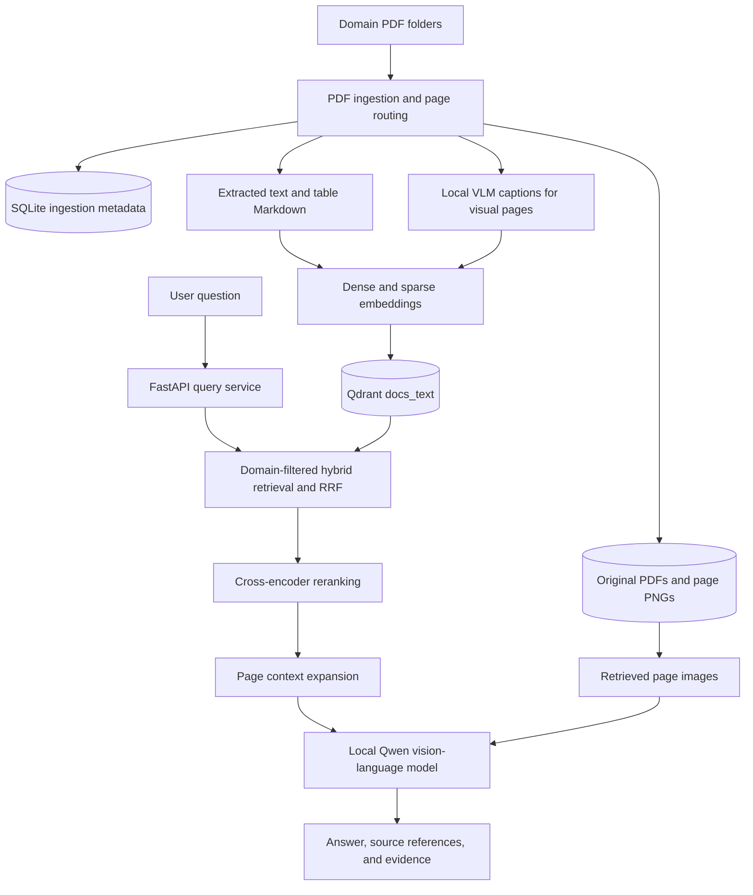
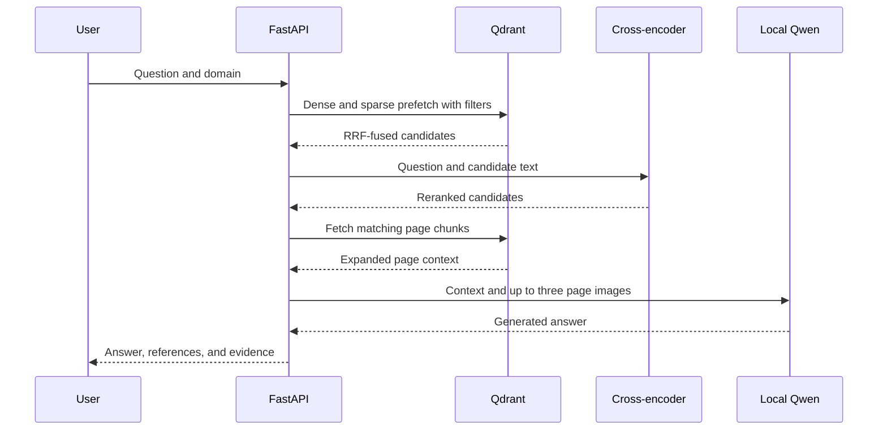

# Multimodal RAG: Design, Implementation, and Validation

Updated: 27 October 2026.

## 1. Purpose and implementation status

The application answers questions from PDF text, tables, charts, graphs, and images using local retrieval and a local vision-language model (VLM). A common pipeline supports all six application domains. The complete CPU profile has been exercised with three independent PDFs containing text, a table, and an image-only chart.

**Recorded validation:** 112 regression tests passed with selective OCR and ColPali integration. The earlier nine summary-based end-to-end inference checks also passed: they called the FastAPI application through `TestClient` and used the real local Qwen model over HTTP without mocked answers. Real ColPali page-vector storage and table/chart MaxSim retrieval are recorded in [the ColPali report](colpali_validation_results.md); actual scanned-page and image-region OCR retrieval is recorded in [the OCR report](ocr_validation_results.md). These results cover the supplied synthetic fixtures, rather than establish accuracy for arbitrary PDFs or all domain corpora.

This implementation follows the summary-based visual retrieval alternative in section 7 of [the original architecture](qdrant_multimodal_rag_architecture.md). Visual pages become searchable through extracted text, table Markdown, and VLM captions. Retrieved page images are supplied to the VLM again when answering.

### Original proposal and implemented choices

| Area | Original proposal | Implemented local profile |
|---|---|---|
| Target corpus | Approximately 200,000 pages | Small local PDF corpus; no large-scale benchmark |
| Parsing | Layout-aware PDF parser | PyMuPDF text extraction, table detection, images, and drawing inspection |
| Binary storage | S3/MinIO | Local filesystem, outside Qdrant |
| Metadata | Postgres/SQLite | SQLite |
| Retrieval | Dense and sparse vectors with RRF | Qdrant named `dense` and `bm25` vectors with RRF |
| Text embeddings | Example 1,024-dimensional model | MiniLM, 384 dimensions, in the complete profile |
| Visual retrieval | Summaries, optionally ColPali/ColQwen | Summaries in the shared `docs_text` collection |
| Reranking | Cross-encoder and/or MaxSim | MS MARCO MiniLM cross-encoder |
| Answer generation | LLM/VLM with text and page images | Quantized Qwen3-VL 2B running locally through llama.cpp |
| Optional visual tier | `visual_pages` multivectors | Implemented ColPali path with summary prefetch and Qdrant MaxSim; enable explicitly |
| Deployment | Server-based infrastructure | Windows CPU launcher, embedded Qdrant, localhost services |

## 2. Supported domains

| Domain identifier | Application area |
|---|---|
| `financial_report_qa` | Financial reports |
| `procurement_vendor` | Procurement and vendors |
| `travel_expense` | Travel and expenses |
| `competitive_research` | Competitive research |
| `incident_postmortem` | Incident reviews |
| `hr_policy` | HR policies |

Every stored point includes a domain. Retrieval applies the domain filter to both dense and sparse candidate searches. Documents from different domains share a collection; there is no collection per PDF or domain.

## 3. System design



The complete profile runs three local components: the FastAPI application, an embedded Qdrant client in that application process, and a managed llama.cpp child process. SQLite and the PDF/image object directory provide persistent metadata and source files.

### Models and runtime

| Component | Complete-profile selection |
|---|---|
| Dense encoder | `sentence-transformers/all-MiniLM-L6-v2` |
| Reranker | `cross-encoder/ms-marco-MiniLM-L-6-v2` |
| VLM | `Qwen/Qwen3-VL-2B-Instruct-GGUF` |
| Language model file | `Qwen3VL-2B-Instruct-Q4_K_M.gguf` |
| Vision projector | `mmproj-Qwen3VL-2B-Instruct-Q8_0.gguf` |
| CPU runtime | llama.cpp release `b11900` |
| Local model alias | `local-qwen3-vl` |
| Context window | 8,192 tokens in the managed server |
| Generation | Temperature 0; up to 256 output tokens; no streaming |

The two Qwen GGUF files total approximately 1.55 GB on disk. This is model-file size, not total installation size or a measured RAM requirement. CPU PyTorch supports the learned encoder and reranker; llama.cpp performs Qwen inference.

## 4. Ingestion design and behavior

1. Validate the domain and calculate the PDF's SHA-256 hash as `doc_id`.
2. Check SQLite for a completed ingestion with the same hash and pipeline signature. Skip it unless `force=True`.
3. Record `processing` and copy the original into the managed object directory.
4. Extract each page's text in sorted reading order and detect tables using PyMuPDF. Apply selective RapidOCR only to scanned pages or uncovered image regions; preserve recognized lines, confidence, and coordinates.
5. Convert detected tables into Markdown-like rows and retain them in the payload.
6. Classify a page as visual-rich if it has a table, raster images, more than four drawing objects, or no extracted text.
7. Render visual pages to PNG using a 1.5 scale matrix. With a configured vision backend, generate a caption containing readable values, labels, and trends.
8. Combine extracted text, table text, accepted OCR text, and the visual caption. Split into windows of up to **400 whitespace-separated words**, advancing by 350 words: 50 words of overlap for full windows. This is word-based chunking, not the original proposal's tokenizer-based chunking.
9. Embed each chunk and upsert deterministic Qdrant points.
10. Record successful completion and update the source-path mapping. A changed PDF at the same path replaces the preceding version's vectors after the new version is indexed.

Content types are `table`, `chart`, `image`, or `text`. A detected table takes precedence. A visual page whose extracted text or caption contains “chart” or “graph” is labelled `chart`; other visual pages are labelled `image`. This is a heuristic rather than a trained layout classifier.

On failure, ingestion removes the failed document's partial points, records `failed` plus an error, and re-raises the exception. Force-ingesting an existing hash clears its earlier points before rebuilding; that operation is not an atomic version swap. Originals and rendered files are not automatically garbage-collected.

### Incremental processing and identifiers

```text
doc_id = SHA256(original PDF bytes)
point_id = UUID5(NAMESPACE_URL, "domain:doc_id:page:chunk_index")
```

Page numbers are one-based. Chunk indexes are zero-based. The pipeline signature records the pipeline version, embedding configuration, and vision configuration/model identifier. A signature change causes an unchanged PDF to be processed again. `--force` also rebuilds unchanged files.

The embedding signature is stored separately. Opening an index with a different embedding-model identifier raises an error; use another `RAG_LOCAL_DIR` and reingest. Identifiers are configuration strings, not cryptographic fingerprints of every model weight file.

## 5. Storage and schemas

```text
indexes/
  models/
    all-MiniLM-L6-v2/
    ms-marco-MiniLM-L-6-v2/
    Qwen3-VL-2B/
  runtime/llama.cpp/
    llama-server.exe
    server.log
  multimodal_full/
    metadata.sqlite3
    qdrant/
    objects/<domain>/<doc_id>/
      source.pdf
      page_0001.png
  multimodal/                         # Separate hashing-demo index
```

### Qdrant collection: `docs_text`

| Vector | Configuration |
|---|---|
| `dense` | Model-derived dimension; 384 for the complete profile; cosine distance; `on_disk=True` requested |
| `bm25` | Sparse vector with Qdrant IDF modifier |

The collection requests on-disk payload storage. Embedded Qdrant has different execution characteristics from a standalone indexed server; these settings do not establish production-scale performance. The local code does not configure the original design's quantization, explicit HNSW tuning, or payload indexes.

Dense vectors are normalized learned embeddings in the complete profile. The lightweight demo uses deterministic hashing vectors. Sparse document vectors use hashed term identifiers, BM25-style term saturation, and a fixed reference length of 400; sparse query weights are 1. Qdrant supplies corpus IDF. This is not a full implementation of corpus-average-length BM25.

### Point payload

| Fields | Purpose |
|---|---|
| `domain`, `doc_id` | Isolation and document identity |
| `doc_title`, `title` | PDF filename stem |
| `page`, `chunk_index`, `chunk_id` | Source location and deterministic point identity |
| `content_type` | Text, table, chart, or image |
| `visual_rich`, `visual_captioned` | Page-routing and caption status |
| `text` | Combined chunk content |
| `ocr_text`, `ocr_mode`, `ocr_blocks`, `ocr_signature` | Selective OCR text, routing, recognized-line provenance, and configuration signature |
| `table_markdown` | Extracted table rows |
| `source_uri`, `source_url` | Local original-PDF URI |
| `page_image_uri`, `image_path` | Rendered-page references, when available |
| `source_type` | Source category; defaults to `sample_pdf` |
| `ticker`, `year` | Optional ingestion metadata |

Binaries stay outside Qdrant. Retrieval responses additionally include `metadata`, rank, scores, a preview, and expanded `page_context`.

### SQLite metadata

| Table | Key and fields |
|---|---|
| `documents` | Key: `(domain, doc_id)`; status, error, pipeline signature |
| `sources` | Key: `(domain, path)`; current document hash |
| `settings` | Key/value settings, including the embedding identifier |

Statuses include `processing`, `complete`, `failed`, and `superseded`.

## 6. Retrieval and answering



Both candidate searches prefetch 30 records. With a reranker, fusion returns up to `max(top_k, 20)` candidates; otherwise it returns `top_k`. The cross-encoder sorts candidates, after which retrieval retains the requested number.

Page expansion fetches up to 100 chunks for each hit's `(domain, doc_id, page)`, orders them by chunk index, and caps page context at 16,000 characters. For the local Qwen/Transformers answer prompt, combined textual context is capped at 8,000 characters before attached-image descriptions. Up to three unique page images are attached.

The answer step discards reranked hits below `RAG_MIN_RERANK_SCORE`, default `-4`. The retrieval-only endpoint returns ranked candidates without that answer-stage threshold. If no evidence survives, the answer is “No evidence found in this domain.”

For Qwen and Transformers, the application appends retrieved source UUIDs after generation unless the answer is empty or contains “insufficient evidence.” Ollama is prompted to emit UUID citations itself. Citation validation checks that cited identifiers belong to the retrieved evidence; it does not prove factual entailment or that every claim is supported. The independent inference checks validate expected answer content separately.

## 7. Implementation map

| File | Responsibility |
|---|---|
| [`scripts/rag/multimodal_rag.py`](../scripts/rag/multimodal_rag.py) | Ingestion, storage, embeddings, retrieval, reranking integration, answering, and base CLI |
| [`scripts/common/local_models.py`](../scripts/common/local_models.py) | Lazy encoder/reranker loading, Transformers vision inference, llama.cpp HTTP image requests |
| [`scripts/rag/run_local_multimodal.py`](../scripts/rag/run_local_multimodal.py) | Complete-profile configuration, downloads, managed model service, ingestion/evaluation/API commands |
| [`scripts/downloads/download_model_files.py`](../scripts/downloads/download_model_files.py) | Ranged GGUF downloads and SHA-256 verification against repository metadata |
| [`scripts/api/api_app.py`](../scripts/api/api_app.py) | Multimodal retrieval/chat endpoints and request validation |
| [`scripts/agents/rag_agent.py`](../scripts/agents/rag_agent.py) | Existing non-financial retrieval adapter for `RAG_BACKEND=qdrant` |
| [`scripts/agents/financial_prompting_agent.py`](../scripts/agents/financial_prompting_agent.py) | Existing financial retrieval adapter for Qdrant |
| [`scripts/evaluation/generate_multimodal_samples.py`](../scripts/evaluation/generate_multimodal_samples.py) | Six domain PDFs with text, tables, vector charts, and raster diagrams |
| [`scripts/evaluation/generate_multimodal_validation_pdfs.py`](../scripts/evaluation/generate_multimodal_validation_pdfs.py) | Three independent validation PDFs, including the raster-only chart |
| [`scripts/evaluation/evaluate_multimodal_local.py`](../scripts/evaluation/evaluate_multimodal_local.py) | Actual model/API evaluation and persisted reports |
| [`tests/test_multimodal_rag.py`](../tests/test_multimodal_rag.py) | Routing, isolation, metadata filters, updates, retries, adapters, API, and fixture checks |
| [`tests/test_local_models.py`](../tests/test_local_models.py) | Image-byte serialization in the local inference request |
| `pyproject.toml`, `uv.lock` | Dependency declarations and resolved dependencies |

## 8. Setup and operating commands

Run commands from the repository root in PowerShell. The current workspace already has the model files, runtime, and evaluated index prepared.

### Start the prepared application

```powershell
.venv/Scripts/python.exe -m scripts.rag.run_local_multimodal serve
```

The application listens on `http://127.0.0.1:8000`; interactive API documentation is at `/docs`. The model service listens on `http://127.0.0.1:8081`. The launcher uses one API worker, starts the model child process without a visible window, waits for readiness, and stops its child when the command exits. It refuses an occupied model-service port rather than attaching to an unknown process.

### Prepare dependencies and models on another environment

Python 3.12 or later and Windows x64 are required by the current project/managed binary profile. From an environment provisioned with the project's dependencies, install CPU model runtimes as needed:

```powershell
uv pip install --python .venv/Scripts/python.exe torch torchvision --index-url https://download.pytorch.org/whl/cpu
uv pip install --python .venv/Scripts/python.exe "transformers>=4.57,<5" "sentence-transformers>=3,<6" "accelerate>=1,<2"
.venv/Scripts/python.exe -m scripts.rag.run_local_multimodal prepare
```

The project also requires its existing FastAPI, Qdrant, PyMuPDF, ReportLab, and agent dependencies; model-runtime installation alone does not provision the entire application. `prepare` downloads Qwen weights and the projector, verifies their SHA-256 checksums, downloads encoder/reranker files, and installs the pinned llama.cpp Windows CPU binary. The ranged downloader persists per-chunk checksums and reuses verified chunks after interrupted transfers. Model preparation needs internet; prepared inference uses local models and localhost requests.

### Evaluate or query the validation corpus

```powershell
.venv/Scripts/python.exe -m scripts.rag.run_local_multimodal evaluate
.venv/Scripts/python.exe -m scripts.rag.run_local_multimodal query --domain financial_report_qa --query "What is the annual review code?"
```

`evaluate` ingests the three validation files, skipping compatible completed records, and runs all nine checks. `query` uses one retrieved hit. Each command owns and shuts down its model service.

### Ingest the six-domain samples or your own PDFs

```powershell
.venv/Scripts/python.exe -m scripts.rag.run_local_multimodal ingest
.venv/Scripts/python.exe -m scripts.rag.run_local_multimodal ingest --input C:/path/to/domain-folders
.venv/Scripts/python.exe -m scripts.rag.run_local_multimodal ingest --force
```

Input layout is `<input>/<domain>/*.pdf`. The complete-profile `ingest` command loops all six domain folders; its `--domain` argument is used for querying, not to restrict that ingestion loop. Missing folders contain no matching files and are skipped. Stop `serve` before using another command against the same embedded index.

Python callers can set financial/source metadata explicitly:

```python
from scripts.rag.multimodal_rag import LocalRAG

rag = LocalRAG()
try:
    rag.ingest("financial_report_qa", "report.pdf",
               source_type="annual_report", ticker="DEMO", year=2026)
finally:
    rag.close()
```

This direct example uses the current process's environment. Call `configure()` from `scripts.rag.run_local_multimodal` first, and supply a running local vision service, when using the complete profile from another Python program.

## 9. API contract and examples

| Endpoint | Behavior |
|---|---|
| `POST /multimodal/{domain}/retrieve` | Ranked evidence without answer generation |
| `POST /multimodal/{domain}/chat` | Input guard, retrieval, generation, and source references |
| `GET /domains` | Existing list of supported application domains |
| `GET /health` | Existing application health endpoint; not a full inference-readiness check |

### Request fields

| Field | Default / constraint |
|---|---|
| `query` | Required; 1–4,000 characters |
| `top_k` | 5; range 1–10 |
| `provider` | `llamacpp` when `RAG_VISION_API_BASE` is set; otherwise `extractive` |
| Provider choices | `llamacpp`, `transformers`, `ollama`, `extractive` |
| `source_type`, `ticker`, `year` | Optional exact-match metadata filters |

The standalone validation uses `top_k=1`. Filtering for a ticker or year that was not stored during ingestion yields no matching evidence. The sample PDFs have no ticker/year metadata unless added by a caller.

```powershell
$endpoint = 'http://127.0.0.1:8000/multimodal/financial_report_qa/chat'

# Text
$body = @{query='What is the annual review code?'; top_k=1} | ConvertTo-Json
Invoke-RestMethod $endpoint -Method Post -ContentType application/json -Body $body

# Table
$body = @{query='What is the North regional budget in million USD?'; top_k=1} | ConvertTo-Json
Invoke-RestMethod $endpoint -Method Post -ContentType application/json -Body $body

# Image-only chart
$body = @{query='Which quarter has the highest revenue in the chart?'; top_k=1} | ConvertTo-Json
Invoke-RestMethod $endpoint -Method Post -ContentType application/json -Body $body
```

Successful chat responses include `domain`, `query`, `answer`, `provider`, `model`, `generation_mode`, `images_used`, `final_status`, `citation_check`, and `evidence`. Evidence identifies the document, page, chunk, raw table data, original URI, rendered image, and scores. The API returns local file references; it does not provide a PDF upload endpoint or an HTTP file-download service.

Unknown domains produce 404; request-schema failures produce 422. Guarded chat queries can return HTTP 200 with `final_status="refused"`. The chat endpoint maps caught model/configuration `ValueError` and `OSError` failures to 503. Other failures use the application's existing error handling. No silent fallback to mock inference is performed by the complete profile.

### Existing application integration

Setting `RAG_BACKEND=qdrant` routes existing financial and non-financial retrieval functions through `retrieve_local`. The complete launcher sets it automatically. Without it, the existing Chroma retrieval path remains the default.

Existing guarded agents retain their configured text LLM and workflow. Use the new `/multimodal/{domain}/chat` endpoint for the image-aware generation path. Existing Chroma-specific embedding/retrieval-mode request options do not select the complete profile's encoder; environment configuration selects that encoder.

## 10. Configuration reference

| Variable | Complete-profile default / effect |
|---|---|
| `RAG_LOCAL_DIR` | `<repo>/indexes/multimodal_full`; base CLI otherwise defaults to `indexes/multimodal` |
| `RAG_EMBEDDING_MODEL` | `<repo>/indexes/models/all-MiniLM-L6-v2`; unset means hashing |
| `RAG_RERANKER_MODEL` | `<repo>/indexes/models/ms-marco-MiniLM-L-6-v2`; unset disables reranking |
| `RAG_VISION_API_BASE` | `http://127.0.0.1:8081/v1`; selects llama.cpp for ingestion captions |
| `RAG_VISION_MODEL_ID` | `Qwen3-VL-2B-Instruct-Q4_K_M+Q8-projector`; identity in signatures/responses |
| `RAG_CPU_THREADS` | 4 |
| `RAG_DEVICE` | `cpu` for Python models; does not configure llama.cpp GPU offload |
| `RAG_MIN_RERANK_SCORE` | `-4`, applied during answering |
| `RAG_BACKEND` | `qdrant` in the complete launcher |
| `HF_HUB_OFFLINE` | Defaults to `1` in the complete runtime configuration |
| `QDRANT_URL` | Optional external Qdrant URL, e.g. `http://localhost:6333`; unset uses embedded storage |
| `RAG_TRANSFORMERS_MODEL` | Optional direct-Python vision model path/repository |
| `RAG_VISION_MODEL` | Optional Ollama model name |
| `OLLAMA_HOST` | `http://127.0.0.1:11434` for Ollama |

The launcher uses environment defaults without overriding existing values. Caption-provider precedence is llama.cpp, then Transformers, then Ollama. The explicit answer `provider` selects generation separately. Model startup readiness timeout is 180 seconds; llama.cpp HTTP inference timeout is 600 seconds. Ollama inference timeout is 180 seconds.

Embedded Qdrant supports one owning process. The API uses a shared instance and a reentrant lock around multimodal operations. Changing to a server URL does not by itself provide distributed metadata, shared object storage, or production concurrency management.

## 11. Sample documents and verified results

### Fixtures

The original `data/samples/multimodal/<domain>/` corpus contains six four-page PDFs, one per domain: overview text, a ruled table, vector bar/line charts, and a raster process diagram. Earlier ingestion routed 24 pages, including 18 visual pages. Regression tests cover all six domains.

The actual model validation uses three one-page PDFs under `data/samples/multimodal_validation/financial_report_qa/`:

| File | Evidence |
|---|---|
| `text_operations.pdf` | Review code ORCHID; submission deadline 14 days |
| `table_budget.pdf` | North 73, South 46, West 28 million USD |
| `chart_revenue.pdf` | Raster-only chart: Q1 10, Q2 20, Q3 30, Q4 40 million USD |

All data is synthetic. The chart has no extracted PDF text. Its values are not repeated in the text/table fixtures or supplied through an ingestion sidecar. The real model first captions its pixels, and answer requests also attach the rendered chart image.

### Actual inference results

| Check | Observed answer | Images | Time | Result |
|---|---|---|---|---|
| Review code | ORCHID | 0 | 1.33 s | PASS |
| Expense deadline | 14 | 0 | 0.47 s | PASS |
| North budget | 73 | 1 | 38.08 s | PASS |
| South budget | 46 | 1 | 35.83 s | PASS |
| North minus South | 27 | 1 | 36.98 s | PASS |
| Revenue trend | Increases | 1 | 37.47 s | PASS |
| Highest-revenue quarter | Q4 | 1 | 35.86 s | PASS |
| Q4 revenue | 40 | 1 | 35.89 s | PASS |
| Unsupported question | No evidence found in this domain. | 0 | 0.14 s | PASS |

Times are observations from this CPU run, not service guarantees; they exclude initial model startup and ingestion. Each supported-answer check required HTTP 200, the expected source, expected answer content, and valid source identifiers. Chart checks additionally required an attached image. The trend check rejected decreasing/declining answers. The unsupported check required no evidence and `insufficient_evidence` status.

### Reproduce validation

```powershell
.venv/Scripts/python.exe -m pytest -q
.venv/Scripts/python.exe -m scripts.rag.run_local_multimodal evaluate
```

Current regression outcome with OCR and ColPali: **112 passed**. Historical Qwen summary-based model/API outcome: **9/9 passed**. The serialization unit test uses a mocked HTTP response to inspect request bytes; the separate nine inference cases use the actual local model. ColPali and selective OCR have their own actual-model retrieval and storage evaluations.

Evidence artifacts:

- [`docs/multimodal_validation_results.md`](multimodal_validation_results.md): generated human-readable answers and checks.
- [`output/multimodal_validation/results.json`](../output/multimodal_validation/results.json): raw recorded results, scores, and timings.
- [`output/multimodal_validation/report.md`](../output/multimodal_validation/report.md): local report copy.

`output/` and `indexes/` are ignored runtime artifacts. Regenerate them after a fresh checkout. The tracked source, fixtures, and documentation describe how to reproduce the run.

## 12. Limits and operational notes

| Situation | Current behavior / action |
|---|---|
| Another process owns embedded Qdrant | Stop it before ingestion/evaluation/API startup |
| Model-service port is occupied | Stop the owning service or choose another localhost port in `RAG_VISION_API_BASE` |
| Missing model files/runtime | Run the `prepare` command |
| Model fails to start | Inspect `indexes/runtime/llama.cpp/server.log` |
| Embedding identifier mismatch | Use a new index directory and reingest |
| Changed vision configuration | Pipeline signature triggers reprocessing; `--force` is also available |
| No configured vision backend | Native text, table extraction, and selective OCR remain available; visual relationship/image reasoning requires a vision backend |
| Decorative or sparse vector graphics | Routing heuristics can over-classify or miss visual content |
| Long or complex documents | Word chunks, encoder input limits, context caps, and image caps need corpus-specific evaluation |
| External Qdrant | Keep filesystem objects and SQLite metadata accessible and consistent; do not share collections with incompatible embedding configurations |

The implementation now includes a dedicated selective RapidOCR engine with recognized-line polygons; see [OCR routing and text-vector backfill](selective_ocr.md). It does not include OCR-based table-cell reconstruction or a full semantic layout parser. The optional ColPali path supplies independent page multivectors and visual retrieval; see [ColPali implementation and Qdrant storage](colpali_qdrant.md). Scanned pages can also be interpreted by the answer VLM. There is no atomic force-reindex transaction, source-deletion reconciliation, multi-path content-reference management, distributed ingestion workers, authentication layer added by this feature, or production backup workflow.

The smaller SmolVLM-500M model was tested during development and gave the wrong chart trend. The validated default is Qwen3-VL; the optional Transformers and Ollama backends should be evaluated independently with their selected models. Broader accuracy, difficult scans, dense charts, and large-scale performance remain unmeasured.

## 13. Related documentation

- [Original scalable Qdrant architecture](qdrant_multimodal_rag_architecture.md)
- [Local quick-start guide](local_multimodal_rag.md)
- [Recorded actual inference report](multimodal_validation_results.md)
- [ColPali implementation and Qdrant storage](colpali_qdrant.md)
- [Selective OCR fallback and text-vector storage](selective_ocr.md)
