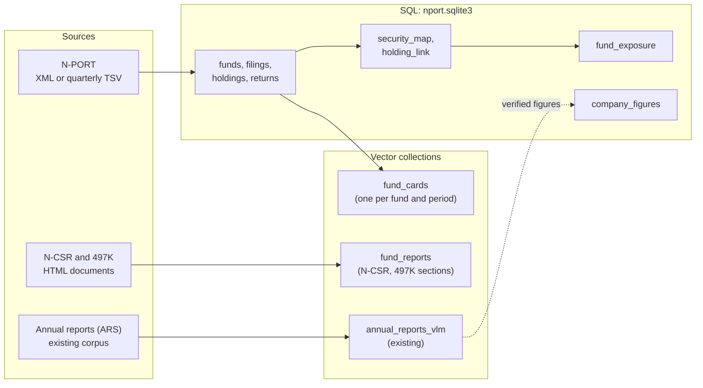
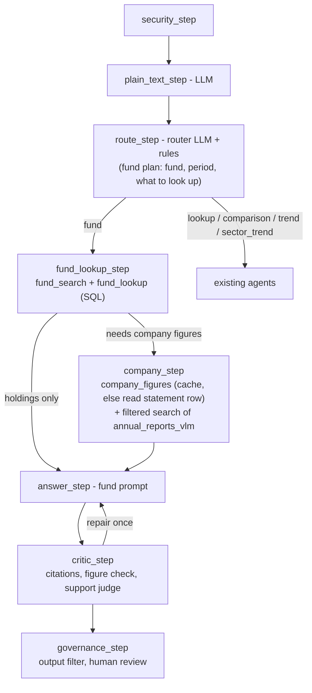

# Mutual Fund Data with the Annual Report Copilot: Data, Storage, RAG and Agents

How US mutual fund data (SEC Form N-PORT holdings, N-CSR shareholder reports, 497K summary prospectuses) can sit next to the existing annual-report corpus, and how the agents would use both to answer one question. Date: 13 November 2026.

This is a design: none of the mutual fund parts below are built yet. Related: [mutual_fund_corpus_plan.html](mutual_fund_corpus_plan.html) (the 500 fund documents to download), [agent_flows.md](agent_flows.md) (the existing agents), [annual_report_rag_structure.md](annual_report_rag_structure.md) (the existing index).

**In short**

- **The link between the two datasets is the company.** A fund owns shares of companies; the corpus holds those companies' annual reports. Each fund holding is mapped to a corpus ticker, and each holdings date to the annual report available at that date. Every answer can then cite both the fund filing and the company's own filing.
- **The overlap is large for US equity funds.** In the Vanguard 500 Index Fund's N-PORT filing for 30 June 2026, 240 of the corpus's 289 companies are holdings, worth 86.8% of the fund's $1.67 trillion of net assets, and all of its 15 largest holdings are listed in `companies.py` (12 of them with filings in the corpus plan; Apple, Meta and Eli Lilly have none).
- **Store by kind of data.** Holdings and fund figures are exact numbers that are summed and ranked: they go into **SQL tables**, not the vector index. Fund documents (N-CSR, 497K) are text and tables: they go into a **separate RAG collection**. A short **fund card** per fund and period, written by code from the tables, is embedded so search can find the fund.
- **The agents gain one route and one tool.** The router adds a `fund` route; a `fund_lookup` tool runs the SQL and returns rows as citable evidence. Questions that need company figures hand over to the existing Q&A, trend and sector trend agents. The guards, critic, governance and the 10-step cap are unchanged.
- **Indian fund factsheets (AMFI) are not linked.** They cover Indian schemes holding mostly Indian-listed companies, none of which is in the corpus (section 2.4).

---

## 1. What exists today: the annual-report side

| Part | Today (13 November 2026) |
|---|---|
| Corpus | SEC annual reports to shareholders (Form ARS) of **289 companies in 13 sectors**. Plan: 1,004 filings; the `min500` preset: 509 filings (fiscal years 2022 to 2026) |
| Index | Chroma collection `annual_reports_vlm` (pipeline 1) at `RAG_HOME/indexes/chroma_db`: **180 of the 509 filings, about 132,600 chunks, 2.3 GB**. Text layer, native tables and OCR pages; Qwen3-VL and paid-model pages skipped for a later run |
| Chunk fields | One schema for both indexes (`rag/chunk_schema.py`): `ticker`, `company`, `year`, `sector`, `sector_slug`, `page`, `content_type`, `text_source`, `reader`, `chunk_id` and provenance |
| Company directory | `common/companies.py`: name, aliases and sector for every ticker; `GET /companies` lists what the served index holds |
| Agents | `router` (supervisor) → Q&A agent (`agentic_graph`), trend agent (`trend_graph`), sector trend agent (`sector_trend_graph`), report handoff or refusal. Shared guards, critic (citations, figure check, LLM support judge, one repair) and governance (output filter, human review). At most 10 steps |
| Answers | Every figure cited to a chunk of a company's filing; changes, totals and CAGR computed in code |

Everything below reuses these parts. The fund side adds data and one route; it changes none of the existing flows.

## 2. Mutual fund sources and what each is for

### 2.1 Form N-PORT: holdings (structured)

Every US registered fund and ETF except money market funds reports its full portfolio monthly on Form N-PORT, as XML. Two ways to get it:

| Way | What | When to use |
|---|---|---|
| One filing from EDGAR | `primary_doc.xml` of an `NPORT-P` filing, a few MB | A handful of funds |
| SEC bulk data sets | One ZIP per quarter, about 400 to 440 MB (2026 Q3: 441 MB), October 2019 to September 2026, at `https://www.sec.gov/files/dera/data/form-n-port-data-sets/2026q3_nport.zip` | Many funds or several years |

The bulk ZIP is up to **30 tab-separated UTF-8 tables** joined by `ACCESSION_NUMBER` (filing) and `HOLDING_ID` (holding). Five of them cover what the copilot needs:

| Table | Fields used |
|---|---|
| `SUBMISSION` | accession number, filing date, form (`NPORT-P` or amendment), **report period end** |
| `FUND_REPORTED_INFO` | **series name and ID** (the fund), series LEI, total assets, total liabilities, **net assets**, monthly sales, redemptions and reinvestments |
| `MONTHLY_TOTAL_RETURN` | total return per share class for each of the 3 months |
| `FUND_REPORTED_HOLDING` | **issuer name**, issuer LEI, title, **CUSIP**, balance and unit, currency, **value**, **% of net assets**, long or short, **asset category**, issuer type, **country**, fair-value level |
| `IDENTIFIERS` | **ISIN** and **ticker** of each holding |

The other 25 tables describe bonds, repos, derivatives and securities lending.

N-PORT does **not** contain expense ratios, fees, fund managers, the fund's objective, NAV per share, ratings, fund categories or sector classifications. Fees, managers and objectives come from the documents in 2.2; sectors are derived through the company link (section 4).

*Not verified:* which months are made public and how soon after the month ends (the SEC readme says only that filings are disseminated quarterly), and the status and compliance dates of the 2024 amendments to N-PORT reporting. Check the SEC rulemaking pages before relying on either.

### 2.2 N-CSR and 497K: fund documents (text)

These are already planned in [mutual_fund_corpus_plan.html](mutual_fund_corpus_plan.html): 500 EDGAR documents from 300 fund trusts, all **HTML, not PDF**.

| Form | Content | Use |
|---|---|---|
| N-CSR (annual shareholder report) | Since July 2024 it opens with a tailored shareholder report per share class (expenses, performance graph, average annual returns, holdings breakdown), then the financial statements and the full schedule of investments | Questions about a fund's costs, performance and management commentary |
| 497K (summary prospectus) | Objective, fee table, principal risks, yearly-returns chart, average annual returns | Questions about fees, risks and objectives |

The corpus plan's rules carry over: split a trust's report into one section per fund (the inline XBRL tags name the series), read HTML tables exactly (no OCR or VLM), and send only chart images to the page reader.

### 2.3 Fund company PDFs and factsheets

Monthly factsheets and commentaries on fund company websites (the corpus plan found 121 confirmed PDFs from 27 families). Optional: they repeat N-PORT and N-CSR data in marketing layouts and usually list only the top 10 holdings. Use them only for commentary text; they would go through the existing PDF pipeline (page audit, OCR, routed reading).

### 2.4 Indian factsheets (AMFI)

AMFI's [factsheet page](https://www.amfiindia.com/online-center/download-factsheets) indexes monthly factsheets of about 60 Indian fund houses. They cover Indian schemes regulated by SEBI, whose holdings are mostly Indian-listed companies. None of those companies is in `companies.py`, including those listed in the US (Infosys, HDFC Bank, ICICI Bank). The only overlap is the few India-based funds that invest in US stocks. Not linked in this design.

## 3. The measured overlap

The latest N-PORT filing of the **Vanguard 500 Index Fund** (EDGAR accession 0000036405-26-000473, period ending 30 June 2026), matched by ticker, then by company name and aliases (equity holdings, share classes summed):

| Measure | Value |
|---|---|
| Net assets | $1,671.2 billion |
| Holdings | 520 |
| Corpus companies held | **240 of 289** |
| Share of net assets in corpus companies | **86.8%** |
| Top 15 holdings listed in `companies.py` | 15 of 15 (12 with filings in the plan) |

| Holding | % of net assets | Corpus ticker |
|---|---|---|
| NVIDIA | 7.51 | NVDA |
| Apple | 6.59 | AAPL |
| Microsoft | 4.30 | MSFT |
| Amazon.com | 3.62 | AMZN |
| Alphabet (two share classes) | 3.25 + 2.59 | GOOGL |
| Broadcom | 2.77 | AVGO |
| Micron Technology | 2.02 | MU |
| Meta Platforms | 1.92 | META |
| Tesla | 1.84 | TSLA |
| Eli Lilly | 1.47 | LLY |

Exact name matching found only 216 companies (81.4%): legal names such as "Amazon.com Inc", "Costco Wholesale Corp" and "Walt Disney Co" differ from the corpus names, and loose matching then mistook Norfolk Southern for Southern Company. That is why the design matches on identifiers first (section 4.1).

**Coverage by corpus tier** (equity value of each fund held in companies of the tier):

| Corpus tier | Companies | Vanguard 500 Index | Vanguard Total Stock Market |
|---|---|---|---|
| Indexed now (13 November 2026) | 52 | 52 held, 14.6% | 52 held, 13.0% |
| `min500` preset | 143 | 137 held, 62.8% | 140 held, 55.4% |
| Full plan | 281 | 232 held, 74.7% | 267 held, 66.6% |
| All of `companies.py` | 289 | 240 held, 86.8% | 275 held, 77.5% |

Eight companies are in `companies.py` but have no filing in the corpus plan: Apple, Meta, Eli Lilly, Exxon Mobil, UnitedHealth, Oracle, Honeywell and Nike, together 12.1% of the 500 fund. The Total Stock Market fund holds 3,454 companies; the 3,179 outside the corpus are 22.3% of it, and the next 100 largest of them would add 8.3 points. Broad US equity funds will overlap like this; international, bond and money market funds will barely overlap.

## 4. Linking the two datasets

### 4.1 Identity: holding → company

Each holding gets a corpus ticker from the most reliable identifier available, and the method is recorded:

| Order | N-PORT field | Mapping | Note |
|---|---|---|---|
| 1 | `IDENTIFIERS.IDENTIFIER_TICKER` | Normalise (`BRK/B`, `BRK.B` → `BRK-B`), look up in `companies.py` | Often present, not always |
| 2 | `ISIN` or `ISSUER_CUSIP` | A US ISIN is `US` + CUSIP + check digit. The **first 6 CUSIP characters identify the issuer**, so all share classes map together (Alphabet's two classes share `02079K`) | `cusip6 → ticker` learned from holdings already matched by ticker: N-PORT supplies the pairs, so no licensed CUSIP file is needed |
| 3 | `ISSUER_LEI` | LEI → ticker, learned the same way | Survives renames and ticker changes |
| 4 | `ISSUER_NAME` | Cleaned name → aliases in `companies.py` | Last resort; listed for review |

Rules:

- **Equity only by default** (`ASSET_CAT = 'EC'`). A fund that holds a company's bonds is a lender, not an owner; debt holdings are kept but not counted as exposure.
- **Share classes are summed** per company.
- **Unmatched holdings stay unmatched.** Foreign companies, cash, futures and companies outside the corpus are reported as the "not covered" share of the fund, never guessed.
- **CIK** comes from the corpus manifests, or from SEC's `company_tickers.json`, so the link also works by CIK.

### 4.2 Time: holdings date → annual report

Holdings are dated (`REPORT_ENDING_PERIOD`); companies close their fiscal years at different times (Apple in September, Walmart in January). Rule: **use each company's latest annual report filed on or before the holdings date** (`filing_date <= period_end`), using `filing_date` and `year` from the manifests. That is what an investor could have read at the time, so no answer uses information from the future.

### 4.3 Figures: a cache of verified company numbers

Fund-level measures need company figures (revenue, net income and so on). The trend and sector trend agents already verify such figures one company-year at a time; the design keeps them:

```
company_figures(ticker, fiscal_year, metric, value, unit, chunk_id, page, method, verified_at)
```

`method` is `label` (statement row read in code) or `llm` (copied by the model, checked against its chunk). A figure is read once and reused by every fund question, and it keeps its `chunk_id`, so answers still cite the page.

## 5. Storage design



| Store | Location (`RAG_HOME` layout) | Content | Built by |
|---|---|---|---|
| `nport.sqlite3` | `indexes/funds/nport.sqlite3` | The tables in 5.1 | New loader: parse XML or TSV, filter to the chosen funds, map holdings |
| `fund_cards` | New collection in the served backend (Chroma `indexes/chroma_db` or Qdrant) | One text card per fund and period | Written by code from the tables, then embedded |
| `fund_reports` | New collection beside `annual_reports_vlm` | N-CSR and 497K chunks, one section per fund | Ingest of the corpus plan's 500 documents |
| `annual_reports_vlm` | Unchanged | Company annual reports | Existing pipeline 1 |

**Separate collections, not new fields in `annual_reports_vlm`.** The two annual-report indexes share one chunk schema pinned by `tests/test_chunk_schema.py`. Fund cards and fund documents describe a fund and a share class, not a company page, so they get their own schema and collections, and the existing index and its tests are untouched.

### 5.1 Tables

```sql
funds(series_id PRIMARY KEY, series_name, registrant, cik, series_lei, family)
filings(accession PRIMARY KEY, series_id, period_end, filing_date, net_assets, total_assets, total_liabilities)
monthly_returns(accession, class_id, month, total_return)
holdings(accession, holding_id, issuer_name, title, cusip, isin, ticker_raw, lei,
         value_usd, pct_of_net_assets, asset_cat, issuer_type, country, PRIMARY KEY (accession, holding_id))
security_map(cusip6, isin, lei, ticker_raw, corpus_ticker, cik, method, confidence)
holding_link(accession, holding_id, corpus_ticker, method)
fund_exposure(series_id, period_end, corpus_ticker, pct_of_net_assets, value_usd, report_doc_id)  -- view
company_figures(ticker, fiscal_year, metric, value, unit, chunk_id, page, method, verified_at)
```

`fund_exposure` sums share classes per company and picks `report_doc_id` (for example `edgar_ars_NVDA_2025`) by the rule in 4.2. Filtered to the 100 largest equity funds and ETFs, the database stays in the tens of MB even when loaded from the 440 MB quarterly ZIP.

### 5.2 Fund cards

One card per fund and period, written entirely by code so every number on it is exact:

> Vanguard 500 Index Fund, Form N-PORT for the period ended 30 June 2026 (accession 0000036405-26-000473). Net assets $1,671.2 billion; 520 holdings. Top 10 holdings: NVIDIA 7.51%, Apple 6.59%, Microsoft 4.30%, Amazon.com 3.62%, Alphabet 5.84% (two share classes), Broadcom 2.77%, Micron Technology 2.02%, Meta Platforms 1.92%, Tesla 1.84%, Eli Lilly 1.47%. Sector mix by corpus sector: (percentages computed by the loader). 86.8% of net assets is in companies listed in the corpus.

Card metadata: `series_id`, `series_name`, `family`, `period_end`, `accession`, `chunk_id = nport_<accession>_card`. Cards let the agent find a fund from the way users name it ("Vanguard's S&P 500 fund"); the numbers are then read from the tables, not from the card.

### 5.3 Why holdings are not embedded

A fund has hundreds of holding rows, and vector search returns the top few chunks. "What share of this fund is technology?" needs every row summed; "which funds hold the most NVIDIA?" needs a ranking across funds. Both are exact in SQL and partial or wrong in top-k retrieval. Embeddings are used only to find the fund.

## 6. Agent design

### 6.1 New route and tools

| Addition | What it does | LLM? |
|---|---|---|
| Router route `fund` | Chosen when the question names a fund, a fund family with a fund word, or a fund ticker. The clarifier asks for the fund when only the family is named, and for the period when it is ambiguous | Router only |
| Tool `fund_search` | Searches `fund_cards` (and `fund_reports` for fee, risk or commentary questions) | No |
| Tool `fund_lookup` | Runs fixed, parameterised SQL: top holdings, sector mix, exposure to a company, funds holding a company, net assets and flows, monthly returns. Never free-form SQL written by the LLM | No |
| Tool `company_figures` | Reads cached verified figures; for a missing one, calls the trend agent's reading step (statement row in code, LLM last) and caches the result | Only for rows code can't read |

`fund_lookup` returns rows as evidence items with IDs (`nport_<accession>_<holding_id>`, `nport_<accession>_fund`) and the text of the row, so the critic's citation check, figure check and support judge work on them unchanged.

### 6.2 Fund flow



Path: security → plain_text → route → fund_lookup → company (when needed) → answer → critic → governance: **8 steps**, or 10 with one repair, inside the Track B cap. As in the sector trend agent, retries happen inside a node, not as graph loops.

### 6.3 How existing agents are reused

| Need | Reused part |
|---|---|
| Revenue or income of a holding over years | Trend agent's reading step: `label_match`, broadened search, LLM last, `validate_point` |
| A sector's trend for a fund's main sector | Sector trend agent (`financial_sector_trend`) unchanged |
| Risks or strategy a holding reports | Q&A agent's filtered search: one search per (ticker, report year) |
| Arithmetic (weighted growth, shares, differences) | Code, recorded as calculations so the critic accepts the results |
| Not answerable | `not_available` with the reason, as the clarifier and sector agent already do |

### 6.4 Example questions

| Question | Flow | Data used |
|---|---|---|
| What are the top holdings of the Vanguard 500 Index Fund? | `fund`: `fund_search` → `fund_lookup` top holdings → answer | N-PORT tables |
| Which funds hold the most NVIDIA? | `fund`: `fund_lookup` ranking across funds | N-PORT tables |
| How much of this fund is in technology, and how did tech revenue trend? | `fund`: sector mix → sector trend agent for Technology and IT | N-PORT + annual reports |
| How did the revenue of this fund's top 5 holdings grow last year? | `fund`: top 5 → `company_figures` per company → weighted growth in code | N-PORT + annual reports |
| What risks do this fund's three largest holdings report? | `fund`: top 3 → filtered search per company in `annual_reports_vlm` | N-PORT + annual reports |
| What is this fund's expense ratio? | `fund`: `fund_search` over `fund_reports` (497K fee table) | 497K |
| What did the manager say about performance? | `fund`: `fund_search` over `fund_reports` (N-CSR) | N-CSR |
| Should I buy this fund? | Refused by the existing input guard (investment advice) | None |

### 6.5 Example: weighted growth

"How did the revenue of the Vanguard 500 fund's top 10 holdings grow last year?"

1. `fund_search` finds the series; `fund_lookup` reads the filing for the period ending 30 June 2026 and its 10 largest equity holdings, share classes summed.
2. `fund_exposure` gives the tickers and, for each, the latest annual report filed by 30 June 2026.
3. `company_figures` returns each company's revenue for that fiscal year and the year before; missing ones are read and cached.
4. Code computes each company's growth and the weighted average, `Σ (weight × growth) / Σ covered weight`, and records the calculations.
5. The answer cites the N-PORT rows for the weights and each company's filing page for its revenue, and states coverage ("these 10 holdings are 38% of the fund"; illustrative figure).

### 6.6 Guardrails and governance

| Risk | Control |
|---|---|
| Investment advice ("should I buy", "which fund is best") | Existing input guard refuses it; the fund prompt states facts only |
| A number not in the data | Figure check: every number must be in a cited row or chunk, or a recorded calculation |
| Low coverage | Human review when the companies used cover under half of the fund weight asked about (same rule as `low_sector_coverage`) |
| Stale holdings | The answer names the holdings date and the filing; holdings are never presented as current |
| Look-ahead | The date rule in 4.2 |
| Wrong company match | Identifier-first matching; name matches flagged `method = name` and listed for review |
| Prompt injection in fund documents | Existing evidence guard; flagged chunks dropped as in the sector agent |

## 7. Evaluation

| What | How |
|---|---|
| Holdings answers | Exact: compare with the N-PORT rows (gold answers generated from the tables) |
| Mapping quality | Share of fund value matched, by method; a hand-checked sample of name matches |
| Fund document answers | Expense ratios and returns are inline XBRL in N-CSR and 497K, so gold values can be read exactly (as the corpus plan notes) |
| Linked answers | Each company figure checked against its cited page; weighted results recomputed from the tables |
| Agents | Route accuracy for fund questions; steps, tool calls and repairs from `agent_run` |

## 8. Implementation plan

| Step | Work | Effort |
|---|---|---|
| 1 | N-PORT loader: XML for selected funds, TSV for bulk; the tables in 5.1; holding mapping with method; tests on a saved filing | 1 day |
| 2 | `fund_lookup` tool with fixed queries; evidence rows with IDs | 0.5 day |
| 3 | `company_figures` cache, filled by the trend and sector agents' reading step | 0.5 day |
| 4 | Router `fund` route, clarifier fund slot, fund flow nodes, fund answer prompt; tests with the mock LLM | 1 to 1.5 days |
| 5 | Fund cards: writer and `fund_cards` collection | 0.5 day |
| 6 | Streamlit: holdings table, sector mix, coverage line | 0.5 day |
| 7 | (Optional) `fund_reports` ingest of N-CSR and 497K from the corpus plan | 2 days |

Steps 1 to 6 are about 4 to 5 days and give holdings questions plus their link to company figures. Step 7 adds fee, risk and commentary questions.

## 9. Open questions

- N-PORT public disclosure: which months are public, how soon, and the status of the 2024 amendments (section 2.1).
- Which funds to load: the largest equity funds and ETFs by net assets (best overlap) or a sample across categories (wider but thinner overlap).
- Whether bond holdings should link to the issuer's annual report (credit questions) or stay out of scope.
- Hosted LLM cost for `company_figures` reads that code can't do; cached once, but the first run over many holdings could take many calls.
