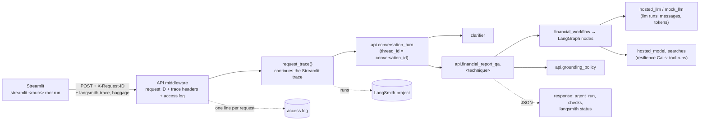

# Observability, Traceability and Logging with LangSmith

This page explains how the Financial Report Copilot records what it does, and how to follow any answer back to the question, the evidence, the model calls and the checks that produced it.

Code: [langsmith_utils.py](../scripts/observability/langsmith_utils.py), [api_app.py](../scripts/api/api_app.py) (`request_trace`, `/health`), [financial_prompting_agent.py](../scripts/agents/financial_prompting_agent.py) (`traced_llm` in `MockLLM` and `HostedChatLLM`), [resilience.py](../scripts/common/resilience.py), [trace_log.py](../scripts/observability/trace_log.py), [evaluate_agent_api.py](../scripts/evaluation/evaluate_agent_api.py). Tests: [test_langsmith_tracing.py](../tests/test_langsmith_tracing.py), [test_langsmith_utils.py](../tests/test_langsmith_utils.py).

## 1. Summary

The system has three layers, and each answers a different question:

| Layer | Question it answers | Where it lives | Needs a key? |
|---|---|---|---|
| **Logging** | Did the request arrive, how long did it take, did it fail? | API access log (stdout / `api.log`) | No |
| **Audit record** | Why did the agent answer, refuse or ask for review? | `agent_run`, `security`, `evidence_guard`, `support_check`, `human_review` in every response | No |
| **Tracing (LangSmith)** | What exactly happened inside: every graph node, every LLM prompt and reply, tokens, latency? | LangSmith project, one trace per request | `LANGSMITH_API_KEY` |

One ID joins all three: the **request ID** (`X-Request-ID`). The API puts it on the access log line, returns it in the response header, and attaches it as metadata to every LangSmith run of that request.

**LangSmith rather than Langfuse.** LangSmith understands LangGraph out of the box: every node of the financial graph appears as a run without extra code. It is already wired into the API, the agents and the evaluation scripts, and its free Developer plan is enough for the demo and evaluation runs. Langfuse would be the choice if traces had to stay on our own servers. Self-hosting it adds Postgres, ClickHouse and other containers and needs new instrumentation, which isn't justified for public SEC filings. We use one tool, not both.

## 2. Architecture



How the pieces connect:

1. **Streamlit starts the trace.** With the sidebar's *LangSmith tracing* toggle on (or `LANGSMITH_TRACING=true`) and a key in the Streamlit process, each question is a root run `streamlit.conversation` (or `streamlit.chat`) with `client=streamlit` and a new request ID. The HTTP call carries that ID as `X-Request-ID` and LangSmith's distributed-trace headers (`langsmith-trace`, `baggage`). Without a key in the Streamlit process, the trace starts at the API instead.
2. **Middleware** gives every request an ID (the caller's `X-Request-ID` if it is a UUID, otherwise a new one), keeps the incoming trace headers for the request, and writes one access-log line when the request finishes.
3. **`request_trace`** decides whether this request is traced: either the request asks (`enable_langsmith: true`, the Streamlit "LangSmith tracing" toggle) or `LANGSMITH_TRACING=true` is set for the whole API. Either way it needs a key. It opens a LangSmith `tracing_context` holding the project, the tags and the metadata (`request_id`, and `thread_id` for conversations). Nothing in the process environment changes, so other requests are unaffected. When the request carries Streamlit's trace headers, the API's runs become children of the Streamlit run, in its project: one trace from the browser to the LLM. The headers apply once, at the top. Inner runs keep their own parent.
4. **Everything inside inherits the context.** The tracing context lives in Python context variables, and the worker threads (parallel searches in `financial_tools.fan_out`, model calls in `resilience.Calls`) start with `copy_context()`. So every LangGraph node, LLM call and tool call joins the same trace tree with the same metadata.
5. **LLM calls are `llm` runs.** Searches are `retriever` runs (§4). `MockLLM` and `HostedChatLLM` go through `traced_llm`, which records the role/content messages, the reply, the model name and, for hosted models, the token counts from the response's `usage`.

## 3. What a trace shows

One question asked in Streamlit (conversation mode, the default `router` technique) produces this tree. It was captured on 20 November 2026 from the real Streamlit app (driven by Streamlit's `AppTest`), a real FastAPI process on the Chevron 2022 Chroma test index and the mock LLM, with both processes uploading to a stand-in LangSmith endpoint. That produced one trace of 26 runs in one project.

```text
streamlit.conversation                        chain     Streamlit process: question, client=streamlit, request_id
└─ api.conversation_turn                      chain     FastAPI: thread_id = conversation_id, request_id
   ├─ clarifier                               chain     company / year / measure resolution
   ├─ api.financial_report_qa.router          chain     technique, provider, ticker, year, sector, rag_backend
   │  └─ financial_workflow                   tool
   │     └─ LangGraph
   │        ├─ security_step                  prompt-injection / unsafe-input decision
   │        ├─ plain_text_step → mock_llm     llm       domain-intent classifier prompt and reply
   │        ├─ route_step → mock_llm          llm       supervisor route (lookup, trend, sector, fund, report)
   │        ├─ retrieve_step
   │        │  └─ retrieve.financial_vlm      retriever query, filters, 5 documents (chunk ID, page, reader, scores)
   │        ├─ evidence_guard_step → after_evidence     retry decision
   │        ├─ answer_step → mock_llm         llm       answer prompt with evidence, draft answer
   │        ├─ calculator_step                          when the answer has CALC[...]
   │        ├─ critic_step → mock_llm         llm       support-check judge prompt and verdict
   │        ├─ should_repair                            repair loop decision
   │        └─ governance_step                          human-review triggers, final status
   └─ api.grounding_policy                    chain     citation validation, answer withheld or kept
```

With the `agentic_graph` technique, `plan_step` (the planner LLM) replaces `route_step`. With a hosted model, the LLM runs are `hosted_llm`, and each holds a `hosted_model` tool run (the HTTP call, with retries). The test `test_agentic_graph_trace_shows_every_node_and_llm_call` checks the graph part, and `test_api_continues_a_callers_trace_and_nests_the_chat_under_the_turn` checks the Streamlit → API nesting.

The router hands trend, sector-trend and fund questions to their own graphs, whose nodes appear under `LangGraph` in the same way. **Report** requests add a `report_pipeline` run.

For each run LangSmith shows inputs, outputs, latency and errors. For `llm` runs it also shows the full prompt, the reply, the model (`ls_model_name`) and the tokens.

### Metadata and tags on every run

| Key | Set by | Use |
|---|---|---|
| `request_id` | Streamlit (sent as `X-Request-ID`) or the API middleware | Join the trace to the access log and the response header |
| `client` | Streamlit | `streamlit` on runs started from the UI |
| `thread_id`, `conversation_id` | `/conversation` | LangSmith **Threads** view: all turns of one chat together |
| `domain`, `technique`, `top_k`, `dense_top_k`, `bm25_top_k`, `retrieval_mode` | chat route | Filter by agent and retrieval settings |
| `ticker`, `year`, `sector` | chat route | Find all traces for one company or sector |
| `rag_backend` | chat route | `financial_vlm` (Chroma, the default), `financial_qdrant` or `financial_hybrid` |
| `guardrails_enabled`, `human_review_enabled` | chat route | Ablation runs |
| `langgraph_node`, `langgraph_step` | LangGraph | Which node a nested run belongs to |
| `ls_provider`, `ls_model_name`, `ls_temperature` | `traced_llm` | Cost and latency per model |
| tags `capstone`, `fastapi`, `financial_report_qa`, technique, providers | API | Quick filters |

## 4. Tracing each RAG backend

Every search the agents make is a LangSmith **retriever** run named after the served backend. Its input is the query and filters (ticker, year, sector, top k, visual, mode); its output is the hits as documents (text up to 1,500 characters, plus chunk ID, page, reader, retrieval paths and scores). A trace therefore shows which pipeline answered and exactly what evidence the LLM saw.

| `RAG_BACKEND` | Retriever runs in a trace | What the documents show |
|---|---|---|
| `financial_vlm` (Chroma, default) | `retrieve.financial_vlm` | Chroma chunks; `retrieval_paths` `vlm_text` (and `same_page` when a chart description pulled in its page's values); `reader` (pdfParser, OCR, Qwen3-VL, Gemini) |
| `financial_qdrant` (Qdrant + ColPali) | `retrieve.financial_qdrant` | text hits (`text`) and ColPali page hits (`visual`) with the page's text layer or OCR text |
| `financial_hybrid` (both) | `retrieve.financial_hybrid` with child runs `hybrid.chroma_text` → `hybrid.colpali_pages` → `hybrid.fusion` | Chroma's hits, the pages ColPali found (doc ID, page, rank), and the fused list where ColPali pages carry `visual` and come after Chroma's top k |

The hybrid's ColPali and fusion runs appear only when the plan includes `visual_search` (chart questions, or `RAG_FIN_VISUAL=1`). A text question shows just `hybrid.chroma_text`.

**Verified on 20 November 2026 (live API, Chevron 2022 test indexes, mock LLM, stand-in LangSmith endpoint):**

| Backend | Question | Final status | Runs uploaded | LLM runs | Retriever runs (documents) |
|---|---|---|---|---|---|
| `financial_vlm` | chart: net crude oil production | answered | 23 | 4 | `retrieve.financial_vlm` (5: pages 35, 35, 37, 37, 41) |
| `financial_vlm` | table: net income | answered | 23 | 4 | `retrieve.financial_vlm` (5) |
| `financial_qdrant` | chart | answered | 23 | 4 | `retrieve.financial_qdrant` (5: four `text`, one `visual`) |
| `financial_qdrant` | table | answered | 23 | 4 | `retrieve.financial_qdrant` (5) |
| `financial_hybrid` | chart | answered | 26 | 4 | `retrieve.financial_hybrid` (11) → `hybrid.chroma_text` (5), `hybrid.colpali_pages` (3: pages 25, 8, 33), `hybrid.fusion` (11) |
| `financial_hybrid` | table | answered | 24 | 4 | `retrieve.financial_hybrid` (5) → `hybrid.chroma_text` (5) |

Every run carried the request ID and the conversation's `thread_id`, and went to that backend's project. Every trace ran from `api.conversation_turn` to `governance_step` and `api.grounding_policy`. Results: `output/hybrid_test/langsmith_backend_check.json`.

**Cold start:** on CPU, the first Qdrant or hybrid question after the API starts loads the text embedder and ColPali (bfloat16, about 6 GB). That can take longer than the 60-second request deadline (`RAG_REQUEST_TIMEOUT_SECONDS`), and the answer is then `not_grounded`. The trace shows this: `retrieve_step` followed directly by `api.grounding_policy`. Send one warm-up question before a demo, or raise the deadline. Warm, each traced question took 2–4 seconds.

## 5. Traceability: from an answer back to its cause

| Starting point | Steps |
|---|---|
| A user reports a wrong answer in Streamlit | The response carries `X-Request-ID`. In LangSmith, filter the project by metadata `request_id = <id>`. Open `answer_step` to see the evidence the model received, then `critic_step` for the support verdict. |
| An access-log line shows a slow or failed request | Take `request_id` from the log line and use the same filter. Latency per node shows whether retrieval, the LLM or the critic was slow. |
| A multi-turn conversation went wrong | Open **Threads** and pick the `conversation_id`. Each turn shows the clarifier's questions and the final run. |
| An evaluation question failed | `output/eval/agent_api/<run_id>/results.jsonl` stores `request_id` per question. Run the evaluation with `--langsmith` and search that ID. |
| Why was an answer withheld or sent to review? | Without LangSmith: the response's `agent_run`, `support_check`, `human_review` and `explanation`. With LangSmith: the `governance_step` output shows the triggers (for example `unverified_vlm_figure`, `unverified_calculation`). |

### Watching the guardrails and the critic

| Check | Node / run | What to look at |
|---|---|---|
| Input security (injection, unsafe requests) | `security_step` | `decision` (`allow`/`block`) and `risk_labels` |
| Domain intent / scope | `plain_text_step` | Classifier prompt and reply; refusal reason |
| Evidence guard (prompt injection in documents, missing targets) | `evidence_guard_step`, `after_evidence` | Dropped hits, retry chosen or not |
| Calculator | `calculator_step` | Expression, operands found in evidence, result |
| Critic support check | `critic_step` | Numeric grounding (`ungrounded`, `unverified`) and the LLM judge verdict |
| Repair loop | `should_repair`, second `answer_step` | How many repairs, whether citations were fixed |
| Governance / HITL | `governance_step` | `final_status`, `human_review.triggers` |
| Citation policy | `api.grounding_policy` | Whether the answer was withheld |

## 6. Logging

| Log | Example / contents | Never contains |
|---|---|---|
| API access log | `api_request_completed request_id=… method=POST path=/chat/financial_report_qa status_code=200 duration_ms=8123.4` (warning level for 4xx/5xx) | Request bodies, prompts, answers, keys |
| Tracing decision | `langsmith_trace_configured request_id=… enabled=True reason=enabled project=…` | The key |
| Startup | Runtime profile, chosen `financial_backend`, retrieval warm-up time | Keys |
| Report pipeline JSONL | `output/pdf/<TICKER>_<YEAR>/<trace_id>/logs/<trace_id>.jsonl`: spans, model calls, artifacts with SHA-256. Summarise with `python -m scripts.observability.monitor_report_trace` | Keys |
| Response audit record | `agent_run.path`, `steps`, `tool_calls`, `calculations`, `search_fan_out`, `repairs`, plus `security`, `evidence_guard`, `output_filter`, `support_check`, `human_review` | Keys |

The JSONL trace (`trace_log.TraceLog`) is used by report generation and the multimodal answer path. The financial chat path does not write JSONL files. Its offline record is the `agent_run` block in the response, and its detailed trace is LangSmith.

`GET /health` reports the LangSmith setup without the key: `api_key_set`, `tracing_all_requests`, `project`, `endpoint`, and a `warning` when `LANGSMITH_TRACING` is set but no key is present.

## 7. Setup

The key stays with you. Set it in your own terminal or in a secrets store, never in the repo, a notebook or Drive.

**Local (PowerShell), tracing every request:**

```powershell
$env:LANGSMITH_API_KEY="<your key>"
$env:LANGSMITH_TRACING="true"
$env:LANGSMITH_PROJECT="financial-report-copilot"
uvicorn scripts.api.api_app:app --host 127.0.0.1 --port 8000
streamlit run scripts\ui\api_streamlit_app.py
```

**Local, tracing only chosen requests:** set only `LANGSMITH_API_KEY`. Then turn on the *LangSmith tracing* toggle in the Streamlit sidebar's *Demo settings*, or send `"enable_langsmith": true` (and optionally `"langsmith_project"`) in the API request body.

**Colab:** add `LANGSMITH_API_KEY` as a Colab secret. The serving-secrets cell (cell 9 of `colab_rag_pipelines.ipynb`, the serving-dependencies cell of the ingest notebooks) then sets the key, `LANGSMITH_TRACING=true` and the project `financial-report-copilot-colab`, and `cp.serve(s)` passes them to the API.

**Docker / Google Cloud:** in `.env` (not committed): `LANGSMITH_TRACING=true`, `LANGSMITH_API_KEY=…`, `LANGSMITH_PROJECT=annual-report-copilot`. Compose passes it to the `api` service.

**Checking it works (any environment):** `python -m scripts.observability.check_langsmith` sends one traced conversation turn and looks its runs up in LangSmith by request ID (PASS/FAIL/SKIP per step). On the VM: `docker compose exec api python -m scripts.observability.check_langsmith`. Per-environment steps and what was verified: [deployment.md §7.5](deployment.md).

**Project name, in order of precedence:** the request's `langsmith_project`, then `LANGSMITH_PROJECT`, then the route default (`capstone-financial-report-qa-api` for chat and conversation, `capstone-financial-retrieval-api` for `/retrieve`). A conversation's inner chat run stays in the conversation's project.

**CLIs and evaluations:**

```powershell
# agent evaluation through the API (the API needs the key; each row keeps its request_id)
python -m scripts.evaluation.evaluate_agent_api --langsmith --langsmith-project capstone-agent-eval --run-id eval_traced
# retrieval evaluation and the standalone agent
python scripts\evaluation\evaluate_financial_rag.py --enable-langsmith --langsmith-project capstone-financial-rag-eval
python scripts\agents\financial_prompting_agent.py --llm-provider hosted --technique agentic_graph --query "..." --enable-langsmith
```

## 8. Privacy, cost and limits

- **What is sent:** prompts, retrieved evidence excerpts, answers and metadata for traced requests. These come from public SEC filings. API keys, authorization headers and the LLM endpoint's key are never recorded; a test checks this.
- **Hiding content:** `LANGSMITH_HIDE_INPUTS=true` / `LANGSMITH_HIDE_OUTPUTS=true` keep the tree and timings but drop the contents.
- **Volume:** `LANGSMITH_TRACING_SAMPLING_RATE=0.2` traces one request in five when tracing every request. Prefer per-request tracing for demos.
- **No key or no network:** nothing is sent, and the API answers normally. The response's `langsmith` field says why tracing is off (`not_requested`, `missing_LANGSMITH_API_KEY`).

## 9. Issues found and fixed

| # | Issue | Effect | Fix | Test |
|---|---|---|---|---|
| 1 | The API turned tracing on by writing `LANGSMITH_TRACING` and the project into the process environment on the first request with `enable_langsmith=true` | Every later request was traced, even with the toggle off. Concurrent requests overwrote each other's project. | `request_trace` uses a per-request `tracing_context`; the environment is no longer changed by requests | `test_api_request_flag_does_not_turn_tracing_on_for_later_requests` |
| 2 | Hosted LLM calls were raw HTTP inside a `tool` run with no inputs | Traces showed no prompts, replies or tokens | `traced_llm`: `llm` runs with messages, reply, model and token usage, for both hosted and mock LLMs | `test_hosted_llm_run_records_tokens_and_never_the_key`, `test_request_tracing_traces_only_inside_the_block` |
| 3 | The Streamlit path (`/conversation`) didn't trace the clarifier or the report pipeline, and turns had no shared ID | Multi-turn chats couldn't be followed | `api.conversation_turn` run with `thread_id`/`conversation_id`; `clarifier` and `report_pipeline` runs | `test_conversation_turns_share_a_thread_id` |
| 4 | `LANGSMITH_PROJECT` was ignored by the API: the route default always won | Traces went to an unexpected project | Request project, then `LANGSMITH_PROJECT`, then route default | covered by the API test |
| 5 | Few filter fields on chat runs | Hard to find traces by company or backend | Added `ticker`, `year`, `sector`, `rag_backend` metadata; grounding policy as its own run | API test |
| 6 | No way to see whether tracing is configured, and a silent no-op when `LANGSMITH_TRACING` is set without a key | Demos could run untraced without notice | `/health` `langsmith` block with a `warning` | `test_health_reports_langsmith_without_the_key` |
| 7 | The agent evaluation runner couldn't trace or link results to traces | Failed questions couldn't be inspected | `--langsmith`, `--langsmith-project`; one `X-Request-ID` per question stored in `results.jsonl` | `tests/test_evaluate_agent_api.py` |
| 8 | Searches weren't runs of their own | A trace didn't show which backend answered or what it returned | `retrieve.<backend>` retriever run per search; the hybrid's three stages as child runs | `test_each_backend_search_is_a_retriever_run` (3 backends), `test_hybrid_stages_are_child_runs`, `test_colpali_pages_show_as_documents` |
| 9 | The trace started at the API: the Streamlit side (question, HTTP call, waiting time) wasn't in LangSmith | No single view from the browser to the LLM | Streamlit opens a `streamlit.<route>` root run and sends `langsmith-trace`/`baggage` and `X-Request-ID`; the API continues that trace (headers applied once, at the top) | `test_api_continues_a_callers_trace_and_nests_the_chat_under_the_turn`, `test_streamlit_post_json_sends_trace_headers_only_when_traced`, live Streamlit run (§3) |

All tests are offline: `RunTree.post`/`patch` are replaced, so the tests see every run that would be sent and nothing leaves the machine. The full suite passes (580 tests).

## 10. Known limits

- **Answer cache:** with `ANSWER_CACHE_SECONDS` set, a repeated identical request is served from the cache. It creates no new trace, and its `langsmith` field is the stored one.
- **Streamlit without a key:** the Streamlit root run needs `LANGSMITH_API_KEY` in the Streamlit process too. Docker Compose gives both services the same `.env`, and `cp.serve` passes the notebook's environment to both. Locally, set it in both terminals; otherwise the trace starts at the API.
- **Multimodal routes** (`/multimodal/financial_report_qa/*`) aren't traced to LangSmith. They are not part of the Streamlit financial flow.
- **Human review** is a status and payload in the response and the trace. No review queue stores or assigns it (see [agents_flows.md](agents_flows.md)).
- **LangSmith plan limits** (traces per month, retention) depend on your account; check the pricing page before a large traced evaluation.
