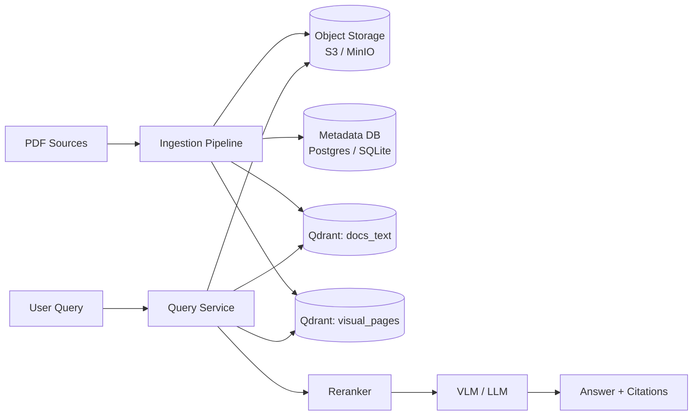
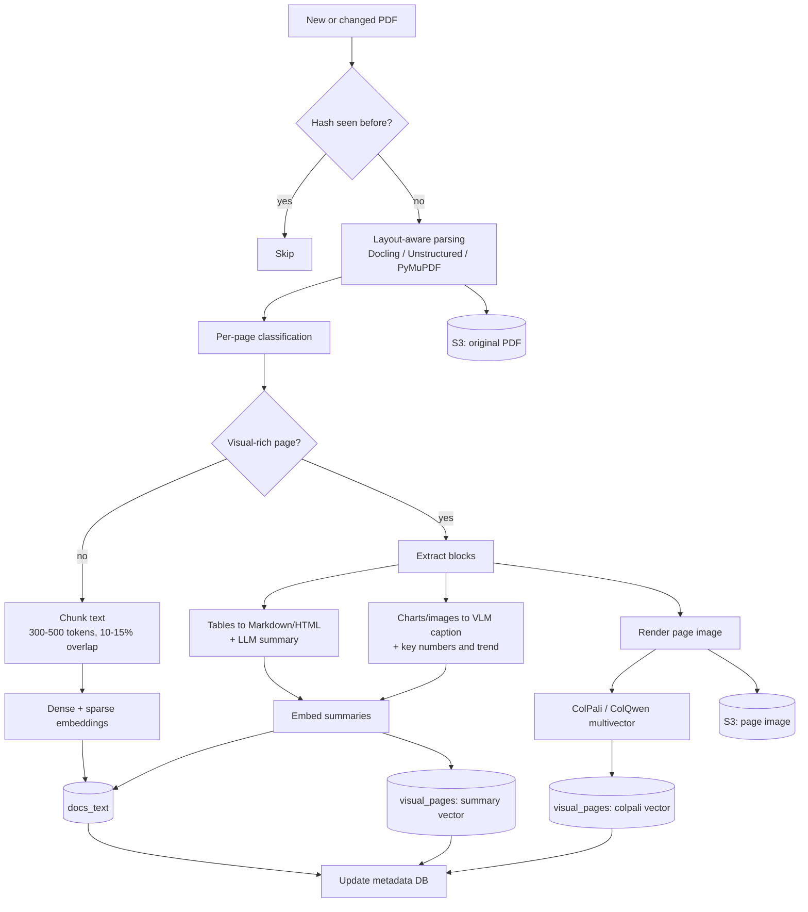
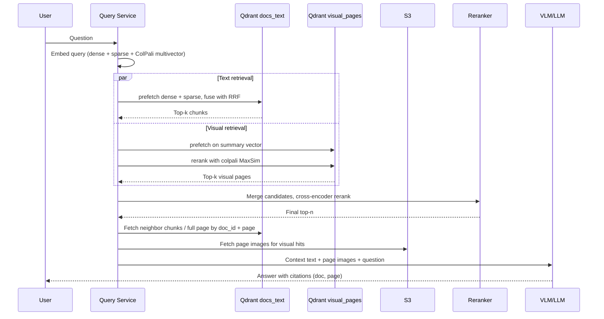

# Multimodal RAG on Qdrant: Architecture and Flow

**Implementation status:** This document describes the scalable target design. The implemented local CPU profile follows the summary-based alternative in section 7. Its current design, implementation details, commands, and measured validation results are consolidated in [Multimodal RAG: Design, Implementation, and Validation](multimodal_rag_design_and_implementation.md).

The optional ColPali tier is now implemented with a `visual_pages` collection and Qdrant MaxSim queries. See [ColPali implementation and Qdrant storage](colpali_qdrant.md) for model preparation and writing visual multivectors into the existing local database.

**Corpus:** ~2,000 PDFs x ~100 pages (~200,000 pages). Most pages are plain text; a minority contain charts, images, tables and graphs.

**Core idea:** route every page by type. Use cheap text embeddings for the bulk, and spend the expensive multimodal processing only on visual-rich pages.

---

## 1. High-Level Architecture



| Component | Role |
|---|---|
| Object storage | Original PDFs and rendered page images (PNG/WebP) |
| Metadata DB | Ingestion status, file hashes, doc-level info |
| Qdrant `docs_text` | Text chunks, table summaries, chart summaries (dense + sparse) |
| Qdrant `visual_pages` | Visual-rich pages (summary vector + ColPali multivector) |
| Reranker | Cross-encoder and/or ColPali MaxSim rerank |
| VLM / LLM | Generates the final answer from text and page images |

---

## 2. Ingestion Flow



### Steps

1. **Deduplicate:** hash each PDF (SHA-256). Skip if already ingested.
2. **Parse:** extract text blocks, tables, figures, charts and their page positions.
3. **Classify each page:** text-only vs visual-rich (has a figure, table or chart region).
4. **Text pages:** chunk by section/paragraph and embed (dense + sparse).
5. **Tables:** convert to Markdown/HTML, generate a short summary, embed the summary, keep raw table in payload or object storage.
6. **Charts, graphs, images:** VLM produces caption, key numbers and trend; embed that text.
7. **Visual pages (optional tier):** render page image, embed with ColPali/ColQwen multivector.
8. **Store binaries outside Qdrant:** page PNGs and PDFs go to S3/MinIO; payload keeps only the URI.
9. **Record status** in the metadata DB for retries and incremental updates.

---

## 3. Qdrant Collection Design

Use **two collections**, not one per document. Filter by `doc_id` in the payload.

### 3.1 `docs_text`

```python
from qdrant_client import QdrantClient, models
client = QdrantClient(url="http://localhost:6333")

client.create_collection(
    collection_name="docs_text",
    vectors_config={
        "dense": models.VectorParams(
            size=1024, distance=models.Distance.COSINE, on_disk=True
        )
    },
    sparse_vectors_config={
        "bm25": models.SparseVectorParams(modifier=models.Modifier.IDF)
    },
    quantization_config=models.ScalarQuantization(
        scalar=models.ScalarQuantizationConfig(
            type=models.ScalarType.INT8, quantile=0.99, always_ram=True
        )
    ),
    hnsw_config=models.HnswConfigDiff(m=16, ef_construct=128),
    on_disk_payload=True,
)
```

### 3.2 `visual_pages`

```python
client.create_collection(
    collection_name="visual_pages",
    vectors_config={
        "summary": models.VectorParams(size=1024, distance=models.Distance.COSINE),
        "colpali": models.VectorParams(
            size=128,
            distance=models.Distance.COSINE,
            on_disk=True,
            multivector_config=models.MultiVectorConfig(
                comparator=models.MultiVectorComparator.MAX_SIM
            ),
            hnsw_config=models.HnswConfigDiff(m=0),  # rerank-only, no graph
            quantization_config=models.BinaryQuantization(
                binary=models.BinaryQuantizationConfig(always_ram=True)
            ),
        ),
    },
    on_disk_payload=True,
)
```

> `m=0` on the multivector skips graph indexing. It is used only to rerank candidates retrieved via the `summary` vector. Validate binary-quantization recall on your own queries.

### 3.3 Payload schema (both collections)

```json
{
  "doc_id": "sha256-of-pdf",
  "doc_title": "...",
  "page": 42,
  "chunk_id": 3,
  "content_type": "text | table | chart | image",
  "section": "3.2 Results",
  "text": "...",
  "page_image_uri": "s3://bucket/doc/page_042.png",
  "source_uri": "s3://bucket/doc.pdf"
}
```

### 3.4 Payload indexes

```python
client.create_payload_index("docs_text", "doc_id", models.PayloadSchemaType.KEYWORD)
client.create_payload_index("docs_text", "content_type", models.PayloadSchemaType.KEYWORD)
client.create_payload_index("docs_text", "page", models.PayloadSchemaType.INTEGER)
```

### 3.5 Point IDs

Use a deterministic UUID5 of `doc_id + page + chunk_id` so re-ingestion overwrites instead of duplicating.

---

## 4. Query Flow



### Steps

1. Embed the query as dense and sparse vectors (and a ColPali multivector if using the visual tier).
2. **Text path:** Query API with `prefetch` on dense and sparse, fused with RRF.
3. **Visual path:** prefetch on `summary`, then rerank with `colpali` MaxSim.
4. Merge candidates and optionally rerank with a cross-encoder.
5. Expand context: fetch neighboring chunks or the full page via `doc_id` + `page` filters.
6. Load page images from S3 for visual hits.
7. Send text and images to the VLM; return the answer with citations (document, page).

---

## 5. Sizing (rough estimates)

| Item | Estimate |
|---|---|
| Total pages | ~200,000 |
| Text chunks (~400 tokens) | ~400k-600k |
| Visual pages (assuming 10-15%) | ~20k-30k |
| Text vectors, 1024-d fp32 | ~2-2.5 GB (~0.6 GB with int8) |
| ColPali page vectors fp32 (~1,000 patches x 128-d) | ~0.5 MB/page, ~10-16 GB for visual pages |
| ColPali on all pages | ~100 GB (avoid; this is why routing matters) |

---

## 6. Operational Guidelines

- **Memory:** keep quantized vectors and HNSW in RAM; originals and payloads on disk (`on_disk=True`, `on_disk_payload=True`).
- **Bulk load:** use `upload_points` in parallel batches of 100-500.
- **Incremental updates:** file hash plus metadata DB, so only changed PDFs are reprocessed.
- **Embedding consistency:** use the same text embedding model (e.g. bge-m3 / e5-large) for chunks and summaries.
- **Evaluation:** build 50-100 test questions (include chart and table questions); track recall@k when changing chunk size, quantization or models.
- **Backups:** use Qdrant snapshots regularly; object storage and metadata DB are the source of truth for re-ingestion.

---

## 7. Lighter Alternative (no ColPali)

Make every visual page text-searchable via VLM summaries and extracted table text in `docs_text`. Keep page images only in S3 and pass them to the VLM at answer time. This needs a single collection and no multivectors. Add `visual_pages` with ColPali later if retrieval on charts and layout-heavy pages is weak.

---

## 8. Suggested Build Order

1. Parsing and page classification
2. `docs_text` ingestion with hybrid search
3. Table and chart summarization
4. Query service with RRF and context expansion
5. Evaluation set and tuning
6. (Optional) `visual_pages` with ColPali reranking
