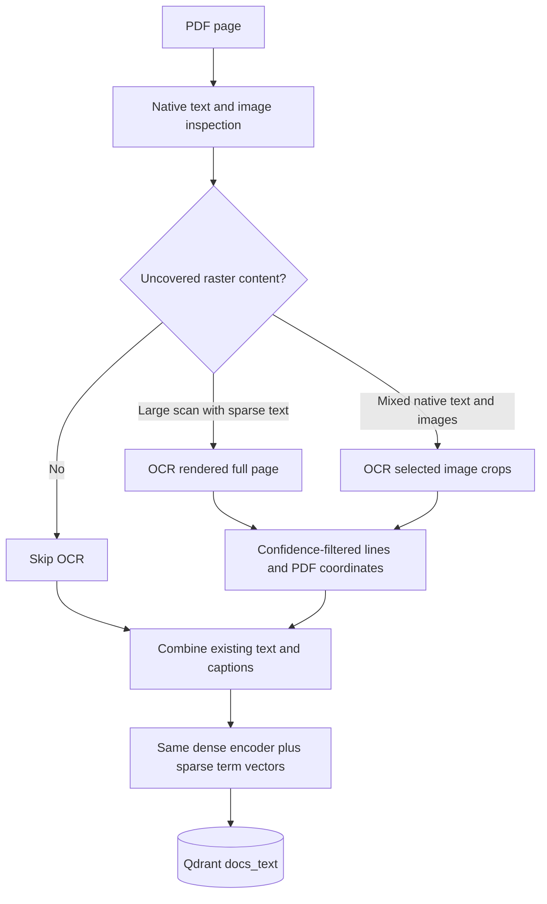

# Selective OCR fallback and text-vector storage

Updated: 27 October 2026.

## Implemented behavior

Dedicated RapidOCR CPU inference now extracts text from scanned pages and image regions that lack a usable PDF text layer. OCR text is combined with native text, extracted table text, and any VLM captions before chunking and embedding. It is stored in the **existing Qdrant `docs_text` collection**, with the same dense encoder and BM25-style sparse vectors as other text. There is no separate OCR collection or incompatible embedding space.

ColPali still embeds page images into `visual_pages`. OCR text complements those image multivectors. OCR-only backfill updates a visual page's summary vector and payload when that point exists, without recomputing or changing its ColPali matrix.



## Selection rules

The engine is lazy-loaded only after a region needs recognition:

- Native-text pages with no qualifying image region skip OCR.
- Images smaller than 0.5% of page area, below 80 source pixels wide, or below 30 pixels high are skipped.
- A region with at least 12 native words, at least 40 normalized text characters, and native word boxes covering at least 3% of its area is treated as already searchable, unless replacement characters suggest corrupt extraction.
- Image regions contained at least 90% inside a larger selected region are deduplicated.
- A selected image covering at least 65% of the page, combined with sparse/corrupt native text, triggers full-page OCR.
- Pages containing outlined vector content but no extracted text/images can also trigger full-page OCR.
- Other qualifying images are recognized as crops. Selected content on rotated pages uses a full-page render; recognized polygons are mapped back into unrotated PDF coordinates.

These are explicit routing heuristics, not a complete layout-understanding model. Decorative images may be examined and return no useful text. Small labels, complex crops, unusual rotations, or a partially correct existing text layer need corpus-specific checks.

## Recognition and provenance

The installed RapidOCR package uses local ONNX Runtime CPU models. The validated package version is 3.10.0 with its bundled models; no Tesseract installation or separate model service is required for this configuration.

Accepted lines must have finite confidence between the configured threshold and 1. Lines already present as normalized native-text sequences are retained for provenance but omitted from newly appended text. This avoids adding a second searchable copy of native labels. Rejected line counts are recorded.

| Payload field | Meaning |
|---|---|
| `ocr_applied` | Whether an OCR route was selected |
| `ocr_mode` | `none`, `full_page`, or `image_regions` |
| `ocr_text` | Accepted new OCR text appended to the page's searchable content |
| `ocr_blocks` | Accepted lines with text, confidence, polygon, and `included_in_text` |
| `ocr_regions` | Regions selected for recognition |
| `ocr_engine` | Recognition engine name |
| `ocr_rejected_lines` | Number of empty, low-confidence, or invalid-confidence lines rejected |
| `ocr_coordinate_space` | `unrotated_pdf_points` for line polygons |
| `ocr_signature` | OCR package/configuration signature |
| `ocr_artifact_uri` | Local extraction sidecar URI |
| `extraction_methods` | Native, table, OCR, and/or VLM extraction provenance |

`ocr_regions` describe the selected render rectangles; on rotated full-page routes that rectangle is in displayed-page coordinates. Line polygons are consistently converted into unrotated PDF points. Page IDs, source URIs, chunk IDs, and citations remain shared with other text evidence.

Each managed document directory contains `page_0001_ocr.json`-style sidecars. These store the pre-OCR base text, OCR result, and signature, allowing repeated backfill to rebuild content without appending OCR repeatedly. Native text, table data, and captions remain available in the base content.

OCR reads labels and printed values; it does not by itself reconstruct table-cell semantics or chart series/value relationships. Use stored polygons, extracted table structures, ColPali retrieval, and the original images/VLM for those tasks.

## Run and backfill

New ingestion applies selective OCR automatically. To enrich PDFs already in the existing learned-embedding database, stop any process owning embedded Qdrant and run:

```powershell
.venv/Scripts/python.exe -m scripts.rag.ocr_index --domain financial_report_qa
# Omit --domain to process all indexed domains.
.venv/Scripts/python.exe -m scripts.rag.ocr_index
# Re-run recognition with the current configuration.
.venv/Scripts/python.exe -m scripts.rag.ocr_index --force
```

The CLI defaults to `indexes/multimodal_full` and the existing local MiniLM encoder. It reads managed source PDFs and sidecars, adds accepted OCR text, re-embeds page chunks, upserts them into `docs_text`, and removes obsolete chunk IDs if the page's chunk count shrinks. It also refreshes existing visual summary vectors while preserving ColPali vectors. No Qwen or ColPali model load is needed for this backfill.

Backfill is idempotent by OCR signature and completion metadata. Changes to OCR configuration/package version cause affected pages to be reconsidered. New normal ingestion includes the OCR signature in pipeline version 3, so older documents may undergo a full pipeline rebuild on their next ingestion. Backfill leaves the document's full-ingestion signature unchanged because it does not rerun all vision/ColPali stages.

Backfill is page-by-page rather than an atomic multi-collection transaction. Incomplete pages carry completion metadata so a subsequent attempt can retry. Source PDFs and existing text-encoder configuration must remain available. OCR exceptions during normal ingestion follow the existing failed-document cleanup/retry path; no fabricated OCR text is substituted.

Dependencies are declared in `pyproject.toml` and `uv.lock`. For an existing environment missing them:

```powershell
uv pip install --python .venv/Scripts/python.exe "rapidocr>=3,<4" "onnxruntime>=1.17,<2"
```

## Configuration

| Variable | Default |
|---|---|
| `RAG_OCR_ENABLED` | `1`; `0`, `false`, or `no` disables OCR for ingestion |
| `RAG_OCR_SCALE` | `2`; supported range 0.5–4 |
| `RAG_OCR_MIN_CONFIDENCE` | `0.6`; supported range 0–1 |
| `RAG_OCR_THREADS` | `2` CPU inference threads |

Disabling OCR does not prevent existing stored OCR text from being retrieved. The dedicated backfill command requires OCR to be enabled, avoiding accidental removal of existing enrichment. Pure native-text pages do not initialize the OCR engine. The default OCR models should be evaluated independently for languages and document types beyond the supplied fixtures.

## Actual validation

The three-page `data/samples/ocr_validation/financial_report_qa/selective_ocr_sample.pdf` contains a native-text control, a raster-only scanned invoice, and a native page with an embedded equipment-label image. It was visually reviewed after generation.

| Query term | Retrieved page | OCR route | Actual outcome |
|---|---|---|---|
| `IRIS` | 1 | `none` | PASS: native control, no OCR region |
| `SCAN7429` | 2 | `full_page` | PASS: OCR-only invoice reference retrieved |
| `IMAGE8635` | 3 | `image_regions` | PASS: OCR-only equipment code retrieved |

The scanned reference and equipment code are absent from the corresponding native PDF text layers. Validation used actual RapidOCR and learned MiniLM embeddings, without mocked OCR results. Existing records were also backfilled. The local database now contains **6 text points and the same 2 existing ColPali page points**; hashes of those ColPali matrices were unchanged. Dense and sparse OCR vectors survived reopening the database, and repeated backfill added no duplicate enrichment.

New OCR fixture pages were added to `docs_text` for this check; they were not additionally encoded with ColPali. Normal ingestion with `--colpali`, or the ColPali backfill command, can populate their image vectors separately.

Reproduce:

```powershell
.venv/Scripts/python.exe -m scripts.evaluation.evaluate_ocr
.venv/Scripts/python.exe -m pytest tests/test_selective_ocr.py -q
```

See [the actual OCR validation report](ocr_validation_results.md) and `output/ocr_validation/results.json`. Unit tests additionally check confidence filtering, native-line deduplication, an existing hidden OCR layer, rotated-page coordinates, persistence, idempotence, summary-only visual updates, and failed recognition.

The OCR suite contains **25 passing test cases**, including real local RapidOCR recognition and retrieval through Qdrant text vectors. Additional regression coverage verifies:

- Inclusive confidence boundaries and rejection of nonfinite or out-of-range scores.
- Invalid OCR settings and regions with no recognized text.
- Removal of obsolete chunks and stale OCR text after reprocessing.
- Preservation of native text and dense/sparse vector storage during backfill.
- Recovery after an interrupted backfill, without duplicate text.
- Domain isolation for OCR-backed retrieval.

Run the full regression suite with `.venv/Scripts/python.exe -m pytest -q`.

## Implementation files

| File | Responsibility |
|---|---|
| `scripts/rag/selective_ocr.py` | Selection, lazy RapidOCR, confidence filtering, coordinates, and sidecars |
| `scripts/rag/multimodal_rag.py` | Normal ingestion and OCR backfill into existing vector collections |
| `scripts/rag/ocr_index.py` | Existing-index backfill CLI |
| `scripts/evaluation/generate_ocr_validation_pdf.py` | Independent scanned/image-region fixtures |
| `scripts/evaluation/evaluate_ocr.py` | Actual OCR/vector-storage/retrieval validation |
| `tests/test_selective_ocr.py` | Routing, provenance, persistence, failure, and vector-preservation checks |
