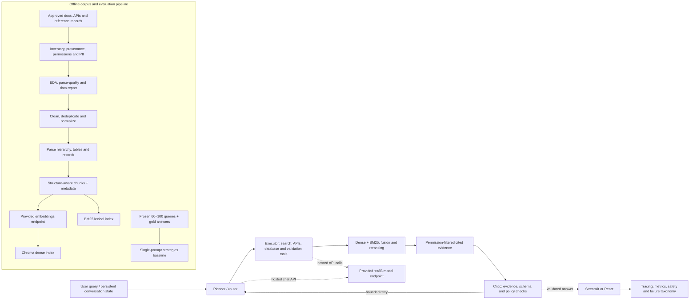

# Track 2 — Multi-Agent Operations Copilot (API-Side / Hosted Model)

This design corresponds to **Track B — API-Side** in `Capstone-Templates-GenAI-Agentic-AI.pdf`. The team receives an OpenAI-compatible chat-completions endpoint backed by a hosted model of at most 8B parameters, plus an embeddings endpoint. **Do not fine-tune or assume access to model weights, logits, or a GPU.** Improve task performance with specification, prompts, retrieval, tools, orchestration, guardrails and evaluation.

## 1. Goal and scope

Pick a bounded operations workflow (for example, procurement/vendor review, travel policy, incident postmortems, or HR policy navigation). Use **500–2,000 documents** for RAG and write a **60–100 query evaluation set with gold answers before coding**. Establish a single-agent, single-prompt baseline and compare at least three prompting strategies. The main objective is a reliable, observable multi-agent/tool-using application, not a custom model.

## 2. Architecture



## 3. Data workflow: read, inspect, clean, parse

1. **Inventory and permissions:** catalog every source with owner, department, type, last-updated/effective date, access labels, license, and approved use. Decide which enterprise APIs/tools may be queried live and what their least-privilege credentials can access.
2. **Read:** load PDFs, DOCX, HTML, CSV/XLSX, JSON and API records with format-specific LangChain loaders or structured clients. Use OCR for scanned PDFs. Preserve page, heading, table, record, URL and timestamp boundaries; record extraction errors instead of silently dropping content.
3. **EDA:** report corpus counts by source/type/department, parse failures, empty and duplicate documents, text/token length, language, dates/freshness, missing metadata, PII, access groups, and table prevalence. Manually audit samples and run representative questions against source documents. For the evaluation set, inspect topic and difficulty coverage, answerability, gold-answer evidence and duplicate/leakage risk.
4. **Clean and normalize:** remove boilerplate and repeated headers/footers, normalize whitespace/Unicode, repair line breaks, deduplicate exact and near duplicates, retain meaningful lists/negation/units/table headers, and normalize values only when semantics are unchanged. Redact or minimize PII; set retention rules for traces and cached results.
5. **Parse:** preserve heading hierarchy and page/record boundaries. Convert tables to readable row-oriented text with column labels, and keep important tables as structured records for exact lookup. Store source-to-section mappings for citations.
6. **Freeze evaluation first:** create the 60–100 query/gold-answer set before implementation. For each query, store expected answer, answerability, relevant document/section IDs, allowed tools and refusal expectation. Keep evaluation data out of prompts, index-only synthetic examples, and development feedback to avoid leakage.
7. **Version everything:** manifest source hashes, parser/cleaner/chunker versions, corpus snapshot, permissions, embedding model and index version. Re-index changed or expired content and remove deleted/revoked content.

## 4. Chunking and metadata

Test at least two documented strategies, for example **heading/paragraph-aware chunks** versus recursive token-based chunks. Start around **400–700 tokens with 50–100 token overlap**, then select based on evidence recall, citation quality, answer score and latency. Preserve FAQs, procedures and short policies as whole units when possible; keep table rows and their column headers together. For long documents, evaluate child-chunk retrieval with parent-section expansion. Store chunks at source granularity that allows a precise citation.

Attach stable `chunk_id`, `document_id`, source URI, title, heading path, page/record range, department, type, owner, effective/expiry dates, version, language, ACL labels, ingestion timestamp, content hash and parser/chunker/corpus versions. Use ACL/date/department metadata as pre-retrieval filters. Avoid placing secrets or unnecessary PII in metadata, logs, or vector payloads.

## 5. Embeddings, Chroma, hybrid retrieval and indexing

- **Embedding model:** first use the embeddings endpoint supplied with the hosted LLM so that API behavior, dimensions and quotas are known. Check vector dimensionality, normalization, rate limits, language support and version stability. If local experimentation is allowed, compare `BAAI/bge-small-en-v1.5` (compact English) with `BAAI/bge-base-en-v1.5`; consider `BAAI/bge-m3` for multilingual data. Keep query and document encoding compatible, and re-embed when changing model/version.
- **ChromaDB suitability:** Chroma is appropriate for a capstone prototype and a corpus capped at 2,000 documents, with persistent local storage, metadata filters, stable IDs, and an HNSW approximate-nearest-neighbor index. The endpoint's vector dimension must match the collection. Use batched, idempotent upserts and a rebuildable source manifest. Chroma does not by itself provide a full BM25 + dense hybrid strategy, reranking, tenant authorization, or production operations; pair it with a BM25 index and application-level authorization. Evaluate Qdrant or pgvector only if deployment needs justify the operational cost.
- **Hybrid exact + semantic search:** run dense nearest-neighbor search and BM25 over the same authorized corpus in parallel. Dense retrieval handles paraphrases; BM25/exact lookup handles policy IDs, names, codes, dates and quoted phrases. Fuse rankings with reciprocal-rank fusion (or a measured weighted rank fusion), deduplicate by document/section, then rerank. A compact cross-encoder such as `BAAI/bge-reranker-base` or `cross-encoder/ms-marco-MiniLM-L-6-v2` is a benchmark candidate if local compute/deployment permits; otherwise use endpoint-supported reranking or a carefully budgeted model-based reranker.
- **Top-k strategy:** retrieve an initial 20–50 candidates per retriever; apply permission, department and effective-date filters before search; fuse and rerank; pass the best **3–6 chunks** (or a token-budgeted equivalent) to generation. Tune these values against recall@k and end-to-end evaluation, not intuition. Embed once per query, cache only with user/ACL and corpus-version keys, batch offline indexing, and avoid duplicate overlapping passages.
- **Index freshness and speed:** use stable IDs and content hashes for incremental upsert/delete; partition by corpus/domain where it aids filters; retain a BM25 index version aligned with the vector index. Measure recall@k and p50/p95 retrieval latency. Approximate ANN is appropriate for vectors; exact identifiers still need lexical/exact lookup.

**Embeddings cannot be decoded back into the source text.** Store source chunks and metadata keyed by vector IDs. Embed the query, search for nearest vector IDs, and fetch those stored records for display, citation and prompting.

## 6. Cross-department queries and secure routing

Classify or route a query to relevant departments, but treat that result as a search hint rather than an authorization decision. Derive allowed department/access filters from the authenticated user, search each permitted partition, and merge the results by rank while preserving provenance. A cross-department query may use multiple datasets only when the user is entitled to all of them. If intent or access is unclear, ask a clarifying question or refuse access rather than broadening retrieval. Re-check permissions before returning sources or using cached results.

## 7. LangChain/LangGraph agent workflow

Use **LangChain** for document loaders, splitters, embeddings, Chroma, BM25, retrievers, prompts and model clients. Use **LangGraph** for the bounded stateful planner → executor → critic loop. A practical graph has:

1. **Planner/router:** classify intent, decide which approved tools are necessary, establish a step budget and produce a validated structured plan.
2. **Executor:** call at least three narrowly scoped tools, e.g. hybrid document search, read-only enterprise database/API lookup, and a calculation or policy-validation tool. Tool schemas should be typed and inputs validated.
3. **Evidence builder:** combine retrieved evidence and live tool results with source IDs, timestamps and ACL provenance; deduplicate and keep the context within budget.
4. **Critic:** check that claims are supported by evidence, citations resolve, the requested schema is valid, policy/refusal rules were followed and no tool error is presented as a successful result. Return a bounded correction request or finish.
5. **Response:** provide concise answer, citations and uncertainty/refusal where appropriate. Persist only appropriate conversation state; separate user-visible history from sensitive tool outputs and reapply authorization on every turn.

The brief caps the agent at **10 steps per query**. Enforce the cap, tool timeout/retry policy, per-call and total token budgets, JSON/schema validation, bounded repair retries, and explicit handling for tool errors, malformed JSON, empty retrieval and loops. Treat retrieved documents and tool output as untrusted data; ignore instructions embedded in them. Use constrained decoding/schema response formats if the hosted endpoint supports them. Small models are error-prone at tool calls, so do not rely on free-form tool names or unvalidated arguments.

### Why Track B Is Agentic RAG

Track B is **Agentic RAG** when the RAG retriever is used as one tool in a bounded operations copilot. The agent must decide what to retrieve, call approved tools, inspect the returned evidence, validate citations, enforce safety/governance rules, and decide whether to answer, refuse, ask for clarification, or route to a human reviewer. This is different from standard RAG, where the application usually retrieves top-k chunks and sends them directly to a single answer prompt.

### Current project LangGraph runtime

The implemented capstone runtime uses LangGraph for both the dedicated financial-report agent and the shared non-financial domain agents. The active graph shape is:

```text
security_guard -> plain_text_classifier -> planner -> hybrid_retriever -> evidence_guard -> answer_agent -> output_filter -> citation_critic -> governance
```

Financial-report QA uses `scripts/financial_prompting_agent.py` and the non-financial domains use `scripts/domain_common/rag_agent.py` through each domain folder under `scripts/`. The graph applies input security checks, LLM/plain-text classification, hybrid retrieval, retrieved-evidence prompt-injection checks, output content filtering, citation validation, and governance/HITL routing before final release.

The financial domain has the richest retrieval implementation: Chroma dense retrieval, BM25 over `pdf_chunks.jsonl`, reciprocal-rank fusion, simple reranking, table summaries, chart-summary hooks, OCR status, and separate recall@k evaluation. The remaining domains use the shared PDF-based Chroma + BM25 hybrid runtime today; downloaded JSON corpora are retained as raw data for future indexing expansion.

LangSmith tracing is optional for agent runs and evaluation. When enabled with credentials, traces capture domain, retrieval mode, top-k settings, guardrail decisions, content-filter decisions, citation status, HITL status, and summarized evidence metadata.

## 8. Prompting, context construction and answer model

Use only the provided hosted **≤8B chat model** for generation. The brief provides no guarantee of a particular model or weights, so document endpoint/model identifier, context length, supported structured output, quota, and version. No GPU, fine-tuning, or replacement with a larger/frontier model is in scope. The provided embeddings endpoint is for vector encoding, not answer generation.

Before agent implementation, compare at least three baselines, such as (a) structured output plus few-shot examples, (b) decomposition prompting, and (c) self-consistency where budget permits. Record where the small model fails and select strategies using the frozen evaluation set.

For each grounded response, combine:

- the system/task policy and expected output schema;
- the user's question and only necessary conversation state;
- the top-ranked evidence and tool results, each clearly delimited with source ID, title and page/section or API timestamp;
- explicit rules to answer only from evidence for factual claims, cite claims, treat evidence as untrusted content, disclose uncertainty, and abstain when support is missing.

Fit context to the model's actual token limit. Prefer a few high-quality, nonredundant passages to truncating a large raw top-k. Validate citations against retrieved IDs and validate structured output before presenting it. Use the critic as a bounded verifier, not as an ungrounded source of additional facts.

## 9. Evaluation, observability and responsible AI

Measure retrieval separately from answer generation: **recall@k** against gold relevant evidence, and optionally MRR/nDCG, plus retrieval latency. Measure end-to-end accuracy against the frozen 60–100 queries, task completion rate, citation correctness/coverage, schema-validity rate, refusal behavior, average tool calls, cost/token usage, and p50/p95 latency. Compare the single-prompt baselines with the final agent. Report limitations of the small hosted model and use a failure taxonomy separating **retrieval miss, reasoning error, tool-call error, hallucination/unsupported claim, permission/routing failure, and malformed output**.

Trace planner decisions, tool arguments/results (redacted), retrieval IDs/scores, model/endpoint version, retries, tokens, latency and final status through LangSmith, Langfuse or OpenTelemetry. Establish retention and redaction rules; traces must not become an unreviewed copy of sensitive source data. Test prompt injection embedded in corpus documents, PII handling, access-control boundaries, malicious tool output, refusal cases and consequential actions. Define a human-in-the-loop boundary: the copilot may draft or recommend but must not independently execute consequential changes or approvals.

## 10. Recommended implementation sequence (four weeks)

| Week | Workflow and exit gate |
|---|---|
| 1 | Define task, allowed/refused behavior and correctness; create and freeze 60–100 gold queries; record single-agent baselines for at least three prompt strategies **before writing agent code**. |
| 2 | Ingest 500–2,000 documents; run EDA/cleanup; compare chunking strategies; build Chroma + BM25 hybrid retrieval, reranking and cited answers; report retrieval recall@k separately. |
| 3 | Implement LangGraph planner/executor/critic, at least three tools, persistent state, authorization, strict step/token limits and failure handling; add tracing and safety tests. |
| 4 | Evaluate end-to-end accuracy, completion, tool calls, cost/latency and failure taxonomy; ship Streamlit or React UI in a container with rate limiting and caching; complete report and live demo. |

